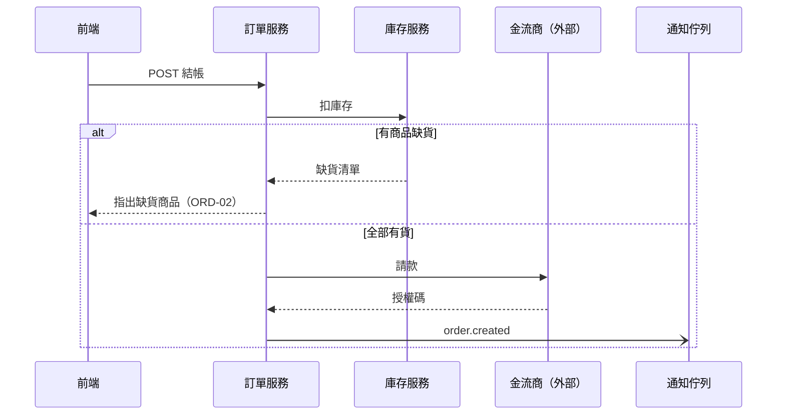

# ADR-2026-11-06-001: 架構文件新增人寫的「4. 資料流」節（每個服務或主要功能一張 sequenceDiagram）；自動段改為第 5 節；plan 多一小節「資料流變更」，`/verify` 只提醒、不改圖

## 背景

範本審閱時使用者指出缺口：架構文件的自動段只畫「模組間誰 import 誰」，PRD 只寫對外行為（ADR-005 明定不寫實作），
**沒有任何一份文件畫「一個功能的資料怎麼跨服務流動」**。使用者的真實專案有多個獨立服務（平台、OCR、簡報、知識庫這類），
一個功能常要經過兩三個服務、一條佇列、一個外部系統，這條路徑程式碼掃不出來（import 圖看不到 HTTP 呼叫的業務順序、佇列、外部系統、分支條件）。
審閱頁預覽了三種做法，使用者決定做法 1（文件）與做法 3（地圖展開，見 ADR-2026-11-06-002）都要。
資料流要寫在哪一節、怎麼寫、誰在什麼時候更新？

## 決策

### 1. 節號與位置：資料流是第 4 節，自動段改成第 5 節

```
## 1. 系統情境      人寫
## 2. 技術選型      人寫
## 3. 部署          人寫
## 4. 資料流        人寫（新增）
## 5. 模組與依賴    自動段（<!-- overview:generated:start/end -->，原第 4 節）
```

- 人寫的節集中在前、自動段固定在最後：讀者讀完人寫部分就知道後面全是機器產的，之後再加人寫節也不會夾在自動段後面
- **要改的引用只有文字**：機器讀的是標記字串（`--sync-arch`、`check-counts.sh`），不是節號，沒有程式依賴「第 4 節」。
  要改的地方：05 範本第 3、43、55 行；文件計畫階段 1 第一項的「第 4 節自動段」、「改善了什麼」的「人寫三節」；
  `architect.md`（文件計畫階段 3）的「人寫三節」→「人寫四節」。ADR-007 的表不改寫，在它的「相關」加一行指向本 ADR
- 還沒有任何專案用新範本產出架構文件（文件計畫尚未完成），不會有既有文件要搬節號
- 另一個選項「資料流放在自動段之後當第 5 節」不用改節號，但人寫的節會被自動段切成兩截，否決（見替代方案）

### 2. 寫法規則（寫進 05 範本，唯一來源）

````markdown
## 4. 資料流

只畫跨服務、跨系統的流動。服務內部的函式呼叫看程式碼或專案地圖的模組展開。

### orders 結帳 — 正常結帳（ORD-01、ORD-02）


````

- **一張圖＝一個獨立服務或一個主要功能的一條流程**。小標題格式：`### <主要模組 id> <功能> — <流程名>（<PRD 情境編號>、…）`。
  沒有對應情境的背景流程（排程、批次）括號寫觸發來源，例如 `（排程：每日 02:00）`
- **參與者 id 規則（地圖靠它連結）**：系統內的服務，`participant` 的 id 寫**模組 id**；一個服務被掃描切成多個模組時寫**分組 id**。
  外部系統、佇列、使用者端用不撞模組 id 的任意 id。**所有參與者都要用 `participant`（或 `actor`）行先宣告**——地圖只解析宣告行。
  mermaid 自 2022 年（PR #3524）起支援 id 含連字號，`backend-api` 這類 id 可直接用
- **畫什麼**：服務、佇列／事件、外部系統、分支條件（`alt`／`opt`）、非同步訊息（`-)`）。訊息文字寫業務動作或端點名稱，至多帶一兩個關鍵欄位
- **不畫**：服務內部的函式、類別、檔案；服務自己的資料庫（多個服務共用、或「先寫庫再發事件」這類順序本身就是重點時才畫）；重試、逾時細節（除非影響使用者看得到的結果）
- **大小**：一張圖 ≤ 8 個參與者、≤ 15 條訊息；超過就依 `alt` 分支拆成兩條流程。資料流節不計入人寫部分約 200 行的長度預算
- 系統只有一個服務、也不連外部系統 → 本節寫一行「無跨服務或跨系統的流程」，**節保留**（節號穩定）
- 05 範本「本檔不寫」表加一列：`服務內部的函式呼叫、檔案結構 → 程式碼／專案地圖的模組展開`

### 3. plan 的「資料流變更」小節

位置：plan 的「## 為什麼做」底下、「### PRD 情境變更」之後，同層級：

```markdown
### 資料流變更
- ADDED orders 結帳 — 部分出貨 — orders 呼叫 shipping 拆單，shipping 發 `shipment.split`
- MODIFIED payments 金流 — 退款 — 改成先寫 outbox，再由 worker 呼叫金流商
- REMOVED members 會員 — 舊點數同步 — 點數服務下線
```

- 每行：`ADDED／MODIFIED／REMOVED` ＋ 流程識別（＝架構文件小標題去掉括號那段）＋ 一句說明。**不貼整張圖**
- 沒有動到跨服務流動就寫「無」。舊 plan 沒有這一小節 → 視同「無」
- 寫的人：planner。新流程的完整 sequenceDiagram 放在 architect 的設計提案或 ADR 裡，plan 只寫一句並連結
- `### 資料流變更` 是三級標題，不是 `### 階段 N`，`overview.sh`、statusline 的解析不受影響（ADR-006 讀的部分不動）

### 4. `/verify`：只提醒，不改圖

「文件同步關卡」（文件計畫階段 4 改成固定順序）多一項，排在 `--sync-arch` 之後、`.doc-impact` 之前：

1. PRD 情境套回（ADR-005）
2. `overview.sh --sync-arch`（ADR-007）
3. **資料流提醒（本 ADR）**
4. `.doc-impact`

第 3 項的行為：

- 跳過條件（和第 1 項一致）：在 worktree、沒有進行中 plan、plan 沒有「資料流變更」或寫「無」
- 已更新的判斷：本任務分岔點以來 `docs/architecture.md` 有改動、且改動落在「資料流」節 → 印一行「資料流節已更新」，不再提醒
- 否則印出提醒（**不問問題、不擋完成、不改任何檔**）：
  ```
  ⚠ 這個 plan 改了跨服務資料流，docs/architecture.md「資料流」節要人工更新（/verify 不改圖）：
    - MODIFIED payments 金流 — 退款 — 改成先寫 outbox…
    新流程的圖在：<設計提案或 ADR 路徑>（可委派 architect 改）
  ```
- 架構文件沒有「資料流」節（舊專案）→ 提醒改成「架構文件沒有資料流節，見 05 範本」

為什麼不像 PRD 一樣由 `/verify` 套回：PRD 情境是三行文字，模型照編號整條取代不會出錯；sequenceDiagram 要同時改參與者、訊息順序、`alt` 分支，
模型自動合併容易畫錯而且難檢查，使用者明確要「圖由人改」。

### 5. 誰寫、什麼時候寫

| 時機 | 誰 | 做什麼 |
|---|---|---|
| `/docs-init`（mvp／full） | 主模型或 `architect` | 依 PRD 的領域，為跨服務的主要功能先畫流程；demo 模式只放節標題和「尚無」一行 |
| 設計新功能 | `architect` | 設計提案或 ADR 裡畫新流程的完整圖；交棒給 planner 時列出資料流變更 |
| `/plan` | `planner` | 寫「資料流變更」小節 |
| `/verify` | 主模型 | 只提醒（上一節） |
| 任務完成後 | 使用者或委派 `architect` | 把提案裡的圖搬進架構文件第 4 節 |
| quick 任務（沒有 plan） | 主模型 | 改到某條流程描述的行為時直接改那張圖（`.md` 不受判級閘門攔） |

架構文件在**任務完成後**才改，理由同 ADR-005：做到一半放棄或改方向時，文件不會描述不存在的流程。

### 6. 地圖怎麼連到這一節

專案地圖解析第 4 節的小標題與 `participant` 宣告，點模組時列出它參與的流程（細節在 ADR-2026-11-06-002）。
這是唯讀：`overview.sh` 從不寫這一節，`--sync-arch` 只改第 5 節的標記之間。

## 替代方案

| 方案 | 優點 | 否決理由 |
|---|---|---|
| 維持現狀（不畫資料流） | 不用改 | 使用者在審閱時明確指出這是缺口；多服務專案看不到一個功能經過哪些服務 |
| 資料流放第 5 節、自動段維持第 4 節 | 不改任何節號引用 | 人寫的節被自動段切成兩截；之後再加人寫節只能繼續往後疊。要改的引用只有文字、沒有程式依賴節號，代價很小 |
| 資料流放第 2 節（緊接系統情境） | 敘事最順：先看邊界、再看流程 | 技術選型、部署也要往後移，改動的引用最多；收益只是閱讀順序 |
| 資料流寫在 PRD 情境底下 | 情境與流程在同一處 | PRD 的讀者含客戶、ADR-005 明定不寫實作；服務名稱、佇列是實作 |
| 另開一份 `docs/data-flows.md` | 架構文件不變長 | 文件就變 7 份（ADR-004 定 6 份）；客戶拿到的架構文件要一份完整的 |
| `/verify` 由模型自動把圖套回 | 文件永遠最新 | 圖的合併容易畫錯且難驗；使用者明確要人改 |
| 從程式碼自動產生跨服務順序圖 | 不會過期 | 業務順序、`alt` 條件、佇列語意掃不出來；程式結構已由做法 3（ADR-2026-11-06-002）負責 |
| 用 flowchart 而非 sequenceDiagram | 和自動段同一種圖 | 看不出先後順序與同步／非同步；審閱頁預覽的就是 sequenceDiagram |

## 後果

**得到：**
- 每個跨服務功能有一張看得懂的流程圖，括號裡的情境編號對得回 PRD
- plan 寫明這次改了哪條流程，`/verify` 會提醒更新，地圖點模組就看得到它參與哪些流程
- 文件仍是 6 份；沒有新腳本、新 hook

**犧牲：**
- 圖由人更新，沒有機器保證。緩解：`/verify` 提醒、地圖對不到模組的流程會出 notice（ADR-2026-11-06-002）
- 架構文件人寫部分變長；圖的數量隨服務數成長
- 參與者 id 要等於模組或分組 id，目錄改名時圖要跟著改

**何時該重新考慮：**
- 抽查發現完成的 plan 有兩成以上的資料流變更沒有反映到架構文件 → 讓 `/verify` 的提醒改成 AskUserQuestion（委派 architect／我自己改／先不要）
- 第 4 節超過約 15 張圖或 400 行 → 改成每個服務一份 `docs/flows/<服務>.md`，架構文件只留索引
- 使用者常要求「直接幫我改圖」→ 再評估讓模型依設計提案套圖、由使用者審 diff

## 確認方式

- [C] `check-counts.sh`：05 範本有 `^## [0-9]+\. 資料流` 一節，位在 `<!-- overview:generated:start -->` 之前；節內至少一個首行為 `sequenceDiagram` 的 mermaid 區塊，且每個 `###` 小標題以全形括號結尾
- [C] `check-counts.sh`：`plan-format` 範例在 `### PRD 情境變更` 之後有 `### 資料流變更`，項目以 `- ADDED `／`- MODIFIED `／`- REMOVED ` 開頭
- [C] 地圖計畫最後一個階段：`overview.sh` 的資料流節名稱常數與 05 範本的節名相同（比照 A7 標記常數的檢查）
- [M] 文件計畫階段 2 的範本審閱：mock 的架構文件有至少一張帶 `alt` 的資料流圖，mock plan 有「資料流變更」

## 相關

- 審閱頁（主模型產）：`https://claude.ai/artifact/RskXDQm9VJ6eMGF3AEVpga`
- 設計提案：`.claude/context/decisions/architect-2026-11-06-1100.md`
- 部分修訂：ADR-2026-11-05-007（自動段節號 4 → 5、人寫三節 → 四節；標記、`--sync-arch`、自動段內容都不變）
- 補充：ADR-2026-11-05-005（流程小標題引用 PRD 情境編號；PRD 規則不變，資料流不套回 PRD）、ADR-2026-11-05-006（plan 多一個不被程式解析的小節）
- 相關：ADR-2026-11-05-004（文件仍 6 份）、ADR-2026-11-05-002（模組說明由 documentation-specialist 寫；資料流由 architect 寫，兩者不互相取代）、ADR-2026-11-06-002（地圖的模組展開與流程連結）
- 查證：mermaid sequenceDiagram 的 `participant … as …`、`alt`／`else`、`box`（context7 `/mermaid-js/mermaid`）；參與者 id 含連字號支援（mermaid-js/mermaid PR #3524，2022-09 合併）
- 實作：文件計畫 `.claude/taskmaster-data/plans/adhoc-2026-11-05-docs-system.md`（調整項見 `coordination/handoffs/architect-to-planner-2026-11-06-1100.md`）
