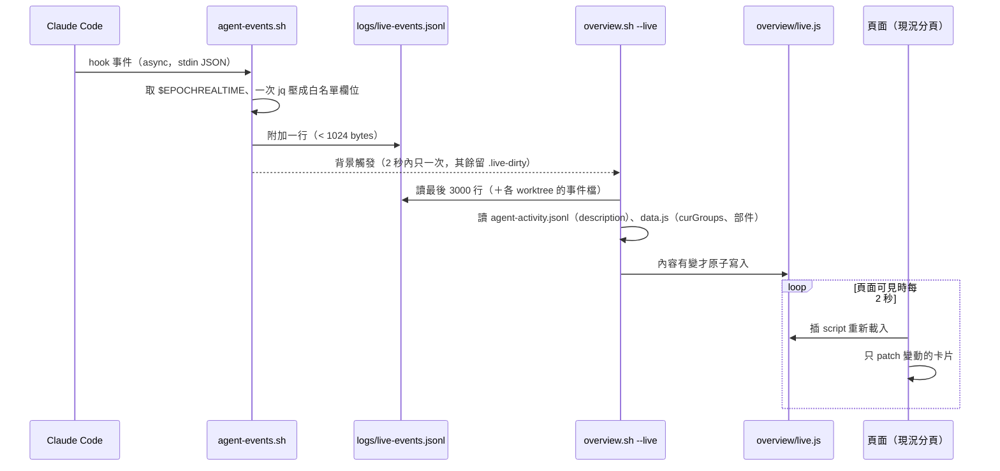

# ADR-2026-11-12-002: agent 即時事件記錄檔 `logs/live-events.jsonl` 的格式，與即時資料獨立成 `overview/live.js`

## 背景

專案圖解要加「現況分頁」：哪條線在跑、正在改哪個檔、哪裡在等使用者、哪個檔兩邊都在改。這些資料每幾秒就變一次，
而現有的 `data.js` 是整份掃描結果，重產要掃程式碼、跑 git，也是 Live Server 每幾秒整頁閃一次的來源（計畫階段 1 要消除的事）。
現有的 `agent-monitor.sh`／`agent-activity.jsonl` 只記 agent 開始與結束，而且 `pre-agent-gate.sh`、`lib/agent-inflight.sh` 兩道閘門在讀它，改它的形狀風險高。

這份事件檔是 hook（寫）、`overview.sh --live`（聚合）、頁面（讀 live.js）三方的契約，欄位一旦定了就難回頭。
要記哪些事件、記哪些欄位、怎麼不記到敏感內容、寫到哪一邊、「需要你」什麼時候算處理掉了？

## 決策驅動因素

* **不能拖慢 Claude**：hook 每個工具呼叫都會跑，Windows 上每多一個 `bash`／`jq` 行程約 170ms（KNOWN-GAPS）
* **不能記到秘密**：Bash 指令、檔案內容、使用者 prompt 可能含 token、密碼、客戶資料
* **不能影響閘門**：`agent-activity.jsonl` 與 `agent-inflight` 的行為一律不動
* **worktree 要看得到**：平行開發是這個功能的主要使用情境，且 `resolve-roots.sh` 在 `claude -w` session 有已知誤判（KNOWN-GAPS，使用者決定暫不修）
* **頁面不能閃**：即時資料頻繁更新時，地圖與任務圖不能跟著重寫
* 前車之鑑：`PostToolUse(Agent)` 不代表 agent 結束（`learned/2026-09-11-async-dispatch-breaks-posttooluse-gates.md`）；記錄型 hook 與讀它的 hook 會互相看到（`learned/2026-09-09-hook-sees-own-dispatch.md`）

## 決策

選擇 **新 hook `agent-events.sh` 只寫一份獨立的 JSONL；`overview.sh --live` 把它聚合成獨立的 `overview/live.js`**，
因為這樣即時資料的寫入頻率與 data.js 完全脫鉤，閘門讀的帳本一個字都不用改，而且聚合不掃描、不跑 git，可以每幾秒跑一次。

### 1. 接線與執行方式

| 事件 | matcher | 記什麼 | 用途 |
|---|---|---|---|
| `SubagentStart` | 全部 | 開始 | lane 開始（`since`） |
| `SubagentStop` | 全部 | 結束 | lane 結束、`doneToday`、關掉該 agent 的 need。**lane 結束只認這個**（2026-09-11 的坑） |
| `PreToolUse` | `AskUserQuestion\|Bash\|PowerShell` | 開始跑指令／發問 | `doing`；AskUserQuestion 開一筆 need |
| `PostToolUse` | `*`（全部工具；白名單外的只記 `ev`／`tool`／`sid`／`aid`／`at`／`src`，`act` 為 `用 <tool>`，不讀 `tool_input`） | 寫了哪個檔／指令跑完／問題答完／用了其他工具 | `doing`、寫入集（撞檔）、關 need |
| `PermissionRequest` | 全部 | 要使用者批准 | 開一筆 `approve` need |
| `Notification` | 全部（不設 matcher） | 通知種類 | `permission_prompt`／`idle_prompt`／`elicitation_dialog` 開 need |
| `UserPromptSubmit` | — | 只記「使用者送出了」，**不記 prompt 內容** | 關主 session 的 need |
| `Stop` | — | 主 session 這一輪結束 | 主 session lane 的「最後一筆是 Stop」判斷 |

- 主 session（沒有 `agent_id`）的工具事件**也記**，`aid` 為空字串。只記帶 `agent_id` 的不夠：主 session 自己問 AskUserQuestion、自己等批准、自己寫檔時，「需要你」與撞檔都會漏掉，主 session 的 need 也沒有事件可以關掉
- 全部 hook 設定 `"async": true`。官方文件（hooks reference「Run hooks in the background」）：只有 `type: "command"` 可用、不阻擋 Claude、預設逾時同同步 hook；社群文件與 issue 一致指出 async hook 的輸出被忽略、不能當閘門——**這支 hook 本來就只寫不擋，正好符合**。若階段 3 探針發現某版本的 async 有問題（社群 issue 提到 `asyncRewake` 在 2.1.246 會阻擋），退回同步，但腳本裡只准 1 次 `jq`
- 腳本永遠無 stdout、永遠 exit 0；沒有 `jq`、輸入不是 JSON → 什麼都不寫
- `OVERVIEW=off` 或 `OVERVIEW_LIVE=off` → 不寫、不觸發聚合
- 沒有 `taskmaster-data/project.json`（模板 repo 本身）→ 照寫事件，但不觸發 `--live`

### 2. 事件行格式（v1，一行一筆）

```json
{"v":1,"t":1762912345,"ms":417,"ev":"PostToolUse","sid":"…","aid":"a1b2…","at":"implementer",
 "src":"worktree:wt-a","tool":"Write","file":"src/cart/store.py","act":"編輯 store.py",
 "need":null,"nt":"","text":""}
```

| 欄位 | 型別 | 來源 | 上限 |
|---|---|---|---|
| `v` | 整數 | 固定 1；改形狀就加 1，`--live` 遇到不認得的 `v` 整行略過 | — |
| `t` | 整數 | 腳本**一開始**讀 bash 內建 `$EPOCHREALTIME` 的整數秒（不開 `date` 行程） | — |
| `ms` | 整數 0–999 | 同一次讀到的毫秒部分 | — |
| `ev` | 字串 | `hook_event_name` | — |
| `sid` | 字串 | `session_id` | 64 字 |
| `aid` | 字串 | `agent_id`（SubagentStart／Stop 的頂層欄位；subagent 內的其他事件依官方「common input fields」也帶這欄）；主 session 為 `""` | 40 字 |
| `at` | 字串 | `agent_type`（自訂 agent 是 frontmatter 的 `name`）；沒有為 `""` | 40 字 |
| `src` | 字串 | `resolve_roots` 的結果：`main` 或 `worktree:${WORK_ROOT##*/}`（與 overview.sh 的 overlay 命名相同） | — |
| `tool` | 字串 | `tool_name`；非工具事件為 `""` | 40 字 |
| `file` | 字串 | `tool_input.file_path` 相對**該 checkout 根**（`WORK_ROOT`）的路徑；不在 checkout 內 → `""` | 120 字，超過留尾段、前面補 `…` |
| `act` | 字串 | 「正在做」的一句話，規則見第 3 節 | 80 字 |
| `need` | `"approve"`／`"reply"`／`null` | 見第 5 節 | — |
| `nt` | 字串 | Notification 的 `notification_type`；其他事件為 `""` | 30 字 |
| `text` | 字串 | need 的說明（批准什麼／問了什麼）；沒有 need 為 `""` | 120 字 |

- 字數以 Unicode 字元算（jq 的字串切片）。整行再設一道**位元組**上限：`tojson | utf8bytelength` 超過 1000 時依序把 `text` 縮到 40 字、`act` 縮到 40 字、`file` 只留檔名。**保證每行 < 1024 bytes**
- 為什麼要 `ms`：async hook 是各自在背景跑的行程，**寫入檔案的順序不保證等於事件發生的順序**。`PreToolUse` 與緊接著的 `PermissionRequest` 常在同一秒內，只靠整數秒排不出先後，會讓 `PreToolUse` 被誤判成「開啟之後的事件」而把 need 關掉。時間戳在腳本**第一行**取，越早取越接近事件發生時刻
- 為什麼每行 < 1024 bytes：Linux 上 `O_APPEND` 單次寫入小於 `PIPE_BUF`（4096）不會與其他寫入交錯；Windows 沒有這個保證，靠讀取端 `fromjson?` 略過壞行。行越短，交錯機率越低、壞掉的也只有一行

### 3. 不記敏感內容（白名單，不是黑名單）

只有上表的欄位會被寫出，每個欄位的來源固定。**永遠不寫**：`tool_input` 整體、`tool_response`、使用者 prompt、`transcript_path` 的內容、檔案內容、Edit 的 `old_string`／`new_string`、Bash 的完整指令。

| 事件 | `act`／`text` 怎麼產 |
|---|---|
| Bash／PowerShell | 有 `tool_input.description` → `跑 <description>`；沒有 → 只記指令的**第一個詞**：跳過開頭所有 `NAME=value` 形式的環境變數賦值，取第一個不含 `=` 的詞，再只留 basename（`/usr/bin/curl` → `curl`）。取不到 → `跑指令` |
| Write／Edit／MultiEdit | `編輯 <檔名>`（只有 basename；完整相對路徑在 `file`） |
| PermissionRequest | `text` = `<tool>：` ＋ 同上規則（Bash 用 description 或第一個詞；寫檔用檔名；其他工具只寫工具名） |
| PreToolUse AskUserQuestion | `text` = `tool_input.questions[0].question`（模型寫給使用者看的題目） |
| Notification | `text` = `message`（Claude Code 自己產的通知文字，例如「需要你的批准才能用 Bash」） |
| UserPromptSubmit | `act`、`text` 都為 `""` |

- 「第一個詞」要跳過賦值，是因為 `API_KEY=xyz curl …` 的第一個詞就是秘密本身
- Bash 的 `description` 是模型寫的摘要，理論上仍可能帶出敏感字；接受這個殘餘風險（80 字上限、只在本機、`logs/` 不進 git），換來「正在做」看得懂
- MCP 工具、WebFetch 等白名單外的工具：PostToolUse 只記工具名（`act` 為 `用 <tool>`），`tool_input`／`tool_response` 一律不讀；PreToolUse 不接
- 檔案在 `.claude/logs/` 下，由 `.claude/logs/.gitignore` 排除進版控、`copy-template` 不複製

### 4. 寫到哪一邊、worktree 怎麼讀

**寫入：`$MAIN_CLAUDE/logs/live-events.jsonl`**（`resolve_roots` 解析）。
這是「共享產物」：各 worktree 的事件要集中一處，現況分頁才看得到全部的線；與 `logs/`、`agent-activity.jsonl` 同一邊，符合 `worktree-orchestration` 邊界表 `MAIN_CLAUDE` 欄的「log 集中一處才查得到」。

| 情境 | `CLAUDE_PROJECT_DIR` | hook 的 `cwd` | 寫到 | `src` |
|---|---|---|---|---|
| 主 checkout 的 session 與它的 subagent | 主 checkout | 主 checkout | 主 checkout | `main` |
| 主 session 派 `isolation: worktree` 的 subagent | 主 checkout | worktree 根（官方：cwd 是 worktree 根） | 主 checkout | `worktree:<名>` |
| `claude -w` 開的 session（KNOWN-GAPS 的 resolve-roots 誤判） | **worktree** | worktree | **worktree 裡的** `.claude/logs/` | 誤記成 `main` |

第三種情境不修 `resolve-roots.sh`（使用者決定暫不處理），由**讀取端補償**：`overview.sh --live` 除了主 checkout 的檔，也讀 `.claude/worktrees/*/.claude/logs/live-events.jsonl`，這些檔裡 `src` 為 `main` 的事件改標成 `worktree:<該資料夾名>`。
worktree 被刪掉時它的事件檔一起消失——那些線多半已經結束，接受這個損失。日後 `resolve-roots.sh` 修好，讀取端的補償自然變成空操作，不需要回頭改。

### 5. 「需要你」何時開、何時算處理掉

**開啟者**（`need` 非 null 的事件）：

| 事件 | `need` |
|---|---|
| `PermissionRequest` | `approve` |
| `Notification` `permission_prompt` | `approve`（與前後 10 秒內同 `sid`／`aid` 的 PermissionRequest 合併成一筆） |
| `Notification` `idle_prompt`、`elicitation_dialog` | `reply` |
| `PreToolUse` `AskUserQuestion` | `reply` |
| 其他 notification_type（`auth_success`、`elicitation_complete`、`elicitation_response`，及官方清單外的值） | `null`（但仍是一筆事件，能當關閉者） |

**關閉規則**（由 `--live` 依 `(t, ms)` 排序後判斷，不靠檔案行序）：

1. 同 `sid`＋同 `aid` 在開啟者**之後**出現**任何非開啟者事件** → 已處理。理由：Claude Code 在等使用者時那條線不會有別的動作；有動作就代表使用者回應了（批准、拒絕、回答都算）。PostToolUse 接全部工具，所以批准後一定有下一筆事件（WebFetch、MCP 這類只觸發 PermissionRequest 的工具也一樣）。拒絕批准時不會有 PostToolUse（`learned/2026-10-15-posttooluse-skips-failures.md`），但模型接著的下一個動作、或 SubagentStop 會關掉它
2. 該 `aid` 的 `SubagentStop` → 已處理
3. 主 session（`aid` 為空）的 need：同 `sid` 的 `UserPromptSubmit` 也關閉
4. 同 `sid`／`aid` 只留最新一筆開啟者
5. 開啟超過 4 小時 → 不列（安全網：漏掉關閉事件時不會永遠掛著）

**待階段 3 探針實測**：subagent 內觸發的 `PermissionRequest`／`Notification` 是否帶 `agent_id`。官方「common input fields」寫 subagent 內的 hook 會帶 `agent_id`，但沒有逐一列出這兩個事件。

- 有帶 → 照上面的規則
- 沒帶 → subagent 的批准請求會被記成主 session 的 need（`aid` 為空），而 subagent 後續事件帶 `aid`、關不掉它。此時規則 1 對「`aid` 為空的開啟者」改成：同 `sid` 之後出現**同 `tool` 的** PostToolUse，或任一事件晚於開啟者 10 秒以上且該 session 沒有其他未結束的 subagent → 已處理。實測結果與採用的分支寫進計畫的「發現與決策」與 `overview.sh` 檔頭

計畫裡的 `agent_needs_input` 不在官方 Notification 類型清單裡（官方：`permission_prompt`、`idle_prompt`、`auth_success`、`elicitation_dialog`、`elicitation_complete`、`elicitation_response`），探針沒錄到就不要列進開啟者。

### 6. 與現有帳本的關係（全部不改）

| 既有 | 關係 |
|---|---|
| `agent-monitor.sh`／`logs/agent-activity.jsonl` | **不動**。`--live` 只讀它的 `agent_start` 取 `description`，用 `agent_id` join（兩邊的 `agent_id` 是同一個值，2026-09-11 實測） |
| `lib/agent-inflight.sh` | **不動**。`--live` 從它讀 `AGENT_INFLIGHT_READONLY` 判斷 lane 的 `readonly`，不抄一份 |
| `pre-agent-gate.sh` 等閘門 | **不得**讀 `live-events.jsonl`。這份是給人看的：async 寫入、順序不保證、可能少行，拿來當閘門依據就是重演 2026-09-11 的坑 |

- `agent-events.sh` 只寫不讀，與「讀到自己這一次」（2026-09-09）的坑無關
- SubagentStart 與 agent-monitor 的 `agent_start`（PostToolUse(Agent) 寫）會各記一次「開始」，**這是刻意重複**：兩者的用途與可靠性要求不同，合併會讓閘門的帳本跟著展示需求改形狀

### 7. 截尾

- `session-start.sh` 加 `rotate_log "$CLAUDE_DIR/logs/live-events.jsonl" 3000`（約 750KB 以下）
- `--live` 只讀最後 3000 行；session 很長、沒重開時檔案會長過 3000 行，只多佔磁碟，不影響聚合時間
- 截尾用既有的「tail 到暫存檔再 mv」：截尾當下其他 session 剛好附加的那幾行會遺失。只影響即時畫面，接受

### 8. 聚合成獨立的 `overview/live.js`

- `overview.sh --live`：不掃描、不跑 git；讀事件檔＋`agent-activity.jsonl`＋現有 data.js（`curGroups`、plan 部件），一支 jq 算出 `lanes`／`needs`／`clashes`／`doneToday`／`feed`／`at`（欄位規則在 `overview.sh` 檔頭，唯一來源）
- 輸出 `overview/live.js`，內容只有一句 `window.OVERVIEW_LIVE = {...};`（classic script，file:// 下也能用插 `<script>` 的方式輪詢）；暫存檔＋`mv` 原子寫入；去掉 `at` 後內容沒變就不寫
- **data.js 只在掃描結果真的變了才重寫**（計畫階段 1），live.js 才是頻繁更新的那個檔。頁面輪詢兩者：data.js 變了才重畫地圖／任務圖，live.js 變了只 patch 現況分頁與部件卡
- 觸發：`agent-events.sh` 寫完事件後在背景觸發 `--live`，2 秒內只觸發一次，視窗內只留 `.live-dirty`；`--live` 有自己的 `.live.lock`，不搶完整重產的 `.lock`

## 替代方案

| 方案 | 優點 | 缺點 | 否決理由 |
|---|---|---|---|
| 即時資料放進 data.js 的 `live` 區塊（使用者原話的說法） | 頁面只讀一個檔 | 每個事件都要讀改寫整份 data.js；頁面每次都要判斷要不要重畫地圖 | 使用者選分檔（Q2）；正好重演階段 1 要消除的「每幾秒整份重寫」 |
| 擴充 `agent-monitor.sh`／`agent-activity.jsonl` | 少一支 hook、少一個檔 | 閘門的帳本要跟著展示需求改形狀；每個工具呼叫都進同一份帳，閘門讀的量變大 | 兩道閘門靠它，改壞是無聲的（2026-09-11 前例） |
| 只記帶 `agent_id` 的工具事件 | 事件量少 | 主 session 的等批准、AskUserQuestion、寫檔全部看不到；主 session 的 need 沒有事件能關 | 現況分頁最常見的「需要你」就是主 session 在等 |
| 用 `claude agents --json` 輪詢 | 不用 hook | 每次起一支 node CLI（Windows 秒級）；背景環境不保證 PATH 有 `claude`；看不到「正在改哪個檔」 | 成本高、資訊少；之後若發現別的終端機開的 session 看不到再評估當備援 |
| 讀 transcript（`transcript_path`）取內容 | 資訊最完整 | 要解析大檔；內容含 prompt 與工具輸出，敏感資料一起進來 | 違反「不記敏感內容」 |
| 每個 worktree 各寫自己那份（`WORK_CLAUDE`） | 不用 `src` 欄 | 讀取端要列舉所有 worktree，主 checkout 派出的 worktree subagent 會散在各處 | 邊界表的判準：給人跨線看的共享產物放 `MAIN_CLAUDE` |
| 修 `resolve-roots.sh` 的 `claude -w` 誤判 | 根治 | 動到所有 hook 的路徑解析，要跑整套測試（Windows 約 50 分鐘） | 使用者已決定暫不修（KNOWN-GAPS）；讀取端補償成本低且日後可自然退場 |
| 同步 hook | 寫入順序＝事件順序 | 每個工具呼叫多 1 個 bash＋1 個 jq，Windows 約 340ms | 拖慢所有工具呼叫；只在 async 實測有問題時退回 |

## 後果

**得到：**
* 現況分頁的資料來源與閘門完全隔離，閘門行為零變動
* data.js 不再因即時資料重寫，地圖不會因 agent 活動而閃
* 每行 < 1024 bytes、只有白名單欄位，事件檔可放心給人看
* worktree 的線（含 `claude -w` 誤判的情境）都看得到

**犧牲：**
* 多一支在每次 Bash／寫檔／發問都會跑的 hook（async，不阻擋，但 Windows 上仍多佔背景行程）
* async 讓順序不保證，「需要你」的關閉要靠 `(t, ms)` 排序；同一毫秒內的兩筆仍可能排錯（機率低，最壞是 need 多掛到下一筆事件）
* `act` 用 Bash 的 description，模型寫進 description 的敏感字會被記下（80 字、只在本機）
* 事件檔與 `agent-activity.jsonl` 對「agent 開始」各記一次

**中性影響：**
* `worktree-orchestration` 邊界表的 `MAIN_CLAUDE` 欄多一句 `logs/live-events.jsonl`，overview 那格多一句 `live.js`
* `hooks/README.md` 檔案樹、功能表、輪替段各多一列

**何時該重新考慮：**
* 探針顯示 subagent 內的 PermissionRequest／Notification 不帶 `agent_id`，且第 5 節的退路常誤判 → 改用 `transcript_path` 只讀最後一行的狀態（不讀內容）或等官方補欄位
* `resolve-roots.sh` 修好 → 刪掉 `--live` 讀 worktree 事件檔的補償
* 事件量大到 3000 行不夠一個工作日的 feed → 調 `rotate_log` 行數或改按時間截
* Claude Code 官方提供「列出所有 session／subagent 即時狀態」的介面 → 評估取代 hook

## 確認方式

- [T] SubagentStart（實測形狀）→ 多一行，`v` 1、`ev`／`aid`／`at` 對得上 payload、`src` `main`、`t` 與 `ms` 為整數
- [T] `cwd` 是 `.claude/worktrees/wt-a/src`、Write 的 `file_path` 是絕對路徑 → `src` `worktree:wt-a`、`file` `src/x.ts`
- [T] Bash 指令 `API_KEY=xyz curl -H 'Authorization: Bearer abc' …`、沒有 description → 事件行不含 `xyz`、`abc`，`act` 為 `跑 curl`
- [T] Edit 事件 → 事件行不含 `old_string`／`new_string` 的任何內容
- [T] UserPromptSubmit 帶 prompt「密碼是 hunter2」→ 事件行不含 `hunter2`
- [T] 任一欄位超長（含全形字）→ 截斷，整行 < 1024 bytes
- [T] `PreToolUse` Bash（`ms` 100）與 `PermissionRequest`（同一秒、`ms` 300）**以相反順序寫進檔案** → `needs` 1 筆（PreToolUse 不被當成關閉者）
- [T] `--live` 讀 `.claude/worktrees/wt-c/.claude/logs/live-events.jsonl` 裡 `src` 為 `main` 的事件 → 當成 `worktree:wt-c`
- [T] 測試裝好 `agent-events.sh` 後跑既有的 `pre-agent-gate`／`agent-monitor` 測試節 → 全綠、`agent-activity.jsonl` 內容與裝前相同
- [C] `grep -l live-events .claude/hooks/pre-agent-gate.sh .claude/hooks/lib/agent-inflight.sh` 為空（閘門不讀事件檔）
- [M] 階段 3 探針：各事件的實測 payload 存 scratchpad，`agent_id` 是否出現在 subagent 內的 PermissionRequest／Notification、SubagentStart 的 `cwd`、`async: true` 是否生效，三項結果寫進計畫「發現與決策」

## 資料流



## 相關

- 計畫：`.claude/taskmaster-data/plans/adhoc-2026-11-12-overview-live.md` 階段 3、6
- 使用者決定：`.claude/qa-history/2026-11-12-130000-overview-live-plan.md` Q2
- 坑：`.claude/context/learned/2026-09-11-async-dispatch-breaks-posttooluse-gates.md`、`2026-09-09-hook-sees-own-dispatch.md`、`2026-10-15-posttooluse-skips-failures.md`
- 落差：`.claude/context/decisions/KNOWN-GAPS.md` 的 resolve-roots 那條
- 狀態邊界：`.claude/skills/worktree-orchestration/SKILL.md`「短命旗標 vs 共享產物」表
- 官方文件：Claude Code hooks reference（SubagentStart 輸入、common input fields 的 `agent_id`／`agent_type`、PermissionRequest 輸入、Notification matcher 值、Run hooks in the background）
- 相關 ADR：ADR-2026-11-12-001（頁面大小）、ADR-2026-11-12-003（本機伺服器）

## 2026-11-16 增補：記 SessionStart，判定被中斷的 agent

背景：smartwork 實例——planner 跑到一半，使用者 `resume` 了 session，那個 planner 不會再有 SubagentStop，lane 掛到 12 小時才消失。

- **第 1 節表多一列**：`SessionStart`（不設 matcher、`async: true`）｜記 `source`｜用途：`--live` 判斷同 sid 的 agent 是否被中斷。
- **第 2 節欄位表多一列**：`ss`｜字串｜SessionStart 的 `source`（`startup`／`resume`／`clear`／`compact`）；其他事件為 `""`｜10 字。
- **`v` 維持 1**：只加欄位、沒改既有欄位的意義；讀取端用 `.ss | str` 容忍沒有這欄的舊行。第 2 節「改形狀就加 1」的「形狀」指既有欄位的型別或意義，加欄位不算——否則已寫進檔的舊行會被整行略過，現況畫面清空。
- **中斷規則的唯一來源是 `overview.sh` 檔頭「即時聚合」**：restart（同 sid 的 SessionStart `startup`／`resume`／`clear`，`compact` 不算）與 silent（最後一筆距今超過 `OVERVIEW_LIVE_CUT_MIN` 分鐘，預設 30；最後一筆是 PreToolUse Bash／PowerShell 不判）。本 ADR 不重述門檻與細節。
- **`/clear` 與新視窗只能靠 silent**：這兩種會換新的 `session_id`（VS Code 重開若是 `startup` 也是新 sid），payload 裡沒有舊 sid 可以對，無法用 restart 認出，只有等 silent 超時收掉。這是已知的延遲，不是漏洞。
- **閒置主 session 不進 lanes**：session lane 判斷「最後一筆」時略過 `Notification` 與 `SessionStart`；主 session 停下等回話時只在 `needs` 顯示等回覆。
- 中斷只影響 `live.js` 的顯示：不寫回 `agent-activity.jsonl`、閘門不讀（第 6 節不變）。
