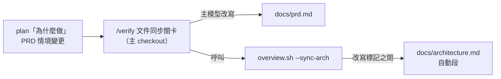
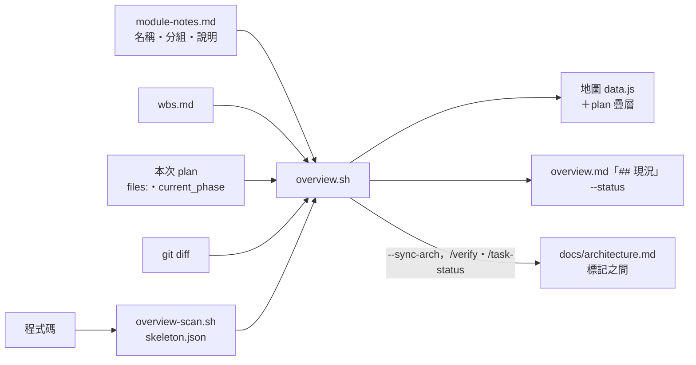

# 設計提案：文件收成 6 份、PRD 跟著現況走、會過期的部分由地圖資料產生

> 本版依使用者定案的方向改寫（2026-11-05）。前一版的 `docs/specs/`、`spec-merge.sh`、`docs-lint.sh`、新 hook、
> 生命週期資料夾、status 英文列舉都已拿掉，不是並列成選項；拿掉了什麼見第 12 節。

## TL;DR
- 文件只有 6 份：brief、PRD、架構文件、WBS、plan、ADR（另有條件式的威脅模型、選配的 runbook）；範本 20 → 5，`workflow-template-manager` 退場
- PRD 用編號的中文情境（假設／當／那麼）＋用語表；plan 記「這次增、改、刪了哪幾條情境」，`/verify` 的文件同步關卡由主模型套回 PRD——不寫腳本、不加 hook
- 架構文件分人寫三節＋`overview.sh` 產生的模組與依賴段；一頁現況、地圖的「plan 預計會動」一層也由同一份地圖資料產生。開發流程不變，唯一新腳本仍是地圖的 `overview-scan.sh`
- plan 每個階段寫「依賴」，依賴完成且檔案不重疊的階段由 `/tdd` 主動提供「用 worktree 同時跑」；`/task-next` 沒 plan 時用 WBS 模組欄粗估（第 6.4 節，只改 md）

## 範圍
- **檢查目標**：`.claude/skills/project-docs/`（SKILL＋20 份範本）、`commands/{docs-init,task-init,plan,tdd,verify,task-status,template-check,adr}.md`、`skills/{plan-format,spec-convergence}`、`templates/CLAUDE-md.template.md`、`agents/{planner,architect,documentation-specialist,workflow-template-manager}.md`、`scripts/overview.sh` 讀 plan 與架構文件的部分
- **觸發原因**：使用者指出文件太多太冗、沒反映真實狀態、沒有一眼看懂的總覽；專案地圖在兩個實測專案畫不出來，因為架構文件不是真實狀態；hook 與腳本已經太多（Windows 上每次 Bash 工具呼叫 hook 約多 3.5～4 秒）
- **不變**：開發流程 task-init → task-next → plan → tdd → verify → pr（SDD＋TDD）；ADR-2026-11-05-001～003 與地圖計畫的既有定案
- 狀態：**提議中**。本次只寫文件，沒有動範本、指令、hook 或腳本

決策紀錄（一份一個決策；檔名與前一版的對應見第 12 節）：

| ADR | 決策 |
|---|---|
| `ADR-2026-11-05-004-six-docs-and-templates` | 6 份文件、範本收斂、ADR 單一的家、`workflow-template-manager` 退場 |
| `ADR-2026-11-05-005-prd-scenarios-and-delta` | PRD 格式（情境＋用語表＋領域＝模組分組）、plan 的情境變更由 `/verify` 套回 |
| `ADR-2026-11-05-006-plan-slim-format` | plan 四段、程式在讀的部分不動、status 只准四個既有值、階段寫「依賴」並可平行 |
| `ADR-2026-11-05-007-architecture-doc-generated-section` | 架構文件人寫＋自動段、一頁現況、plan 疊層的介面 |
| `ADR-2026-11-05-008-legacy-docs-inventory` | 既有專案按需盤點、對到 6 份、逐批同意 `git mv` |

---

## 1. 依據（暫存資料會消失，重點抄在這裡）

### 1.1 實測專案盤點（匿名 A、B，2026-11-05 唯讀盤點）

| 面向 | A（開發者為主） | B（交付物為主） |
|---|---|---|
| `docs/` md | 85 份／27,554 行 | 75 份／26,808 行 |
| `.claude/context/` 報告 | 537 份（docs 的 6 倍） | 291 份（3.9 倍） |
| 失效路徑 | 1,244 處中 76 處（6%），入口索引 8 處 | 488 處中 64 處（13%），主架構文件 9 處 |
| 同一數字的版本 | — | API 端點數 5 種（111／118／128／108／134）、部署包版本同一份文件 3 種 |
| PRD 類來源 | 5 處（現行 847 行） | 1 份（318 行，附錄混了 26 個 API 端點設計） |
| ADR | 單檔 22 條／1,604 行＋`context/decisions/` 另一套編號 | 單檔 10 條／1,391 行＋另一套編號 |
| plans | 321 份，平均 197 行、最長 1,053；`status:` 60 多種寫法 | 65 份，平均 200 行、最長 569；20 多種寫法；4 份「階段狀態未逐項回填」 |
| plan 區段頻率 | 目標 252、階段拆解 246、風險與緩解 240、驗收標準（整體）224、WBS 連結 211、技術依賴 151 | 風險 47、驗收 46、階段 46、目標 46、技術依賴 32、WBS 連結 28；多份完成後變成實作日誌 |
| 讀者 | 開發者 68%、客戶 10%、歷史 10%、PM 8%、維運 4% | 客戶／稽核 57%、開發者 17%、歷史 14%、維運 11%、PM 1% |

**共同 5 大問題**與本版的對應：

| 問題 | 本版怎麼處理 |
|---|---|
| 1 沒有「現在狀態」的單一頁面 | 一頁現況由 `overview.sh` 產生（ADR-007） |
| 2 入口索引與計數手寫、會腐爛 | 計數與模組表只出現在產生物與架構文件自動段；不提供手寫索引（第 3.3 節）。**不做**連結檢查腳本 |
| 3 新舊並存、靠附錄打補丁 | PRD 由情境變更套回、不寫附錄；架構文件會過期的部分改由程式產生 |
| 4 同一主題多種成品 | 模板只管 6 份；舊文件盤點時標出重複群組（ADR-008） |
| 5 TaskMaster 自己的產物變成第二套文件體系 | plan 四段、status 只准四個值；ADR 只有一個家 |

### 1.2 研究結論（2026-11-05 查證）與本版的採用

| 來源 | 事實 | 本版採用什麼 |
|---|---|---|
| GitHub Spec Kit | 每功能 7 份以上檔案；只補 tasks、不改 spec | 不採用：就是「太多份」的反例 |
| AWS Kiro | requirements／design／tasks 三份；EARS 句型；Quick Spec 給小任務 | 只取「依規模換組合」（demo／mvp／full 決定先產哪幾份） |
| OpenSpec | 現況規格是唯一真相；變更寫 ADDED／MODIFIED／REMOVED，完成時套回 | **只借概念**：plan 寫情境變更、`/verify` 由模型套回 PRD；不裝 CLI、不建 `specs/`、不寫合併腳本 |
| BDD（Given／When／Then） | 情境讓非開發者讀得懂 | PRD 的情境用「假設／當／那麼」，不另開 BDD 文件、不接 Gherkin 工具 |
| DDD | ubiquitous language、bounded context | 只取用語表與模組邊界（＝地圖分組＝PRD 領域）；不做聚合、領域事件 |
| BMAD v6 | 依規模換文件組合 | 同 Kiro |
| Böckeler（martinfowler.com，2025-10） | spec-first／spec-anchored／spec-as-source；批評冗長重複 | PRD 走 spec-anchored：隨每個完成的 plan 更新 |
| Thoughtworks Radar | 流程繁複、spec 冗長難審 | 支持「少幾份」 |
| C4／arc42／MADR | C4 多數只畫前兩層；arc42 精簡用法；MADR 接受後不改 | 架構文件人寫三節＝C4 第一層＋arc42 的技術選型與部署；ADR 照 04 範本 |
| Diátaxis | 一份文件只服務一種需求 | 6 份各回答一個問題（ADR-004 表） |
| Google docguide | 最少可用文件、與程式碼同一變更更新 | 6 份；PRD 與架構自動段在 `/verify` 時同步 |
| Anthropic Claude Code best practices | CLAUDE.md 只放程式碼看不出來的；「描述架構與檔案配置」是過時做法 | CLAUDE-md 範本刪「專案結構」 |
| OpenAI ExecPlan | plan 自足、活文件；Surprises／Decision Log／Outcomes | plan 的「發現與決策」「改善了什麼」 |
| Gherkin 繁中關鍵字 | 本次沒查到官方對照表 | 不宣稱與 Gherkin 工具相容，「假設／當／那麼」只是寫作格式 |

---

## 2. 分層決定（`writing-extensions` 五層表）

| 機制 | 層 | 判斷依據 |
|---|---|---|
| 6 份文件的集合、各文件格式、寫作標準 | **Skill**：`project-docs`（SKILL＋範本） | 只在寫文件時需要；寫文件的指令與 agent 在定義裡明寫路徑 |
| plan 格式與 status 值 | **Skill**：`plan-format`（既有，唯一來源） | 同上 |
| 情境變更套回 PRD | **Command**：`/verify` 的「文件同步關卡」（既有） | 寫字的工作、量小、有固定關卡；不需要腳本或另一個 agent |
| 架構文件自動段、一頁現況、plan 疊層 | **Script**：`overview.sh` 的新出口（`--sync-arch`、`--status`、data.js 欄位） | 確定性的產生，0 token；`overview.sh` 已經解析過全部輸入 |
| 自動段何時更新 | **Command**：`/verify`、`/task-status` 呼叫 `--sync-arch` | hook 不寫模型會 Edit 的檔（既有原則） |
| 既有專案盤點 | **Command**：`/docs-init`（入口）→ **Agent**：`documentation-specialist` | 讀幾十份文件需要獨立 context；必須使用者同意 |

**不新增 hook、rule、agent、指令、腳本**（地圖的 `overview-scan.sh` 屬 ADR-001，已在地圖計畫裡）。退場 1 個 agent——
這會刪改三個既有 hook 裡的名稱字串（第 10 節），不增加任何 hook 的執行成本。

---

## 3. 文件集合

### 3.1 6 份文件

| 文件 | 讀者 | 回答什麼 | 更新時機 | 誰維護 | 長度參考 |
|---|---|---|---|---|---|
| `docs/00_brief.md` | 決策者、新成員、agent | 為什麼做、範圍上限、不做什麼、怎樣算成功 | 方向改變時 | `/task-init` 2.7b 產、使用者確認 | 150 行 |
| `docs/prd.md` | 開發者、客戶、agent | 系統該有什麼行為（編號情境）、用語 | 每個帶情境變更的 plan 完成時 | `/docs-init` 產初稿；之後由 `/verify` 套回 | 600 行（超過就按領域拆，見 ADR-005） |
| `docs/architecture.md` | 客戶、新成員、維運 | 跟誰連、用什麼、怎麼部署；模組與依賴 | 人寫三節：選型或部署改變時；自動段：`/verify`、`/task-status` | `architect`＋`overview.sh --sync-arch` | 人寫部分 200 行 |
| `.claude/taskmaster-data/wbs.md` | 所有人 | 做到哪、誰負責、下一個 | 任務狀態改變時 | 既有指令 | 版面見 `wbs.template.md` |
| `.claude/taskmaster-data/plans/*.md` | 開發者、agent | 這次為什麼做、怎麼做、改善了什麼 | 開發中；完成即歸檔 | planner、`/tdd`、`/verify` | standard 250／critical 350 行 |
| `docs/decisions/ADR-*.md` | 開發者、agent | 為什麼這樣設計 | 做決策時新增；只改 status | `architect`、`/adr` | 120 行 |
| `docs/threat-model.md`（條件式） | 審查者 | 威脅與緩解 | critical 碰認證、金流、個資時必產 | `architect`＋`security-infrastructure-auditor` | 300 行 |
| `docs/runbook.md`（選配） | 維運 | 怎麼部署、排障、SLO | 部署或告警改變時 | `deployment-expert` | 400 行 |

**產生物（不算文件，不進 git）**：專案地圖＋一頁現況（`taskmaster-data/overview/`）。
**入口（不算文件體系）**：`README.md`、`CLAUDE.md`。
**模板外**：交付物、對外手冊、評測紀錄、匯出檔——使用者自己的，模板不管、不檢查。
**UI 鏈**：`docs/12_*`、`docs/17_*` 由 `/ui-site` 產生、`ui-lint.sh` 讀，路徑不動，不算文件體系。

### 3.2 每份「不寫什麼」（重複就是過期的來源）

| 欄位 | 唯一來源 | 其他文件怎麼寫 |
|---|---|---|
| 產品方向、不做什麼 | brief | PRD、plan 不重述 |
| 系統行為 | PRD 情境（已完成的）／plan 的情境變更（進行中的） | 驗收句寫情境編號 |
| 設計理由 | ADR | plan 的「發現與決策」只記本變更內的小決策 |
| 做法、階段 | plan | WBS 不寫 |
| 任務狀態、負責 | WBS | plan 只有 `wbs_task` |
| 模組、依賴、路由數 | 程式碼（`overview-scan.sh`） | 只出現在架構文件自動段與地圖 |
| 用語 | PRD 用語表 | 其他文件與程式命名照用 |

### 3.3 沒有手寫索引

`docs/README.md` 這種手寫索引不在集合裡——A、B 的入口腐爛都發生在手寫索引。
6 份文件的位置是固定路徑，寫在 CLAUDE.md 的「文件在哪」一節（路徑，不寫數字）。

### 3.4 demo／mvp／full

| 模式 | `/docs-init` 先產 |
|---|---|
| demo | brief、WBS（PRD 等第一條情境出現才建） |
| mvp | brief、PRD、架構文件、WBS |
| full | 同 mvp；碰到認證、金流、個資時加威脅模型；詢問是否要 runbook |

不再產 `tech-spec.md` 與編號文件序列。舊專案的 `tech-spec.md`、`01_prd.md` 照樣被讀（地圖的 `find_arch` 有退路，見 8.1 的 A1；`spec-convergence` 沒有 `docs/prd.md` 時退回舊路徑）。

---

## 4. PRD 與情境變更（ADR-005）

### 4.1 PRD 格式

見 ADR-005 的範例。要點：
- 用語表在最前面（用語／意思／不要說成）
- 功能依領域分節，**節標題括號寫模組分組名**——就是架構文件自動段的「分組」欄、地圖的群組框。新專案還沒有程式碼時，分組名先由 PRD 定，之後 module-notes 的「分組」欄照用同一個名字
- 情境 `#### <代碼>-<序號> 標題`，下面「假設／當／那麼」三行；編號永不重用
- 不寫實作細節、檔案路徑、API 端點清單、進度

### 4.2 情境變更與套回



`/verify`「文件同步關卡」改成三項（順序固定）：

| 項 | 誰做 | 何時跳過 |
|---|---|---|
| 1 PRD 情境套回 | 主模型照 plan 的情境變更改 `docs/prd.md`，小節末加 `已套回 PRD（YYYY-MM-DD）` | 在 worktree；沒有進行中的 plan；情境變更為「無」；已有「已套回」行 |
| 2 架構文件自動段 | `overview.sh --sync-arch` | 在 worktree；`docs/architecture.md` 沒有標記 |
| 3 `.doc-impact` 清單 | 照現行 AskUserQuestion（選項說明把「codemap／API 文檔」改成「README、架構文件人寫部分、runbook」） | 清單為空 |

第 1、2 項不另外問使用者：情境變更在 `/plan` 時已核准，自動段是機械產生；做完後把 PRD 的 diff 摘要印在 `/verify` 的輸出裡。

### 4.3 與 `spec-convergence` 的關係

| | 現在 | 之後 |
|---|---|---|
| 輸入 | brief → PRD → WBS／plans → 程式碼 | brief → `docs/prd.md`（沒有時退回舊 PRD 路徑）→ WBS／plans → 程式碼 |
| C 描述失真 | PRD 敘述 vs 程式碼 | PRD 情境 vs 程式碼 |
| 不自動改 | PRD | PRD 與 brief 都不直接改；PRD 只透過 plan 的情境變更改 |

---

## 5. 範本（20 → 5）

| 範本 | 處置 | 新內容 |
|---|---|---|
| 02 `project_brief_and_prd.md` | **改寫**（檔名不變） | 上半 brief 骨架（`/task-init` 2.7b 改成指向這裡，唯一來源）；下半 PRD 骨架（ADR-005） |
| 04 ADR | 保留 | 落點：兩版都寫 `docs/decisions/` |
| 05 `architecture_and_design_document.md` | **改寫**（檔名不變，`check-counts.sh` 的 `TPL05` 引用它） | 人寫三節＋自動段標記（ADR-007）；刪掉 5.1 容器圖、5.5 模組表的手寫要求 |
| 14 部署與運維 | **精簡**成 runbook（選配） | 吸收 19 的 SLO 要點 |
| 20 威脅模型 | 保留 | critical 用 |
| 12、17 | 不動 | UI 鏈，不算文件體系 |
| 01、03、06、07、08、09、11、13、15、16、18、19、21 | **淘汰** | 去處：01→`guides/WORKFLOW.md`；03→PRD 情境；06→`api-design` skill（準則）＋框架產生的 OpenAPI；07→PRD＋`testing-standards`；08、09→地圖＋架構自動段；11→`code-quality-specialist`；13→`rules/security.md`＋`security-infrastructure-auditor`；15→`project-docs` SKILL；16→brief（appetite）＋`wbs.template.md`；18→`database-migrations` skill；19→runbook；21→PRD 的領域情境＋`cost-aware-llm-pipeline` skill |

plan 沒有範本檔（唯一來源是 `plan-format`），WBS 版面在 `.claude/templates/wbs.template.md`。
`update-template` 不會刪除專案裡已淘汰的範本檔，它們只是不再被引用。

**CLAUDE-md 範本**：刪「## 專案結構」（Anthropic 列為過時；地圖產生）；「## 技術棧」改成「## 程式碼看不出來的事」；
加「## 文件在哪」：6 份文件的路徑＋「專案地圖：`/task-status`」，**不寫任何數字**。

**`/docs-init` 新流程**：
1. 偵測既有文件 → 第一題問要不要先盤點（ADR-008）
2. brief：沒有就照 02 上半產（`/task-init` 觸發時直接用它的問答）
3. 依 demo／mvp／full 產 PRD 初稿（從 brief 的核心能力切領域，每個領域先寫 1–3 條情境，`[待確認]` 照實標，使用者逐領域確認）、架構文件人寫三節（自動段先放空標記，第一次 `/task-status` 填上）
4. full 且碰認證、金流、個資 → 威脅模型必產；詢問 runbook
5. 寫 `project.json` 的 `docs.set`（實際產出的清單）；`mode` 只准 `demo／mvp／full`

---

## 6. plan（ADR-006）

### 6.1 段落對照

| 現行 | 之後 |
|---|---|
| 目標 | **為什麼做**（≤ 3 句）＋「PRD 情境變更」小節 |
| 一眼看懂 | 搬到**怎麼做**底下（`### 一眼看懂`），mermaid＋部件表欄名不變 |
| WBS 連結 | 刪（`wbs_task`） |
| 技術依賴 | 刪（寫進步驟） |
| 階段拆解 | **怎麼做**底下的 `### 階段 N: 名稱 <狀態>`（格式不變）；步驟附「驗證：」；驗收引用情境編號 |
| 風險與緩解 | 刪（真的會踩的坑寫進該階段一行「注意」；跨任務風險寫 WBS 風險表） |
| 驗收標準（整體） | 刪（共同門檻在 `task-mode.md`、`testing-standards`） |
| — | **改善了什麼**（之前／之後，只寫行為） |
| — | **發現與決策**（一筆一行帶日期） |
| 計畫 vs 實際（`overview:actual`） | 不變 |

### 6.2 讀 plan 的程式（grep 結果，本版確認不用改）

| 程式 | 讀什麼 | 新格式下 |
|---|---|---|
| `overview.sh` `parse_plan`（約 556–582 行） | frontmatter、`# ` 標題、`^###\s*階段\s*\d`、任何位置表頭含 `OVERVIEW_COLS_PART` 的表、actual 區塊 | `### 一眼看懂` 換了層級也找得到（部件表依表頭比對、不看所在節） |
| `overview.sh` 第 858 行 `test("✅")` | status | status 仍是 `✅ 完成`，不用改 |
| `statusline.sh` 第 274–279 行 | `current_phase`、`grep -c '^### 階段'` | 不變 |
| `pre-tool-use.sh`、`session-start.sh` | `mode:` | 不變 |
| `pre-agent-gate.sh` 第 254 行 | `^files:` | 不變 |

只有文字要改：`plan-format`、`agents/planner.md`（第 92–117 行內嵌骨架改成指向 plan-format）、
`commands/tdd.md`（status 寫法照舊，只改段落名稱的引用）、`commands/verify.md`（第 187–195 行的驗收比對：新格式看階段驗收＋情境；舊格式有「驗收標準（整體）」照舊）、
`commands/task-status.md`（第 185–187 行把舊格式轉換寫進「驗收標準（整體）」「風險與緩解」的說法改成「發現與決策」或該階段的「注意」）。

### 6.3 遷移

舊 plan 一份都不改寫；`/tdd` 接續舊格式照舊做。`plans/INDEX.md` 照現行維護（本版不動它，避免改 `/verify` 歸檔步驟）。
舊 plan 沒有「依賴」行（6.4 節）→ 視為依賴前一階段，`/tdd` 不提供階段平行選項（等同現狀）。

### 6.4 階段可平行（使用者新增需求，已拍板）

**問題**：使用者要特別說「平行開發」，plan 的階段才會被考慮平行。原因有兩層：

| 層 | 現狀 | 為什麼幾乎不會平行 |
|---|---|---|
| 任務 | `commands/task-next.md` 第 83–95 行：只有 ready 任務**都已有 plan 且寫了 `files:`** 才出現平行選項 | plan 通常在選完任務後才寫，候選任務幾乎都沒 plan |
| 階段 | `commands/tdd.md` 第 84–100 行：只問「逐階段派 implementer／主模型直接做」，兩者都循序 | plan 的階段沒有「依賴哪些階段」，部件表有「檔案」欄但算不出哪些階段能同時跑 |

**修法**（只改 md）：

1. **plan 格式**（`plan-format`）：每個 `### 階段 N: 名稱 <狀態>` 標題下第一行寫 `- **依賴**：階段 1, 2`（沒有寫「無」）。
   **會讀到另一階段產出的型別、介面、schema、fixture 也算依賴**——部件表的「檔案」只看得到寫入，看不到讀取（同 `agent-orchestration.md`「讀撞寫」的道理）
2. **可平行的判準**：兩個階段的依賴都已完成，**而且**部件表中屬於這兩個階段的「檔案」glob 無交集。任一階段在部件表沒有列檔案 → 視為不可平行（保守）
3. **planner**：寫 plan 時在「怎麼做」開頭寫一行 `**可平行**：階段 2、3（依賴都是階段 1，檔案不重疊）`；沒有就寫「無」。這行是給人看的摘要，`/tdd` 會依 1、2 重算，兩者不一致時以重算為準並在輸出指出
4. **`/tdd` 選執行方式**：重算後若「依賴已完成、可同時開工」的階段 ≥ 2 個，多一個選項「階段 N、M 用 worktree 同時跑」。程序沿用 `worktree-orchestration`（開 worktree、合併順序、共用執行資源）與 `subagent-execution`（每階段一個 implementer、階段審查），**不在 tdd.md 重寫**。要點：
   - 每個 implementer 用 `Agent` 帶 `isolation: "worktree"`；`pre-agent-gate.sh` 依 `agent-orchestration.md` 的規則放行，不另開例外
   - 階段審查（`code-quality-specialist` 等會讀整個 repo 的 agent）在**該階段的 worktree 裡**審那一階段的 diff，不在主 checkout 同時跑
   - plan 檔與帳本只由主模型在主 checkout 改：開 worktree 前 plan 要已 commit；合併一條、驗一條（既有合併關卡），合併後才把該階段標 ✅
   - 同時跑的階段都標 🔄；`current_phase` 寫最小的未完成階段（statusline 照算）
5. **`/task-next`**：候選任務沒有 plan 時，若 WBS 有「模組」欄且兩個 ready 任務的模組不同（都不是空或 `—`），在選項說明提示「2.2、2.3 可能可平行，先 `/plan` 兩個再確認」，**不直接提供平行選項**；有 plan 且有 `files:` 的照現行規則

**對程式在讀的部分的影響**（逐條確認過 `overview.sh` 第 542–543、578–580 行與 statusline）：

| 讀取點 | 新增「依賴」行的影響 |
|---|---|
| `overview.sh` 階段解析：只看 `^###\s*階段\s*\d` 標題行，名稱經 `strip_state` | 無：依賴寫在標題**下一行**，不寫進標題（寫進標題會被當成階段名稱的一部分） |
| 部件表：依表頭含 `id／部件／階段／檔案` 找表 | 無：不加欄 |
| `overview:actual` 區塊 | 無 |
| statusline `grep -c '^### 階段'`、`current_phase` | 無；平行時 `current_phase` 照第 4 點寫最小未完成階段 |
| 地圖 plan 疊層「plan 第 N／M 階段」（ADR-007、A3） | **有**：兩個階段同時 🔄 時只顯示 N 會誤導。A3 改成「進行中的階段」取標題狀態為 🔄 的全部階段（`overview.sh` 已有 `pstate`），沒有 🔄 才退回 `current_phase`；畫面顯示「plan 第 2、3／4 階段」 |

---

## 7. 架構文件自動段、一頁現況、plan 疊層（ADR-007）

### 7.1 資料流



### 7.2 自動段

- 標記：`<!-- overview:generated:start -->`／`<!-- overview:generated:end -->`（字串常數放 `overview.sh`，05 範本用同一字串；`check-counts.sh` 比對兩邊一致）
- 內容：一行「此段由專案地圖產生」說明、mermaid（每分組一個 subgraph、邊取 import 與 http）、模組表（id／模組／分組／路徑／檔數／路由數／說明）
- 大小：沿用地圖的模組上限 40；mermaid 邊超過 60 條時只畫跨分組的邊，表格照列
- 解析：`overview.sh` 讀 5.5 覆寫時跳過標記區（同 `overview:actual`）
- 寫入：只在主 checkout、只改標記之間、走「暫存檔＋`mv`」；沒有標記 → 不碰、印提示「架構文件沒有自動段標記，見 05 範本」

### 7.3 一頁現況

```text
## 現況 — <專案名>（2026-11-05 14:20 產生）
<brief 的一句話>

里程碑  M3 結帳流程     ███░░ 3/8  🔄  目標 11-15
        M4 退貨與退款   ░░░░░ 0/5  ⏳  目標 11-30
進行中  3.2 付款逾時重試（plan 第 2／4 階段）・4.1 退貨申請（plan 未開始）
阻塞    3.4 金流正式環境串接 — 等供應商開通
下一個  3.3 訂單確認信
最近 14 天  完成 6 項
落差    3 項（見地圖）
```

### 7.4 plan 疊層（屬地圖計畫）

見 ADR-007 第 3 點。資料欄位（加進地圖計畫階段 1 的 schema 2 合約）：

| 欄位 | 值 |
|---|---|
| `modules[].planned` | 本次任務 plan 的 `files:` 對到此模組 → `true`，否則 `false` |
| `currents[].phase`、`currents[].phases` | `current_phase`、`### 階段 N` 的數量；沒有 plan 為 `null` |
| `currents[].activePhases` | 標題狀態為 🔄 的階段編號陣列（階段可平行時會有多個，見 6.4）；沒有 🔄 時為 `[phase]` |
| `status` | 一頁現況的結構化版本（頁首用）；階段 1 先放 `null` |

`modules[].planned` 與 diff 的對照沿用既有 `mismatch`（第 841 行 `declared-not-touched`／`touched-not-declared`），不另寫比對。

---

## 8. 與專案地圖計畫的整合

### 8.1 地圖計畫要改的地方

| # | 位置 | 修正 | 理由 |
|---|---|---|---|
| A1 | 階段 1「`find_arch` 加入 `docs/**/*architecture*.md`」 | 順序改成：`overview.architectureDoc` → **`docs/architecture.md`（精確檔名）** → `docs/*architecture*.md`（**排除檔名含 `frontend` 的**）→ `docs/**/*architecture*.md`（同樣排除）→ `docs/tech-spec.md`；補一條驗收 | 現行 glob 依字母序，`docs/12_frontend_architecture.md`（`/ui-site` 產的）排在 `docs/architecture.md` 前面，會被當成系統架構文件。新集合的架構文件就叫 `docs/architecture.md`，這個問題一定會出現 |
| A2 | 階段 1 schema 2 合約 | 多四組欄位：`modules[].planned`、`currents[].{phase,phases,activePhases}`、`status`（第 7.4 節），階段 1 先放預設值 | 讓階段 3 平行開工時版面先排好 |
| A3 | 階段 2 | 新增「plan 疊層」：從本次 plan 的 `files:` 算 `modules[].planned`、填 `currents[].phase/phases/activePhases`（`activePhases` 取標題狀態為 🔄 的階段，沿用既有 `pstate`）；對照沿用 `mismatch` | 使用者選的新一層；階段可平行（6.4）時同時有多個進行中的階段 |
| A4 | 階段 2 | 新增 `--sync-arch` 與「解析 5.5 時跳過標記區」；標記字串常數 | 架構文件自動段 |
| A5 | 階段 2 | 新增一頁現況：`overview.md` 開頭「## 現況」、`--status`；`task-status.md` 改成印 `--status` | `task-status.md` 已在地圖計畫的 `files:` |
| A6 | 階段 3 | 畫面：`planned` 模組加虛線框；右側欄「plan 第 N／M 階段」（多個進行中時「第 2、3／4 階段」）與「預計但沒動／沒預計卻動了」；頁首顯示 `status` 的一行摘要 | 只碰 `index.html`，維持階段 3 的檔案範圍 |
| A7 | 階段 5 | **拿掉**「05 範本 5.5 改成選配覆寫」與「`architect.md`：5.5＝設計意圖、掃描＝現況」兩項，`files:` 同步刪這兩個路徑（移到文件計畫 D1）；新增 `check-counts.sh` 比對自動段標記字串（`overview.sh` 常數 vs 05 範本） | D1 要整份改寫 05 與 architect；兩邊改同一段會衝突 |

估時增加：A3 2.5h（含 `activePhases`）、A4 3h、A5 2h、A6 1.5h，地圖計畫總估約 31h → 40h。

### 8.2 兩份計畫的順序：分開、交錯

| 順序 | 地圖計畫 | 文件計畫 | 條件 |
|---|---|---|---|
| 1 | 階段 0、1 | **D1 範本與格式**（純 md＋`check-counts.sh` 的範本數） | 可平行：檔案不重疊。**D1 必須在地圖階段 3 開工前合併**（兩邊都改 `check-counts.sh`）；地圖階段 5 的標記比對要讀 D1 寫好的 05 範本 |
| 2 | 階段 2（含 A3–A5） | — | 循序 |
| 3 | 階段 3（worktree）∥ 階段 4 | — | 照地圖計畫原條件 |
| 4 | — | **D2 流程文字**（`verify`、`tdd`、`task-status`） | 依賴地圖階段 2 的 `--sync-arch`；`task-status.md` 要等地圖階段 4 合併 |
| 5 | 階段 5 | — | 依賴 D1 |
| 6 | — | **D3 agent 調整**、**D4 舊文件盤點** | `documentation-specialist.md`、`README.md`、`check-counts.sh` 都在地圖階段 4／5 改過 → 排在之後 |

**為什麼不合併成一份**：地圖計畫已核准、有 fixture 與驗收；文件計畫幾乎都是 md。合起來約 50h、十幾個階段，違反「每個階段各自合併」。
**為什麼腳本都放地圖計畫**：所有 `overview.sh` 的改動集中在一份計畫，就不會兩邊互相 rebase；文件計畫因此只動 md 與 `check-counts.sh`。
**為什麼 D1 先做**：新專案馬上拿到 6 份文件的範本；地圖的自動段要依 05 範本的標記。

---

## 9. 既有專案盤點（ADR-008）

補充兩點：
1. **升級後第一天**：地圖、一頁現況立即可用（只讀程式碼、WBS、plan）；在既有的 `docs/architecture.md`（或 `overview.architectureDoc` 指的檔）手動加一對標記，下次 `/task-status` 就會填上自動段——**不用整理文件就有價值**
2. **盤點報告格式**（`context/docs/docs-inventory-<日期>.md`，照 `_REPORT_TEMPLATE.md`）：文件表（路徑／行數／最後修改／分類／建議去處／理由）、重複群組、數字衝突（同一數字的各種寫法與出處）、入口文件的失效路徑、搬移批次（每批 ≤ 15 檔、同一類）。報告只記路徑與分類，不抄內容

---

## 10. agent 職責調整

| agent | 調整 |
|---|---|
| `architect` | ADR 寫 `docs/decisions/`（模板 repo 例外）；寫架構文件人寫三節與威脅模型；**不再負責 5.1 容器圖與 5.5 模組表的 id／路徑**——模組 id 來自掃描，設計中的模組寫在 ADR 或 plan；改名走 module-notes |
| `planner` | 骨架改指向 `plan-format`，不再內嵌；寫「PRD 情境變更」；在其他進行中 plan 找同一個情境編號，有就提一句 |
| `documentation-specialist` | description 拿掉「不處理 PRD/ADR（那是 workflow-template-manager）」；同步範圍改成 README、架構文件人寫部分、runbook；**codemap（`docs/CODEMAPS/`）從職責移除**（架構自動段與地圖取代）；新增「盤點既有文件」節（ADR-008） |
| `workflow-template-manager` | **退場**（理由見 ADR-004）。grep 到 22 個檔引用它，要同步的現行檔：`rules/agent-orchestration.md`（終端節點名單與 8＋1＋1＋4 → 8＋1＋1＋3＝13，`conflict-resolver` 成為第 14 個）、`skills/using-taskmaster/SKILL.md` 路由表、`commands/hub-delegate.md`、`agents/documentation-specialist.md`、`guides/{MECHANISMS,MODELS}.md`、`.claude/README.md`、`context/decisions/README.md`、`check-counts.sh` 的 agent 數；**以及三個既有 hook 的字串**（只刪改，不新增 hook）：`hooks/user-prompt-submit.sh` 第 165–169 行的「流程性文件 → 委派 workflow-template-manager」改成「PRD → `/docs-init`／`project-docs`，ADR → `/adr` 或 `architect`」、`hooks/lib/agent-inflight.sh` 第 43 行唯讀名單、`hooks/pre-agent-gate.sh` 第 78–80 行註解，連同 `hooks/tests/run-tests.sh` 第 607、2877 行與 `hooks/README.md`。改了注入內容與 `using-taskmaster` 要跑 `skill-compliance`，改了 hook 要跑 `run-tests.sh --changed` |
| `deployment-expert` | 維護 `docs/runbook.md` |

---

## 11. 實作階段建議（給 planner：文件計畫）

| 階段 | 內容 | 主要檔案 | 依賴 | 估時 |
|---|---|---|---|---|
| D1 範本與格式 | 第 5 節全部（02、05、14 改寫，04 落點，13 份淘汰，INDEX）、`task-init` 2.7b 指向 02、`docs-init` 新流程（盤點分支除外）、CLAUDE-md 範本、`plan-format`（含 6.4 的「依賴」行與可平行判準）、`planner`（含寫「可平行」摘要行）、`architect`、`spec-convergence`、`adr`、`template-check`、`project-docs` SKILL（description 改成觸發條件）、`check-counts.sh` 範本數與淘汰檔名殘留檢查、`skills/INDEX.md` | `skills/project-docs/**`、`commands/{docs-init,task-init,template-check,adr}.md`、`templates/CLAUDE-md.template.md`、`skills/plan-format/SKILL.md`、`agents/{planner,architect}.md`、`skills/spec-convergence/SKILL.md`、`skills/INDEX.md`、`scripts/check-counts.sh` | 無；地圖階段 3 開工前合併 | 6h |
| D2 流程文字 | `verify` 文件同步關卡三項（4.2 節）與收尾（改善了什麼、status）、驗收比對兩條路徑；`tdd` 的段落名稱引用與 6.4 第 4 點「階段 N、M 用 worktree 同時跑」選項；`task-next` 的 6.4 第 5 點（沒有 plan 時用 WBS 模組欄粗估）；`task-status` 的段落名稱引用 | `commands/{verify,tdd,task-next,task-status}.md` | D1（plan-format 的依賴格式）、地圖階段 2（`--sync-arch`）、地圖階段 4（`task-status.md`） | 4.5h |
| D3 agent 調整 | `workflow-template-manager` 退場與第 10 節列的所有同步點；`documentation-specialist` 的 description 與同步範圍；`deployment-expert` 的 runbook | `agents/{workflow-template-manager,documentation-specialist,deployment-expert}.md`、`rules/agent-orchestration.md`、`skills/using-taskmaster/SKILL.md`、`commands/hub-delegate.md`、`guides/{MECHANISMS,MODELS}.md`、`.claude/README.md`、`hooks/{user-prompt-submit.sh,pre-agent-gate.sh,lib/agent-inflight.sh,README.md}`、`hooks/tests/run-tests.sh`、`scripts/check-counts.sh`、`README.md` | D1、地圖階段 5（`run-tests.sh`、`hooks/README.md`、`check-counts.sh` 地圖也改） | 3h |
| D4 舊文件盤點 | `docs-init` 偵測與盤點分支、`documentation-specialist`「盤點既有文件」節 | `commands/docs-init.md`、`agents/documentation-specialist.md` | D3 | 2h |

合計約 15.5h。本計畫自己就用 6.4 的格式寫：D1 依賴無；D2 依賴 D1；D3 依賴 D1；D4 依賴 D3（兩者都改 `documentation-specialist.md`）。
D2 與 D3 依賴都只有 D1，但兩者都等地圖計畫的後段、且 D3 會改 `check-counts.sh`、D2 不會——檔案不重疊，**D2 ∥ D3 可平行**（各自的地圖前置條件成立後）。
每階段共同門檻：`check-counts.sh` 綠；D3 改了 `using-taskmaster` 與 `user-prompt-submit.sh` 的注入，要跑一輪 `skill-compliance`，改了 hook 要跑 `run-tests.sh --changed`。
D3 是本計畫唯一碰 hook 的階段，而且只刪改既有字串，不新增 hook、不增加 hook 的執行成本。

---

## 12. 跟前一版比，拿掉了什麼

| 前一版 | 本版 | 原因 |
|---|---|---|
| brief **取代** PRD | brief 與 PRD 並存，PRD 是人看得懂的情境 | 使用者定案 |
| `docs/specs/<領域>.md`＋EARS 需求條目 | 一份 `docs/prd.md`，情境（假設／當／那麼）＋用語表 | 使用者定案 |
| `spec-merge.sh` 機械合併、`--check` | `/verify` 文件同步關卡由主模型套回 | 不寫合併腳本 |
| `docs-lint.sh`（死連結、手寫計數、補丁段落、spec ID、plan status、`--inventory`）與 `post-write.sh` 接線 | 全部拿掉；盤點改由 `documentation-specialist` 用 git 指令列檔 | 不寫腳本、不加 hook |
| `post-write.sh` 的 plan status／歸檔寫入／長度提醒 | 拿掉，規則只寫在 `plan-format` | 不加 hook |
| status 改英文六值列舉＋`pstatus` 對照表＋改 `overview.sh` 第 858 行 | 沿用四個既有 emoji 值、禁止附註；讀取程式不用改 | 少改程式 |
| 生命週期資料夾 `docs/deliverables/`、`docs/records/` | 拿掉；模板外的檔案留在原處、模板不管。只留 `docs/archive/` 給盤點封存 | 6 份之外不管 |
| 按需 5 種（架構、威脅模型、runbook、對外手冊、CHANGELOG） | 架構文件改為常駐；威脅模型條件式、runbook 選配；對外手冊、CHANGELOG 拿掉 | 6 份 |
| 架構文件「按需」、5.1／5.5 選配覆寫 | 常駐；人寫三節＋自動產生段 | 客戶需要；地圖不取代它 |
| `overview.sh --wbs-summary`、`--plan-status` | 拿掉 | 不在定案範圍 |
| 地圖側欄顯示 spec（D7） | 拿掉 | 沒有 specs 了 |
| `plans/INDEX.md` 停止維護 | 拿掉（照現行維護） | 要改 `/verify` 歸檔步驟，不在定案範圍 |
| 範本 20 → 8 | 20 → 5（12、17 屬 UI 鏈另計） | 6 份對應的範本 |
| `workflow-template-manager`「建議退場、待決定」 | 退場（已拍板） | 使用者要求依新方向判斷 |
| 計畫 D1–D7 約 30h | D1–D4 約 15.5h（含階段可平行）；腳本工作移到地圖計畫（+9h） | 腳本集中一份計畫 |

**ADR 檔名對應**：004 `docs-set-and-lifecycle` → `six-docs-and-templates`（改名）；005 `spec-plan-wbs-layers` → `prd-scenarios-and-delta`（改名）；
006 `plan-slim-format`（同名改寫）；007 `status-page-and-docs-lint` → `architecture-doc-generated-section`（改名）；008 `legacy-docs-inventory`（同名改寫）。
數量維持 5 份：每份仍是一個獨立決策，合併只會讓「何時該重新考慮」混在一起。
**改名留下的三個舊檔要刪除**（architect 沒有刪檔工具，由主模型刪；它們從未 commit）。

---

## 13. 已拍板（2026-11-05）

使用者全部照建議同意。ADR 狀態仍為「提議中」，整批 commit 時由主模型改成已採納。

| # | 問題 | 答案 |
|---|---|---|
| Q1 | 架構文件自動段在 `/verify` 與 `/task-status` 時更新，**不在背景重掃時改寫** | **同意**。使用者知道這和「重掃就更新」不同，接受兩次之間落後幾個 commit |
| Q2 | ADR 唯一的家改成 `docs/decisions/`（`/adr` 簡易版也搬過去） | **同意** |
| Q3 | plan 的 status 沿用四個 emoji 值、禁止附註（不改成英文列舉） | **同意** |
| Q4 | `documentation-specialist` 不再產 codemap（`docs/CODEMAPS/`） | **同意** |
| — | `workflow-template-manager` 退場，從 `user-prompt-submit.sh`、`lib/agent-inflight.sh`、`pre-agent-gate.sh` 刪它的名字 | **同意**（只刪字串，不新增 hook） |
| — | 既有文件要留還是封存 | 照 ADR-008：併入類與過期類搬 `docs/archive/`、交付物留原處、永不刪除 |
| — | plan 階段可平行（使用者新增需求） | **同意**修法，併進 ADR-006，見第 6.4 節 |

---

## 14. 風險

| 風險 | 影響 | 緩解 |
|---|---|---|
| 主模型在 `/verify` 漏套 PRD 情境 | MEDIUM | 固定在文件同步關卡第 1 項；「已套回」行讓遺漏看得出來；ADR-005 寫了「兩成以上沒套回」時再加機器檢查 |
| 有人手改架構文件的自動段，被下次同步覆蓋 | MEDIUM | 標記區第一行寫明；名稱與分組的正確改法是 module-notes |
| `--sync-arch` 改到標記外的字 | HIGH | 只取代兩個標記之間、暫存檔＋`mv`；測試比對標記外位元組不變 |
| `find_arch` 誤抓前端架構文件 | HIGH | A1；測試涵蓋 `docs/12_frontend_architecture.md` 與 `docs/architecture.md` 並存 |
| 淘汰範本後殘留引用 | MEDIUM | `check-counts.sh` 新增淘汰檔名殘留檢查（`docs/12_*`、`docs/17_*` 例外） |
| D1 與地圖階段 3 都改 `check-counts.sh` | MEDIUM | D1 必須在地圖階段 3 開工前合併 |
| `workflow-template-manager` 退場漏同步一處 | MEDIUM | `check-counts.sh` 的 agent 計數會擋；`skill-compliance` 跑一輪 |
| PRD 情境寫太細、PRD 變長 | LOW | 600 行時按領域拆（ADR-005 的重新考慮條件） |
| planner 漏列「讀取」型的依賴（例：階段 3 用到階段 2 新增的型別），兩階段被判成可平行 | MEDIUM | `plan-format` 明寫讀取也算依賴；worktree 裡缺型別會在該階段的建置／測試就失敗，不會靜默合併；合併一條驗一條（既有合併關卡） |
| 平行階段在同一台機器搶本機 DB、固定 port | MEDIUM | 照 `worktree-orchestration`「共用的執行資源」節分配，不在 tdd.md 另寫 |
| 盤點報告或 PRD 初稿寫進客戶機密 | HIGH | 盤點只讀每份開頭 40 行；報告只記路徑與分類；沿用 module-notes 的機密樣式清單人工抽查 |

## 建議的後續 Agent
- **planner** — 依第 11 節寫文件計畫，並依第 8.1 節修改地圖計畫（handoff：`coordination/handoffs/architect-to-planner-2026-11-05-1730.md`）

## 度量
- 讀過的檔案：前一版約 30 份；本版再讀 `overview.sh` 的 `find_arch`、`parse_plan`、第 841／858 行，`verify.md` 文件同步關卡與歸檔節，`workflow-template-manager.md`，`documentation-specialist.md` 的 frontmatter，`project-docs` SKILL，地圖計畫全文，`overview-shop-clean-reference.md`
- 讀 plan 的程式：17 處，新格式下需要改程式的 0 處（只改文字 5 處）
- 範本：20 → 5（保留 04、20；改寫 02、05；精簡 14；淘汰 13 份；12／17 屬 UI 鏈不計）

## 來源

- 研究報告與實測盤點：2026-11-05 當日暫存檔（重點已抄進第 1 節）
- OpenSpec 合併行為複核（2026-11-05 搜尋）：
  [Fission-AI/OpenSpec PR #1437](https://github.com/Fission-AI/OpenSpec/pull/1437)、
  [Ted Neward：OpenSpec 筆記](https://research.tedneward.com/ai/llm/spec-driven/openspec.html)、
  [OpenSpec SDD 介紹（recca0120）](https://recca0120.github.io/en/2026/03/08/openspec-sdd)、
  [tessl：openspec sync specs](https://tessl.io/registry/skills/github/Fission-AI/OpenSpec/openspec-sync-specs)
- Gherkin 繁中關鍵字（2026-11-05 搜尋，未查到對照表，所以不宣稱相容）：
  [Gherkin::I18n（rubydoc）](https://rubydoc.info/gems/bryanl-gherkin/Gherkin/I18n)、
  [language-gherkin-i18n](https://web.pulsar-edit.dev/packages/language-gherkin-i18n)
- 其他來源見研究報告附表：github/spec-kit、kiro.dev/docs/specs、martinfowler.com（Böckeler 2025-10-15）、thoughtworks.com/radar、
  c4model.com、arc42.org、adr.github.io/madr、diataxis.fr、google.github.io/styleguide/docguide、
  code.claude.com/docs/en/best-practices、developers.openai.com/cookbook（ExecPlans）
