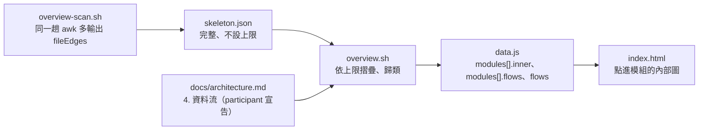

# 設計提案：資料流用兩種方式呈現——架構文件人寫「4. 資料流」、地圖點模組展開看程式結構

> **2026-11-06 修訂**：第 1 節的節號決定已被使用者在範本審閱推翻——自動段維持第 4 節、資料流為第 5 節，標示不用「人寫」改「architect 撰寫」。
> 以 ADR-2026-11-06-001 的「修訂紀錄」與 `architect-2026-11-06-1400.md` 為準；本提案其餘內容不變。

## TL;DR
- 做法 1（ADR-2026-11-06-001）：架構文件新增人寫的 **`## 4. 資料流`**，自動段從第 4 節改成 **第 5 節**；每個服務或主要功能一張 `sequenceDiagram`，參與者 id＝模組 id 或分組 id；plan 多「資料流變更」小節；`/verify` 只印提醒、不改圖
- 做法 3（ADR-2026-11-06-002）：`overview-scan.sh` 保留檔案層級的 import（同一趟 awk、不加行程），`overview.sh` 依上限（每模組 60 節點／200 邊／15 個框外目標）寫進 data.js 的 `modules[].inner`；框外依賴分「其他模組／資料庫／外部套件」；畫面點進模組看內部圖；`index.html` 上限 50KB → 64KB
- 地圖計畫多兩個階段：**5 展開資料**、**6 展開畫面＋審閱**；原階段 5（收尾）改號為 **7**。6 可以和 4、5 平行
- 文件計畫：階段 1 回到 🔄 補範本與 plan-format（審閱發現的缺口，照階段 2 的「要改」路徑）；階段 3 改 `architect.md`、`docs-init.md`；階段 4 改 `/verify`

## 範圍
- **讀過**：ADR-2026-11-05-001、002、005、006、007、003 的上限段；兩份計畫全文；05 範本（現行，階段 1 改寫後）；`plan-format` SKILL 的計畫檔格式節；`check-counts.sh` 第 340–410 行；`overview.sh` 的 `MAX_BYTES`、`shrink_data`、5.1 容器圖挑選（第 616–622 行）；`overview-scan-bench-2026-11-05.md`；提案 `architect-2026-11-05-1500.md` 第 3、6、7 節
- **觸發原因**：範本審閱時使用者指出沒有地方畫「一個功能的資料怎麼跨服務流動」；審閱頁預覽三種做法，使用者選做法 1＋3
- **不變**：文件 6 份；不新增 hook；腳本只改 `overview-scan.sh`、`overview.sh`；jq ≥ 1.7.1；ADR-001～008 除下列「部分修訂」外不動
- 本次只寫 ADR、本報告、handoff；另在 ADR-001、ADR-007 的「相關」各加一行指向新 ADR。沒有動範本、plan、程式碼

## 1. 節號決定：資料流＝第 4 節，自動段＝第 5 節

| 選項 | 人寫節是否集中 | 要改的引用 | 結論 |
|---|---|---|---|
| A. 4 資料流、5 自動段 | 是（1–4 人寫、5 自動） | 只有文字（見下表），沒有程式依賴節號 | **採用** |
| B. 4 自動段不動、5 資料流 | 否（人寫被自動段切開） | 0 | 否決：之後再加人寫節只能往自動段後面疊 |
| C. 2 資料流（緊接系統情境） | 是 | A 的全部＋技術選型、部署也改號 | 否決：多改一倍，收益只是閱讀順序 |

選項 A 要改的引用（grep `第 ?4 ?節`、`三節` 的結果，`plans/` 用逐檔 grep 補）：

| 位置 | 現在 | 改成 | 誰改 |
|---|---|---|---|
| 05 範本第 3 行 | 前三節由人寫…第 4 節由專案地圖產生 | 前四節…第 5 節 | 文件計畫階段 1 |
| 05 範本第 43 行 | `## 4. 模組與依賴` | `## 4. 資料流`＋`## 5. 模組與依賴` | 文件計畫階段 1 |
| 05 範本第 55 行 | 第 4 節（程式碼掃描產生） | 第 5 節 | 文件計畫階段 1 |
| 文件計畫第 164 行（階段 1 已完成項） | 人寫三節＋第 4 節自動段 | 在階段 1 補一項（不改寫已完成項，加「發現與決策」一筆） | planner |
| 文件計畫第 206 行（階段 3） | `architect.md`：寫架構文件人寫三節 | 人寫四節（含資料流） | planner |
| 文件計畫第 290 行（改善了什麼） | 人寫三節 | 人寫四節 | planner |
| ADR-007 決策表 | `4 模組與依賴` | 不改寫；「相關」已加一行指向 ADR-2026-11-06-001 | 本次已做 |
| `architect-2026-11-05-1730.md` | 人寫三節 | 歷史提案，不改 | — |

機器讀的是 `<!-- overview:generated:start/end -->` 標記（`--sync-arch`、地圖計畫 A7 的 `check-counts.sh` 檢查），不是節號。
地圖新增的資料流解析用 `^## [0-9]+\. 資料流`，也不綁節號。

## 2. 做法 1 的規則摘要（全文在 ADR-2026-11-06-001）

- 小標題 `### <主要模組 id> <功能> — <流程名>（<情境編號>、…）`；背景流程括號寫觸發來源
- 參與者全部用 `participant`／`actor` 宣告；系統內服務的 id＝模組 id，服務被切成多個模組時＝分組 id
- 只畫跨服務、跨系統：服務、佇列、外部系統、`alt`／`opt`、非同步訊息；不畫服務內函式、私有資料庫（共用或順序是重點時才畫）
- 一張 ≤ 8 參與者、≤ 15 訊息；不計入人寫部分 200 行預算；沒有跨服務流程時節保留、寫一行「無」
- plan「資料流變更」：`為什麼做` 底下、`PRD 情境變更` 之後；`ADDED／MODIFIED／REMOVED <流程識別> — <一句>`；完整新圖放 architect 的提案或 ADR
- `/verify` 文件同步關卡變四項：PRD 套回 → `--sync-arch` → **資料流提醒** → `.doc-impact`。資料流提醒不問、不擋、不改檔；分岔點以來架構文件的資料流節有改動就印「已更新」
- 架構文件在任務完成後才改（同 ADR-005 的理由），提醒就是在這個時間點

## 3. 做法 3 的設計摘要（全文在 ADR-2026-11-06-002）

### 3.1 資料流向

### 3.2 大小估算

| 項目 | 每模組上限 | 每項約 | 每模組約 |
|---|---|---|---|
| `nodes`（相對路徑字串） | 60 | 35 B | 2.1 KB |
| `edges`（`[i,j,w]`） | 200 | 10 B | 2.0 KB |
| `out`（`[i,"pkg:x",w,"import"]`） | 15 | 40 B | 0.6 KB |
| 合計 | | | ≈ 4.7 KB |

40 個模組（`OVERVIEW_MAX_MODULES`）× 4.7KB ≈ 190KB；data.js 上限 512KB（`overview.sh` 第 44 行）。
`shrink_data` 新增兩級：最先丟「非本次相關模組」的 `inner`，既有四級後最後丟全部 `inner`。

### 3.3 畫面大小

階段 3 預估 40–45KB（地圖計畫 X9）；展開要加：分層排版 ~3KB、進出切換與麵包屑 ~1.5KB、框外三欄與虛線 ~1.5KB、右側欄資料流清單 ~0.5KB、CSS ~1KB → 7–9KB。
所以上限改 64KB（ADR-003 原訂 80KB 以內）。

## 4. 地圖計畫：新階段的位置與平行

**改號**：原階段 5（收尾）→ 階段 7。新增 5、6。合計預估 40.5h → 48.5h。

| 階段 | 名稱 | 依賴 | 檔案（部件表用具體路徑） | 預估 |
|---|---|---|---|---|
| 5 | 模組展開：資料 | 階段 2, 4；跨計畫：文件 1（補資料流節後）已合併 | `.claude/scripts/overview-scan.sh`, `.claude/scripts/overview.sh`, `.claude/hooks/tests/run-tests.sh`, `.claude/hooks/tests/fixtures/overview/make-fixture.sh` | 3.5h |
| 6 | 模組展開：畫面＋審閱 | 階段 3 | `.claude/templates/overview/index.html`, `.claude/hooks/tests/fixtures/overview/qa-check.js`, `.claude/scripts/check-counts.sh`, `.claude/qa-history/*-overview-expand-review.md` | 4h（含審閱 artifact 0.5h） |
| 7 | 文件同步與 CI 常數檢查（原 5） | 階段 2, 3, 4, 5, 6；跨計畫：文件 1 | 原階段 5 的檔案 | 3h＋0.5h |

為什麼拆成兩個階段而不是一個：資料（`overview.sh`）和畫面（`index.html`）的檔案不重疊，畫面靠本 ADR 定死的欄位名與 `.claude/tmp/` 手補的 data.js 就能開工（同階段 3 的做法）。
拆開後階段 6 可以在階段 3 合併後立刻開工、和階段 4、5 同時跑；合成一個階段就得等階段 4 做完才能開始畫面。

| 組合 | 可否 | 理由 |
|---|---|---|
| 4 → 5 | 循序 | 同改 `overview.sh`、`run-tests.sh`、`make-fixture.sh` |
| 2 → 5 | 循序 | 5 要用 2 的 http 邊（X6）與 `overview-scan.sh` 的改動 |
| 3 → 6 | 循序 | 同改 `index.html`、`qa-check.js`、`check-counts.sh`；6 也要 3 的雙主題與 token |
| **6 ∥ 4、6 ∥ 5、6 ∥ 2** | **可平行** | 檔案無交集；6 只讀本 ADR 的欄位合約 |
| 7 | 最後 | 依賴全部 |

跨計畫：階段 6 改 `check-counts.sh`，但文件 1、3 在地圖 3 之前就已合併，文件 5 等的是地圖收尾（原「地圖 5」→「地圖 7」），所以**沒有新的跨計畫限制，只有改號**。

## 5. 文件計畫：要補的地方

| 階段 | 補什麼 | 預估 |
|---|---|---|
| 1（回到 🔄） | 05 範本：`## 4. 資料流`（規則＋範例電商一張帶 `alt` 的圖）、自動段改 `## 5.`、第 3／55 行、「本檔不寫」加一列；`plan-format`：「資料流變更」範例與規則；`check-counts.sh`：05 範本資料流節與 plan-format 小節兩項檢查 | +1h |
| 2 | mock 加：架構文件一張資料流圖、plan 的「資料流變更」；重新產 artifact | +0.25h |
| 3 | `architect.md`：人寫四節、提案裡放新流程的完整圖、交棒列資料流變更、架構文件在任務完成後改；`docs-init.md`：mvp／full 依 PRD 領域畫跨服務流程、demo 只放節標題；`planner.md`：寫「資料流變更」 | +0.5h |
| 4 | `verify.md` 文件同步關卡變四項，資料流提醒排第 3；驗收「三個字串依序出現」改成四個 | +0.25h |

`check-counts.sh` 該不該檢查新節：**要**。地圖會解析資料流節（節名、`participant` 宣告），`/verify` 會找 `### 資料流變更` 這個標題；範本或範例被改名時兩邊都會靜默失效。
節名常數與 05 範本的比對放地圖計畫階段 7（常數在 `overview.sh`，比照 A7）。

## 6. 風險

| 風險 | 緩解 |
|---|---|
| 資料流圖沒人更新 | `/verify` 提醒；地圖對不到任何模組的流程出 notice；重新考慮的觸發寫在 ADR |
| 參與者 id 隨目錄改名失效 | 同上的 notice；module-notes 改名不影響 id |
| 外部套件誤歸類（標準庫沒列到） | 依次數排序＋框外上限壓在後面；`overview.scan.dbPackages` 可補資料庫 |
| 階段 6 做完時 `index.html` 仍超過 64KB | 階段 6 驗收含 `check-counts.sh`；超過時回報，不自行再調上限 |
| 階段 1 重開讓階段 2 的審閱重做 | 本來就是階段 2「要改」的路徑；只多 0.25h |

## 7. 待確認
- 無。節號、拆兩個階段、上限 64KB 都在使用者給的範圍內由本提案決定；若使用者想把地圖新增的兩個階段合成一個，代價是畫面不能和階段 4、5 平行（約多 4h 牆鐘時間）
