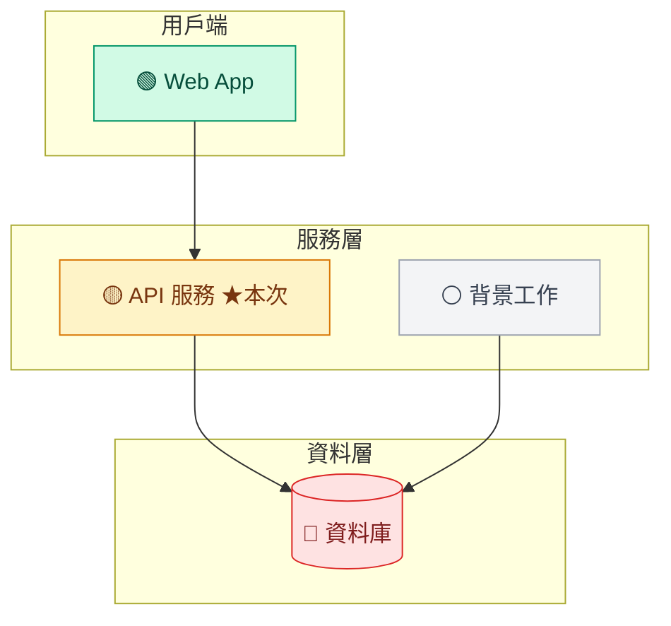
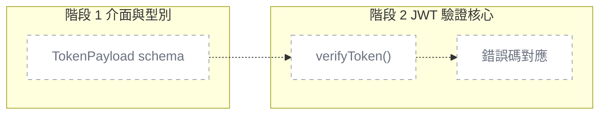
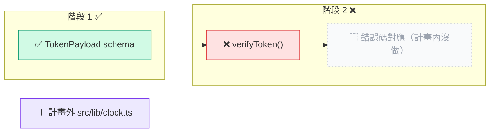

# 設計提案：專案圖解（專案地圖＋任務圖）

- 日期：2026-11-04
- 作者：skill-curator
- 狀態：**提案，未動工**。本次沒改任何現有檔案、沒開分支
- 需求來源：`.claude/qa-history/2026-11-04-000000-visual-overview-scope.md`（Q1–Q5）＋主模型轉述的八項定案

---

## 0. 結論（先看這段）

1. **可以做到 0 token 自動更新，而且幾乎不用新增機制。** 主體是一支產生器腳本
   `.claude/scripts/overview.sh`（bash＋awk＋jq＋git，全是模板既有依賴）和一個固定的
   `.claude/templates/overview/index.html`。觸發點只要在既有的 `post-write.sh` 加一段
   （偵測到寫 `wbs.md`／`plans/*.md`／架構文件 → 在背景跑腳本，不輸出任何東西）。
   **不新增 hook 檔、不改 `settings.json`、不新增 skill／command／agent／rule。**
2. **五個觸發時機裡有四個不必各自接線**：`/task-init`、`/plan`、`/tdd` 每階段都會寫
   `wbs.md`／plan／架構文件，post-write 兜底就涵蓋了。只有兩處要在 command 裡明寫一行：
   `/verify`（要把「計畫 vs 實際」與失敗原因寫回 plan）、`/task-status`（重產並印路徑）。
3. **有四個設計點跟需求字面不同，是我查現況後認為必須調整的**（理由在第 3 節，最後都列進「待確認」）：
   - **index.html 的原檔放 `.claude/templates/overview/`，腳本負責複製到 `taskmaster-data/overview/`**。
     `taskmaster-data/` 被 `copy-template` 整個排除、被 `update-template` 保留不碰，
     原檔放那裡的話新專案拿不到、舊專案永遠升級不了畫面
   - **進 git 的 md 圖叫 `.claude/taskmaster-data/overview.md`（放 `wbs.md` 旁邊），不放 `docs/`**。
     `/verify` 的 `.last-verify` 用 `SCOPE` 判斷工作區乾不乾淨，只排除 `taskmaster-data/` 等四個目錄；
     放 `docs/` 的話 hook 每重產一次就讓 `clean=no`，`/pr` 永遠沿用不了驗證結果
   - **hook 絕不寫模型會 Edit 的檔案**（plan、wbs、架構文件）。否則模型下一次 Edit 會因
     「檔案在讀取後被改過」而失敗、得重讀。plan 裡的「計畫 vs 實際」只由 `/verify` 明確呼叫腳本寫入
   - **主 checkout 的位置由腳本用 `git rev-parse --git-common-dir` 自己算，不信 `CLAUDE_PROJECT_DIR`**。
     `claude -w` 開的 session 裡 `CLAUDE_PROJECT_DIR` 很可能就是 worktree 本身（待第一階段實測），
     用它會把 overview 寫進 worktree
4. **第一階段只做可行性實測**：`file://` 下動態插入 `<script src="data.js?t=…">` 能不能重載、
   hook 背景啟動腳本在 Windows Git Bash 會不會被 Claude Code 等住。都有退路（4.1 節）。
5. **token 成本**：hook／腳本 0。新增的模型成本集中在 planner 寫「一眼看懂」（每份 plan 約 0.5–1k 輸出 token）、
   `/verify` 寫一句失敗原因（約 0.1–0.2k）、舊專案反推架構文件（一次性約 10–40k）。細算見第 9 節。
6. **最大的風險**：模型主動去 `Read` data.js（大專案可達數百 KB ≈ 數萬 token）；
   `overview.md` 進 git 後主 checkout 會被 hook 弄髒，觸發 `git-workflow.md`「不認得的變更要停下來問」。
   對策見第 8 節。

---

## 1. 每個機制放哪一層、為什麼

照 `writing-extensions` 的五層決策表依序問，第一個「是」決定層級。

| 機制 | 層級 | 依序問到哪一題成立 |
|---|---|---|
| 從 05／wbs／plan／帳本／git diff 算出燈號，產 `overview.md` 與 `data.js` | **Script**（`.claude/scripts/overview.sh`） | 不是「要不要擋」也不是「要塞資訊給模型」——是確定性的資料轉換。寫成腳本才能被 hook 與 command 共用，且 0 token。不能寫成 skill：讓模型自己算燈號＝每次幾千 token 而且會算錯 |
| 寫入 wbs／plan／架構文件後重產 | **Hook**（`post-write.sh` 加一段） | 第一題：時機機器判斷得出（`tool_input.file_path` 命中就是時機）。這正是模板踩過四次的那類事——**有機器判斷得出的時機，就不要寫成「記得重產」** |
| 這段 hook 不輸出 `additionalContext` | Hook 的**刻意不用**的能力 | 第二題「需要當下塞資訊進對話嗎？」→ 否。圖是給人看的，不是給模型看的；注入只會吃 token 又稀釋注意力 |
| `/verify` 寫回「計畫 vs 實際」與失敗原因 | **Command**（`verify.md` 加一步呼叫腳本） | 失敗**原因**機器判斷不出來，需要模型寫一句話；而這一步的時機（驗證結束）已經在 `/verify` 的流程裡，加一行比另造機制便宜 |
| `/task-status` 重產並印路徑 | **Command**（`task-status.md` 加一步） | 使用者主動叫的。也是 hook 漏接（用 Bash `mv`／`sed` 改檔不觸發 PostToolUse）時的手動兜底 |
| plan 的「一眼看懂」格式（mermaid＋部件表） | **Skill**（`plan-format` 加一節，唯一來源） | 只在寫 plan 時需要，不是每個任務都適用 → 不能是 rule。planner 已經「必讀」`plan-format`，不必新開 skill，**召喚路徑零新增** |
| 05 模組表多 `id`、`路徑` 兩欄 | **Skill 附帶的範本**（`project-docs/templates/05_…`） | 範本的唯一來源本來就在這裡。mvp 的 `tech-spec.md` 改成**指向**它，不抄第二份（見 6.2） |
| WBS 多「模組」欄 | **範本檔**（`.claude/templates/wbs.template.md`） | 它已是 WBS 版面的唯一來源，五個指令都引用它 |
| architect 負責 05 模組表；documentation-specialist 維護與反推 | **Agent 定義** | 需要獨立 context 去讀整個架構或掃程式碼；而且「誰負責這張表」是 agent 的職責邊界 |
| 「帳本記一句話摘要」 | **Skill**（`subagent-execution` 帳本格式） | 帳本格式的唯一來源 |
| 各來源表頭一致（05 的 `id/路徑`、WBS 的 `模組`、腳本認得的欄名） | **Script**（`check-counts.sh` 加檢查） | 三處欄名一漂開，腳本就靜默抽不到東西——跟孤兒 skill 同類的「安靜失效」，只有 CI 擋得住 |
| Floorplan | 只在 README 寫一段「選配」 | 使用者定案不整合 |

**刻意不做的層**：

- ❌ **不新增 rule**：第一道判準「任何任務都適用嗎？」→ 否（quick 任務沒有 plan、demo 沒有架構）
- ❌ **不新增 command**（不做 `/overview`）：使用者記憶「整合進既有流程而非新增指令」；`/task-status` 已經是「看狀態」的入口
- ❌ **不改 `using-taskmaster`**：常駐注入，每 session 都付錢；這功能對模型沒有路由價值
- ❌ **不新增 hook 檔**：觸發條件與 post-write 完全相同（PostToolUse Write|Edit），多一支檔＝每次寫檔多開一個 bash（Windows 上約 170ms 起跳）

---

## 2. 整體資料流

```
人寫的 md（真正的資料來源）                      衍生物（腳本產生）
──────────────────────────                      ─────────────────────────────────────
docs/*architecture*.md 或 docs/tech-spec.md  ─┐
  5.1 容器圖（骨架）＋5.5 模組表（id／路徑）  │
taskmaster-data/wbs.md（模組欄、狀態）         ├─► overview.sh ─┬─► taskmaster-data/overview.md        （進 git，GitHub／VS Code 看）
taskmaster-data/wbs-archive.md（只算數量）     │                ├─► taskmaster-data/overview/data.js     （不進 git）
taskmaster-data/plans/*.md（一眼看懂、階段）   │                └─► taskmaster-data/overview/index.html  （不進 git，從 templates 複製）
taskmaster-data/plans/*.progress.md（摘要）    │
git diff／git worktree list                   ─┘
```

**對「md 是正本」的解讀**（列入待確認）：真正的資料來源是人寫的 05、wbs、plan；
`overview.md` 與 `data.js` **都是衍生物**。差別是 `overview.md` 只反映**主 checkout 已追蹤的狀態**（確定性輸出、進 git），
`data.js` 另外疊上**各 worktree 的即時進度**（不進 git、會含時間戳）。

---

## 3. 四個跟需求字面不同的設計點（理由）

### 3.1 index.html 原檔放 `.claude/templates/overview/index.html`

查證：`scripts/copy-template.sh` 的 `EXCLUDES` 含 `.claude/taskmaster-data/`；`copy-template.ps1` 的 `$excludeDirs` 含 `taskmaster-data`；
`update-template.sh` 的 `PRESERVE_NOTE` 列 `taskmaster-data/`，`SYNC_CLAUDE_DIRS` 有 `templates` 與 `scripts`。

所以：原檔放 `taskmaster-data/overview/` → 新專案沒有、舊專案永遠拿不到新版畫面。
放 `.claude/templates/overview/` → 兩支腳本都會帶過去，**不用改 copy/update 腳本**。
`overview.sh` 每次執行時 `cmp` 原檔與 `taskmaster-data/overview/index.html`，不同就覆蓋——
update-template 之後畫面自動升級。

### 3.2 進 git 的 md 放 `.claude/taskmaster-data/overview.md`

查證：`commands/verify.md`「記下這次驗證」的 `SCOPE` 只排除 `taskmaster-data`、`context`、`coordination`、`qa-history`。
衍生檔放在這四個以外（例如 `docs/`）→ hook 重產就讓工作區不乾淨 → `clean=no` → `/pr` 不沿用、「標記與歸檔」第 0 步過不了。

放 `wbs.md` 旁邊還有兩個好處：md 內的連結可以直接寫 `wbs.md`、`plans/…`，與 WBS 範本「路徑相對於 `wbs.md` 所在目錄」的慣例一致。

**附帶要求：`overview.md` 必須是確定性輸出**——不含時間戳、排序固定。輸入沒變就 byte 相同，
否則每次觸發都會弄髒工作區（時間戳只放 data.js）。

### 3.3 hook 不寫模型會 Edit 的檔

Claude Code 的 Edit 在檔案「讀取後被改過」時會失敗。如果 hook 在背景改 plan，`/tdd` 下一步更新 plan 階段狀態就會撞到。
所以：

| 檔案 | 誰寫 |
|---|---|
| `overview.md`、`overview/*` | 只有 `overview.sh`（hook 或 command 觸發） |
| plan 的「一眼看懂」 | planner（寫 plan 時一次寫好，全虛線） |
| plan 的「計畫 vs 實際」 | `/verify` **明確**呼叫 `overview.sh --actual`（模型隨後要 Edit 時先重讀，流程上本來就在它之後） |
| plan 的階段狀態 | 主模型（照舊，`plan-format`「誰可以寫入計畫檔」） |

### 3.4 主 checkout 自己算

`resolve-roots.sh` 以 `CLAUDE_PROJECT_DIR` 為主 checkout——對「主 session 派出的 worktree subagent」成立（官方：hook 路徑不跟著 worktree）。
但 `claude -w` 是**在 worktree 裡啟動的 session**，此時 `CLAUDE_PROJECT_DIR` 很可能就是 worktree（**未實測**）。
`overview.sh` 改用：

```bash
MAIN_ROOT=$(cd "$(git -C "$WORK_ROOT" rev-parse --path-format=absolute --git-common-dir)/.." && pwd)
```

`.git` common dir 的上一層永遠是主 checkout，兩種情境都對。第一階段順便實測 `claude -w` 裡的 `CLAUDE_PROJECT_DIR`——
若真是 worktree，這是 `resolve-roots.sh` 本身的既有缺陷，**另開 handoff**，不在本功能內修。

---

## 4. 分階段實作

每階段可獨立驗收、可獨立 merge。驗收句都寫成能直接變成 `run-tests.sh` 案例或手動檢查清單的形式
（**[T]** = 進 `run-tests.sh`；**[M]** = 手動實測，結果寫進該階段報告；**[C]** = `check-counts.sh` 擋）。

### 階段 1：可行性實測（spike，只產實測報告與最小原型）

做什麼：手寫一個約 5KB 的 `index.html` 原型＋手寫 `data.js`；一支假的 `overview.sh`（`sleep 5` 後寫 data.js）；
在 scratchpad 的沙箱專案裡把 post-write 的觸發段接上。

驗收：

1. [M] Chrome、Edge、Firefox 以 `file://` 開 `index.html`：初次載入以 `<script src="data.js">` 讀到 `window.OVERVIEW`，畫面顯示 `generatedAt`
2. [M] 頁面開著時改寫 `data.js`，**8 秒內**（輪詢 3 秒＋寫入）畫面上的 `generatedAt` 變新值，**頁面沒有整頁重載**（展開中的模組、捲動位置不變）
3. [M] 分別測「帶 `?t=<時間戳>`」與「不帶查詢字串」兩種重載寫法，記下各瀏覽器哪種會拿到新內容（查證時沒有找到 `file://` 加查詢字串的權威說法，只確認 classic script 不受 CORS 限制、module script 會被擋——所以**不能用 `type="module"`**）
4. [M] VS Code 內開啟（Live Preview 擴充或 Simple Browser）能不能讀 `file://`，記錄結果
5. [M] 寫 `data.js` 的過程中（寫一半）畫面不壞：腳本先寫 `data.js.tmp-$$` 再 `mv`，頁面讀到語法錯誤時保留上一份並顯示「更新中」
6. [M] Windows Git Bash：post-write 觸發段用 `( nohup bash overview.sh … </dev/null >/dev/null 2>&1 & )` 啟動，hook 本身 **1 秒內返回**（假腳本 `sleep 5`），Claude Code 不等它
7. [M] 在 `claude -w x` 開的 session 裡印出 `CLAUDE_PROJECT_DIR` 與 hook payload 的 `cwd`，記錄是否指向 worktree
8. [M] subagent（例如 architect）用 Write 寫檔時，post-write 有被觸發（`hooks.log` 有紀錄）

**退路（任一項不通時）**：

| 不通的是 | 退路 | 代價 |
|---|---|---|
| 動態插 script 讀不到新內容（第 2、3 項） | 改成 data 內嵌：腳本把資料直接寫進 `overview/index.html`，頁面用 `<meta http-equiv="refresh" content="10">` 整頁重載；展開狀態存 `location.hash` 還原 | 每次重產要寫整個 html（50KB＋資料）；整頁閃一下 |
| 連內嵌＋refresh 都不行（極不可能） | 不自動更新，`/task-status` 印路徑、使用者手動重新整理 | 失去「自動」 |
| 背景啟動會被等住（第 6 項） | 改成同步跑，但加「節流」：距上次產生 <10 秒就只寫 `overview/.dirty` 不產；`/task-status`、`/verify` 一定產 | 寫 plan 的那次工具呼叫多 2–5 秒 |
| `CLAUDE_PROJECT_DIR` 指向 worktree（第 7 項） | 就是 3.4 的寫法，本來就不依賴它 | 無；另開 handoff 修 `resolve-roots.sh` |

### 階段 2：架構文件格式與 WBS 模組欄（純文件，先把資料來源整理好）

照使用者「先把架構文件整理出來，再處理專案地圖」的順序。這一階段**不產任何圖**。

改動：05 範本、`docs-init.md`、`wbs.template.md`、`task-init.md`、`task-add.md`、`architect.md`、`documentation-specialist.md`、`check-counts.sh`（細節見第 6 節）。

驗收：

1. [C] 05 範本 5.5 節的表頭含 `id` 與 `路徑` 兩欄
2. [C] 05 範本 5.1 的 mermaid 範例中，每個節點 id 都出現在 5.5 表的 `id` 欄（範例本身自洽，示範「節點 id＝模組 id」）
3. [C] `wbs.template.md` 第 1 節任務表頭含 `模組`；第 2 節欄位規則表有 `模組` 列
4. [C] `docs-init.md` 路徑 B 的「2. 架構總覽」含指向 `05_architecture_and_design_document.md` 5.5 的字樣，且**不**內嵌 `| id |` 表頭（防第二份副本）
5. [C] `overview.sh` 裡宣告的欄名常數（`OVERVIEW_COLS_MODULE="id 路徑"`、`OVERVIEW_COL_WBS="模組"`）與上面三處一致
6. [C] 現有 `check-counts.sh` 全綠
7. [M] 用新範本跑一次 `/task-init`（mvp）到 WBS 寫完：`tech-spec.md` 有容器圖與模組表、WBS 每列有模組欄（值為模組 id 或 `—`）

### 階段 3：專案地圖端到端

改動：`overview.sh`（地圖部分）、`templates/overview/index.html`（地圖視圖）、`post-write.sh` 觸發段、`task-status.md`、hooks README、worktree 邊界表。

驗收（全部 [T]，在 `run-tests.sh` 的 mktemp 沙箱、`git init` 過的假專案裡跑；用 `OVERVIEW_SYNC=1` 讓 hook 前景執行以便斷言）：

1. 沙箱沒有 `taskmaster-data/project.json` → `overview.sh` exit 0，且**不建立** `overview/` 也不建立 `overview.md`（模板 repo 本身不被污染）
2. `project.json` 的 `mode` 是 `demo` → data.js 的 `modules` 為 `[]`，`notices` 有一筆 `action` 為 `/docs-init --mvp`
3. 架構文件 5.5 有 `web`、`api`、`db` 三列，WBS 無任務 → 三個模組 `status` 都是 `todo`；`overview.md` 含 `class web todo`
4. WBS 任務 1.1（模組 `api`）✅、1.2（模組 `api`）🔄 → `api.status` 為 `wip`
5. 任務 1.3（模組 `db`）🚫 → `db.status` 為 `issue`，`statusReason` 含 `1.3`
6. 某模組所有任務 ✅ 或 ⏭️（至少一個 ✅）→ `done`
7. WBS 舊格式（沒有模組欄）→ 不報錯；所有任務歸入 `unmappedTasks`，`notices` 有「WBS 沒有模組欄」
8. 同一組輸入連跑兩次 → `overview.md` 兩次 `cmp` 相同
9. data.js 去掉開頭 `window.OVERVIEW = ` 與結尾 `;` 後能被 `jq .` 解析，且 `.schema == 1`
10. `overview/.gitignore` 內容恰為 `*`；沙箱 `git status --porcelain` 不出現 `overview/` 底下任何檔
11. `overview/index.html` 與 `.claude/templates/overview/index.html` `cmp` 相同；改動原檔後再跑一次 → 被覆蓋成新版
12. post-write 收到寫 `…/taskmaster-data/plans/1.2-x.md` 的 payload → **stdout 為空**、data.js 被產生
13. post-write 收到寫 `…/src/app.ts` 的 payload → data.js 不存在（或 mtime 不變）
14. 同一 payload 加 `OVERVIEW=off` → data.js 不存在
15. 同一 payload 在 `.suggest-mode=off` 時**仍會**產生（不是建議密度的問題）
16. payload 的 `cwd` 指向沙箱內的 linked worktree → data.js 寫在**主 checkout** 的 `overview/`，worktree 底下沒有 `overview/`
17. 兩個 `overview.sh` 同時啟動 → 結束後 data.js 合法（同第 9 條）、鎖目錄 `overview/.lock` 不存在
18. 鎖目錄存在且超過 60 秒（模擬當掉的前一次）→ 視為過期並接手產生
19. 架構文件帶 `<!-- overview: draft -->` 標記 → 不產生地圖，`notices` 為「架構草稿待確認」
20. 5.1 mermaid 有 5.5 沒有的節點 → 照畫、灰色、`notices` 列出；5.5 有 5.1 沒有的模組 → 放進「未分組」
21. hook 背景模式（不設 `OVERVIEW_SYNC`）下 post-write 本身的執行時間 < 2 秒（以 `SECONDS` 量；Windows 上留餘裕）

手動 [M]：`/task-status` 印出 `file:///…/overview/index.html` 一行；瀏覽器打開後改 WBS 某任務狀態，10 秒內燈號變色。

### 階段 4：任務圖端到端

改動：`plan-format` 的新節、`planner.md`、`subagent-execution` 帳本格式與 `implementer-prompt.md`、`verify.md`、`overview.sh`（任務圖部分＋`--actual`）、index.html 任務視圖。

驗收（[T]，沙箱內用真的 git commit 造 diff）：

1. plan 有「一眼看懂」部件表 p1（階段 1，`src/a.ts`）、p2（階段 2，`src/b.ts`），兩階段都 ⏳ → 兩個部件 `state` 都是 `planned`，`overview.md` 的任務圖兩個部件都 `class … planned`
2. 階段 1 標 ✅、`src/a.ts` 在 diff 裡 → p1 `done`
3. 階段 1 標 ✅、但 p1 的檔案都不在 diff 裡 → p1 `skipped`（計畫內沒做）
4. diff 裡有 `src/c.ts`、不在任何部件也不在 `files:` → 出現 `extra` 部件，`planned:false`
5. `changes[]` 的 `added`／`removed` 等於 `git diff --numstat <base>..HEAD` 的值
6. diff 基準：帳本有 `BASE=abc123` → 用它；沒有帳本 → 用 `git merge-base HEAD <預設分支>`；都沒有 → `changes` 為 `[]`、`notices` 說明「找不到比較基準」
7. 帳本「階段完成」行帶 `摘要=新增 token 解析｜測試=12/12` → 該階段部件的 `ai.summary` 與 `ai.tests` 等於這兩個值；帳本有 `部件 p1 完成｜摘要=…` 時以部件行為準
8. `overview.sh --actual <plan> --result FAIL --reason "2 個測試失敗：token 過期"` → plan 檔出現 `<!-- overview:actual:start -->` 區塊，內含 `❌ FAIL` 與原因；再跑一次 `--result PASS` → 區塊被**取代**（不重複）、內含 `✅ PASS`
9. `--actual` 只動標記區塊內的文字：區塊外內容 `diff` 前後相同
10. plan 驗證 FAIL → 該 plan 碰到的模組 `status` 為 `issue`，`statusReason` 含原因
11. 「本次」：主 checkout 的 `.current-task` 為 `1.2` → 任務 1.2 的模組 `current:true`；沒有 `.current-task` 時取 `status: "⏳ 未開始"` 且 mtime 最新的 plan
12. WBS 任務 1.2 模組欄是 `api`，但 plan 的 `files:` 與 diff 只落在 `web` 的路徑 → `api` 與 `web` 都帶 `mismatch`（`declared-not-touched` / `touched-not-declared`）
13. 有 linked worktree 且其 plan 進度比主 checkout 新 → data.js 取 worktree 那份（`source: "worktree:<名稱>"`），**`overview.md` 仍只反映主 checkout**
14. 已歸檔（`plans/archive/`）的 plan 不進 `plans[]`，只計入模組的完成數

手動 [M]：真的跑一輪 `/plan → /tdd（2 階段）→ /verify`，畫面依序：全虛線 → 階段 1 實線 → 全實線＋「這次 AI 改了什麼」表有數字。

### 階段 5：舊專案升級、大小上限、收尾

改動：`documentation-specialist.md` 反推流程、`task-status.md` 的升級提議、`overview.sh` 大小上限、README（Floorplan 選配）、`WORKFLOW.md`、測試數同步、壓力測試題。

驗收：

1. [T] 模擬 300 個任務、20 份 plan、每份 500 個變更檔 → data.js ≤ 512KB，`truncated:true`，每份 plan 的 `changes` 只留前 200 筆、其餘依目錄彙總成 `{dir, files, added, removed}`
2. [T] `wbs-archive.md` 舊節（無模組欄）→ 數量歸入「未標模組」，不報錯
3. [T] 沒有 jq → `overview.sh` exit 0，寫出只含 `{"schema":1,"notices":[{"text":"需要 jq"}]}` 的 data.js（用 printf，不靠 jq）
4. [M] 在一個真實舊專案（無架構文件、舊 WBS）跑 update-template 後 `/task-status`：印出路徑、畫面顯示「沒有架構文件」並說明委派 documentation-specialist 反推；反推產出的檔案帶 draft 標記、地圖不出現；使用者確認、移除標記後地圖出現
5. [M] 壓力測試：`.claude/tests/skill-compliance/` 加一題**不含關鍵字**的開場（例：「這個舊專案我想看一下整體長什麼樣、哪些做完了」），看主模型會不會走 `/task-status` 或委派 documentation-specialist。**必須在有應用程式碼的專案裡跑**（CLAUDE.md「已知落差」：模板 repo 跑正向題半殘）
6. [C] `check-counts.sh --tests <實跑數>` 全綠

---

## 5. data.js schema 草稿（`schema: 1`）

```js
window.OVERVIEW = {
  schema: 1,
  generatedAt: "2026-11-04T14:03:22+08:00",      // 只有 data.js 有時間戳；overview.md 沒有
  generator: { script: "overview.sh", version: 1 },
  truncated: false,                                // 觸發大小上限時為 true

  project: {
    name: "訂單系統",
    docsMode: "full",                              // full | mvp | demo | none（取自 project.json）
    architectureDoc: "docs/05_architecture.md",    // 找不到為 null
    architectureDraft: false                       // 帶 <!-- overview: draft --> 時為 true
  },

  notices: [                                       // 顯示在頁面頂端；overview.md 也印成引言區塊
    { level: "warn", text: "WBS 沒有模組欄，任務無法對到模組", action: "/task-status（會提議補欄）" }
  ],

  current: { task: "13.2", plan: "plans/13.2-rerank.md", source: "main" },  // 「本次」；沒有為 null

  groups: [ { id: "g2", label: "服務層" } ],       // 來自 5.1 的 subgraph；沒有分組的模組歸 "_ungrouped"

  modules: [
    {
      id: "api",                                   // = 5.1 節點 id = 5.5 的 id 欄 = WBS 模組欄的值
      name: "API 服務",
      group: "g2",
      paths: ["src/api/**", "src/routes/**"],
      responsibility: "對外 REST 介面",             // 5.5 的「職責」欄
      status: "wip",                               // done | wip | issue | todo
      statusReason: "1/3 完成；13.2 進行中",
      counts: { done: 1, total: 3, archivedDone: 4 },
      tasks: ["13.1", "13.2", "13.3"],
      current: true,
      mismatch: [
        { task: "13.2", kind: "touched-not-declared", files: ["src/web/form.tsx"] }
      ]
    }
  ],

  edges: [ { from: "web", to: "api", label: "" } ],

  tasks: [
    { id: "13.2", title: "地端 rerank 拒答門檻", status: "🔄", milestone: "M11",
      modules: ["api"], plan: "plans/13.2-rerank.md", worktree: null }
  ],
  unmappedTasks: ["9.1"],                          // 模組欄是 — 或沒有模組欄

  plans: [
    {
      file: "plans/13.2-rerank.md", task: "13.2", title: "地端 rerank 拒答門檻",
      mode: "standard", status: "🔄", currentPhase: 2,
      source: "main",                              // main | worktree:<名稱>
      base: "a1b2c3d",                             // diff 基準；找不到為 null
      phases: [ { n: 1, name: "介面與型別", state: "done" }, { n: 2, name: "核心", state: "wip" } ],
      parts: [
        {
          id: "p1", name: "TokenPayload schema", phase: 1,
          files: ["src/types/auth.ts"],
          acceptance: ["缺 sub 欄位 → 驗證錯誤"],
          state: "done",                           // planned | wip | done | skipped | failed | extra
          planned: true,
          ai: { summary: "新增 TokenPayload 的 Zod schema", added: 42, removed: 3, tests: "6/6" }
        }
      ],
      verify: { result: "FAIL", reason: "2 個測試失敗：token 過期", at: "2026-11-04T13:50" },  // 沒跑過為 null
      changes: [ { file: "src/types/auth.ts", added: 42, removed: 3, part: "p1", planned: true } ],
      changesRollup: []                            // 超過上限時依目錄彙總
    }
  ]
};
window.__overviewLoaded && window.__overviewLoaded();
```

**燈號規則不另寫一份**：模組燈號沿用 `wbs.template.md` 第 3 節「里程碑狀態」的判法（全 ✅／⏭️ → 完成；有 🔄 或部分完成 → 開發中；其餘有 🚫 → 有問題；否則未開始），
**另加一條**：任何掛在該模組的 plan 最近一次 `/verify` 是 FAIL → 有問題。腳本註解寫「規則唯一來源：wbs.template.md 第 3 節」。

---

## 6. 改動清單

### 6.1 新增檔案

| 檔案 | 內容 |
|---|---|
| `.claude/scripts/overview.sh` | 產生器。旗標：無參數＝重產；`--actual <plan> --result PASS\|FAIL [--reason "…"]`＝寫回 plan 的「計畫 vs 實際」並重產；`--print-path`＝只印 `file://` 路徑。環境變數：`OVERVIEW=off`、`OVERVIEW_SYNC=1`（測試用）、`OVERVIEW_MAX_BYTES`（預設 524288）。沒有 `project.json` 一律 exit 0 |
| `.claude/templates/overview/index.html` | 固定畫面，目標 ≤ 50KB，**不載 CDN、不用 mermaid.js**（約 3MB，且 `file://` 離線要能開）。地圖用 CSS grid（群組＝欄、模組＝卡片）＋簡單 SVG 連線；任務圖用「階段欄 × 部件卡」。輪詢間隔 3 秒，`generatedAt` 沒變就不重繪 |

腳本**依賴**：bash、awk、jq、git——全是 hooks 已要求的（`session-start.sh` 已做 jq 健檢）。
評估過 Python／Node：各自只在一半的專案保證存在（Node 專案不一定有 Python，反之亦然），
為了一支產生器讓模板多一個執行期依賴不划算。bash 的代價是速度（Windows 每開一個行程約 170ms，估 15–30 個行程 ≈ 3–5 秒），
用背景執行吸收掉。

### 6.2 修改既有檔案

| 檔案 | 改什麼 |
|---|---|
| `.claude/hooks/post-write.sh` | 在「`[ -z "$FILE_PATH" ] && exit 0`／jq 檢查」之後、**`.suggest-mode` 檢查之前**加觸發段：路徑相對化到 `WORK_ROOT` 後比對 `.claude/taskmaster-data/wbs.md`、`.claude/taskmaster-data/plans/*.md`（含 `.progress.md`）、`docs/*architecture*.md`、`docs/tech-spec.md` → 背景啟動 `overview.sh`，**不輸出任何東西**，然後**繼續往下**（WBS 格子長度提醒仍要照跑）。放在 suggest-mode 之前的理由：那是「建議密度」開關，圖不是建議 |
| `.claude/hooks/tests/run-tests.sh` | 新增兩節：`overview.sh — 專案地圖`、`overview.sh — 任務圖`，以及 `post-write.sh — 圖解觸發`（第 4 節列的 [T] 案例，估 45–55 個） |
| `.claude/hooks/tests/README.md`、`.claude/guides/WORKFLOW.md`、`README.md` | 測試案例數（`check-counts.sh --tests N` 會擋） |
| `.claude/hooks/README.md` | `post-write.sh` 那一列加「④圖解觸發」說明與逃生門 `OVERVIEW=off`；檔案結構樹那行的職責摘要加一詞。**hook 腳本數不變，`check-counts.sh` 不會提醒——這條要自己記得** |
| `.claude/settings.json` | **不改**（沿用既有 PostToolUse Write\|Edit 接線） |
| `.claude/skills/project-docs/templates/05_architecture_and_design_document.md` | 5.5 表改為 `\| id \| 模組 \| 路徑 \| 對應 BDD \| 職責 \| API 設計 \| 資料模型 \|`；加三行說明：id 用 `[a-z0-9-]+`、**必須等於 5.1 的節點 id**、路徑是 glob 可多個以 `,` 分隔。5.1 範例的節點 id 改成小寫 id 風格（`web`、`gateway`、`svc-a`…） |
| `.claude/commands/docs-init.md` | 路徑 B 的「2. 架構總覽」改為：容器圖（mermaid）＋模組表，**欄位照 05 範本 5.5（唯一來源，勿在此重述）**。路徑 A（demo）的備註加一句「demo 沒有架構，圖解只顯示任務圖」 |
| `.claude/templates/wbs.template.md` | 第 1 節任務表在「任務」後加 `模組` 欄；第 2 節欄位規則加一列（填 5.5 的 id，多個用 `,`；沒有架構或跨全域填 `—`）；第 5 節歸檔版面同步加欄，並重申「舊節原樣保留、依表頭找欄位」 |
| `.claude/commands/task-init.md` | 步驟 5：寫 WBS 時填模組欄（取自剛產出的架構文件 5.5）；完成訊息加一行 `bash .claude/scripts/overview.sh --print-path` 的輸出 |
| `.claude/commands/task-add.md` | 步驟 3 欄位決定表加「模組」列：比對架構文件 5.5 的職責與路徑提出建議，放進步驟 4 的預覽讓使用者確認 |
| `.claude/commands/task-status.md` | 流程最後加一步：跑 `overview.sh` 並印出路徑；**明寫「只印路徑，不要 Read `data.js`／`overview.md`」**。「舊格式轉換」節加一種偵測：有現況區但沒有模組欄 → 用 `AskUserQuestion` 提議補欄 |
| `.claude/commands/verify.md` | 在「記下這次驗證」之後、「任務完成銜接」之前加一步：有對應 plan 時跑 `overview.sh --actual <plan> --result <PASS\|FAIL> --reason "<一句>"`（FAIL 才要 reason）。worktree 內一樣跑（plan 在 worktree，沒有衝突問題——歸檔仍只在主 checkout） |
| `.claude/commands/plan.md` | 「持久化」第 1 點補一句：plan 含「一眼看懂」段，格式見 `plan-format` |
| `.claude/skills/plan-format/SKILL.md` | 新節「一眼看懂」（**唯一來源**）：位置在「目標」之後；mermaid（全部 `planned`、`-.->` 虛線）＋表 `\| 部件 id \| 部件 \| 階段 \| 檔案 \| 驗收 \|`；部件 id 規則 `p1`、`p2`…；驗收寫法指回「驗收欄怎麼寫」。另一節「計畫 vs 實際」：由 `/verify` 經 `overview.sh --actual` 寫在標記區塊內，**任何人不得手改**。`誰可以寫入計畫檔` 表加一列 |
| `.claude/agents/planner.md` | 「寫入計畫檔」那步加：寫「一眼看懂」段（指向 `plan-format`）。必讀路徑已有，不用新增 |
| `.claude/skills/subagent-execution/SKILL.md` | 「帳本要記什麼」：`階段完成` 行加 `｜摘要=<一句話，30 字內>｜測試=<通過/總數>`；可選的 `部件 pN 完成｜摘要=…` 行。主模型直接實作時同樣要記 |
| `.claude/skills/subagent-execution/implementer-prompt.md` | 回報格式加 `測試：<通過/總數>`（摘要已有，主模型濃縮成一句寫帳本） |
| `.claude/agents/architect.md` | 職責加「負責 05 的 5.1 容器圖與 5.5 模組表（id／路徑）」；寫架構文件前必讀 `.claude/skills/project-docs/SKILL.md`（已有）。**tools 目前沒有 `Edit`**——更新既有 05 只能整份覆寫，見待確認 #4 |
| `.claude/agents/documentation-specialist.md` | 兩件事：①程式碼搬家／新增目錄時同步 5.5 的路徑欄（`/verify` 文件同步關卡派它時順便做）②沒有架構文件時從程式碼反推草稿：寫到 `docs/05_architecture.md`（mvp 則補進 `tech-spec.md`）並在檔頭加 `<!-- overview: draft -->`，回 `NEEDS_CONTEXT` 列出要使用者確認的模組切分；**確認後由主模型移除標記**。加必讀 `.claude/skills/project-docs/SKILL.md` |
| `.claude/skills/worktree-orchestration/SKILL.md` | 狀態隔離邊界表右欄加一列：`taskmaster-data/overview/` — 圖解畫面與資料，各 worktree 都更新主 checkout 這一份。表下註記：`overview.md` 雖進 git，但**只由主 checkout 寫**，worktree 那份永遠不動 → 不會產生合併衝突 |
| `.claude/hooks/lib/resolve-roots.sh` | 只改檔頭註解的對照表（加 `overview/` 一行），程式不動 |
| `.claude/scripts/check-counts.sh` | 新增三項檢查：①05 範本 5.5 表頭含 `id`、`路徑` ②`wbs.template.md` 任務表頭含 `模組` ③`overview.sh` 的欄名常數與①②一致；④`templates/overview/index.html` 存在且 ≤ 80KB（「畫面固定約 50KB」的護欄） |
| `README.md`（根） | 功能介紹加一段「專案圖解」；「選配工具」加 Floorplan 一段（逐檔說明交給它，本模板不整合） |
| `CLAUDE.md`（模板開發須知，不會被複製） | 「改動時的連帶檢查」加一條：改 05 的 5.5 欄位或 WBS 模組欄 → 同步 `overview.sh` 的欄名常數（check-counts 會擋） |

### 6.3 依 CLAUDE.md「改動時的連帶檢查」逐條對照

| 連帶檢查項 | 本功能是否觸發 | 處理 |
|---|---|---|
| 加或改 `.claude/` → 先讀 `writing-extensions` | 是 | 已讀，第 1 節是逐條結果 |
| 改了注入內容 → 跑 skill-compliance | **否**（hook 不注入、不改 `using-taskmaster`／關鍵字路由／rules） | 但階段 5 仍加一題壓力測試，驗「看整體狀態」這句話會不會走到 `/task-status` |
| 新增 agent／skill／command／rule → check-counts | 都不新增 | 仍要跑；新增的三項檢查見上表 |
| 改 `.claude/` 目錄結構 → 同步 copy-template.sh 的 `EXCLUDES` 與 ps1 | 新增 `templates/overview/` 與 `scripts/overview.sh`，都在**要被複製**的範圍；`taskmaster-data/overview/` 已在排除範圍 | **兩支 copy、兩支 update 都不用改**（3.1 節的查證） |
| 新增 skill → INDEX.md | 否 | — |
| 新增 `.claude/ui/` 風格 | 否 | — |
| 改 hook → run-tests.sh | 是 | 第 4 節 [T] 案例 |
| 「那件事做完了沒」的閘門 | 否（不是閘門，且不靠 PostToolUse 判斷完成） | — |
| 新增 hook 事件接線 → settings.json＋hooks/README | **事件不新增** | 只改 hooks/README 的 post-write 列 |
| 改 agent 報告落點或 handoff 行為 → post-agent-report 的 `AREA` | architect 落點不變（`decisions`）；documentation-specialist 仍是終端節點、不寫 `context/` 報告（反推草稿本身就是產出） | **`AREA` 表不改**。若決定讓 doc-specialist 寫報告（待確認 #6），才要加 `documentation-specialist) AREA="docs"` 並同步 `agent-orchestration.md` 的 8＋1＋1＋4 名單 |
| 新增 `context/` area 子目錄 | 否 | — |
| 改 hook 讀寫的狀態檔 → 邊界表選 root | 是 | `overview/` 屬共享產物 → `MAIN_CLAUDE`（且自算，3.4 節）；鎖 `overview/.lock` 同在主 checkout（鎖必須跨 worktree 共用才有意義） |
| 改閘門的路徑排除規則 → 先相對化到 `WORK_ROOT` | 觸發段不是閘門，但同樣要相對化再比對（否則 `.claude/worktrees/x/.claude/taskmaster-data/plans/` 也會命中——這正好是我們要的；但 `docs/` 的比對必須錨定開頭） | 測試案例 3-16 涵蓋 |
| 改 `using-taskmaster` | 否 | — |
| `.gitignore`（根） | 不改：`overview/.gitignore` 內容 `*` 讓資料夾忽略自己。`check-counts` 的「短命旗標不得進版控」只看 `.` 開頭檔，`overview/.gitignore` 被自己忽略，不會被追蹤 | — |

---

## 7. md 產出範例

### 7.1 `overview.md` 的專案地圖

````markdown
<!-- 由 .claude/scripts/overview.sh 產生，勿手改。互動版：.claude/taskmaster-data/overview/index.html -->
# 專案圖解 — 訂單系統

> ⚠️ WBS 任務 9.1 沒有標模組

## 專案地圖



| 燈號 | 模組 | 路徑 | 任務 | 本次 | 不一致 |
|---|---|---|---|---|---|
| 🟢 完成 | Web App | `src/web/**` | 2/2 | — | — |
| 🟡 開發中 | API 服務 | `src/api/**` | 1/3：[13.2](plans/13.2-rerank.md) 🔄 | ★ 13.2 | 13.2 改到 `src/web/form.tsx`（WBS 沒標 web） |
| ⚪ 未開始 | 背景工作 | `src/worker/**` | 0/1 | — | — |
| 🔴 有問題 | 資料庫 | `migrations/**` | 0/1：13.4 🚫 R3 | — | — |
````

設計理由：

- **燈號同時放在 emoji 和 classDef**：VS Code 內建 markdown 預覽是否原生渲染 mermaid 不確定（可能要擴充），emoji 讓沒有渲染器、或色盲使用者也看得懂
- **「本次」只放在 label**（`★本次`），不疊第二個 class：mermaid 一個節點套兩個 `class` 的行為不可靠
- **連結放在表格，不用 mermaid `click`**：GitHub 渲染 mermaid 時會停用 click 互動
- 不放時間戳（3.2 節的確定性要求）

### 7.2 plan 的「一眼看懂」（planner 寫，全虛線）

````markdown
## 一眼看懂



| 部件 id | 部件 | 階段 | 檔案 | 驗收 |
|---|---|---|---|---|
| p1 | TokenPayload schema | 1 | `src/types/auth.ts` | 缺 `sub` 欄位 → 驗證錯誤 |
| p2 | verifyToken() | 2 | `src/lib/auth/middleware.ts` | 簽章正確且未過期 → 回傳 payload |
| p3 | 錯誤碼對應 | 2 | `src/lib/auth/errors.ts` | 過期 → 401 `TOKEN_EXPIRED` |
````

### 7.3 「計畫 vs 實際」（`/verify` 經腳本寫入）與「這次 AI 改了什麼」

````markdown
<!-- overview:actual:start — 由 /verify 經 overview.sh --actual 寫入，勿手改 -->
## 計畫 vs 實際

驗證：❌ FAIL（11-04 13:50）— 2 個測試失敗：token 過期判斷用了本地時區



### 這次 AI 改了什麼

| 部件 | 狀態 | AI 做了什麼 | 檔案 | +/− | 測試 |
|---|---|---|---|---|---|
| p1 | ✅ | 新增 TokenPayload 的 Zod schema | `src/types/auth.ts` | +42 / −3 | 6/6 |
| p2 | ❌ | 實作 JWT 驗簽與過期判斷 | `src/lib/auth/middleware.ts` | +118 / −0 | 10/12 |
| p3 | ⬚ 沒做 | — | — | — | — |
| ＋ | 計畫外 | （帳本無紀錄） | `src/lib/clock.ts` | +15 / −0 | — |
<!-- overview:actual:end -->
````

線條規則：**虛線 `-.->`＝還沒走到；實線 `-->`＝兩端都完成**。部件外框虛線＝計畫、實線＝已做。

---

## 8. 風險與對策

| # | 風險 | 嚴重度 | 對策 |
|---|---|---|---|
| R1 | 模型主動 `Read` data.js 或 overview.md（大專案數百 KB ≈ 數萬 token） | 高 | `task-status.md` 明寫只印路徑；data.js 開頭第一行加註解 `// 給瀏覽器讀的資料，模型不要讀——要狀態請讀 wbs.md`。若實測仍被讀，再考慮 `pre-tool-use.sh` 對 `overview/data.js` 的 Read 回 deny（目前 matcher 不含 Read，**先不做**） |
| R2 | `overview.md` 進 git → 主 checkout 被 hook 弄髒 → `git-workflow.md` 第 2 條「不認得的變更要停下來問」、第 1 條「工作區不乾淨要問」 | 中 | ①確定性輸出：只在輸入（wbs／plan）也變了時才變，而輸入是模型自己剛改的 ②檔頭註明「由 overview.sh 產生」，模型看到就認得 ③**若使用者接受，最乾淨的解法是 `overview.md` 也不進 git**（待確認 #1） |
| R3 | 背景行程在 Windows 上沒被正確脫離 → hook 被等住、每次寫 plan 卡數秒 | 中 | 階段 1 第 6 項實測；退路是同步＋節流 |
| R4 | 背景行程當掉留下鎖 → 之後永遠不產 | 中 | 鎖目錄內寫 pid 與時間，超過 60 秒視為過期（測試 3-18） |
| R5 | 架構文件的 mermaid 自由度高，bash 解析不完 | 中 | 只支援子集：`subgraph`、`id[...]`／`id[(...)]`／`id((...))`、`a --> b`、`a -->\|x\| b`、`a -.-> b`。認不得的行忽略；以 5.5 模組表為主、5.1 只提供分組與連線，**認不出分組也能出圖**（全部進「未分組」） |
| R6 | plan `files:` 的 glob 在 bash 比對：`[[ $f == $g ]]` 的 `*` 會跨 `/`，`**` 不特別 | 低 | 剛好讓 `src/**` 正確命中；`src/*.ts` 會多命中子目錄——對「這個檔屬不屬於部件」的判斷是寬鬆側誤差，可接受，寫進腳本註解 |
| R7 | 中文在 Windows Git Bash 的 awk 處理（多位元組） | 低 | 一律 `LC_ALL=C.UTF-8`；JSON 跳脫交給 jq；測試資料用中文 |
| R8 | 用 Bash `mv`／`sed` 改的檔不觸發 PostToolUse（`/verify` 歸檔 plan 就是 `mv`） | 低 | 歸檔後緊接著會 Edit `plans/INDEX.md`、`wbs.md`，仍會觸發；其餘漏接由 `/task-status` 兜底。畫面顯示 `generatedAt`，過舊時使用者看得出來 |
| R9 | full 模式的架構文件檔名不固定（`docs-init` 寫 `01_prd`、`02_bdd`、`03_adr`…，範本編號 05 對到的實際檔名不明） | 低 | 找檔順序：`project.json` 的 `overview.architectureDoc`（選填覆寫）→ `docs/*architecture*.md` → `docs/tech-spec.md` |
| R10 | 部件只能對到「階段」層級的摘要（帳本以階段為單位） | 低 | 帳本可選 `部件 pN 完成` 行；沒有就用階段摘要。畫面標「（階段摘要）」以免誤導 |

### 大專案的 data.js 大小上限策略

1. **不讀進來**：`wbs-archive.md` 只取每模組的完成數；`plans/archive/` 只取數量
2. **截斷**：每份 plan 的 `changes` 最多 200 筆，其餘依第一層目錄彙總到 `changesRollup`；字串欄（摘要、原因）最多 80 字
3. **硬上限**：`OVERVIEW_MAX_BYTES`（預設 512KB）。超過時依序丟掉：`changes` 明細 → 非本次 plan 的 `parts[].acceptance` → 非本次 plan 整份（只留 `status`），設 `truncated:true` 並在畫面頂端顯示
4. 量級估計：100 個任務、10 份進行中 plan、每份 50 個變更檔 ≈ 60–120KB，遠低於上限

### 舊專案升級路徑

```
update-template（帶來 overview.sh、templates/overview/、新版 post-write）
  │
  ├─ 下一次寫 wbs／plan，或跑 /task-status → 第一次產生 overview/
  │
  ├─ 沒有架構文件 → 畫面：「沒有架構文件，只能顯示任務圖。委派 documentation-specialist 反推？」
  │     └─ 反推草稿帶 <!-- overview: draft --> → 地圖不出現（測試 3-19）
  │          └─ 使用者確認 → 主模型移除標記 → 地圖出現
  │
  ├─ 有 05 但 5.5 沒有 id／路徑欄 → 畫面列出 5.1 節點（全灰）＋提示補欄（委派 documentation-specialist）
  │
  └─ WBS 沒有模組欄 → /task-status 的「舊格式轉換」提議補欄（AskUserQuestion）；
        不補也能用：靠 plan files: 與 git diff 的路徑比對把任務掛上模組（事後檢查那一半）
```

---

## 9. token 成本估計

| 步驟 | 多花的 token | 頻率 | 說明 |
|---|---|---|---|
| hook 觸發、腳本產生 | **0** | 每次寫 wbs／plan／架構 | 不注入、不輸出 |
| planner 讀 `plan-format` 新增的兩節 | 輸入約 +600 | 每次派 planner（每份 plan 派 2 次） | skill 本來就要讀，新增內容約 40 行 |
| planner 寫「一眼看懂」 | 輸出約 400–900 | 每份 plan 一次 | mermaid 15–25 行＋部件表 |
| 主模型寫帳本的 `摘要=`、`測試=` | 輸出約 30–50／階段 | 每階段 | 摘要本來就在 implementer 回報裡，只是濃縮成一句 |
| `/verify` 寫一句原因並呼叫腳本 | 輸出約 100–200 | 每次 `/verify` | PASS 時更少（不用原因） |
| `/verify` 之後歸檔前重讀 plan | 輸入約 +500–1,500 | 每次歸檔 | plan 多了「計畫 vs 實際」區塊 |
| `/task-status` 跑腳本、印路徑 | 約 100 | 每次 | 只印一行，不讀資料 |
| architect 寫 5.5 的兩欄 | 輸出約 100–300 | 架構設計時 | |
| task-init／task-add 填模組欄 | 輸出約 5／任務；task-add 讀 5.5 約 +500 輸入 | 每次 | |
| documentation-specialist 反推架構 | **約 10k–40k** | 每個舊專案**一次** | 要掃目錄結構與進入點；最大宗但一次性 |
| 文件同步關卡時 doc-specialist 順便更新 5.5 路徑 | 約 300–1,000 | 有搬目錄時 | |

**一個典型 standard 任務（1 份 plan、3 階段、1 次 verify）合計約 +2k–4k token**，
相對於一輪 `/plan → /tdd → /verify` 的總量（數十萬級）是個位數百分比以下。
**最大的潛在成本不在設計內：R1（模型去讀 data.js）**，所以對策要先到位。

---

## 10. 待確認（使用者決定）

1. **`overview.md` 要不要進 git？** 定案是「md 進 git」。但 R2 的摩擦（主 checkout 被弄髒）是真的。替代：md 也放 `overview/`、不進 git；GitHub 上要看的人改看 plan 裡的「計畫 vs 實際」（那份本來就進 git）。建議：**先照定案進 git，階段 3 實際用一週再決定**
2. **「md 是正本」的意思**是第 2 節的解讀嗎（人寫的 05／wbs／plan 是來源，兩份圖都是衍生物）？
3. **index.html 原檔放 `.claude/templates/overview/`**（3.1 節）可以嗎？使用者看到的位置仍是 `taskmaster-data/overview/index.html`
4. **architect 要不要加 `Edit` 工具？** 目前只有 `Write`，更新既有 05 只能整份覆寫，有洗掉人工修改的風險。建議加（它的寫入邊界是「只寫文件」，加 Edit 不改變邊界）
5. **demo 升級提示的措辭與位置**：只在 html 頂端與 `overview.md` 引言顯示，`/task-status` 不另外提醒？
6. **documentation-specialist 反推時要不要寫 `context/docs/` 報告**？要的話 `post-agent-report.sh` 的 `AREA` 加一列、`agent-orchestration.md` 的「8＋1＋1＋4」名單要改成 9＋1＋1＋3（它不再是終端節點）。建議**不要**：草稿檔本身就是產出，用 `NEEDS_CONTEXT` 回報足夠
7. **「本次」的定義**：主 checkout 的 `.current-task` → 各 worktree 的 `.current-task` → 最新的 `⏳ 未開始` plan。平行開發時「本次」會有多個——畫面全部標出，可以嗎？
8. **自動更新的輪詢間隔**：建議 3 秒（data.js 很小時讀取成本可忽略）

---

## 11. 本輪盤點附帶發現（與本功能無直接關係）

- `.claude/taskmaster-data/.skill-impact` 有 33 行 hook 累積的變更（多為 hooks，另有 `commands/plan.md` 等），**本輪未處理、未清除**——任務限定「只寫提案、不改現有檔案」。下次 skill-curator 例行盤點時處理
- `resolve-roots.sh` 在 `claude -w` session 下可能把 worktree 當主 checkout（3.4 節），**未實測**，階段 1 第 7 項會驗；屬實則另開 handoff
- `docs-init.md` 路徑 C 的產出檔名（`docs/03_adr.md`…）與範本編號（04 是 ADR、05 是架構）對不上，連帶讓「架構文件在哪」沒有唯一答案（R9）。建議另案統一

---

## 驗證狀態

- 接線檢查：`check-counts.sh` 基線 695 項全部一致（本提案未改任何檔，數字不變）
- 行為驗證：**未驗證**——這是提案；`file://` 載入與背景執行都列為階段 1 實測項
- 查證來源：`file://` 下 classic script 不受 CORS 限制、module script 會被 Chrome 擋（[Mozilla Bug 1570629](https://bugzilla.mozilla.org/show_bug.cgi?id=1570629)、[V8: JavaScript modules](https://v8.dev/features/modules)、[Mozilla Bug 1330682](https://bugzilla.mozilla.org/show_bug.cgi?id=1330682)）；`file://` 加查詢字串的重載行為**沒有找到權威說法**，故列為實測項

---

## 12. 使用者決定（2026-11-04，主模型逐題確認）

| # | 決定 |
|---|---|
| 1 | `overview.md` **先進 git**，實際用一週再決定是否改為不進 |
| 2 | 同意第 2 節解讀：人寫的 05／wbs／plan 是來源，`overview.md`、`data.js` 皆為衍生物 |
| 3 | 同意畫面原檔放 `.claude/templates/overview/index.html`，腳本複製到 `taskmaster-data/overview/` |
| 4 | **architect 加 `Edit` 工具** |
| 5 | 同意：demo 升級提示只在畫面頂端與 `overview.md` 開頭，`/task-status` 不另提醒 |
| 6 | 同意：documentation-specialist 反推時不另寫報告，`AREA` 表與 8＋1＋1＋4 名單不改 |
| 7 | 同意：平行開發時多個「本次」全部標出 |
| 8 | 輪詢 **3 秒**，且**分頁不在前景時暫停**（`document.visibilityState`），切回前景立刻檢查一次 |
| 9 | 專案地圖做成**畫布**：拖曳平移、滾輪縮放（以游標為中心）、小地圖、雙擊聚焦、縮放分層（<55% 只看模組＋燈號；≥55% 顯示路徑、檔名、任務；≥110% 顯示每個檔改了什麼）、「只看本次改動」篩選、右側本次改動清單。**節點不可拖**，位置由腳本依 05 自動排。畫布上不能新增或刪除模組（md 是正本）。預估多 6–8KB，仍在 50KB 上限內。預覽：https://claude.ai/artifact/Ka5Jp3VTyqDJyZiGVTwnum（使用者確認 OK） |
