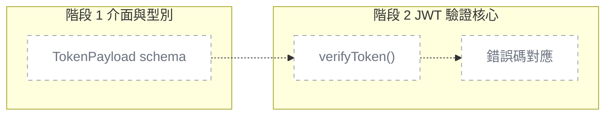

# 計畫持久化規則（Plan Persistence）

規範 `/plan` 產出的實作藍圖如何儲存、與 WBS 的職責分工、以及 `/tdd` 如何接續執行。

## 核心原則

**WBS 是 What，Plan 是 How。** 兩者職責不重疊。

| 欄位 | 唯一來源 | 說明 |
|---|---|---|
| 任務狀態（⏳/🔄/✅） | **WBS** | `/task-next` 或 `/tdd` 開工時更新進行中（`/plan` 不改），`/verify` 或使用者確認後標完成 |
| 優先級、依賴任務、總預估 | **WBS** | 專案 backlog 視角 |
| 階段拆解、驗收標準、實作細節、發現與決策 | **Plan 檔** | 單任務實作藍圖 |
| 單階段狀態（⏳/🔄/✅） | **Plan 檔** | `/tdd` 每完成一階段更新 |

Plan 檔**不重複** WBS 已有欄位。

---

## 檔案位置與命名

```
.claude/taskmaster-data/
├── wbs.md
├── project.json
└── plans/
    ├── INDEX.md
    ├── 2.1-auth-middleware.md          ← 對應 WBS 任務 2.1
    ├── 2.1-auth-middleware.progress.md ← 執行帳本（僅執行型委派會產生）
    ├── 3.2-oauth-flow.md
    └── adhoc-2026-04-20-fix-login.md   ← 無 WBS 對應的臨時計畫
```

`*.progress.md` 是**執行帳本**，只在走執行型委派時產生（見 `subagent-execution` skill）。
它記派工、commit、審查結果與裁決，是 context 被壓縮後的復原依據——
**不是** plan 的替代品，也不放 plan 已有的資訊。

- **有 WBS 對應**：`<task-id>-<kebab-slug>.md`（slug 取自任務標題，英數小寫 + 連字號，20 字元內）
- **無 WBS 對應（ad-hoc）**：`adhoc-YYYY-MM-DD-<kebab-slug>.md`

### INDEX.md

`plans/INDEX.md` 列出所有計畫檔，供快速瀏覽：

```markdown
# Plans Index

| ID | 標題 | WBS 任務 | 狀態 | 最後更新 |
|---|---|---|---|---|
| 2.1 | Auth Middleware | 2.1 | 🔄 階段 2/4 | 2026-04-20 |
| 3.2 | OAuth Flow | 3.2 | ⏳ 未開始 | 2026-04-20 |
| adhoc-2026-04-20 | Fix Login Bug | - | ✅ 完成 | 2026-04-20 |
```

`/plan` 建立計畫時自動更新 INDEX.md，`/tdd` 更新階段狀態時同步。

---

## 計畫檔格式

四段：**為什麼做、怎麼做、改善了什麼、發現與決策**。其他東西不另開一段：WBS 連結用 `wbs_task`、
技術依賴寫進步驟、真的會踩的坑寫進該階段一行「注意」、跨任務風險寫 WBS 風險表、
共同門檻（測試、覆蓋率、審查）在 `rules/task-mode.md` 與 `testing-standards`。

```markdown
---
wbs_task: "2.1"              # WBS 任務編號，ad-hoc 填 "none"
slug: "partial-shipment"
created: "2026-11-05"
updated: "2026-11-05"
status: "🔄 進行中"           # 只准四值：⏳ 未開始／🔄 進行中／🚫 阻塞／✅ 完成；後面不加附註
current_phase: 1              # 目前在第幾階段
mode: "standard"              # 任務模式 quick / standard / critical（WBS 不放這欄）
files:                       # 本任務會「新增/修改」的檔案範圍
  - "src/services/orders/**"
  - "tests/orders/**"
---

# 訂單可以部分出貨

## 為什麼做

≤ 3 句：誰遇到什麼問題。

### PRD 情境變更

- ADDED ORD-03 部分出貨 —（假設／當／那麼全文）
- MODIFIED ORD-02 庫存不足 —（改後的全文）
- REMOVED ORD-05 —（理由一句）

### 資料流變更

- ADDED orders 結帳 — 部分出貨 — orders 呼叫 shipping 拆單，shipping 發 `shipment.split`
- MODIFIED payments 金流 — 退款 — 改成先寫 outbox，再由 worker 呼叫金流商
- REMOVED members 會員 — 舊點數同步 — 點數服務下線

## 怎麼做

**可平行**：階段 2、3（依賴都是階段 1，檔案不重疊）

### 一眼看懂

（部件表＋虛線 mermaid，寫法見下方「一眼看懂」節）

### 階段 1: 資料結構 ⏳
- **依賴**：無
- [ ] 新增 `shipments` 子單 schema — 驗證：`pytest tests/orders/test_schema.py`
- [ ] 定義 `PartialShipment` 型別 — 驗證：`tsc --noEmit`
- **預估**：30min
- **驗收**：
  - ORD-03 的「那麼」成立
  - 子單數量為 0 時建立失敗，丟出 `InvalidQuantity`
- **注意**：舊訂單沒有子單，讀取時要當成單一子單

### 階段 2: 出貨服務拆單 ⏳
- **依賴**：階段 1
- [ ] 實作 `splitShipment()` — 驗證：`pytest tests/orders/test_split.py`
- **預估**：1.5h
- **驗收**：
  - 缺一件貨的訂單 → 有貨的先出，缺的那件另開待出貨

### 階段 3: 訂單頁顯示子單 ⏳
- **依賴**：階段 1
- [ ] 訂單頁列出每張子單的狀態 — 驗證：截圖
- **預估**：1h
- **驗收**：
  - 訂單有 2 張子單時，頁面列出 2 列，各自顯示出貨狀態（截圖驗收）

## 改善了什麼

| | 之前 | 之後 |
|---|---|---|
| 缺一件貨的訂單 | 整筆卡住不能出貨 | 有貨的先出，缺的那件另開待出貨 |

## 發現與決策

- 2026-11-06 物流 API 不支援拆單編號，改成在我們這邊產子單號
```

critical 任務多兩段，放在「改善了什麼」之前：`## 回滾`（出事時怎麼退回去，migration 要寫可逆或前向修復）、
`## 威脅`（連到 `docs/threat-model.md` 的對應項）。quick 不寫 plan。

- **為什麼做**：底下的「PRD 情境變更」只列這次動到的情境（格式與套回規則見 PRD 範本 `02_project_brief_and_prd.md`）。
  沒有動到使用者看得到的行為就寫「無」。同一個情境編號在其他進行中的 plan 也出現時，planner 提一句（不擋）
- **資料流變更**：每行 `ADDED／MODIFIED／REMOVED` ＋ 流程識別（＝架構文件資料流節的小標題去掉括號那段）＋ 一句說明，不貼整張圖。
  沒動到跨服務流動就寫「無」；舊 plan 沒有這一小節視同「無」。新流程的完整圖放 architect 的設計提案或 ADR，plan 只寫一句並連結
- **怎麼做**：「一眼看懂」與每個「階段 N」都在這段底下；每個步驟附「驗證：」指令；
  階段的「驗收」引用 PRD 情境編號（如「ORD-03 的『那麼』成立」），只補該階段特有的行為
- **改善了什麼**：寫 plan 時就填「之前／之後」（只寫**行為**，不要求數字或截圖）；`/verify` 完成時照實際結果修正
- **發現與決策**：邊做邊寫，一筆一行帶日期；只記改變了計畫或影響之後的事。跨任務的設計決策寫 ADR，這裡放連結
- **歸檔後的 plan 不再續寫**：新的發現開新 plan，或寫進 `context/learned/`

### `status:` 只准四個值

`⏳ 未開始`、`🔄 進行中`、`🚫 阻塞`、`✅ 完成`，**後面不加任何附註**。附註（為什麼阻塞、做到哪）寫進「發現與決策」。
`overview.sh`、`/tdd`、`/verify` 只認這四個；歸檔另加 `archived:` 日期。

### 階段「依賴」與可平行

每個 `### 階段 N` 標題的**下一行**寫 `- **依賴**：階段 X, Y`；沒有依賴寫 `- **依賴**：無`。
**會讀到另一階段產出的型別、介面、schema、fixture 也算依賴**——部件表的「檔案」只看得到寫入，看不到讀取。
依賴寫在標題下一行、不寫進標題：`overview.sh` 只解析 `### 階段 N` 標題行，寫進去會變成階段名稱的一部分。

**兩個階段可平行**的判準，兩條都要成立：

1. 兩者的依賴階段都已 ✅
2. 部件表中屬於這兩個階段的「檔案」glob 無交集；任一階段在部件表沒有列檔案 → 不可平行

「怎麼做」開頭的 `**可平行**：…` 是 planner 寫的人讀摘要（沒有就寫「無」）；`/tdd` 依上面兩條重算，不一致時以重算為準並指出。
舊 plan 沒有依賴行 → 視為依賴前一階段，不提供階段平行。

### 「驗收」欄怎麼寫（RED 測試的來源）

驗收條件會**直接變成測試**（見 `tdd-workflow` skill）：寫幾條就至少測幾條。
所以每一條都要能讓人照著寫出一個會失敗、再變綠的測試。

| ❌ 變不成測試 | ✅ 能直接變成測試 |
|---|---|
| 功能正常運作 | 數量為 0 時 `addToCart()` 丟出 `InvalidQuantity` |
| 錯誤處理完善 | 付款服務逾時 → 訂單狀態維持 `pending`，回 503 |
| 測試全綠、覆蓋率達標 | （這是每個階段的共同門檻，不是這個階段的驗收——不用寫） |
| 介面友善 | 表單送出失敗時，錯誤訊息顯示在對應欄位下方（截圖驗收） |

- 一條寫一個行為：**在什麼情況下 → 會得到什麼結果**
- 寫得出具體值就寫具體值（狀態碼、錯誤碼、回傳值）
- UI 的驗收寫成「截圖上看得到什麼」，不寫成單元測試
- 純接線、設定的階段，驗收寫「接起來之後哪個請求會得到什麼回應」——那是整合測試的來源

### `files:` 欄位（平行開發的依據）

列出本任務會新增/修改的檔案或 glob。`/task-next` 用它來判斷哪些「依賴已滿足」的任務
**彼此檔案範圍不重疊**，進而提供「平行開發」選項。

- 寫**會被寫入/編輯**的檔案即可（讀取的共用檔不必列）
- 不確定範圍時**寧可多列**（多列只會讓系統更保守、少誤判可平行）
- **沒有 plan 檔或沒寫 `files:` 的任務 → 一律視為「範圍未知，不可自動平行」**

### 「一眼看懂」（任務圖的資料來源，唯一來源）

放在「怎麼做」底下、第一個階段之前。`/plan` 寫一次，之後不用維護——進度由階段標題的 ⏳/🔄/🚫/✅、
`git diff` 與執行帳本算出來，畫在 `taskmaster-data/overview/` 的任務圖上（`scripts/overview.sh`）。

````markdown
### 一眼看懂



| id | 部件 | 階段 | 檔案 | 驗收 |
|---|---|---|---|---|
| p1 | TokenPayload schema | 1 | `src/types/auth.ts` | 缺 `sub` 欄位 → 驗證錯誤 |
| p2 | verifyToken() | 2 | `src/lib/auth/middleware.ts` | 簽章正確且未過期 → 回傳 payload |
| p3 | 錯誤碼對應 | 2 | `src/lib/auth/errors.ts` | 過期 → 401 `TOKEN_EXPIRED` |
````

- **部件**＝使用者看得懂的一塊功能，不是一個函式。一個階段 1-3 個部件
- **`id`** 用 `p1`、`p2`…，整份 plan 不重複。mermaid 的節點 id 與表格的 `id` 相同
- **`階段`** 填數字，要對得上「怎麼做」底下的 `### 階段 N`
- **`檔案`** 填這個部件會寫的檔或 glob，多個用 `,` 分隔；都要落在 frontmatter 的 `files:` 範圍內
- **`驗收`** 從該階段的「驗收」挑最能代表這個部件的一條（寫法見「驗收欄怎麼寫」）
- mermaid 一律畫虛線 `-.->`、全部 `planned`：這段是**計畫**，完成狀態由腳本另外畫，不要回來改它
- 表頭四欄 `id／部件／階段／檔案` 的字是腳本抽資料的依據（`overview.sh` 的 `OVERVIEW_COLS_PART`，
  `check-counts.sh` 會比對）。改欄名要兩邊一起改，否則任務圖會靜默抽不到部件

沒寫這段的舊 plan 照樣能跑，任務圖只列得出「改了哪些檔」，畫不出部件。

### 「計畫 vs 實際」（`/verify` 寫入，任何人不得手改）

`/verify` 結束時呼叫 `overview.sh --actual`，在 plan **檔尾**寫入一段由標記包住的區塊：

```markdown
<!-- overview:actual:start — 由 /verify 經 overview.sh --actual 寫入，勿手改 -->
## 計畫 vs 實際

驗證：❌ FAIL（11-04 13:50）— 2 個測試失敗：token 過期判斷用了本地時區

（部件實際狀態的 mermaid ＋「這次 AI 改了什麼」表：部件、狀態、AI 摘要、檔案、+/−、測試）
<!-- overview:actual:end -->
```

- 再跑一次是**原地取代**，不會疊第二份；區塊外的內容一個字都不動
- **一份 plan 只能有零組或一組標記**：`start` 與 `end` 各一行、`start` 在前（標記要在行首）。
  不符合（只剩 `start`、有兩組、`end` 在前）時腳本**整份不寫**、以非 0 結束並印出修法：
  刪掉多餘或落單的標記行，留下一組完整的、或全部刪掉讓它在檔尾重寫。
  解析 plan 時也照這條：標記不成對就當作沒有區塊，讀不到上次的驗證結果
- 「驗證：」那一行會被腳本讀回來決定燈號（FAIL → 這份 plan 碰到的模組顯示「有問題」），所以不要手改
- 「AI 摘要」取自執行帳本的 `摘要=`、`測試=`（格式見 `subagent-execution` skill 的「帳本要記什麼」）；
  帳本沒寫就顯示 `—`

---

## 狀態同步規則

### 誰可以寫入計畫檔？

| 指令 | 權限 | 時機 |
|---|---|---|
| `/plan` | 建立、覆寫整份 | 初次規劃或使用者要求重寫 |
| `/tdd`（主模型） | 只改階段狀態、current_phase、updated | 每完成一階段 |
| `/verify` | 照實際結果修正「改善了什麼」的「之後」欄、標記整體 status=✅ 並歸檔（**帳本一起歸檔**） | 所有階段完成且驗證通過 |
| `/verify` 文件同步關卡 | 只在「PRD 情境變更」小節末加一行 `已套回 PRD（YYYY-MM-DD）` | 把情境套回 `docs/prd.md` 之後（有這行就不重套） |
| `/verify` 經 `overview.sh --actual` | 只寫 `overview:actual` 標記區塊之內 | 每次 `/verify`（PASS 或 FAIL） |
| 使用者手動 | 任何時候 | 但會被 `/tdd` 下次讀取時覆寫階段狀態 |

**subagent 一律沒有寫入權——只有主模型能改 plan 檔**（`/plan` 時的 `planner` 是唯一例外，
它負責建立整份）。implementer、審查者、任何被派出去的 agent 都只讀。
派工 prompt 必須明講「plan 檔只讀」，否則 subagent 會跟主模型搶著改階段狀態。
帳本（`*.progress.md`）同理，只有主模型寫。

### 與 WBS 的雙向同步

- **Plan 建立時** → WBS 對應任務的 **`連結` 欄**加上 `[計畫](plans/2.1-xxx.md)`
  （欄內原本是 `—` 就取代，已有別的連結就用 ` ・ ` 接在後面）
- **執行帳本產生時** → 同一格再加 `[帳本](plans/2.1-xxx.progress.md)`
- **Plan 所有階段完成時** → 提示執行 `/verify`，通過後 WBS 對應任務標 `✅ MM-DD`
- **Plan 歸檔時**（`/verify`）→ WBS `連結` 欄裡的計畫與帳本同步改指 `plans/archive/<filename>`，
  否則歸檔後連結會斷

WBS 版面與連結欄的完整規則見 `.claude/templates/wbs.template.md`（唯一來源）。
**plan 是 WBS 長內容的去處之一**——驗證數據寫進該階段的「驗收」（一筆一行帶日期）、帶給下一任務的疑慮寫進
下一任務 plan 的「發現與決策」或該階段的「注意」，不要回頭塞進 WBS 的格子。

反向連結由 plan frontmatter 的 `wbs_task` 提供，兩個方向都要維護才點得到。
- **WBS 任務被跳過/刪除時** → Plan 檔保留但標記 `status: "⚠️ WBS 已移除"`

### Ad-hoc 計畫

- 建立時不寫入 WBS
- **完成驗收後 `/verify` 會主動問要不要補登 WBS**（不是靠使用者自己記得）
- 歸檔到 `plans/archive/` 後保留，供日後查閱

> 不補登會讓 WBS 逐漸偏離實際做過的事，`/task-status` 與 `/time-log` 的統計失真。

---

## 「Plan 好像跟 WBS 很像？」

會有這個感覺，通常是因為**新增功能時跳過了 WBS**：直接開 plan，那一行從沒被建立，
於是 plan 成了唯一紀錄、被迫兼差當 backlog。

正確做法是先補那一行：

```
想加功能  →  /task-add   （追加 WBS 行：自動拆解、接編號、算依賴）
          →  /plan <id>  （只在達門檻時才產，門檻見下方「何時不該用 /plan」）
```

`/task-next` 在 WBS 待辦清空時、`/verify` 在 ad-hoc plan 完成時，都會主動提起 `/task-add`。

---

## 何時不該用 `/plan`

- 單檔案、< 30 分鐘的修改 — 直接做，不需要計畫
- 已在 WBS 且極簡單的任務（例：更新一個常數）
- 探索性實驗、還不確定方向 — 主模型先用 `AskUserQuestion` 討論

**`/plan` 門檻（唯一來源，其他檔案只寫指標）**：

| 任務模式 | 要不要 plan |
|---|---|
| `quick` | 不用 |
| `standard` | 依門檻：跨 ≥ 2 檔案、預估 ≥ 1h、或有非 trivial 風險 → 要；否則直接做 |
| `critical` | 一律要，沒有 plan 不進 `/tdd` |
