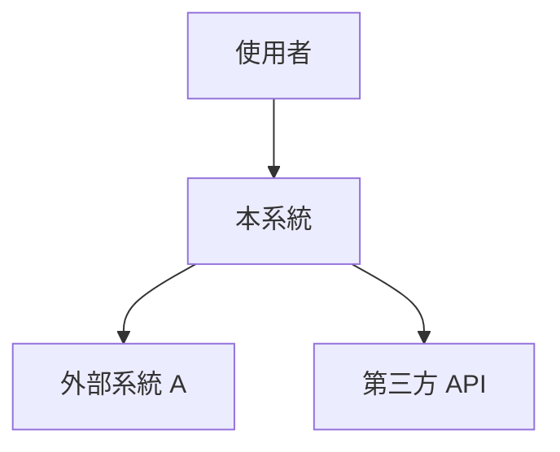
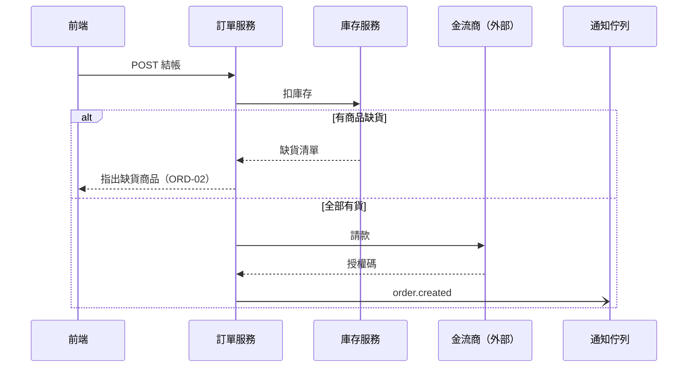

# 架構與設計文件範本（`docs/architecture.md`）

> 第 1–3、5 節由 `architect` 撰寫，只寫程式碼看不出來的事；第 4 節由專案地圖從程式碼自動產生，手改會被蓋掉。
> 圖表抽象層級採 [C4 Model](https://c4model.com)。設計理由不放這裡，寫成 ADR（`04_architecture_decision_record_template.md`），本檔只連結。

---

## 1. 系統情境

| 對象 | 關係 | 協定／格式 |
| :--- | :--- | :--- |
| 使用者 | 用瀏覽器下單、查訂單 | HTTPS |
| [外部系統 A] | [系統向它要什麼／給它什麼] | REST／事件／檔案 |

- **範圍內**：[系統負責的業務能力]
- **範圍外**：[明確排除項，對應 brief 的「明確不做」]

## 2. 技術選型

| 分類 | 選用 | 決策 |
| :--- | :--- | :--- |
| 語言／框架 | | [ADR 連結] |
| 資料庫 | | [ADR 連結] |
| 部署平台 | | [ADR 連結] |

每列連到對應的 ADR；沒有 ADR 的選擇表示還沒有人為它負責，補 ADR 或刪掉該列。

## 3. 部署

| 環境 | 部署單元 | 上線方式 |
| :--- | :--- | :--- |
| Dev／Staging／Production | [容器、函式、靜態站台…] | [CI/CD 觸發條件與關鍵 gate] |

細節（部署步驟、排障、SLO）在 `docs/runbook.md`（若有）。

## 4. 模組與依賴

<!-- overview:generated:start -->
（此段由專案地圖產生，手改會被覆蓋。改模組名稱或分組請改 `.claude/taskmaster-data/module-notes.md`）
<!-- overview:generated:end -->

## 5. 資料流

只畫跨服務、跨系統的流動。服務內部的函式呼叫看程式碼或專案地圖的模組展開。

- **一張圖＝一個服務或主要功能的一條流程。** 小標題：`### <主要模組 id> <功能> — <流程名>（<PRD 情境編號>、…）`；排程、批次等沒有對應情境的背景流程，括號寫觸發來源，如 `（排程：每日 02:00）`
- **參與者 id**：系統內的服務寫模組 id（服務被切成多個模組時寫分組 id），外部系統、佇列、使用者端用不撞模組 id 的任意 id。**所有參與者都用 `participant`／`actor` 行宣告**，地圖只解析宣告行
- **畫**：服務、佇列／事件、外部系統、分支條件（`alt`／`opt`）、非同步訊息（`-)`）；訊息文字寫業務動作或端點名稱，至多帶一兩個關鍵欄位
- **不畫**：服務內部的函式、類別、檔案；服務自己的資料庫（多服務共用、或「先寫庫再發事件」的順序本身是重點時才畫）；重試、逾時細節（除非影響使用者看得到的結果）
- **大小**：一張圖 ≤ 8 個參與者、≤ 15 條訊息；超過就依 `alt` 分支拆成兩條流程
- 系統只有一個服務、也不連外部系統：寫「無跨服務或跨系統的流程」，節保留

### orders 結帳 — 正常結帳（ORD-01、ORD-02）

---

**本檔不寫**：

| 不寫 | 它的唯一來源 |
| :--- | :--- |
| 模組清單、依賴圖、路由數 | 第 4 節（程式碼掃描產生） |
| 服務內部的函式呼叫、檔案結構 | 程式碼／專案地圖的模組展開 |
| 設計理由、替代方案比較 | ADR |
| 系統行為、使用者情境 | PRD |
| 做法、階段、進度 | plan、WBS |
| API 欄位與端點 | 程式碼與框架產生的 OpenAPI |
