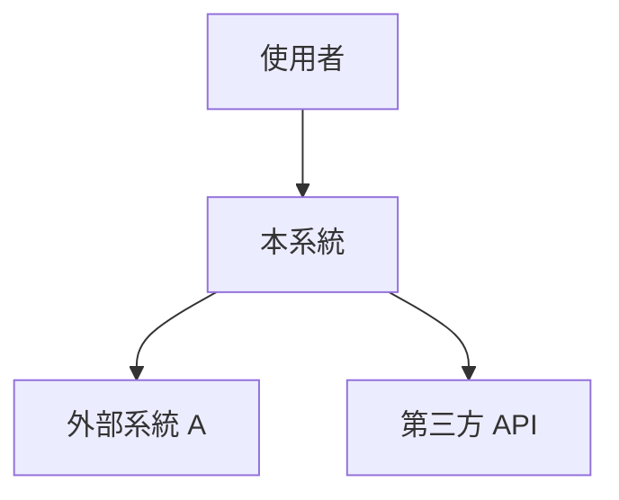

# 架構與設計文件範本（`docs/architecture.md`）

> 前三節由人寫（`architect`），只寫程式碼看不出來的事；第 4 節由專案地圖產生。
> 圖表抽象層級採 [C4 Model](https://c4model.com)。設計理由不放這裡，寫成 ADR（`04_architecture_decision_record_template.md`），本檔只連結。

---

## 1. 系統情境

| 對象 | 關係 | 協定／格式 |
| :--- | :--- | :--- |
| 使用者 | 用瀏覽器下單、查訂單 | HTTPS |
| [外部系統 A] | [系統向它要什麼／給它什麼] | REST／事件／檔案 |

- **範圍內**：[系統負責的業務能力]
- **範圍外**：[明確排除項，對應 brief 的「明確不做」]

## 2. 技術選型

| 分類 | 選用 | 決策 |
| :--- | :--- | :--- |
| 語言／框架 | | [ADR 連結] |
| 資料庫 | | [ADR 連結] |
| 部署平台 | | [ADR 連結] |

每列連到對應的 ADR；沒有 ADR 的選擇表示還沒有人為它負責，補 ADR 或刪掉該列。

## 3. 部署

| 環境 | 部署單元 | 上線方式 |
| :--- | :--- | :--- |
| Dev／Staging／Production | [容器、函式、靜態站台…] | [CI/CD 觸發條件與關鍵 gate] |

細節（部署步驟、排障、SLO）在 `docs/runbook.md`（若有）。

## 4. 模組與依賴

<!-- overview:generated:start -->
（此段由專案地圖產生，手改會被覆蓋。改模組名稱或分組請改 `.claude/taskmaster-data/module-notes.md`）
<!-- overview:generated:end -->

---

**本檔不寫**：

| 不寫 | 它的唯一來源 |
| :--- | :--- |
| 模組清單、依賴圖、路由數 | 第 4 節（程式碼掃描產生） |
| 設計理由、替代方案比較 | ADR |
| 系統行為、使用者情境 | PRD |
| 做法、階段、進度 | plan、WBS |
| API 欄位與端點 | 程式碼與框架產生的 OpenAPI |
