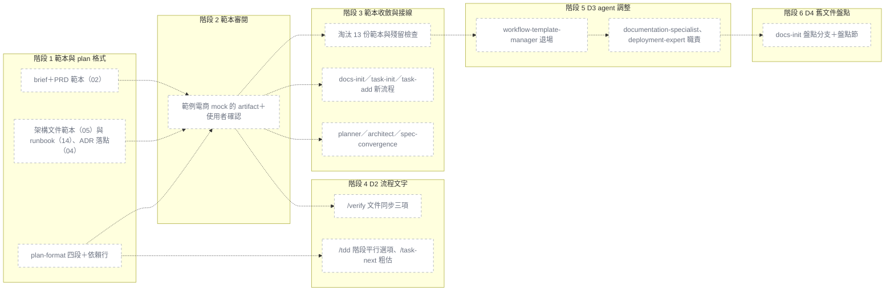

# 文件收成 6 份：範本、PRD 情境、plan 四段、架構自動段的文字接線

## 為什麼做

用這套模板的兩個既有專案（專案 A、B）各長出 75–85 份 `docs/`、6–13% 的路徑已失效、同一個數字有多種寫法，
因為模板本身就有 20 份範本、PRD 寫完不再更新、架構文件的模組表靠人手寫。
ADR-2026-11-05-004～008 已定案：文件只有 6 份、PRD 用編號情境並由 `/verify` 套回、plan 四段且階段可平行、
架構文件會過期的部分由地圖資料產生、舊文件按需盤點。這份計畫把它們落到範本、指令、skill、agent 的文字上；
所有 `overview.sh` 的改動都在地圖計畫（`adhoc-2026-11-05-overview-from-code.md`），這裡只動 md 與 `check-counts.sh`。

### PRD 情境變更

無（模板 repo 沒有 `docs/prd.md`）。

## 怎麼做

**可平行**：階段 3 與階段 4（D2）——依賴分別是階段 2 與階段 1、2，檔案不重疊；階段 4（D2）與階段 5（D3）——依賴分別是階段 1、2 與階段 3，檔案不重疊。階段 1、2、3 與 6 都循序（審閱點、同改 `check-counts.sh`、同改 `documentation-specialist.md`）。兩組都還要先滿足下方「兩份計畫的順序」裡地圖計畫的前置條件。

**預估**：合計 18h（1：3.5h／2：0.5h／3：4h／4：4.5h／5：3.5h／6：2h）

### 一眼看懂

| id | 部件 | 階段 | 檔案 | 驗收 |
|---|---|---|---|---|
| p1 | brief＋PRD 範本（02） | 1 | `.claude/skills/project-docs/templates/02_project_brief_and_prd.md` | 02 範本刪掉「## 用語表」→ `check-counts.sh` 失敗 |
| p2 | 架構文件範本（05）與 runbook（14）、ADR 落點（04） | 1 | `.claude/skills/project-docs/templates/05_architecture_and_design_document.md`, `.claude/skills/project-docs/templates/14_deployment_and_operations_guide.md`, `.claude/skills/project-docs/templates/04_architecture_decision_record_template.md` | 05 範本恰好一行 `<!-- overview:generated:start -->`、一行 `end`，start 在前 |
| p3 | plan-format 四段＋依賴行 | 1 | `.claude/skills/plan-format/SKILL.md`, `.claude/scripts/check-counts.sh` | 範例某個 `### 階段 N` 下一行不是 `- **依賴**：` → `check-counts.sh` 失敗 |
| p4 | 範例電商 mock 的 artifact＋使用者確認 | 2 | `.claude/qa-history/*-docs-template-review.md` | 使用者選「確認」→ 問答紀錄存在且結論為確認 |
| p5 | 淘汰 13 份範本與殘留檢查 | 3 | `.claude/skills/project-docs/**`, `.claude/scripts/check-counts.sh`, `README.md`, `.claude/skills/INDEX.md` | 在任一 command 寫入 `06_api_design_specification.md` → `check-counts.sh` 失敗並指出檔名 |
| p6 | docs-init／task-init／task-add 新流程 | 3 | `.claude/commands/docs-init.md`, `.claude/commands/task-init.md`, `.claude/commands/task-add.md`, `.claude/templates/CLAUDE-md.template.md`, `.claude/templates/wbs.template.md`, `.claude/guides/WORKFLOW.md`, `CLAUDE.md` | `docs-init.md` 的產出表不含 `tech-spec.md`、`01_prd.md` |
| p7 | planner／architect／spec-convergence | 3 | `.claude/agents/planner.md`, `.claude/agents/architect.md`, `.claude/agents/documentation-specialist.md`, `.claude/skills/spec-convergence/SKILL.md`, `.claude/commands/adr.md`, `.claude/commands/template-check.md` | `planner.md` 不含 `## 風險與緩解 / 驗收標準（整體）`、含 plan-format 的完整路徑 |
| p8 | /verify 文件同步三項 | 4 | `.claude/commands/verify.md`, `.claude/commands/task-status.md` | 文件同步關卡的三項依序為 PRD 套回、`--sync-arch`、`.doc-impact` |
| p9 | /tdd 階段平行選項、/task-next 粗估 | 4 | `.claude/commands/tdd.md`, `.claude/commands/task-next.md` | `tdd.md`「選執行方式」含「用 worktree 同時跑」選項與重算判準的指標 |
| p10 | workflow-template-manager 退場 | 5 | `.claude/agents/workflow-template-manager.md`, `.claude/rules/agent-orchestration.md`, `.claude/skills/using-taskmaster/SKILL.md`, `.claude/hooks/user-prompt-submit.sh`, `.claude/hooks/pre-agent-gate.sh`, `.claude/hooks/post-write.sh`, `.claude/hooks/lib/agent-inflight.sh`, `.claude/hooks/README.md`, `.claude/hooks/tests/run-tests.sh`, `.claude/commands/hub-delegate.md`, `.claude/guides/MECHANISMS.md`, `.claude/guides/MODELS.md`, `.claude/README.md`, `.claude/context/decisions/README.md`, `.claude/scripts/check-counts.sh`, `README.md` | 使用者訊息「幫我寫 PRD」→ `user-prompt-submit.sh` 注入不含 `workflow-template-manager` |
| p11 | documentation-specialist、deployment-expert 職責 | 5 | `.claude/agents/documentation-specialist.md`, `.claude/agents/deployment-expert.md` | `documentation-specialist.md` 不含 `CODEMAPS` |
| p12 | docs-init 盤點分支＋盤點節 | 6 | `.claude/commands/docs-init.md`, `.claude/agents/documentation-specialist.md` | `docs-init.md` 步驟 1 寫明偵測條件與「先盤點（Recommended）」選項 |

### 共同門檻

每個階段：`bash .claude/scripts/check-counts.sh` 全綠；審查照 `rules/task-mode.md`（standard：每階段 `code-quality-specialist`）。
驗收只到本 repo 的自動測試、`check-counts.sh`、`skill-compliance` 與階段 2 的審閱點；在真實專案的實測由使用者自己做，不排進本計畫。

### 兩份計畫的順序（平行開發）

文件計畫的「階段 N」以下寫成「文件 N」，地圖計畫的寫成「地圖 N」。D1 拆成文件 1–3（中間夾審閱點），D2＝文件 4、D3＝文件 5、D4＝文件 6。

| 順序 | 地圖計畫 | 文件計畫 | 條件 |
|---|---|---|---|
| 1 | 地圖 0 → 地圖 1 | **文件 1** 範本與 plan 格式 | 可平行：檔案不重疊 |
| 2 | （地圖 1 繼續） | **文件 2** 範本審閱 | 文件 1 合併後由主模型做；使用者確認前文件 3、4 不開工 |
| 3 | 地圖 2（含 A3–A5） | **文件 3** 範本收斂與接線 | 可平行：檔案不重疊 |
| 4 | 地圖 3（含畫面審閱）∥ 地圖 4 | — | **文件 1、3 都已合併才開地圖 3**（三者都改 `check-counts.sh`）；文件 3 合併後才開地圖 4（都改 `documentation-specialist.md`） |
| 5 | — | **文件 4（D2）** | 地圖 2（`--sync-arch`）與地圖 4（`task-status.md`）合併之後 |
| 6 | 地圖 5 | — | 依賴文件 1 寫好的 05 範本標記 |
| 7 | — | **文件 5（D3）**，可與文件 4 平行 | 地圖 5 之後（`documentation-specialist.md`、`run-tests.sh`、`hooks/README.md`、`check-counts.sh`、`README.md` 地圖都會改） |
| 8 | — | **文件 6（D4）** | 文件 5 之後（都改 `documentation-specialist.md`） |

平行時各線用 worktree，程序照 `worktree-orchestration` skill；本 plan 與地圖 plan 在開 worktree 前要已 commit（`plans/` 在 `.git/info/exclude`，要 `git add -f`）。

### 階段 1: 範本與 plan 格式（D1 前半） ✅

- **依賴**：無
- [ ] 改寫 `02_project_brief_and_prd.md`（檔名不變）：上半 brief 骨架（保留 `## 一句話` 標題——地圖的一頁現況讀它）、下半 PRD 骨架照 ADR-005（用語表在最前；功能依領域分節、節標題括號寫模組分組名；`#### <代碼>-<序號> 標題`＋假設／當／那麼；非功能需求選填；待確認）；每份「不寫什麼」照提案第 3.2 節 — 驗證：`bash .claude/scripts/check-counts.sh`
- [ ] 改寫 `05_architecture_and_design_document.md`（檔名不變）：人寫三節（系統情境、技術選型、部署）＋第 4 節自動段，標記字串照 ADR-007（`<!-- overview:generated:start -->`／`<!-- overview:generated:end -->`），標記內第一行寫「此段由專案地圖產生，手改會被覆蓋…」；刪掉手寫 5.1 容器圖與 5.5 模組表
- [ ] `14_deployment_and_operations_guide.md` 精簡成 runbook（吸收 19 的 SLO 要點）；`04_…` 兩版落點都寫 `docs/decisions/`
- [ ] `plan-format` SKILL：ADR-006 的四段骨架（為什麼做＋PRD 情境變更／怎麼做＋可平行行＋一眼看懂＋階段／改善了什麼／發現與決策；critical 多「回滾」「威脅」）；status 只准 `⏳ 未開始`、`🔄 進行中`、`🚫 阻塞`、`✅ 完成` 且不加附註；歸檔後不續寫；每個階段標題下一行 `- **依賴**：階段 X, Y`（無依賴寫「無」，讀取另一階段產出的型別／介面／schema／fixture 也算）；可平行判準（依賴都完成＋部件表「檔案」無交集；沒列檔案就不可平行）；舊 plan 沒有依賴行視為依賴前一階段；`OVERVIEW_COLS_PART` 表頭、`overview:actual` 節不動
- [ ] `check-counts.sh`：刪第 302–346 行的 05 範本 5.1／5.5 檢查，與第 375 行 `OVERVIEW_COLS_MODULE:H55`、`OVERVIEW_COLS_MODULE_OPT:H55` 兩組比對（見「發現與決策」）；新增 02 範本 PRD 骨架有「用語表」「功能」兩節、範例情境編號符合 `^[A-Z]+-[0-9]+`；plan-format 範例的 `status:` 是四值之一；範例每個 `### 階段 N` 的下一行是 `- **依賴**：`
- **預估**：3.5h
- **驗收**：
  - 02 範本刪掉「## 用語表」→ `check-counts.sh` 失敗並指出 02 範本；改回後通過
  - 02 範本的範例情境標題改成 `#### ord-1 正常結帳` → `check-counts.sh` 失敗
  - 02 範本上半有一行 `## 一句話`
  - 05 範本恰好一行 `<!-- overview:generated:start -->`、一行 `<!-- overview:generated:end -->`，start 在前；不含 `### 5.1`、`### 5.5`
  - 05 範本沒有 5.1／5.5 時，`check-counts.sh` 不再輸出「5.5 模組表表頭缺」「5.1 容器圖的節點 id」兩類訊息
  - plan-format 範例的 `status:` 改成 `"✅ 完成（附註）"` → `check-counts.sh` 失敗
  - plan-format 範例刪掉任一 `### 階段 N` 下一行的 `- **依賴**：` → `check-counts.sh` 失敗
  - plan-format 範例部件表表頭仍是 `| id | 部件 | 階段 | 檔案 | 驗收 |`（`OVERVIEW_COLS_PART` 比對照過）
  - 04 範本裡的 ADR 落點只出現 `docs/decisions/`，不出現 `.claude/context/decisions/`
- **注意**：本階段**不刪**淘汰範本、不改 SKILL／INDEX 的範本數（那些在審閱之後的階段 3）；範本數維持 20，`check-counts.sh` 的計數檢查照過

### 階段 2: 範本審閱檢查點 ⏳

- **依賴**：階段 1
- [ ] 主模型讀階段 1 寫好的 02、04、05、14 範本與 plan-format，用 `.claude/context/planning/overview-shop-clean-reference.md` 的範例電商寫一套 mock：brief → PRD（用語表＋至少 2 個領域、每領域 2 條「假設／當／那麼」情境）→ 架構文件（人寫三節＋自動段範例）→ WBS 片段 → plan（新四段、每階段有 `- **依賴**：`、「可平行」行、PRD 情境變更）→ ADR 一份。mock 只放 `.claude/tmp/`，不進 repo
- [ ] 主模型產 artifact：上半是 6 份文件的架構（各回答什麼、誰在何時更新、彼此怎麼引用），下半是上面那套 mock
- [ ] `AskUserQuestion`：確認敘述方式（Recommended）／要改（直接輸入要改的地方）。選「要改」→ 階段 1 回到 🔄、改完重新產 artifact 再問
- [ ] 問答照 `rules/interactive-qa.md` 一次寫入 `.claude/qa-history/<時間>-docs-template-review.md`
- **預估**：0.5h（不含使用者審閱時間）
- **驗收**：
  - artifact 裡看得到 6 份文件的名稱與路徑、PRD 的用語表與至少 4 條帶編號的情境、plan 的四個二級標題與每個階段的依賴行
  - 使用者選「確認」→ `qa-history` 有 `*-docs-template-review.md`，結論為確認；之後階段 3、4 才可標 🔄
- **注意**：mock 用的是通用電商詞彙，不得出現實測專案的名稱、客戶、產業

### 階段 3: 範本收斂與指令、agent 接線（D1 後半） ⏳

- **依賴**：階段 2
- [ ] 刪除淘汰的 13 份範本（01、03、06、07、08、09、11、13、15、16、18、19、21）；`templates/INDEX.md` 改成 5 份＋UI 鏈 2 份
- [ ] `project-docs` SKILL 改寫：description 改成觸發條件；6 份文件表、寫作標準、各份「不寫什麼」（提案第 3 節）；demo／mvp／full 只決定先產哪幾份（提案 3.4）
- [ ] `check-counts.sh`：`N_DOCTPL` 不計 `12_*`、`17_*`（範本數＝5）；新增淘汰範本檔名殘留檢查——在 `.claude/{agents,commands,rules,skills,guides,hooks,scripts,templates}`、`.claude/README.md`、`README.md` 搜 13 份範本的檔名主幹，**暫時排除 `agents/workflow-template-manager.md`**（階段 5 刪檔時一併拿掉例外）
- [ ] 範本數改成 5：`README.md` 第 288、318–330 行（範本節改成 6 份文件對 5 份範本）、`.claude/skills/INDEX.md` 第 47、94 行
- [ ] `docs-init.md` 照提案第 5 節的新流程（步驟 1 的盤點分支留給階段 6）；`project.json` 寫 `docs.set`、`mode` 只准 `demo／mvp／full`；產出表不再有 `tech-spec.md` 與編號文件
- [ ] `task-init.md`：2.7b brief 骨架改成指向 02 範本上半（唯一來源）；第 212、226 行的產出說明；第 248 行與 `task-add.md` 第 74 行「模組欄取 5.5」改成取 `docs/architecture.md` 自動段模組表的 `id`／`路徑`（舊專案沒有自動段但有 5.5 → 照舊讀 5.5；都沒有 → `—`）
- [ ] `CLAUDE-md.template.md`：刪「## 專案結構」、「## 技術棧」改「## 程式碼看不出來的事」、加「## 文件在哪」（6 份路徑＋「專案地圖：`/task-status`」，不寫數字）
- [ ] `wbs.template.md` 第 133 行「下一任務 plan 的『風險與緩解』」改成「下一任務 plan 的『發現與決策』或該階段的『注意』」
- [ ] `planner.md`：骨架改指向 plan-format（不再內嵌）；寫「PRD 情境變更」；同情境編號在其他進行中 plan 出現時提一句；「怎麼做」開頭寫 `**可平行**：…`（沒有寫「無」）
- [ ] `architect.md`：ADR 落點 `docs/decisions/`（第 35、40、54、175 行）；寫架構文件人寫三節與威脅模型；刪「負責 5.1／5.5 的 id／路徑」節（第 69–77 行）；報告仍寫 `context/decisions/architect-*.md`（`post-agent-report.sh` 的 AREA 不變）
- [ ] `spec-convergence` SKILL 照提案 4.3；`adr.md`、`template-check.md` 的範本清單與落點
- [ ] `documentation-specialist.md` 第 76–78 行指向淘汰範本的三句改成指向 `project-docs` SKILL（其餘職責留給階段 5）
- [ ] `guides/WORKFLOW.md` 第 27–28 行模式表改成提案 3.4
- [ ] 根目錄 `CLAUDE.md`「目錄地雷」或連帶檢查加一句：模板 repo 自己的 ADR 仍放 `.claude/context/decisions/`（ADR-004 的例外）
- **預估**：4h
- **驗收**：
  - `find .claude/skills/project-docs/templates -name '*.md' ! -name INDEX.md` → 恰好 02、04、05、12、14、17、20 七個檔
  - `check-counts.sh` 的「文件範本」計數為 5，SKILL、templates/INDEX、skills/INDEX、README 四處寫的都是 5 → 通過
  - 在 `.claude/commands/adr.md` 加一行 `06_api_design_specification.md` → `check-counts.sh` 失敗並指出該檔；拿掉後通過
  - `agents/workflow-template-manager.md` 仍含淘汰檔名 → `check-counts.sh` 不因它失敗
  - `docs-init.md` 的模式表與產出段不含 `tech-spec.md`、`01_prd.md`、`02_bdd.md`
  - `task-init.md` 不含 `## 要解決的問題` 這類 brief 小節（`grep -c '^## 一句話' task-init.md` → 0），並含 02 範本的完整路徑
  - `task-init.md`、`task-add.md` 不再寫「讀架構文件的 5.5 模組表」作為唯一來源，含「自動段」
  - `CLAUDE-md.template.md` 沒有「## 專案結構」；「## 文件在哪」一節不含 `[0-9]+ ?(份|個)`
  - `planner.md` 不含 `## 風險與緩解 / 驗收標準（整體）`，含 `.claude/skills/plan-format/SKILL.md`
  - `architect.md` 不含「5.5 模組表」字樣；ADR 落點只寫 `docs/decisions/`（模板 repo 例外的說法除外）
  - `project-docs` SKILL 的 description 以觸發條件開頭，不含「20 種」
- **注意**：`update-template` 不會刪掉既有專案裡已淘汰的範本檔，SKILL 寫明「不再被引用」即可；`/ui-site` 產的 `docs/12_*`、`docs/17_*` 路徑一律不動

### 階段 4: 流程文字（D2） ⏳

- **依賴**：階段 1, 2；跨計畫：地圖 2（`--sync-arch`）、地圖 4（`task-status.md`）已合併
- [ ] `verify.md`「文件同步關卡」（第 335–369 行）改成三項，順序固定：1 PRD 情境套回（主模型改 `docs/prd.md`、小節末加 `已套回 PRD（YYYY-MM-DD）`；worktree、無進行中 plan、情境變更為「無」、已有「已套回」行時跳過）→ 2 `bash .claude/scripts/overview.sh --sync-arch`（worktree 或沒有標記時跳過）→ 3 `.doc-impact`（選項說明的「codemap／API 文檔」改成「README、架構文件人寫部分、runbook」）；第 1、2 項不另外問，做完印 PRD 的 diff 摘要
- [ ] `verify.md`「Plan 驗收標準比對」（第 182–199 行）與「最後一個合併」第 1 點（第 276–280 行）：有「驗收標準（整體）」的舊 plan 照舊；新 plan 比對各階段驗收與 PRD 情境
- [ ] `verify.md`「標記與歸檔」：修正「改善了什麼」、status 寫 `✅ 完成` 不加附註、歸檔後不續寫
- [ ] `tdd.md` 第 84–100 行「選執行方式」：依 plan-format 判準重算，「依賴已完成、可同時開工」的階段 ≥ 2 個時多一個選項「階段 N、M 用 worktree 同時跑」；程序**指向** `worktree-orchestration` 與 `subagent-execution`、不重寫；寫明 implementer 帶 `isolation: "worktree"`（`pre-agent-gate.sh` 依既有規則放行）、會讀整個 repo 的審查 agent 在該階段的 worktree 裡審、plan 與帳本只由主模型在主 checkout 改（開 worktree 前 plan 已 commit、合併一條驗一條、合併後才標 ✅）、同時進行的階段都標 🔄 且 `current_phase` 寫最小未完成階段、摘要行與重算不一致時以重算為準並指出
- [ ] `task-next.md` 第 83–95 行「平行任務偵測」：候選任務沒有 plan 時，WBS 有模組欄且兩個 ready 任務的模組不同（非空、非 `—`）→ 選項說明提示「可能可平行，先 `/plan` 兩個再確認」，不提供平行選項；有 plan 且有 `files:` 的照現行
- [ ] `task-status.md` 第 185–187 行：「驗收標準（整體）」「風險與緩解」的去處改成該 plan 的「發現與決策」或該階段的「注意」
- **預估**：4.5h
- **驗收**：
  - `verify.md` 文件同步關卡內，`PRD`、`--sync-arch`、`.doc-impact` 三個字串依序出現，且前兩項各有一句 worktree 跳過的條件
  - `verify.md` 不含 `codemap`
  - `verify.md` 的驗收比對同時寫到「驗收標準（整體）」（舊格式）與「PRD 情境」（新格式）兩條路徑
  - `tdd.md`「選執行方式」含「用 worktree 同時跑」、`isolation: "worktree"`、`worktree-orchestration`、`subagent-execution`，且不含 `git worktree add`（程序沒有重寫進來）
  - `task-next.md` 含「可能可平行，先 `/plan`」，且寫明此時不出現平行開發選項
  - `task-status.md` 不含「驗收標準（整體）」「風險與緩解」
- **注意**：ADR-005／006 的 [M] 確認（實跑 `/plan`→`/tdd`→`/verify`、worktree 裡 `/verify` 不改 PRD、平行選項出現與消失）由使用者在自己的專案驗，不排進本計畫

### 階段 5: agent 調整（D3） ⏳

- **依賴**：階段 3；跨計畫：地圖 5 已合併
- [ ] 刪 `agents/workflow-template-manager.md`；同步：`rules/agent-orchestration.md`（終端節點名單與 8＋1＋1＋4 → 8＋1＋1＋3＝13，`conflict-resolver` 成為第 14 個）、`skills/using-taskmaster/SKILL.md` 第 46 行路由（PRD → `/docs-init`／`project-docs`，ADR → `/adr` 或 `architect`）、`commands/hub-delegate.md` 第 71 行、`guides/MECHANISMS.md` 第 84–85 行、`guides/MODELS.md` 第 20、36、39 行、`.claude/README.md` 第 59 行、`README.md` 第 92、217 行、`context/decisions/README.md`
- [ ] hook 只刪改字串：`user-prompt-submit.sh` 第 165–169 行改成「PRD → `/docs-init`／`project-docs`，ADR → `/adr` 或 `architect`」、第 171 行拿掉「codemap」說法；`lib/agent-inflight.sh` 第 43 行唯讀名單刪名字；`pre-agent-gate.sh` 第 78–80 行註解；`post-write.sh` 第 213 行「下一任務 plan 的『風險與緩解』」改成「『發現與決策』或該階段的『注意』」；`hooks/README.md` 第 60 行
- [ ] `hooks/tests/run-tests.sh` 第 607 行（PRD/ADR 路由預期）、第 2877 行（唯讀名單迴圈）
- [ ] `check-counts.sh` 拿掉階段 3 加的 `workflow-template-manager.md` 例外
- [ ] `documentation-specialist.md`：description 拿掉「不處理 PRD/ADR（那是 workflow-template-manager）」與 codemap；同步範圍改成 README、架構文件人寫部分、runbook；刪 `docs/CODEMAPS/` 與「每個 codemap 500 行」
- [ ] `deployment-expert.md`：維護 `docs/runbook.md`（範本 14）
- [ ] 跑：`bash .claude/scripts/check-counts.sh`（agent 數 15 → 14）、`bash .claude/hooks/tests/run-tests.sh --changed <本階段起點>`（背景）、`bash .claude/tests/skill-compliance/run-compliance.sh`（改了 `using-taskmaster` 與關鍵字路由的注入，跑一輪）
- **預估**：3.5h（不含整套 hook 測試的等待時間）
- **驗收**：
  - `.claude/agents/workflow-template-manager.md` 不存在；`check-counts.sh` 的 agent 數為 14，`README.md`、`.claude/README.md` 寫的都是 14 → 通過
  - 在 `.claude/{agents,commands,rules,skills,guides,hooks,scripts,templates}`、`.claude/README.md`、`.claude/context/decisions/README.md`、`README.md` 搜 `workflow-template-manager` → 0 筆
  - `user-prompt-submit.sh` 收到「幫我寫一份 PRD」→ 注入含 `/docs-init`、不含 `workflow-template-manager`
  - `user-prompt-submit.sh` 收到「順便更新 README」→ 注入含 `documentation-specialist`、不含 `codemap`
  - `AGENT_INFLIGHT_READONLY` 不含 `workflow-template-manager`，其餘五個名字不變
  - `post-write.sh`、`wbs.template.md`、`plan-format` 都不含「風險與緩解」
  - `agent-orchestration.md` 含 `8＋1＋1＋3＝13`
  - `check-counts.sh` 的淘汰檔名殘留檢查沒有任何例外檔
  - `run-tests.sh --changed` 全綠；`run-compliance.sh` 的 01、02 兩題 pass@3 ≥ 2/3
- **注意**：
  - `hooks/lib/agent-inflight.sh` 符合 `_changed_rule` 的 `.claude/hooks/lib/*` → `ALL`，`--changed` 會跑整套（Windows 約 50 分鐘），放背景
  - `workshop/docs/03_command_cheatsheet.md` 也提到這個 agent；workshop 依使用者偏好不動，不在本階段範圍

### 階段 6: 舊文件盤點（D4） ⏳

- **依賴**：階段 5
- [ ] `docs-init.md` 步驟 1：偵測既有文件（`docs/` 有 5 份以上不是 6 份之一的 md，或沒有 `docs/00_brief.md` 卻有其他文件）→ 第一題問要不要先盤點（Recommended），選了就派 `documentation-specialist`
- [ ] `documentation-specialist.md` 新增「盤點既有文件」節（ADR-008）：`git ls-files docs/`、`git log -1 --format=%cs` 列檔；每份只讀開頭 40 行；四類（併入／現行模板外／封存／重複）；報告 `context/docs/docs-inventory-<日期>.md`（照 `_REPORT_TEMPLATE.md`；文件表、重複群組、數字衝突、入口失效路徑、每批 ≤ 15 檔的搬移批次）；**不碰 `docs/`**；搬檔由主模型逐批 AskUserQuestion 後 `git mv`、每批一個 commit；交付物不改、永不刪除；內容轉換是另一個要使用者確認的選項
- **預估**：2h
- **驗收**：
  - `docs-init.md` 步驟 1 含偵測條件「5 份以上」與「先盤點」選項，且選項說明寫明盤點只產報告、不改 `docs/`
  - `documentation-specialist.md` 有「盤點既有文件」節，含 `git ls-files docs/`、`40 行`、`context/docs/docs-inventory-`、「每批 ≤ 15」與「不刪除」
- **注意**：
  - `context/docs/` 已在 `copy-template.{sh,ps1}` 的骨架清單（`copy-template.sh` 第 160 行），不用改腳本
  - 不把 `documentation-specialist` 加進 `post-agent-report.sh` 的 AREA：它一般的文件同步不寫報告，加了每次都會假警報

## 改善了什麼

| | 之前 | 之後 |
|---|---|---|
| 新專案跑 `/docs-init --mvp` | 產一份合併 02＋05＋06＋08 的 `tech-spec.md`；full 產十幾份編號文件 | 產 `00_brief.md`、`prd.md`、`architecture.md`（加 WBS），full 碰認證金流個資時多威脅模型 |
| 範本 | 20 份 | 5 份（另有 UI 鏈 2 份） |
| PRD | 寫完不再更新，落差只被報告 | 帶情境變更的 plan 在 `/verify` 時套回 PRD |
| 架構文件的模組表 | 人手寫 5.1／5.5，會過期 | 人寫三節，模組與依賴由地圖資料改寫標記之間 |
| ADR | `docs/` 與 `context/decisions/` 兩處、兩套編號 | 只在 `docs/decisions/` |
| plan | 8 段、status 自由文字 | 四段、status 只有四個值 |
| plan 的階段平行 | 使用者要特別說才會考慮 | `/tdd` 依依賴與檔案重算，主動提供「用 worktree 同時跑」 |
| `/task-next` 候選任務沒有 plan | 不提示能不能平行 | WBS 模組不同時提示「可能可平行，先 `/plan`」 |
| 使用者說「寫 PRD／ADR」 | 被路由到一個知識庫已失效的 agent | 路由到 `/docs-init`／`project-docs` 或 `/adr`／`architect` |
| 既有專案的舊文件 | 沒有收斂的入口 | `/docs-init` 第一題問要不要盤點，報告後逐批同意搬檔 |

## 發現與決策

- 2026-11-05 檔名：handoff 寫 `adhoc-2026-11-05-docs-convergence.md`，派工指示寫 `docs-system`；照派工指示
- 2026-11-05 格式：`plan-format` 現行仍是舊骨架，本 plan 照 ADR-006 寫（四段、依賴行、可平行行）。ADR-006 沒列、本 plan 多加的：「怎麼做」底下的「預估」行、「共同門檻」與「兩份計畫的順序」兩個小節（不是 `### 階段`，不影響 `overview.sh` 與 statusline 的解析）；階段標題用「階段 N: D1…」讓 `/tdd` 與提案的 D1–D4 都對得上；跨計畫的依賴寫在依賴行的分號後
- 2026-11-05 使用者補充：範本一寫好就停下審閱 → 提案的 D1 拆成階段 1（範本＋plan 格式）、2（審閱）、3（收斂與接線）；刪 13 份範本與計數改 5 都放到審閱之後，審閱不通過時不必還原刪檔
- 2026-11-05 使用者補充：驗收只到本 repo 的自動測試、`check-counts.sh`、`skill-compliance` 與審閱點；ADR-004～008 寫的 [M] 實跑確認改由使用者在自己的專案做
- 2026-11-05 範本數：檔案系統會剩 7 份（含 12、17），ADR-004 說 5 份 → 階段 3 讓 `N_DOCTPL` 不計 `12_*`、`17_*`
- 2026-11-05 `check-counts.sh` 第 302–346 行（05 範本 5.1⊂5.5、5.5 表頭）與第 375 行的 `OVERVIEW_COLS_MODULE*:H55` 比對：新 05 範本沒有手寫 5.1／5.5，這些檢查失去比對對象 → 階段 1 刪除。`overview.sh` 仍讀舊專案的 5.5（常數保留），只是不再有範本可以漂開（待使用者確認，見回報）
- 2026-11-05 淘汰檔名殘留檢查只比對 13 份範本的檔名主幹：`docs/12_*`、`docs/17_*` 本來不在淘汰名單；`tech-spec.md` 不列（`overview.sh` 的 `find_arch` 仍把它當舊專案退路）。檢查放在階段 3（`docs-init.md`、`template-check.md` 清乾淨之後），`workflow-template-manager.md` 例外到階段 5
- 2026-11-05 handoff 沒列、但 `check-counts.sh` 或一致性會擋的檔，併入階段 3：`README.md` 範本節與計數、`.claude/skills/INDEX.md` 計數、`guides/WORKFLOW.md` 模式表、`task-init.md` 第 212／226／248 行與 `task-add.md` 第 74 行（模組欄來源）、`wbs.template.md` 第 133 行、`documentation-specialist.md` 第 76–78 行、根目錄 `CLAUDE.md`（模板 repo 的 ADR 例外）
- 2026-11-05 handoff 沒列、併入階段 5：`user-prompt-submit.sh` 第 171 行的 codemap 說法、`post-write.sh` 第 213 行的「風險與緩解」
- 2026-11-05 模組欄來源（`task-init`、`task-add`）：新架構文件沒有手寫 5.5 → 改取自動段模組表；新專案還沒有程式碼時填 `—`，之後由地圖計畫的任務推斷與 `/task-status` 回寫補上（待使用者確認，見回報）
- 2026-11-05 `architect` 的報告落點不變（`context/decisions/`），只有 ADR 本體搬到 `docs/decisions/`，所以 `post-agent-report.sh` 的 AREA 不必改
