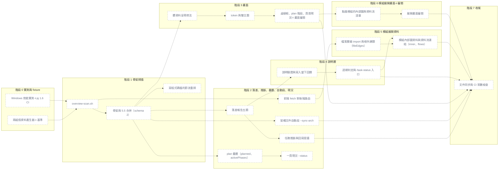

# 專案圖解改以程式碼為準（骨架掃描、落差、plan 疊層、架構自動段、畫面、說明層、模組展開）

## 為什麼做

沒照模板格式寫架構文件的既有專案（Python 後端＋TS 前端、文件放在 `docs/architecture/`、WBS 沒有模組欄），專案地圖畫不出來或全灰，
因為地圖骨架讀的是架構文件的手寫模組表，而那份表不是真實狀態。ADR-2026-11-05-001～003 改成由程式碼掃出骨架、
文件與程式對不上的地方列成落差、按需寫模組說明；ADR-007 再要求同一份地圖資料順帶產生架構文件的自動段、一頁現況，
以及「本次 plan 預計會動哪些模組」這一層。ADR-2026-11-06-002 再加「點模組展開」：看模組內部的檔案、import 關係、
框外碰了哪些模組／資料庫／套件，以及它參與架構文件資料流節（ADR-2026-11-06-001）的哪些流程。

### PRD 情境變更

無（模板 repo 沒有 `docs/prd.md`）。

### 資料流變更

無（模板 repo 沒有跨服務流程）。

## 怎麼做

**可平行**：階段 2 與 3（依賴都只到階段 1，部件表檔案不重疊）；階段 3 與 4（階段 2 合併後若 3 還在跑）；階段 6 與 2、4、5（只依賴階段 3，部件表檔案無交集）。階段 2 與 4 不可（4 依賴 2，且同改 `overview.sh`、`post-write.sh`、`task-status.md`）；4 → 5、2 → 5、3 → 6 循序。階段 3、5 另有跨計畫條件，見「平行開發」。

**預估**：合計 51h（0：3h／1：8h／2：15h／3：8h／4：6h／5：3.5h／6：4h／7：3.5h）。比 standard 一般的量大，**每個階段各自合併**。

### 一眼看懂

| id | 部件 | 階段 | 檔案 | 驗收 |
|---|---|---|---|---|
| p1 | 兩組假資料產生器＋基準 | 0 | `.claude/hooks/tests/fixtures/overview/**` | `make-fixture.sh shop-clean <dir>` 後跑現行 overview.sh → 6 個模組、`unmappedTasks` 為空 |
| p2 | Windows 效能實測＋jq 1.6 CI | 0 | `.claude/context/decisions/overview-scan-bench-*.md`, `.github/workflows/template-ci.yml` | CI 的 jq 1.6 job 印出 `jq-1.6` 並跑完 overview 節全綠 |
| p3 | overview-scan.sh | 1 | `.claude/scripts/overview-scan.sh` | messy-fullstack → 模組含 `backend-api` 與 `frontend-api`（跨套件撞名加套件前綴） |
| p4 | 骨架與 5.5 合併（schema 2） | 1 | `.claude/scripts/overview.sh` | `docs/12_frontend_architecture.md` 與 `docs/architecture.md` 並存 → `project.architectureDoc` 是後者 |
| p5 | 寫程式碼檔的節流重掃 | 1 | `.claude/hooks/post-write.sh` | 30 秒內第二次寫程式碼檔 → 不呼叫 overview.sh、stdout 為空 |
| p6 | 落差報告五類 | 2 | `.claude/scripts/overview.sh` | 5.5 寫了 `src/legacy/**`、沒有對應檔案 → `drift.docNotInCode` 含 `legacy` |
| p7 | 任務推斷與回寫提議 | 2 | `.claude/scripts/overview.sh`, `.claude/commands/task-status.md` | WBS 沒模組欄、plan `files:` 全在 orders 模組 → 該任務 `modules:["orders"]`、`inferredBy:"plan-files"` |
| p8 | 前端 fetch 對後端路由 | 2 | `.claude/scripts/overview-scan.sh` | 前端 `` fetch(`/api/orders/${id}`) ``＋後端 `prefix="/orders"` 的 `@router.get("/{order_id}")` → 一條 `source:"http"` 的邊 |
| p14 | plan 疊層（planned、activePhases） | 2 | `.claude/scripts/overview.sh` | plan 的階段 2、3 標題都是 🔄 → `currents[].activePhases` 為 `[2,3]` |
| p15 | 架構文件自動段 --sync-arch | 2 | `.claude/scripts/overview.sh` | 有標記 → 只改標記之間、標記外的位元組不變 |
| p16 | 一頁現況 --status | 2 | `.claude/scripts/overview.sh`, `.claude/commands/task-status.md` | `--status` 在 fixture 上輸出 ≤ 30 行，含「進行中」「阻塞」「下一個」「落差」 |
| p9 | 髒資料呈現修法 | 3 | `.claude/templates/overview/index.html`, `.claude/hooks/tests/fixtures/overview/qa-check.js` | messy-fullstack 在 390／1440 × 淺／深四種組合下，`qa-check.js` 回傳的六項全為 0／false |
| p10 | token 與雙主題 | 3 | `.claude/templates/overview/index.html`, `.claude/scripts/check-counts.sh` | token 區塊以外出現 hex 色碼 → `check-counts.sh` 失敗 |
| p17 | 虛線框、plan 階段、頁首現況＋畫面審閱 | 3 | `.claude/templates/overview/index.html`, `.claude/qa-history/*-overview-page-review.md` | 使用者在 AskUserQuestion 選「確認」→ 才合併階段 3 |
| p11 | 說明驗證與寫入當下回饋 | 4 | `.claude/scripts/overview.sh`, `.claude/hooks/post-write.sh`, `.claude/skills/project-docs/module-notes.md` | 寫入含 `Server=db01` 的 module-notes.md → post-write 的 `additionalContext` 列出該列 |
| p12 | 過期判定與 /task-status 入口 | 4 | `.claude/scripts/overview.sh`, `.claude/commands/task-status.md`, `.claude/agents/documentation-specialist.md` | `based_on` 之後改過模組 A 的檔 → A 的 `description.stale` 為 true、B 為 false |
| p18 | 檔案層級 import 與框外歸類（fileEdges） | 5 | `.claude/scripts/overview-scan.sh` | `api.py` 寫 `from sqlalchemy.orm import Session`、`import httpx`、`import os` → `orders` 的 `inner.out` 含 `db:sqlalchemy`、`pkg:httpx`，不含 `os` |
| p19 | 模組內部圖資料與資料流連結（inner、flows） | 5 | `.claude/scripts/overview.sh`, `.claude/hooks/tests/run-tests.sh`, `.claude/hooks/tests/fixtures/overview/make-fixture.sh` | 資料流節一條流程宣告 `participant orders`、`participant pay` → `flows[0].modules` 為 `["orders"]` |
| p20 | 點進模組的內部圖與資料流清單 | 6 | `.claude/templates/overview/index.html`, `.claude/hooks/tests/fixtures/overview/qa-check.js`, `.claude/scripts/check-counts.sh` | `index.html` 65537 bytes → `check-counts.sh` 失敗 |
| p21 | 展開畫面審閱 | 6 | `.claude/qa-history/*-overview-expand-review.md` | 使用者在 AskUserQuestion 選「確認」→ 才合併階段 6 |
| p13 | 文件同步與 CI 常數檢查 | 7 | `.claude/scripts/check-counts.sh`, `.claude/guides/WORKFLOW.md`, `README.md` | 05 範本的自動段標記與 `overview.sh` 的常數不同 → `check-counts.sh` 失敗 |

### 共同門檻與限制

每個階段（不另列在驗收裡）：`bash .claude/hooks/tests/run-tests.sh overview post-write` 全綠、
`bash .claude/scripts/check-counts.sh` 全綠（新增的測試案例數依提示同步到文件）、中文＋空格的主 checkout 路徑案例通過。
審查照 `rules/task-mode.md`：standard 每階段 `code-quality-specialist`。
驗收只到本 repo 的自動測試、`check-counts.sh`、`skill-compliance` 與階段 3、6 的畫面審閱；在真實專案的實測由使用者自己做，不排進本計畫。

寫程式時的限制（原「技術依賴」）：
- 只用 bash、awk、jq、git（hook 本來就需要），不新增依賴；新腳本只有 `overview-scan.sh`，其餘都是 `overview.sh` 的新出口，不加 hook
- **jq 最低 1.7.1**（2026-11-06 使用者決定，X12）：不再遷就 1.6；session-start 會對低於 1.7.1 的 jq 印警告
- **jq 不用 `--rawfile`／`--slurpfile`／`-f` 讀含中文的絕對路徑**：掃描結果一律走 stdin，或照 `generate()` 複製到暫存目錄用 ASCII 相對檔名
- **awk 有兩種**：Git Bash 是 gawk、Ubuntu CI 是 mawk。不讓 awk 直接以 `\0` 切欄；兩種都要在 CI 跑過；雜湊取模避免超過 2^31
- 中文路徑：`git -c core.quotepath=off` ＋ `-z`；awk 用 `LC_ALL=C` 逐位元組；**字數一律用 jq 的 `length` 算**
- 節流只用 bash 內建：`printf '%(%s)T' -1`、`read -r < 檔`、`printf > 檔`；bash < 4.2 退回 `date +%s`
- 主 checkout 一律用 `git rev-parse --git-common-dir` 算；骨架、節流戳記、`skeleton.json` 屬「共享產物」，放主 checkout 的 `taskmaster-data/overview/`
- hook 不寫模型會 Edit 的檔：notes、wbs、plan、架構文件都不寫（架構文件自動段只由 `/verify`、`/task-status` 呼叫 `--sync-arch` 改寫）
- 依據：提案 `.claude/context/decisions/architect-2026-11-05-1500.md`（下稱「提案」）與 `architect-2026-11-05-1730.md` 第 7、8 節；ADR-001～003、007；模組展開（階段 5、6）依 ADR-2026-11-06-002 與 `architect-2026-11-06-1100.md` 第 3、4 節；定案問答 `.claude/qa-history/2026-11-05-153000-overview-from-code-adr.md`；坑 `context/learned/2026-11-04-jq-windows-non-ascii-path.md`、`2026-11-05-jq16-reserved-word-variable.md`

### 平行開發（含與文件計畫的順序）

本計畫的階段寫成「地圖 N」，文件計畫 `adhoc-2026-11-05-docs-system.md` 的寫成「文件 N」（文件 1–3＝提案的 D1，中間夾範本審閱；文件 4＝D2、5＝D3、6＝D4）。

| 順序 | 地圖計畫 | 文件計畫 | 條件 |
|---|---|---|---|
| 1 | 地圖 0 → 地圖 1 | 文件 1 範本與 plan 格式 | 可平行：檔案不重疊 |
| 2 | （地圖 1 繼續） | 文件 2 範本審閱 | — |
| 3 | 地圖 2（含 A3–A5） | 文件 3 範本收斂與接線 | 可平行：檔案不重疊 |
| 4 | 地圖 3（含畫面審閱）∥ 地圖 4 | — | **文件 1、3 都已合併才開地圖 3**（都改 `check-counts.sh`）；文件 3 合併後才開地圖 4（都改 `documentation-specialist.md`）；地圖 6 可在地圖 3 合併後開工（不必等地圖 4） |
| 5 | 地圖 5 模組展開資料 ∥ 地圖 6 模組展開畫面（含畫面審閱） | 文件 4（D2） | 地圖 5：地圖 2、4 與文件 1（含資料流節）已合併；地圖 6：地圖 3 已合併；文件 4：地圖 2（`--sync-arch`）與地圖 4（`task-status.md`）合併之後。三條檔案無交集 |
| 6 | 地圖 7 收尾 | — | 依賴地圖 2–6，與文件 1 寫好的 05 範本標記、資料流節名 |
| 7 | — | 文件 5（D3）∥ 文件 4 | 地圖 7 之後 |
| 8 | — | 文件 6（D4） | 文件 5 之後 |

本計畫內：

| 組合 | 可否 | 條件 |
|---|---|---|
| 0 → 1 | 循序 | 1 要用 0 的產生器與 golden |
| 1 → 2 | 循序 | 都改 `overview.sh`、`overview-scan.sh`、`run-tests.sh` |
| 2 → 4 | 循序 | 都改 `overview.sh`、`post-write.sh`、`run-tests.sh`、`task-status.md` |
| 2 → 5、4 → 5 | 循序 | 5 要用 2 的 http 邊（X6）與 `overview-scan.sh` 的改動；4、5 同改 `overview.sh`、`run-tests.sh`、`make-fixture.sh` |
| 3 → 6 | 循序 | 同改 `index.html`、`qa-check.js`、`check-counts.sh`；6 要用 3 的 token 與雙主題 |
| **3 ∥ 2、3 ∥ 4** | **可平行** | 見下 |
| **6 ∥ 2、6 ∥ 4、6 ∥ 5** | **可平行** | 只依賴 3、檔案無交集；6 只讀 ADR-2026-11-06-002 定死的欄位合約。條件見下 |
| 7 | 最後 | 依賴 2–6 |

階段 3 平行開工的條件（全部成立才派）：

1. 階段 1 已合併：data.js 是 schema 2，`drift` 五個 key、每個模組的 `description`、`planned` 與 `currents[].{phase,phases,activePhases}`、`status` 都已存在（值為預設），欄位名照提案第 7 節與 `architect-2026-11-05-1730.md` 第 7.4 節
2. 文件計畫的文件 1、3 已合併（`check-counts.sh`）
3. 階段 0、1 的產物與**本 plan 檔**已 commit（`plans/` 在 `.git/info/exclude`，要 `git add -f`）；worktree 從本地 HEAD 開分支
4. 用 `Agent` 派 `ui-builder` 時帶 `isolation: "worktree"`（它的 frontmatter 沒有設 isolation）
5. 階段 3 只寫 `index.html`、`qa-check.js`、`check-counts.sh`；階段 2、4、5 不得碰這三個檔（notes 常數、自動段標記、資料流節名的檢查因此排在階段 7）
6. 階段 3 需要的落差、說明、plan 疊層、現況資料用 `.claude/tmp/` 裡手補的 data.js；最終以真資料重跑的驗收排在階段 7
7. 合併順序：先合先完成的那條（階段 3 要先過畫面審閱）；兩邊沒有共同檔，預期零衝突。合併前跑 `run-tests.sh overview`

階段 6 平行開工的條件（全部成立才派）：

1. 階段 3 已合併（含畫面審閱「確認」）
2. 本 plan 檔已 commit（`git add -f`）；worktree 從本地 HEAD 開分支
3. 用 `Agent` 派 `ui-builder` 時帶 `isolation: "worktree"`
4. 階段 6 只寫 `index.html`、`qa-check.js`、`check-counts.sh` 與一份 `qa-history`；階段 2、4、5 不得碰這三個檔
5. 資料用 `.claude/tmp/` 手補的 data.js，欄位名照 ADR-2026-11-06-002 決策 1（`modules[].inner`、`modules[].flows`、頂層 `flows`）；最終以真資料重跑的驗收排在階段 7
6. 合併順序：先合先完成的那條（階段 6 要先過展開畫面審閱）；合併前跑 `run-tests.sh overview`

### 階段 0: 實測、fixture 產生器、jq 1.6 CI ✅

- **依賴**：無
- [ ] `.claude/hooks/tests/fixtures/overview/make-fixture.sh <shop-clean|messy-fullstack> <目標目錄>`：把檔案寫進目標目錄（不 `git init`，由呼叫端決定）
  - `shop-clean`：範例電商（照 `.claude/context/planning/overview-shop-clean-reference.md` 重建），`docs/05_architecture.md` 帶有效的 5.1 與 5.5（6 個模組、3 個群組，路徑都對得到檔案），WBS 有模組欄、每個任務都有標，每個模組 2–5 個程式檔（Python＋TS）
  - `messy-fullstack`：**不含任何實測專案的真實名稱或程式碼**，只複製結構特徵
    - `backend/pyproject.toml`、`backend/app/{api,services,models,core,<一個 ≥ 8 字的中文目錄>}/*.py`，含 FastAPI 的 `APIRouter(prefix=…)` 與 `@router.get(…)`，以及 `from app.services… import`、`from .x import`
    - `frontend/package.json`、`frontend/src/{api,pages,components,stores}/*.ts(x)`，含 `@/` 與相對路徑的 import、`fetch` 呼叫
    - `backend/tests/`、`frontend/src/__tests__/`（只計數不當模組）、一個只有 1 個檔的目錄（應併入「其他」）
    - `docs/architecture/01_system_architecture.md`：C4 系統情境圖（使用者、LDAP、MSSQL、Redis），標籤含 ` `、`&amp;`，**沒有**有效的 5.5
    - WBS 沒有模組欄、32 個任務；plan 分布照 X4（24 帶 `files:`、4 只有 diff、4 沒有 plan）
    - 3 個不在任何群組的模組、足以產生 5 則 notices 的條件
  - 名稱以外的參數 → exit 2 並印用法
- [ ] `gen-large.sh <檔案數> <目標目錄>`：產生 N 個帶 import 的 `.py`／`.ts`，分散在 60 個目錄（也給階段 1 測「上限 40 個模組」）
- [ ] 用**現行** overview.sh 跑 shop-clean，把模組 id、群組、邊記成 `fixtures/overview/shop-clean.golden`（一行一項）——階段 1「5.5 有效時 id 完全相同」的比對基準
- [ ] `run-tests.sh`：`_changed_rule` 加 `.claude/hooks/tests/fixtures/overview/*` → `=overview`、`.claude/scripts/overview-scan.sh` 併進第 66 行的規則（否則 `.claude/scripts/*` 會被判成 NONE）；新增一小段驗產生器本身
- [ ] 在 Windows Git Bash 量 `git -c core.quotepath=off ls-files -z` 與一次 `git grep -z -n -I -E '<Python＋TS import 樣式聯集>'` 對 2,000／5,000 檔的耗時，加上 awk 解析一趟；行程數依設計逐一列出。寫進 `.claude/context/decisions/overview-scan-bench-<日期>.md`
- [ ] `.github/workflows/template-ci.yml` 新增 job：下載官方 jq 1.6 linux64 執行檔（**釘 sha256**）放到 PATH 前面，跑 `run-tests.sh overview post-write`
- **預估**：3h
- **驗收**：
  - `make-fixture.sh shop-clean <dir>` 後 `git init`＋commit、跑現行 overview.sh → data.js 有 6 個模組、`unmappedTasks` 為空、沒有 `.last-error`
  - `make-fixture.sh messy-fullstack <dir>` → `docs/architecture/` 底下有一份檔名含 `architecture` 的 md、`wbs.md` 的任務表頭沒有「模組」、任務列恰好 32 列
  - `make-fixture.sh messy-fullstack <dir>` → 至少一個路徑含非 ASCII 字元，且 `git -c core.quotepath=off ls-files` 列得出原字元
  - `make-fixture.sh 不存在的名稱 <dir>` → exit 2、stderr 含用法
  - `gen-large.sh 5000 <dir>` 後 `git ls-files | wc -l` → 5000（不含產生器自己額外放的設定檔）
  - `run-tests.sh --changed - --dry-run`，stdin 給 `.claude/scripts/overview-scan.sh` → 挑到 overview 那節，不是 NONE
  - [實測] 報告列出 2k／5k 兩組的秒數與行程數；5k 檔 ≤ 3 秒、行程 ≤ 12 → 照原設計；超過 → 報告寫明「增量掃描提前到階段 1」，並記進本 plan 的「發現與決策」
  - CI 的 jq 1.6 job：`jq --version` 輸出 `jq-1.6`，且在**現行 main** 上跑 overview 與 post-write 兩節全綠
- **不可退化**：本階段不動 overview.sh／post-write.sh；`run-tests.sh` 原有案例數只增不減
- **注意**：產生器寫中文目錄名用 `printf`、不靠 `echo -e`；heredoc 不帶 CRLF；fixture 只用通用電商／查詢系統詞彙，每階段審查時 grep 一次有沒有混入真實名稱

### 階段 1: 骨架掃描與合併 ✅

- **依賴**：階段 0

**1-A `overview-scan.sh`（獨立腳本，先不接線）**

- [ ] 新增 `.claude/scripts/overview-scan.sh <主 checkout 根目錄>`，輸出 `taskmaster-data/overview/skeleton.json`；演算法照提案 3.1 第 1–8 步，加上 X2、X3
- [ ] 排除：`.claude/`、`docs/`、vendor 與產物目錄（`node_modules/`、`dist/`、`build/`、`.venv/`、`__pycache__/`…）、`project.json` 的 `overview.scan.exclude`；測試目錄只計數
- [ ] 依賴邊：Python（`import x`、`from x.y import`、`from .x import`）、TS／JS（`from '…'`、`require('…')`、`import('…')`，只解析相對路徑與 `@/`→`src/`）優先；Go、Java／Kotlin、C# 照提案對照法，驗收各放 1 個案例
- [ ] 路由：FastAPI／Flask 優先，Express、Spring、ASP.NET 各 1 個案例；每模組 `routes.count` 與前 20 條 `METHOD path`
- [ ] 快取：`key = HEAD sha ＋ 工作區改動清單`，key 相同就不重掃；寫檔走「暫存檔＋`mv`」
- [ ] 上限：`OVERVIEW_MAX_MODULES`（預設 40，超過時最小的併入 `other`）、`OVERVIEW_SCAN_MAX_FILES`（預設 20000，超過只做目錄層級、不掃邊、加 notice）；`overview.scan.roots`／`overview.scan.depth` 覆寫
- [ ] 檔頭註解寫明「給 overview.sh 與瀏覽器讀，模型不要讀」

**1-B 接進 `overview.sh` 與 hook**

- [ ] `overview.sh` 呼叫 `overview-scan.sh`，合併規則照提案 3.2：5.5 有效時路徑對得上的掃描模組改用 5.5 的 id、名稱、分組；5.5 有、對不到檔 → `source:"doc"`；掃到、5.5 沒寫 → `source:"scan"`；5.5 有效時其餘行為照舊
- [ ] 沒有架構文件、或 5.5 格式不合 → 完全用掃描結果，5.1 對不到模組的節點不畫；第 848 行「找不到架構文件…畫不出專案地圖」的 warn 拿掉
- [ ] **A1** `find_arch` 順序：`overview.architectureDoc` → `docs/architecture.md`（精確檔名）→ `docs/*architecture*.md`（排除檔名含 `frontend`）→ `docs/**/*architecture*.md`（同樣排除）→ `docs/tech-spec.md`
- [ ] 草稿標記：帶 `<!-- overview: draft -->` 時照樣畫地圖，只是不拿那份文件覆寫
- [ ] 標籤正規化（X8）：來自 md 的 name／label 去 HTML 標籤、`<br\s*/?>` 換空白、解碼 `&amp;` `&lt;` `&gt;` `&quot;` `&#39;`、壓多餘空白
- [ ] data.js 升 `schema: 2`，新增 `scan`、`modules[].{nameSource,source,fileCount,routes,description}`、`edges[].source`、`tasks[]`、`drift`（五個 key、本階段都是空陣列）、`description` 一律 `null`；**A2** 再加 `modules[].planned`（預設 `false`）、`currents[].phase`／`currents[].phases`（預設 `null`）、`currents[].activePhases`（預設 `[]`）、頂層 `status`（預設 `null`）——**這是階段 3 平行開工的合約**
- [ ] `shrink_data`：超過 `OVERVIEW_MAX_BYTES` 時先丟 `routes.sample`，再走既有四級；沒有 jq 時寫的提示 data.js 改 `schema:2`
- [ ] `--print-path`：找不到架構文件 → 不再印提示；草稿 → 提示改成「不拿它覆寫模組名稱；確認後移除標記」
- [ ] `post-write.sh` 專案圖解觸發段：寫入路徑相對 `WORK_ROOT` 後副檔名屬程式碼（常數 `OVERVIEW_CODE_EXT`：py ts tsx js jsx mjs cjs vue svelte go java kt cs rs）、且不在 `.claude/`、`docs/`、`node_modules/` 底下（錨定開頭）→ 節流觸發：讀主 checkout 的 `overview/.scan-at`，距今 < 30 秒（`OVERVIEW_THROTTLE_SEC`）就只 `: > overview/.dirty`（目錄存在時）然後跳過；否則寫戳記、照既有寫法背景跑 overview.sh。wbs／plan／架構文件的觸發不受節流
- [ ] `task-status.md` 步驟 7 的兩個提示分支改成新行為；`hooks/README.md` post-write 功能表與檔案結構樹加「寫程式碼檔時節流重掃」
- [ ] 改既有測試預期（X10，逐條）：第 3369、3411、3414、3762、3769 行的 `.schema` 1→2；第 3741 行沒有 jq 的 `schema 1`；第 3423–3426 行架構草稿（改成「照畫、`architectureDraft` 仍為 true」）；第 3447–3448 行「寫一般程式檔 → 不產生」（改成節流案例）；第 3750–3756 行 `--print-path` 的提示
- **預估**：8h（A1、A2 併在內）
- **驗收**：
  - shop-clean（5.5 有效）→ `[.modules[].id]` 排序後與 `shop-clean.golden` 完全相同，`unmappedTasks` 為空
  - shop-clean → 每個模組的 `source` 都是 `"both"`
  - 5.5 多一列 `src/legacy/**`、沒有對應檔 → 該模組存在且 `source:"doc"`
  - 程式多一個 `src/search/` 目錄（2 個檔）、5.5 沒寫 → 出現 `search` 模組、`source:"scan"`
  - messy-fullstack → 模組含 `backend-api` 與 `frontend-api`
  - messy-fullstack → 沒有任何 `fileCount == 0` 的模組（C4 的使用者、LDAP、MSSQL、Redis 都沒畫出來）
  - messy-fullstack → 沒有 id 以 `tests` 或 `__tests__` 結尾的模組，且 `scan.files` 不含 `docs/`、`.claude/` 底下的檔
  - messy-fullstack 的中文目錄 → 模組 id 符合 `^[a-z0-9-]+$`、`name` 等於原目錄名；連跑兩次 id 相同
  - 只有 1 個檔的目錄 → 不單獨成模組，該檔計入 `other`
  - `gen-large.sh` 產生 60 個各 ≥ 2 檔的目錄 → `modules | length` 為 40，其中一個是 `other`
  - `backend/app/api/orders.py` 寫 `from app.services.orders import create` → 有一條 api→services、`source:"import"` 的邊
  - `frontend/src/pages/Cart.tsx` 寫 `import { useCart } from '@/stores/cart'` → 有 pages→stores 的邊；`import React from 'react'` → 不產生邊
  - 模組裡 3 個 FastAPI decorator → `routes.count` 為 3，`routes.sample` 含 `"GET /orders"`
  - 第二次執行、HEAD 與工作區都沒變 → `skeleton.json` 的 mtime 不變、`scan.cached` 為 true；新增一個程式檔後再跑 → `scan.cached` 為 false、`scan.files` 加 1
  - `OVERVIEW_SCAN_MAX_FILES=10` → `source:"import"` 的邊數為 0、`scan.truncated` 為 true、notices 有一則說明
  - 主 checkout 路徑含中文與空格 → 掃描與合併都成功，沒有 `.last-error`
  - `docs/12_frontend_architecture.md` 與 `docs/architecture.md` 並存 → `project.architectureDoc` 為 `docs/architecture.md`
  - 只有 `docs/12_frontend_architecture.md` → `project.architectureDoc` 為 null
  - 架構文件放在 `docs/architecture/x_architecture.md`、`project.json` 沒有覆寫 → `project.architectureDoc` 指向它
  - `project.json` 設 `overview.architectureDoc` → 優先用它，即使 `docs/architecture.md` 也存在
  - 沒有任何架構文件 → notices 沒有「找不到架構文件」那則
  - 架構文件帶草稿標記 → `modules | length` > 0、`project.architectureDraft` 為 true、模組名稱不取自該文件
  - 5.1 標籤 `訂單 處理&amp;出貨` → 對應名稱為 `訂單 處理&出貨`；整份 data.js 的 `name`、`label` 都不含 `<`、`&lt;`、`\n`
  - data.js 的 `schema` 為 2、`drift` 有五個 key 且都是陣列、每個模組有 `description: null` 與 `planned: false`、每個 `currents[]` 有 `phase: null`、`phases: null`、`activePhases: []`、頂層 `status` 為 null
  - 寫 `src/app.py`、沒有 `.scan-at` → 替身 overview.sh 被呼叫 1 次、主 checkout 出現 `.scan-at`
  - `.scan-at` 是 5 秒前 → 再寫 `src/app.py`，替身沒被呼叫、hook stdout 為空；31 秒前 → 被呼叫 1 次
  - 節流視窗內、`overview/.lock` 存在 → 寫程式檔後留下 `overview/.dirty`
  - 寫 `.claude/scripts/x.py`、`docs/x.py`、`src/readme.md` → 替身都沒被呼叫
  - `.scan-at` 是 5 秒前 → 寫 plan 仍會觸發
  - `OVERVIEW=off` → 寫程式檔不觸發
  - 在 worktree 寫程式檔 → `.scan-at` 與 data.js 都寫在主 checkout，worktree 底下沒有 `overview/`
  - `--print-path`：沒有架構文件 → 輸出沒有 `提示：` 開頭的行
- **不可退化**：除 X10 列出的預期外，`overview.sh — 專案地圖` 節（含任務圖、`--actual`、鎖、worktree overlay、大小上限、中文路徑）原樣通過；shop-clean 的 golden 比對通過
- **注意**：
  - `git grep` 的樣式聯集用 `-E`、只錨定行首，一次呼叫掃完；Windows 上每多一個行程約 170ms
  - 路徑對 5.5 的 glob 比對沿用 overview.sh 既有的 glob→regex，不另寫一份
  - `find_arch` 的 `docs/**` 不要靠 `globstar`（bash 3.2 沒有），用一次 `find docs -name '*architecture*.md'` 排序後過濾
  - post-write 改壞 → 所有寫入的 hook 失效：靠 `post-write.sh` 的語法檢查與 `run-tests.sh` 全體語法節；節流段在視窗內只用內建指令
  - 自動切出的模組粒度不符直覺 → 上限 40、`overview.scan.roots`／`depth` 覆寫；5.5 有效時以它為準
  - import 解析寫成兩步：**先逐檔產生紀錄（來源檔、目標檔或套件名、`import`／`http`）→ 再彙總成模組邊**，不要在解析時就彙總、也不要在逐檔那一步丟掉第三方 import（模組邊照舊不收）。階段 5 要從這份中間結果多輸出 `fileEdges`（ADR-2026-11-06-002）；本階段範圍與驗收不變

### 階段 2: 落差、任務推斷、前後端連線、plan 疊層、架構自動段、一頁現況 ✅

- **依賴**：階段 1

**2-A 落差、推斷、連線（原階段 2）**

- [ ] `drift` 五類照提案第 4 節：`codeNotInDoc`（只在有 5.5 時報）、`docNotInCode`、`taskModuleMismatch`、`wbsUnknownModule`（附「可能的新 id」）、`tasksInferred`
- [ ] 任務推斷照提案 3.3：WBS 沒有模組欄、或該列是 `—` → 依 plan 的 `files:`，沒有 `files:` 再用該 plan 的 diff；`tasks[].inferred`、`inferredBy`（`plan-files`／`diff`）。WBS 明標的一律優先
- [ ] 推斷出的模組參與燈號計算，推斷不出的任務維持在 `unmappedTasks`
- [ ] `overview.md` 新增「## 落差」：各類數量＋前 10 項明細；五類都是 0 時整節不出現
- [ ] `overview.sh --print-inferred`（X5）：一行一筆 `任務編號<TAB>模組 id（逗號分隔）<TAB>依據`
- [ ] `--print-path`：有推斷結果時多印 `提示：N 個任務的模組是由 plan 推斷的，/task-status 可提議寫回 WBS`
- [ ] `task-status.md`「補模組欄」節：收到上面那行提示時跑 `--print-inferred` 做預覽，AskUserQuestion 問 寫回（Recommended）／先看預覽／不要；**只動 `wbs.md`**
- [ ] 前後端 HTTP 連線（X6）在 `overview-scan.sh`：前端 `fetch('…')`、`` fetch(`…`) ``、`axios.<method>('…')` 的路徑常值；後端 FastAPI `APIRouter(prefix=…)` 與 decorator 路徑；路徑參數正規化成 `*`、去掉前端 `/api` 前綴後做後綴比對；只連得上唯一候選時才畫
- [ ] `shrink_data`：drift 明細超過上限時只留數量

**2-B plan 疊層（A3）**

- [ ] 讀 `.current-task` 對應 plan 的 `files:`，用既有 glob→regex 對到模組路徑，設 `modules[].planned`
- [ ] `currents[].phase` 取 `current_phase`、`phases` 取 `### 階段 N` 的數量；`activePhases` 取標題狀態為 🔄 的全部階段（沿用第 542 行的 `pstate`），沒有 🔄 時為 `[phase]`；沒有 plan 時 `phase`／`phases` 為 null、`activePhases` 為 `[]`
- [ ] 「預計但沒動／沒預計卻動了」沿用既有 `mismatch`（第 841 行），不另寫比對

**2-C 架構文件自動段與一頁現況（A4、A5）**

- [ ] `overview.sh --sync-arch`：標記常數 `<!-- overview:generated:start -->`／`<!-- overview:generated:end -->`（與文件計畫寫進 05 範本的字串相同）；只改兩個標記之間、只在主 checkout、走「暫存檔＋`mv`」；沒有標記就不碰、印一行「架構文件沒有自動段標記，見 05 範本」；標記不成對時整份不寫、非 0 結束（比照 `overview:actual`）。內容照 `architect-2026-11-05-1730.md` 7.2：一行說明、mermaid（每分組一個 subgraph、邊取 import 與 http，超過 60 條只畫跨分組）、模組表（id／模組／分組／路徑／檔數／路由數／說明）。**不接進 post-write 的背景重掃**
- [ ] 解析架構文件的 5.5 覆寫時跳過標記區
- [ ] `overview.md` 開頭「## 現況」（≤ 30 行，格式照 7.3）：一句話取 `docs/00_brief.md` 的「## 一句話」、里程碑、進行中（最多 5 個，帶「plan 第 N／M 階段」，`activePhases` 多個時「第 2、3／4 階段」）、阻塞、下一個、最近 14 天完成、落差數；data.js 的 `status` 填同一份資料
- [ ] `overview.sh --status`：只印「## 現況」一節
- [ ] `task-status.md`：步驟中呼叫 `--sync-arch`，輸出改成印 `--status`，不再自己拼現況

**2-D Maven／Gradle 慣例路徑自動切模組（X16）**

- [ ] `overview-scan.sh` 切模組時：路徑含 `src/main/<lang>/`（`java`、`kotlin`、`scala`）→ 剝掉這段前綴，再剝掉其下「只有一個子目錄、沒有程式檔」的套件前綴鏈（如 `com/acme/shop/`），在第一個分岔的層級切模組
- [ ] 多個 Maven／Gradle 子專案（`/src/main/java/...`）→ 撞名時照 X2 加子專案目錄名
- [ ] 設了 `overview.scan.roots` 或 `overview.scan.depth` → 不做自動偵測，以設定為準
- [ ] `make-fixture.sh` 新增 `maven-multi`（兩個子專案、各 3 個套件、Java＋Kotlin 混合）
- **預估**：15h（2-A 5h／2-B 2.5h／2-C 5h／2-D 2.5h）
- **驗收**：
  - 有效 5.5 沒寫、程式有 `src/search/` → `drift.codeNotInDoc` 含 `search`；沒有架構文件、掃到 8 個模組 → `codeNotInDoc` 為空陣列
  - 5.5 寫了 `src/legacy/**`、沒有對應檔 → `drift.docNotInCode` 含 `legacy`；路徑全部對得到 → 空陣列
  - WBS 標 `api`、plan `files:` 只有 `src/web/**` → `taskModuleMismatch` 有一筆 `task:"1.2"`、`declared:["api"]`、`actual:["web"]`；plan 同時碰兩邊 → 沒有這個任務
  - WBS 模組欄寫 `payment`、骨架沒有、plan `files:` 在 `src/pay/**` → `wbsUnknownModule` 有 `module:"payment"`、`suggest:"pay"`；寫 `—` → 不含這列
  - WBS 沒有模組欄、plan `files:` 全在 `backend/app/services/**` → 該任務 `modules:["services"]`、`inferred:true`、`inferredBy:"plan-files"`
  - plan 沒寫 `files:`、帳本 BASE 之後的 diff 落在 `frontend/src/pages/` → `inferredBy:"diff"`、`modules:["pages"]`
  - WBS 明標 `api` → 即使 plan `files:` 在別處，該任務 `inferred` 不是 true
  - messy-fullstack → 有模組的任務 28 個（24 `plan-files`、4 `diff`）、`unmappedTasks` 恰好 4 個；「還沒對到模組」的 notice 只出現 1 則
  - 推斷出 `services` 的任務是 🚫 阻塞 → `services` 模組 status 為 `issue`
  - 五類落差都是 0 → `overview.md` 沒有 `## 落差`；有落差 → 有這一節且列出各類數量
  - `--print-inferred` 在 messy-fullstack 上 → 28 行、每行 3 欄 tab 分隔；沒有推斷結果 → 輸出為空
  - 有推斷結果 → `--print-path` 有一行以 `提示：` 開頭且含「推斷」
  - 前端 `` fetch(`/api/orders/${id}`) ``、後端 `APIRouter(prefix="/orders")` 的 `@router.get("/{order_id}")` → 有一條 `from:"frontend-api"`、`source:"http"` 的邊；`fetch('https://example.com/x')` 或打到後端沒有的路徑 → 不產生邊
  - 本次任務 plan 的 `files:` 只有 `src/services/a/**` → 只有該模組 `planned: true`；plan 沒有 `files:` → 沒有任何模組 `planned: true`
  - 每個階段標題下一行是 `- **依賴**：…` 的四段格式 plan → 解析出的階段名稱都不含「依賴」、`phases` 等於 `### 階段` 的數量、部件表照舊抽得到
  - plan 的階段 2、3 標題都是 🔄 → `activePhases` 為 `[2,3]`；都不是 🔄、`current_phase: 1` → `[1]`
  - `docs/architecture.md` 有一組標記 → `--sync-arch` 後標記外的位元組與執行前相同（`cmp` 比對去掉標記區的兩份）、標記區內含模組表表頭 `| id | 模組 | 分組 | 路徑 | 檔數 | 路由數 | 說明 |`
  - 沒有標記 → 檔案 mtime 與內容不變、stdout 有一行含「自動段標記」
  - 在 worktree 執行 `--sync-arch` → 主 checkout 與 worktree 的架構文件都不變
  - 只有 `start` 沒有 `end` → 檔案不變、exit 非 0
  - 標記區裡有模組表、標記區外沒有 5.5 → 模組的 `nameSource` 都不是 `"doc"`；標記區外由 architect 撰寫的 5.5（舊格式）→ 照舊覆寫名稱
  - 掃到 70 條邊 → 自動段的 mermaid 只含跨分組的邊，模組表列數不變
  - `--status` 在 shop-clean（加一份進行中 plan、一個 🚫 任務）上 → ≤ 30 行，含「進行中」「阻塞」「下一個」「落差」；`overview.md` 第一個二級標題是 `## 現況`
  - 進行中任務的 plan `activePhases` 為 `[2,3]`、共 4 階段 → 「進行中」那行含 `第 2、3／4 階段`
  - 沒有 `docs/00_brief.md` → `--status` 照常輸出，只少一句話那行
  - 跑完後 data.js 的 `status` 不是 null
  - `task-status.md` 含 `overview.sh --sync-arch` 與 `overview.sh --status`
  - `src/main/java/com/acme/shop/{order,payment,user}/*.java` → 模組 id 恰為 `order`、`payment`、`user`；沒有 id 為 `java`、`main`、`com`、`acme`、`shop` 的模組
  - `src/main/kotlin/com/acme/{billing,report}/*.kt` → 模組 `billing`、`report`
  - `maven-multi`：`api/src/main/java/com/acme/order/` 與 `worker/src/main/java/com/acme/order/` → 模組 `api-order`、`worker-order`
  - 同一份 Maven 樹、設了 `overview.scan.roots` → 模組清單與設定指定的一致，不受自動偵測影響
- **不可退化**：既有 `mismatch` 兩條（`declared-not-touched`／`touched-not-declared`，第 3606–3607 行）原樣通過；shop-clean 的 `drift` 五類全空、`tasks[]` 全部 `inferred` 不為 true；shop-clean、messy-fullstack 的模組 id 清單與 2-D 之前相同
- **注意**：
  - 2-A／2-B／2-C／2-D 各自一個 commit、各自跑一次 `run-tests.sh overview`，階段審查一次看完；量大但同改 `overview.sh`，拆成兩個階段也不能平行
  - 2-D 只改模組切分；Java／Kotlin 的 import 邊對不對得上以階段 1 現行解析為準，對不上記技術債、不擴範圍
  - schema 2 的欄位名在階段 1 定死，本階段只填值不改名（階段 3 可能正在平行做畫面）
  - `--print-inferred` 的輸出經 jq `-r` 印出、tab 用 `@tsv`（1.6 可用）
  - 前端 fetch 的後綴比對可能誤連：只連唯一候選；必要時 2-A 的這段可整段砍掉不影響其他驗收（X6）

### 階段 3: 畫面（ui-builder，可與階段 2、4 平行）＋畫面審閱 ✅

- **依賴**：階段 1；跨計畫：文件 1、文件 3 已合併
- [ ] 提案 6.2 的頁面端修法：未分組獨立一欄放最右（全部未分組就不畫群組框）、全圖範圍改 `world.getBBox()`＋留白、同欄遠距連線從右側繞出、邊的標籤只在右側欄、`fitText(textEl, maxW, maxLines)`（等 `document.fonts.ready` 再量）、沒有資料的列直接省略、任務列最多 6 個＋「＋N」且推斷任務加虛線底線、縮放 ≥ 55% 時顯示 `description.text` 第一行、`el()` 再防禦一次標籤
- [ ] Q1–Q14：語意 token、`prefers-color-scheme`＋`:root[data-theme]` 雙向覆寫、右上角切換鈕（`aria-pressed`，存 `localStorage` 的 `overview-theme`）、系統字型、notices 收成「⚠ N 則提示」chip、「落差 N 項」chip、觸控目標 ≥ 44px、`focus-visible`、`prefers-reduced-motion`
- [ ] **A6**：`planned: true` 的模組卡片外加虛線框；右側欄顯示「plan 第 N／M 階段」（`activePhases` 多個時「第 2、3／4 階段」）與「預計但沒動」「沒預計卻動了」兩類對照；頁首顯示 `status` 的一行摘要
- [ ] 讀到 `schema` 不是 2 → 顯示「請重產（跑一次 /task-status）」
- [ ] `.claude/hooks/tests/fixtures/overview/qa-check.js`：給 `browser_evaluate` 用，回傳 `{overlaps, outOfBounds, brCount, dupEmpty, overflowText, hScroll}`
- [ ] `check-counts.sh`：`index.html` 的 token 區塊以外不得有 hex 色碼；沒有外部網址（`src=`、`href=`、`url(`、`@import`；SVG 命名空間例外）；大小 ≤ 50KB（X9）
- [ ] 截圖資料：用階段 0 的產生器＋階段 1 的 overview.sh 在 `.claude/tmp/overview-fixtures/<名稱>/` 產出 data.js；落差、說明、plan 疊層、現況資料在 `.claude/tmp/` 的複本裡手補（不改 repo 裡任何檔）
- [ ] **畫面審閱（合併前，主模型做）**：ui-builder 回報後，主模型用 shop-clean 的 data.js 手補一份展示資料——WBS 燈號綠、黃、紅至少各一個、本次改動至少一個模組、`planned: true` 至少兩個模組（其中一個沒有改動，才看得到「預計但沒動」）、一份 plan `activePhases: [2,3]`、`phases: 4`、`status` 一行摘要——把 data 內嵌進 worktree 裡的 `index.html` 的一份複本，發成 artifact → `AskUserQuestion`：確認（Recommended）／要改（直接輸入要改的地方）。選「要改」→ 回到 ui-builder 修，修完再發一次。問答一次寫入 `.claude/qa-history/<時間>-overview-page-review.md`
- **預估**：8h（含審閱 artifact 0.5h，不含使用者審閱時間）
- **驗收**：
  - `index.html` 在 token 區塊外寫一個 `#fff` → `check-counts.sh` 失敗並指出行號；拿掉後通過
  - `index.html` 加 `<link href="https://fonts.googleapis.com/…">` → `check-counts.sh` 失敗；SVG 命名空間的 `http://www.w3.org/2000/svg` 不觸發
  - `index.html` 超過 51200 bytes → `check-counts.sh` 失敗
  - shop-clean 與 messy-fullstack × 390／1440 × 淺色／深色共 8 種組合，`qa-check.js` 回傳的六項全為 0 或 false
  - `browser_evaluate` 量兩個主題下 `--fg`／`--muted` 對 `--bg`／`--surface` 的對比 → 全部 ≥ 4.5；縮放鈕的量測尺寸 ≥ 44×44
  - 餵 `schema:1` 的 data.js → 頁面出現「請重產」那則提示（`browser_evaluate` 找得到該文字）
  - 審閱 artifact 裡看得到：三種燈號、本次改動標記、至少兩個虛線框、右側欄「plan 第 2、3／4 階段」、「預計但沒動」與「沒預計卻動了」、頁首的現況摘要、「⚠ N 則提示」與「落差 N 項」兩個 chip
  - 使用者選「確認」→ `qa-history` 有 `*-overview-page-review.md`、結論為確認；**之後才合併階段 3、才標 ✅**
- **不可退化**：互動模型不變（點點底紋、平移縮放、小地圖、縮放分層、點模組開右側欄、點檔案飛到模組、節點不可拖）；`overview.sh` 測試中「overview/index.html 與畫面原檔相同」照過；shop-clean 1440 淺色的群組、卡片、連線位置與現行版面相同
- **注意**：
  - Playwright 開 `file://` 時，非 ASCII 路徑要先 percent-encode；在 worktree 跑時用 worktree 自己的 `.claude/tmp/`
  - 頁面只讀新增欄位，**不得**要求 overview.sh 改欄位名；需要的資料欄位不在合約裡 → 回報 `NEEDS_CONTEXT`
  - ui-builder 是 subagent：**本 plan 檔只讀**，階段狀態由主模型改；審閱 artifact 由主模型做，不交給 ui-builder
  - 階段報告附 `anti-ai.md` 產出後清單的逐項對照

### 階段 4: 說明層 ✅

- **依賴**：階段 2；跨計畫：文件 3 已合併
- [ ] `.claude/skills/project-docs/module-notes.md`（附屬檔，唯一來源）：格式（提案 5.1）、寫作標準（5.2，含禁寫項目與每模組最多讀 3 檔 × 200 行）、範例與反例
- [ ] `overview.sh` 讀 `.claude/taskmaster-data/module-notes.md`（常數 `OVERVIEW_COLS_NOTES="id 名稱 分組 說明 依據"`）：通過驗證的列填進 `modules[].description` 與名稱、分組（優先序：5.5 → notes → 目錄名）；沒通過的列當作沒有說明
- [ ] `overview.sh --check-notes`：規則照提案 5.3；字數用 jq `length`；有違規時 stdout 一行一筆 `第 N 列 <id>：<原因>`、exit 1；沒違規時 stdout 為空、exit 0
- [ ] 過期判定（提案 5.4）：`git diff --name-only <based_on>`＋工作區改動對到模組 → `description.stale`；`based_on` 不是有效 commit → 全部 stale 並加 notice
- [ ] `overview.sh --notes-todo`（X5）：一行一筆 `id<TAB>路徑<TAB>代表檔（最多 3 個）<TAB>missing|stale`
- [ ] `--print-path` 加一行 `提示：N 個模組沒有說明、M 個可能過期`（都是 0 不印）；`overview.notes` 為 `"off"` 時不讀 notes、不印
- [ ] `post-write.sh`：寫入 `taskmaster-data/module-notes.md` 時前景跑 `--check-notes`，有違規就以 `additionalContext` 注入、沒有就不輸出；同時背景重產。**放在 `.suggest-mode` 判斷與「擴充維護提醒」的 exit 之前**
- [ ] `task-status.md` 步驟 7：收到說明層提示時 AskUserQuestion 問 只更新過期的（Recommended）／全部重寫／先不要（本 session 不再提）；說明程式碼片段會經 Claude Code 送到 Anthropic。**永遠不自動執行**
- [ ] `documentation-specialist.md` 新增「寫模組說明」節：先讀附屬檔（完整路徑）→ 跑 `--notes-todo` → 每模組照規定讀檔 → 寫 `module-notes.md`、`based_on` 填當下 HEAD → 看 post-write 注入的違規並修到沒有
- [ ] `hooks/README.md`：post-write 功能表加「寫入 module-notes.md 時驗證並注入違規」
- [ ] `make-fixture.sh` 加一個選項產生 messy-fullstack 的 module-notes.md（含刻意違規的列）
- **預估**：6h
- **驗收**：
  - 格式正確、id 都在骨架裡的 notes → `--check-notes` exit 0、stdout 為空
  - 某列 id 是 `nope`、骨架沒有 → 輸出含 `nope` 與「不存在」
  - 名稱 13 個全形字 → 違規；12 個 → 不違規；說明 61 字 → 違規；60 字 → 不違規
  - 依據檔案不存在 → 違規；存在但不在該模組路徑內 → 違規
  - 說明含 `10.1.2.3`、`Server=db01`、`Data Source=x`、`password`、`pwd=1`、`https://u:p@host`、`a@b.com` → 7 個案例各自違規；含 `版本 1.2.3` → 不違規
  - 表頭少了「依據」欄 → 違規且原因含「表頭」
  - post-write 收到寫入含 `Server=db01` 的 `module-notes.md` → stdout 為 JSON、`additionalContext` 含該列的列號與 id；合格的 → stdout 為空
  - `.suggest-mode` 為 off 時寫入含違規的 notes → 仍注入
  - notes 有 `auth`、5.5 也有 `auth` → 名稱取 5.5、`nameSource:"doc"`；沒有 5.5 → 名稱取 notes、`nameSource:"notes"`
  - 某列違規 → 該模組 `description` 為 null，其他合格列照常填入
  - `based_on` 為 HEAD~1、之後改了 `backend/app/services/a.py` → `services` 的 `description.stale` 為 true、`api` 為 false
  - `based_on` 是不存在的 sha → 所有有說明的模組 stale 為 true、notices 有一則說明
  - 10 個模組中 3 個沒說明、2 個過期 → `--print-path` 有 `提示：3 個模組沒有說明、2 個可能過期`
  - `overview.notes: "off"` → 所有 `description` 為 null、沒有說明層的提示行
  - `--notes-todo` → 只列沒有說明或過期的模組，每行 4 欄、第 3 欄最多 3 個檔且都在該模組路徑內
- **不可退化**：沒有 `module-notes.md` 時，所有模組的名稱、分組與階段 2 完成時相同；`--check-notes` 不在背景重產時執行
- **注意**：
  - 機密樣式不分大小寫；IPv4 要求四段、每段 1–3 位數，避免誤判版本號
  - 說明可能寫進客戶機密：樣式檢查＋寫入當下注入＋附屬檔禁寫清單＋`based_on` 供抽查；`overview.notes: off` 可整個關掉。建議本階段另請 `security-infrastructure-auditor` 看一次樣式清單（選配）
  - notes 檔的讀取照 learned 的做法走 stdin 或暫存 ASCII 檔名

### 階段 5: 模組展開——資料 ✅

- **依賴**：階段 2, 4；跨計畫：文件 1（補資料流節後）已合併
- [ ] `overview-scan.sh`：在既有那一趟 awk 解析 import／http 時多輸出一種行，`skeleton.json` 加 `fileEdges[]`：`{from: 路徑, to: 路徑或 null, ext: "db:<名>"／"pkg:<名>" 或 null, source: "import"／"http"}`（ADR-2026-11-06-002 決策 1）；**不加行程**；`scan.truncated` 時沒有 `fileEdges`（同現行沒有邊） — 驗證：`bash .claude/hooks/tests/run-tests.sh overview`
- [ ] 框外歸類照決策 2 的順序，先符合者為準：解析到 repo 內另一模組的檔（含 X6 的 http 對到後端路由）→ `to` 填路徑，由 `overview.sh` 對成 `m:<模組 id>`；套件名在 `SCAN_DB_PKGS`（＋`project.json` 的 `overview.scan.dbPackages`）→ `db:<名>`；在 `SCAN_STD_PY`／`SCAN_STD_JS`、屬 Go 標準庫、`java.`／`javax.`／`kotlin.`、`System.`（不在 db 清單者）→ 丟掉；其他 → `pkg:<名>`。套件名取法：Python 第一段、TS／JS 第一段（scoped 取兩段、去 `node:`）、Go 前三段、Java／C# 前兩段；兩份清單的起始內容照決策 2，標準庫約 50 個不追求完整 — 驗證：同上
- [ ] `overview.sh` 產 `modules[].inner`（`root`、`nodes`、`folded`、`edges`、`out`、`outMore`，欄位名照決策 1 定死）：常數 `OVERVIEW_INNER_MAX_NODES=60`、`OVERVIEW_INNER_MAX_EDGES=200`、`OVERVIEW_INNER_MAX_OUT=15`（環境變數可覆寫）；摺疊三步（逐檔 → 超過時根下一層子目錄各併成 `<名>/` 節點、根目錄的檔照舊 → 仍超過時依進出邊數留前 59 個、其餘計入 `folded`，碰到被併檔案的模組內邊丟掉）；模組內邊依次數留前 200；框外依「其他模組 → 資料庫 → 外部套件」、同類依次數留前 15，其餘計入 `outMore`；測試目錄不進 `inner`；掃描截斷時 `inner: null` — 驗證：同上
- [ ] `overview.sh` 解析資料流節（決策 3）：找 `^## [0-9]+\. <OVERVIEW_FLOW_SECTION>` 一節（常數 `OVERVIEW_FLOW_SECTION="資料流"`，不綁節號）；節內每個 `###` 是一條流程，只讀其後 mermaid 區塊的 `participant`／`actor` 宣告行取 id；id 等於模組 id → 該模組、等於分組 id → 該分組全部模組；產頂層 `flows[]`（`title`、`line`、`participants`、`modules`）與 `modules[].flows`（索引，沒有時 `[]`）；一條流程沒有任何參與者對得到模組 → notice「資料流「<標題>」對不到任何模組（模組改名？）」；沒有架構文件或沒有資料流節 → `flows: []`、不出 notice；`sequenceDiagram` 不參與 5.1 容器圖的挑選（加測試鎖住） — 驗證：同上
- [ ] `shrink_data` 加兩級：**最先**丟「`planned` 為 false 且沒有本次改動」的模組的 `inner`；既有四級都丟完仍超過 → **最後**丟全部 `inner`
- [ ] `make-fixture.sh`：shop-clean、messy-fullstack 都加資料庫（`sqlalchemy`／`pg`）、外部套件（`httpx`／`axios`）與標準庫（`os`／`node:fs`）的 import；messy-fullstack 加一個 > 60 個檔、分在 3 個子目錄的模組；兩組的架構文件加資料流節，照 05 範本放在自動段 `<!-- overview:generated:end -->` 之後（緊接 end 標記，讓不可退化的「`--sync-arch` 前後資料流節位元組相同」在真實版面上驗）——shop-clean 的流程參與者都對得到模組，messy-fullstack 有一條流程的參與者全部對不到模組
- [ ] `run-tests.sh` 的 overview 節加下面驗收的案例
- **預估**：3.5h
- **驗收**：
  - `backend/app/orders/api.py` 寫 `from app.orders.service import x`、`from sqlalchemy.orm import Session`、`import httpx`、`import os` → `orders` 的 `inner.edges` 有一條 api→service；`inner.out` 含 `db:sqlalchemy` 與 `pkg:httpx`，不含任何指向 `os` 的項目
  - 前端 `import x from '@/stores/cart'`（stores 是另一模組）→ 該檔所在模組的 `inner.out` 有一筆 `m:stores`、`"import"`
  - X6 的前端 fetch 對到後端路由 → 前端模組的 `inner.out` 有一筆 `m:<後端模組 id>`、`"http"`
  - 模組有 61 個檔、分在 3 個子目錄 → `inner.nodes` 含 3 個以 `/` 結尾的節點
  - `gen-large.sh 5000` → 每個模組 `inner.nodes` ≤ 60、`inner.edges` ≤ 200、`inner.out` ≤ 15；`skeleton.json` 的 `fileEdges` 數 ≥ data.js 各模組 `inner.edges`＋`inner.out` 筆數的總和
  - `import React from 'react'` → 模組層 `edges[]` 與加入本功能前相同（階段 1 驗收照過），該模組 `inner.out` 多一筆 `pkg:react`
  - `project.json` 設 `overview.scan.dbPackages: ["mydb"]`、程式寫 `import mydb` → `inner.out` 含 `db:mydb`、不含 `pkg:mydb`
  - `OVERVIEW_SCAN_MAX_FILES=10` → 所有模組的 `inner` 為 null、`skeleton.json` 沒有 `fileEdges` 項目
  - `OVERVIEW_MAX_BYTES` 設成容不下全部 `inner` → `planned` 為 false 且沒有本次改動的模組 `inner` 為 null，`planned: true` 的模組 `inner` 仍在；再調小到既有四級都丟完仍超過 → 全部 `inner` 為 null
  - 架構文件資料流節有一條流程宣告 `participant orders`、`participant pay` → `flows[0].modules` 為 `["orders"]`、`orders` 的 `flows` 含 0
  - 流程參與者 id 等於分組 id → 該分組每個模組的 `flows` 都含該流程的索引
  - 一條流程的參與者全部對不到模組 → notices 有一則含該流程標題與「對不到任何模組」；只有部分對不到（外部系統、佇列）→ 沒有這則
  - 架構文件沒有資料流節 → `flows` 為 `[]`、notices 沒有資料流相關的項目
  - 架構文件唯一的 mermaid 區塊是資料流節的 `sequenceDiagram` → 不被當成 5.1 容器圖（容器圖相關欄位與拿掉該區塊時相同）
  - data.js 的 `schema` 仍為 2
  - [實測] `gen-large.sh 5000`：`overview-scan.sh` 的行程數與本階段前相同；`overview.sh` 整條在 Windows 多花 ≤ 1 秒（數字寫進「發現與決策」）
- **不可退化**：階段 1、2、4 的驗收全部照過（模組層 `edges[]` 不變；shop-clean golden 照過）；`--sync-arch` 產的自動段不含檔案層級（模組表列數、mermaid 節點數與本階段前相同）；`--sync-arch` 前後架構文件資料流節的位元組相同
- **注意**：
  - 欄位名在 ADR-2026-11-06-002 定死，本階段只填值不改名（階段 6 可能正在平行做畫面）
  - fixture 加檔不得改變既有驗收的數字：> 60 檔的模組只加在 messy-fullstack、不掛任何 WBS 任務、shop-clean 不加新模組；既有測試若斷言 messy-fullstack 的 notices 總數，改成斷言特定 notice（多出的資料流 notice 照 X10 的做法逐條列進「發現與決策」）
  - `inner.nodes` 的檔名可能含中文：字數與排序走 jq，awk 照 `LC_ALL=C` 逐位元組；fileEdges 走 stdin，不用 `--rawfile`／`--slurpfile` 讀中文路徑
  - 「本次改動」沿用既有 git diff 的結果，不另跑 git

### 階段 6: 模組展開——畫面（ui-builder，可與階段 2、4、5 平行）＋畫面審閱 ✅

- **依賴**：階段 3
- [ ] 右側欄（點模組時）多兩樣：「展開內部」按鈕、「參與的資料流」清單（標題＋`docs/architecture.md` 第 N 行，連到該檔；`flows` 為空時整塊不出現）
- [ ] 展開＝畫布切換成該模組的內部圖，頁首麵包屑「全圖 › <模組名>」，`Esc` 或點「全圖」返回；平移、縮放、小地圖沿用
- [ ] 內部圖：模組框內是檔案節點，依 import 方向分層由左到右排（環狀依賴略過回邊）；框外右側分「其他模組／資料庫／外部套件」三欄、虛線連過去；`folded`、`outMore` 各畫成一個「其他 N 檔」「其他 N 個」節點；本次改動碰到的檔帶既有的改動標記；點檔案節點，右側欄列出它 import 誰、被誰 import
- [ ] 沒有內部資料時的文字（X14）：data.js 沒有 `inner` 欄位 → 「沒有內部資料」；`scan.truncated` 為 true → 「檔案數超過掃描上限，沒有內部資料」；其他 `inner` 為 null → 「資料量超過上限，未保留內部細節（調高 `OVERVIEW_MAX_BYTES`）」
- [ ] `qa-check.js`：在內部圖狀態下也能量同樣六項（必要時加參數指定量哪個畫布）
- [ ] `check-counts.sh`：`index.html` 上限 51200 → 65536（第 402 行），第 393 行註解與第 404 行訊息的「50KB」改「64KB」；`index.html` 頁首註解同步
- [ ] 資料：`.claude/tmp/` 手補的 data.js，欄位名照 ADR-2026-11-06-002 決策 1；**不得**要求 `overview.sh` 改欄位名，需要的欄位不在合約裡 → 回報 `NEEDS_CONTEXT`
- [ ] **畫面審閱（合併前，主模型做，ADR-2026-11-06-002 決策 5）**：ui-builder 回報後，主模型用 shop-clean 的 data.js 手補展示資料——一個 5 個檔的小模組、一個超過 60 個檔而摺疊成子目錄＋「其他 N 檔」的模組、框外三類各至少一個、`outMore` > 0、兩條資料流——內嵌進 worktree 裡 `index.html` 的一份複本，發成 artifact → `AskUserQuestion`：確認（Recommended）／要改（直接輸入要改的地方）。選「要改」→ 回到 ui-builder 修，修完再發一次。問答一次寫入 `.claude/qa-history/<時間>-overview-expand-review.md`
- **預估**：4h（含審閱 artifact 0.5h，不含使用者審閱時間）
- **驗收**：
  - `index.html` 為 65537 bytes → `check-counts.sh` 失敗；65536 bytes → 這一項通過
  - shop-clean 與 messy-fullstack × 390／1440 × 淺色／深色共 8 種組合，各展開一個模組後在內部圖跑 `qa-check.js`，六項全為 0 或 false
  - 在內部圖按 `Esc` → 回到全圖，模組卡片位置與展開前相同（`browser_evaluate` 比對座標）
  - 餵沒有 `inner` 欄位的 data.js → 點「展開內部」後頁面出現「沒有內部資料」（`browser_evaluate` 找得到該文字）
  - 審閱 artifact 裡看得到：麵包屑、框內分層的檔案節點、框外三欄虛線、「其他 N 檔」與「其他 N 個」節點、改動標記、右側欄的資料流清單
  - 使用者選「確認」→ `qa-history` 有 `*-overview-expand-review.md`、結論為確認；**之後才合併階段 6、才標 ✅**
- **不可退化**：全圖的互動模型與階段 3 完成時相同（不在全圖原地展開）；階段 3 的 8 種組合在全圖跑 `qa-check.js` 照過；`overview.sh` 測試中「overview/index.html 與畫面原檔相同」照過；token 區塊外沒有 hex 色碼、沒有外部網址
- **注意**：
  - 做完仍超過 64KB → 回報，不自行再調上限（ADR-003 原訂 80KB 是天花板，再調要另開決策）
  - Playwright 開 `file://` 時非 ASCII 路徑要先 percent-encode；在 worktree 跑時用 worktree 自己的 `.claude/tmp/`
  - ui-builder 是 subagent：**本 plan 檔只讀**，階段狀態由主模型改；審閱 artifact 由主模型做，不交給 ui-builder
  - 階段報告附 `anti-ai.md` 產出後清單的逐項對照

### 階段 7: 文件同步與 CI 常數檢查 ✅

- **依賴**：階段 2, 3, 4, 5, 6；跨計畫：文件 1 已合併（05 範本的自動段標記與資料流節名）
- [ ] `check-counts.sh`：`OVERVIEW_COLS_NOTES` 對 `project-docs/module-notes.md` 範例表頭；`documentation-specialist.md` 寫到的附屬檔路徑存在；**A7** `overview.sh` 的自動段標記常數對 05 範本裡的兩行標記；`overview.sh` 的 `OVERVIEW_FLOW_SECTION` 對 05 範本的資料流節名（比照 A7）
- [ ] `.claude/guides/WORKFLOW.md`、`README.md`、`.claude/README.md`：專案圖解改成「骨架掃程式碼、進度看 WBS／plan、說明按需、架構文件自動段與一頁現況由同一份資料產生」；地圖說明加「點模組展開看內部、看參與的資料流」；寫明 SSH 遠端怎麼開（VS Code Remote 開遠端的 `overview/index.html`，或把 `overview/` 整個下載回本機）——不做匯出功能
- [ ] `documentation-specialist.md`「沒有架構文件時：從程式碼反推草稿」節：改成選配，觸發來源不再是 `--print-path` 的提示
- [ ] `hooks/tests/README.md`：fixture 產生器與 `qa-check.js` 的用法
- [ ] 壓力測試題 `.claude/tests/skill-compliance/prompts/11-overview-old-project.txt` 與評分標準改成新行為（看地圖、落差與一頁現況，會提議寫說明而不是要求補架構文件）
- [ ] 2–6 都合併後用真資料重跑 `qa-check.js`（全圖與內部圖）
- **預估**：3.5h（原 3h，資料流節名檢查與展開說明 +0.5h）
- **驗收**：
  - 把 `module-notes.md` 附屬檔的表頭「依據」改成「來源」→ `check-counts.sh` 失敗並指出 `OVERVIEW_COLS_NOTES`；改回後通過
  - `documentation-specialist.md` 裡的附屬檔路徑改錯一個字 → `check-counts.sh` 失敗
  - 把 05 範本的 `<!-- overview:generated:start -->` 改成 `<!-- overview:gen:start -->` → `check-counts.sh` 失敗並指出 `overview.sh` 的標記常數；改回後通過
  - 把 05 範本的 `## 5. 資料流` 改成 `## 5. 跨服務流程` → `check-counts.sh` 失敗並指出 `OVERVIEW_FLOW_SECTION`；改回後通過
  - 把 `overview.sh` 的 `OVERVIEW_FLOW_SECTION` 改成 `"流程"` → `check-counts.sh` 失敗；改回後通過
  - `WORKFLOW.md` 有一段 SSH 遠端用 VS Code Remote 開畫面（grep 得到 `VS Code`、`overview/index.html`）
  - `WORKFLOW.md`、`README.md` 的地圖說明各有一句同時含「展開」與「資料流」
  - 2–6 合併後，兩組 fixture × 4 種組合在全圖與一個模組的內部圖重跑 `qa-check.js`，全為 0／false
  - `run-compliance.sh 11` 跑完，結果寫進 results 目錄的判讀
- **不可退化**：`check-counts.sh` 既有檢查全部仍在；CI 既有 job 全綠；`run-tests.sh` 整套在 Ubuntu、Windows 兩個 CI job 都綠
- **注意**：`skill-compliance` 第 11 題在模板 repo 跑不到正向情境（CLAUDE.md「已知落差」）；結果只當參考，正向驗證由使用者在自己的專案做

## 改善了什麼

| | 之前 | 之後 |
|---|---|---|
| 沒照模板寫架構文件的專案打開地圖 | 全灰或畫不出來，只提示要補架構文件 | 由程式碼掃出模組、依賴線、路由數 |
| `docs/12_frontend_architecture.md` 與 `docs/architecture.md` 並存 | 地圖拿前端架構文件當系統架構 | 拿 `docs/architecture.md` |
| 文件、程式碼、WBS 對不上 | 看不出來 | 頁首「落差 N 項」，展開列出五類 |
| WBS 沒有模組欄 | 任務都掛不到模組 | 依 plan 的 `files:` 或 diff 推斷，`/task-status` 可提議寫回 |
| 本次 plan 預計動哪些模組 | 地圖看不到 | 虛線框；右側欄顯示 plan 進行到第幾階段（多階段平行時列出全部）與「預計但沒動／沒預計卻動了」 |
| 架構文件的模組與依賴 | 人手寫、會過期 | `/verify`、`/task-status` 時由 `--sync-arch` 改寫標記之間 |
| 「現在做到哪」 | `/task-status` 自己拼 | `overview.sh --status` 印一頁現況（≤ 30 行），畫面頁首同一份資料 |
| 髒資料下的畫面 | 疊卡、溢出、` ` 原樣出現 | 不疊、不溢出、標籤乾淨，深淺雙主題 |
| 模組的白話說明 | 沒有 | 使用者同意後由 documentation-specialist 寫，過期才重寫 |
| 模組裡面長什麼樣 | 地圖只到模組 | 點進模組看檔案、import、框外的模組／資料庫／套件，以及參與的資料流 |

## 發現與決策

偏離提案的決定（原「偏離提案的決定」表；編號由 D 改成 X，避免和文件計畫的 D1–D4 混淆）：

| 日期 | # | 提案寫的 | 本計畫的做法 | 理由 |
|---|---|---|---|---|
| 2026-11-05 | X1 | fixture 是實體檔放在 `fixtures/overview/` | 改成**產生器腳本** `make-fixture.sh <名稱> <目標目錄>`；repo 裡只有 `.sh`、`qa-check.js` 與基準檔 | `.claude/hooks/tests/` 會被 copy-template 帶進新專案，實體的 `.py`、`.ts`、`package.json` 可能被專案的 pytest、tsc、eslint、依賴掃描撿到 |
| 2026-11-05 | X2 | 撞名時加父層前綴 | **跨套件撞名加套件目錄名**（`backend-api`、`frontend-api`）；同套件內才加父層 | 父層是 `app`、`src` 時看不出是哪一邊 |
| 2026-11-05 | X3 | 模組 id 取目錄名轉 kebab-case | 目錄名含非 ASCII 時 id 用 `m-` 加 6 碼雜湊，名稱保留原目錄名 | mermaid 節點 id 必須是 ASCII |
| 2026-11-05 | X4 | 32 個任務全部對到模組 | messy-fullstack 設計成 24 帶 `files:`、4 只有 diff、4 沒有 plan → 驗收 28 推斷、4 未對 | 沒有 plan 的任務推斷不出來，不猜任務標題 |
| 2026-11-05 | X5 | 落差與說明只寫進 data.js | 加 `--print-inferred`（階段 2）、`--notes-todo`（階段 4），輸出 TSV | 模型不讀 data.js／skeleton.json，總得有個小出口 |
| 2026-11-05 | X6 | 前端 fetch 呼叫提案沒有規劃 | 放階段 2、只做字串常值與 template literal，邊標 `source:"http"` | 前後端分開的專案沒有這條就是兩座孤島；可整段砍掉 |
| 2026-11-05 | X7 | jq 1.6 CI job 在階段 5 | **提前到階段 0** | 階段 1–4 都會新增 jq 程式，晚發現要回頭改四個已合併階段 |
| 2026-11-05 | X8 | 標籤正規化與卡片說明的資料欄位歸在畫面階段 | 腳本端正規化移到階段 1；畫面階段只碰 `index.html`、`qa-check.js`、`check-counts.sh` | 階段 3 才能和 2、4 平行 |
| 2026-11-05 | X9 | ADR-003 寫頁面上限 80KB | 沿用 `check-counts.sh` 現行的 **50KB** | 預估 40–45KB 放得下 |
| 2026-11-05 | X10 | 既有測試只有「架構草稿不畫地圖」要改 | 另有 `schema 為 1` 的 6 處、「寫一般程式檔 → 不產生」、`--print-path` 的提示（清單見階段 1） | 逐條讀過 `run-tests.sh` 第 3258–3772 行 |
| 2026-11-05 | X11 | （ADR-007 與 `architect-2026-11-05-1730.md` 8.1 的 A1–A7） | A1 `find_arch` 順序、A2 schema 2 多四組欄位放階段 1；A3 plan 疊層、A4 `--sync-arch`、A5 `--status` 放階段 2；A6 畫面放階段 3；A7 把「05 範本 5.5 改選配」與「`architect.md`」移到文件計畫，`files:` 刪這兩個路徑，階段 7（原 5）改成比對自動段標記 | 來源是 ADR-007；腳本改動集中在本計畫，文件計畫只動 md 與 `check-counts.sh`，兩邊不互相 rebase |
| 2026-11-06 | X12 | jq 只用 1.6 語法、CI 用 jq 1.6 把關 | **模板最低要求 jq 1.7.1**，拿掉階段 0 加的 `hooks-jq16` job（合併後另一個 commit 移除） | 遷就 1.6 仍然漏（`overview.sh` 的 `{module, file}` 物件簡寫在 1.6 語法錯誤）；使用者可升級，Ubuntu 24.04 apt 即 1.7.1。版本檢查在 `fix/jq-min-version` 分支 |
| 2026-11-06 | X13 | （ADR-2026-11-06-002：地圖點模組展開看內部；`architect-2026-11-06-1100.md` 第 4 節） | 新增階段 5「模組展開——資料」（3.5h）、階段 6「模組展開——畫面＋審閱」（4h）；原階段 5（收尾）改號 7、多兩項（`OVERVIEW_FLOW_SECTION` 對 05 範本、地圖說明加展開與資料流），3h → 3.5h；X9 的 50KB 在階段 6 改 64KB；階段 1 的 import 解析寫成「逐檔紀錄 → 彙總」兩步（不改範圍）。合計 40.5h → 48.5h。本表 X7 的「階段 5」是提案的編號，不改 | 資料與畫面拆開，階段 6 在階段 3 合併後就能和 2、4、5 同時跑；合成一個階段要等階段 4 做完（約多 4h 牆鐘時間）。64KB 仍在 ADR-003 原訂的 80KB 內 |
| 2026-11-06 | X14 | ADR-2026-11-06-002：`inner` 在掃描截斷或被大小上限丟掉時為 null，被丟的顯示「資料量超過上限…」 | 畫面依 `scan.truncated` 分兩種文字：true →「檔案數超過掃描上限，沒有內部資料」；否則 null →「資料量超過上限，未保留內部細節（調高 `OVERVIEW_MAX_BYTES`）」；沒有 `inner` 欄位 →「沒有內部資料」 | ADR 只寫了被丟的那種；兩種原因的解法不同（調 `OVERVIEW_SCAN_MAX_FILES` 還是 `OVERVIEW_MAX_BYTES`），`scan.truncated` 階段 1 就有，不用新欄位 |
| 2026-11-06 | X17 | `status` 是「一頁現況的結構化版本」，沒有定欄位名 | `status` 是物件、至少含 `line`（頁首一行摘要字串）；畫面讀「字串就顯示、物件就顯示 `.line`」；沒有現況可給時仍可為 null | 階段 3 與 2 平行時畫面先做好、需要一個確定的欄位；合約原文沒寫，主模型補上並通知階段 2 |
| 2026-11-06 | X16 | Maven 式深層目錄（`src/main/java/...`）靠 `overview.scan.roots`／`depth` 手動覆寫 | 階段 2 新增 2-D：偵測 `src/main/<lang>/` 慣例路徑、剝套件前綴鏈後自動切模組；有手動設定時不偵測。階段 2 12.5h → 15h，合計 48.5h → 51h | 使用者選「自動偵測」（`qa-history/2026-11-06-093000-maven-module-split.md`）；階段 1 實作時發現整棵樹會併成單一模組 |
| 2026-11-06 | X15 | ADR-2026-11-06-001 原決策：資料流第 4 節、自動段改第 5 節，資料流在 start 標記之前 | ADR 修訂（範本審閱 v3）：自動段維持第 4 節、資料流第 5 節在 `<!-- overview:generated:end -->` 之後。**程式設計不變**；只改階段 7 驗收的節名範例（`## 5. 資料流` → `## 5. 跨服務流程`）與階段 5 `make-fixture.sh` 的版面（資料流節放在 end 標記之後）。預估不變。來源 `coordination/handoffs/architect-to-planner-2026-11-06-1400.md` | 資料流解析樣式 `^## [0-9]+\. 資料流` 不綁節號、A7 標記檢查與 `--sync-arch` 的標記常數不看節號；fixture 要照真實版面，「`--sync-arch` 前後資料流節位元組相同」才驗得到緊鄰 end 標記的情況 |

其他：

- 2026-11-05 改成 ADR-006 的四段格式：原「目標」→「為什麼做」；「WBS 連結」刪（ad-hoc，完成後 `/verify` 會問要不要補登）；「技術依賴」與依據收進「怎麼做」的「共同門檻與限制」小節；「風險與緩解」各列搬進對應階段的「注意」；「驗收標準（整體）」的 CI 三個 job 全綠搬進階段 5（現為階段 7）的不可退化。「共同門檻與限制」「平行開發」兩個小節是 ADR-006 沒列的，不是 `### 階段` 標題，不影響 `overview.sh` 與 statusline 的解析
- 2026-11-05 每個階段補「依賴」行，與「平行開發」表一致；跨計畫的條件寫在依賴行的分號後
- 2026-11-05 使用者補充：畫面做好後由主模型用範例電商資料發 artifact 審閱，確認前不合併 → 放進階段 3 最後一步，階段 7（原 5）依賴階段 3 所以也在審閱之後；原本的「8 張截圖並排給使用者確認」併進這次審閱
- 2026-11-05 使用者補充：驗收只到本 repo 的自動測試、`check-counts.sh`、`skill-compliance` 與畫面審閱 → 刪掉階段 4「在 messy-fullstack 上實跑 documentation-specialist、人工抽查」與階段 5（現為階段 7）「使用者在真實專案跑 update-template＋/task-status」兩條 [M]；階段 3 的畫面檢查改成 `qa-check.js`／`browser_evaluate` 的量測與審閱 artifact 的檢查項
- 2026-11-05 階段 1 加一步：拿掉 `overview.sh` 第 848 行「找不到架構文件…畫不出專案地圖」的 warn——地圖不再依賴架構文件，留著會和「`--print-path` 不再提示」矛盾
- 2026-11-05 階段 2 加了 A3–A5 後是 12.5h；拆成 2-A／2-B／2-C 三個 commit，不拆成兩個階段：拆了也同改 `overview.sh`、不能平行，還會讓文件計畫寫的「地圖 2」「地圖 4」對不上
- 2026-11-05 選做項目不排入本計畫（外部系統欄、codegraph adapter、增量掃描），等完成後照 ADR-001「何時該重新考慮」決定；增量掃描若階段 0 實測超標則提前到階段 1
- 2026-11-06 使用者要求：模組展開的畫面開發時一樣先預覽給使用者看 → 階段 6 最後一步是主模型發 artifact＋`AskUserQuestion`（ADR-2026-11-06-002 決策 5），沒有「確認」不合併、不標 ✅
- 2026-11-06 部件表的檔案用具體檔名（階段 5 寫 `make-fixture.sh`、階段 6 寫 `qa-check.js`），不寫 `fixtures/overview/**`——寫 glob 會讓 `/tdd` 把 5、6 判成檔案有交集而不給平行。來源 `coordination/handoffs/architect-to-planner-2026-11-06-1100.md`
- 2026-11-06 階段 1 完成（合併 `4e9c719`，含修復迴圈 R1）。實測 5000 檔、5.1＋5.5 有效（機器有他線負載，看相對值）：`overview-scan.sh` 有快取 0.18s、重掃 1.24s，在 3 秒門檻內；`overview.sh` 整條 c49fe61 約 3.4s／29 行程 → 有快取約 4.8–5.0s／28 行程、無快取約 5.8s／35 行程。背景執行且有 30 秒節流，不擋使用者；階段 5「整條多花 ≤ 1 秒」實測時以這組為基準一併看。非 git repo 改標「骨架掃描失敗」＋`.scan-error`（審查判為改善；`copy-template` 後尚未 `git init` 的專案會看到這則提示）
- 2026-11-06 階段 4 完成。偏離：`--check-notes`／`--notes-todo` 只讀現有 skeleton、不搶鎖（post-write 前景跑，等鎖最多 60 秒）；代表檔改用「路由最多 → 進入點 → 被引用最多」（腳本不量大小）；「其他」與無程式檔模組不算沒有說明；沒有 notes 檔也印提示（首次產生的入口）；task-status 選項為「只更新沒有說明與過期的」；off 時 `--check-notes` 仍驗。安全稽核（`context/security/security-infrastructure-auditor-2026-11-06-1649.md`）建議全採納：比對前 norm（全形→半形、刪零寬）、IPv4 允許句尾句點、網址／內網主機名／連線字串欄位／token 前綴、Email 最後一段要字母、表格外也檢查；**不加 commit 前閘門**（新機制、超出範圍）。樣式不用 `\b`：Oniguruma 把中文當字元，前接中文會漏擋。依據路徑含 `..`、絕對路徑、磁碟代號、反斜線一律違規、不 stat。人工抽查依 2026-11-05 使用者補充不做。技術債：依據路徑含空白不支援、notes 只寫部分模組又寫分組時同 package 拆兩欄、notes 在 worktree 時模組歸屬用主 checkout 骨架
- 2026-11-06 階段 2 完成（合併 `28d62cc`）。審查 HIGH：`--sync-arch` 與 `--actual` 寫回使用者檔案時，Git Bash 的 gawk 讀檔吃掉 CRLF 的 CR → 兩處 awk 加 `BINMODE=3`、寫入區塊照文件自己的換行（測試 6 案，比對一律用 bash 讀整份，awk／sed 看不出 CR）。順修階段 1 bug：awk 陣列名 `RT` 撞 gawk 內建，`overview.scan.roots` 在 Git Bash 失效（CI 的 mawk 抓不到）。偏離：diff 推斷只用帳本 `BASE=` 之後的 diff；messy-fullstack 1.1／4.1／4.2 補程式檔、新增 `MAKE_FIXTURE_CHANGES=1`；「## 現況」不帶產生時間；「進行中」只看主 checkout 的 plan。`/verify` 呼叫 `--sync-arch` 留給文件計畫階段 4（D2）。技術債：`jshttp` 沒有詞邊界、`hmatch` 雙向後綴、現況 bullet 原樣放任務標題
- 2026-11-06 階段 6 完成（畫面審閱 https://claude.ai/artifact/S72V7j3oqMzwxrScZoXR8B 使用者「確認」，`qa-history/2026-11-06-160000-overview-expand-review.md`）。偏離：框外依賴由「三欄並排」改成「右側一欄上下疊三塊」（避免虛線穿過前一欄，使用者同意）；`qa-check.js` 多第七項 `offStage`（平移後跑出可視區，原六項不變）。`index.html` 62603 bytes，64KB 上限剩約 2.9KB。技術債：展開中資料重產且該模組消失時畫面停在錯位、資料流連結未 `encodeURI`
- 2026-11-06 測試安排（使用者決定）：每階段只跑實作者新增那一節，審查者不跑、合併後只跑 `check-counts.sh`，本輪最後一個合併跑整套＋spec-convergence
- 2026-11-06 階段 3 完成（合併前畫面審閱 https://claude.ai/artifact/94By9Ak7PjkQv9h7qLDGWp 使用者「確認」，`qa-history/2026-11-06-140000-overview-page-review.md`；審查 MEDIUM「`light-dark()` 沒有退路」已修：`:root` 先放淺色 hex、`@supports` 內才用 `light-dark()`）。`index.html` 50346 bytes，離 50KB 上限剩約 0.8KB——階段 6 改 64KB 前不要再往裡加。需要 Chrome 123／Firefox 120／Safari 17.5 才有深色，舊瀏覽器只有淺色
- 2026-11-06 模板最低要求 bash 4（使用者決定，`qa-history/2026-11-06-110000-bash-min-version.md`）：既有 `mapfile`／`declare -A` 不改；R1 加的 `,,`／`^^` 靜態掃描先保留
- 2026-11-06 階段 4 的 `make-fixture.sh` 加選項，但部件表 p11 沒列它；4 → 5 本來就循序，不影響平行判斷，沿用
- 2026-11-09 階段 5 實作完成（待審查、合併）。[實測] `gen-large.sh 5000`、只有 `project.json`（沒有架構文件）、git 已 commit，facf1df（本階段前）對照本階段，shim 計外部行程（git/jq/awk/tr/cp/mv/rm/mkdir/date/wc/head 等）：`overview-scan.sh` 強制重掃 9 → 9（awk 2、git 3、jq 1、mv 1、tr 2，組成相同）、有快取 1 → 1；`overview.sh` 整條有快取 28 → 28。`overview.sh` 整條有快取的秒數：最小值 4.34–4.79s → 5.17–5.44s（多約 0.65–0.83 秒，≤ 1 秒）；機器同時有其他線在跑，交錯量 6 輪的平均 7.3s → 8.5s，雜訊大，看最小值。行程數沒變，多出的是 overview.jq 算 `inner` 的時間。data.js 28.8KB → 72.6KB（仍遠低於 512KB）
- 2026-11-09 階段 5 偏離與補充：
  - **> 60 檔的模組放在 `MAKE_FIXTURE_LARGE=1` 選項**（只有 messy-fullstack、產生時一起帶），不是常態加：常態加會讓既有節斷言的模組清單（`messy-fullstack → 模組 id 與階段 2 相同` 等）與說明層計數改變。帶選項時另寫 `project.json` 的 `overview.scan.depth: 1`：catalog 占全部程式檔 40% 以上，不設會被 `overview-scan.sh` 自動往下切成三個模組
  - 兩組 fixture 的架構文件多了「## 4. 模組與依賴」與一對空的自動段標記，資料流節緊接 end 標記之後（X15 的真實版面）。messy-fullstack 因此多一則 warn「資料流「exporter 匯出 — 每日匯出（排程：每日 02:00）」對不到任何模組（模組改名？）」——既有測試沒有斷言 notices 總數，不用改
  - **改了一條既有測試**：骨架掃描節「5.5 多一列 src/legacy/**」原本把列附加到檔尾；fixture 的 5.5 表後面多了第 4、5 節，附加到檔尾就不在表裡 → 改成用 `sed` 插在表內 `cache` 列之後，斷言不變
  - `out` 的上限 15 以「筆」計（每筆 `[節點索引, 目標, 次數, source]`）；`outMore` 是沒出現在 `out` 的**目標數**（含只被摺疊檔碰到的目標），同一目標有部分筆被截掉時不算進 `outMore`
  - 沒有程式檔的模組（只在架構文件）與骨架掃描失敗時，`inner` 是空的 `{root: "", nodes: [], …}` 而不是 null：ADR 只規定截斷與被大小上限丟掉時為 null，畫面顯示空圖
  - `shrink_data` 的新兩級在 `JQ_SHRINK` 編號 0 與 8，執行順序 0、1–6、8、7（7 是「仍超過上限」那則提示，維持最後）
  - 新節另加三案（計畫沒列、ADR 有寫）：測試檔不進 `inner`、框外排序「其他模組 → 資料庫 → 外部套件」、`OVERVIEW_INNER_MAX_OUT` 覆寫與 `outMore`。新節 36 案，案例數 1201 → 1237
- 2026-11-09 階段 7 實作完成（待審查、合併）：
  - **check-counts 的四項檢查用假模板測**（新節「check-counts.sh — 專案圖解常數對範本」）：真模板跑一次 check-counts 在 Windows 要 2 分鐘以上，每個驗收句改壞＋改回要 13 次。假模板只放這幾項讀的檔，再補讓其餘檢查也全綠的最少檔（documentation-specialist 引用的三個 SKILL.md、plan-format、wbs.template.md、只列這幾個 skill 的 INDEX），所以基準是 exit 0、改壞是 exit 1，不是只看訊息。驗收句之外多三案：end 標記也驗一次、改 `check-counts.sh` 時 `--changed` 挑到本節且不挑只提到檔名的 copy-template 節。RED 7 過 6 敗 → GREEN 15/15；案例數 1237 → 1252；check-counts 714 → 723 項
  - `_changed_rule`：`check-counts.sh` 原本落在 `.claude/scripts/*` → 不跑，改成只挑本節（寫 `=check-counts.sh` 會連帶挑到只是提到檔名的 copy-template 節）
  - 比對方式照 `overview.sh` 本身：自動段標記比「行首是常數」（`--sync-arch` 的 awk 用 `index`、jq 用 `startswith`），節名比 `^##\s+[0-9]+\.\s*<節名>` 開頭；`ov_const` 改成單、雙引號都認（標記常數是單引號）
  - 附屬檔只驗 documentation-specialist.md 裡 `.claude/skills/<名>/` 底下、SKILL.md 以外的 `.md`（目前 module-notes.md、05 範本兩個）；`.claude/scripts/*.sh` 與執行時產物 `taskmaster-data/module-notes.md` 不在內
  - documentation-specialist 的 description 同步：「舊專案沒有架構文件時從程式碼反推草稿」→「被要求替舊專案補架構文件時…（選配）；寫專案地圖的模組說明」（說明層的派工入口原本沒寫在 description）
  - 壓力測試第 11 題 prompt 加「現在卡在哪一步」探一頁現況；不加「文件」字眼：`user-prompt-submit.sh` 會路由到 documentation-specialist，題目就混了。`run-compliance.sh 11` 已跑（`results/20261109-104911/`，gitignore、在 worktree 裡）：正向情境未測（模板 repo 沒有 `project.json`），舊行為（要求補架構文件）沒有殘留；受測 session 讀到本計畫與 results 目錄，知道自己在被測，本輪打折
  - [實測] `qa-check.js` 用真資料重跑：shop-clean（＋CHANGES）、messy-fullstack（＋LARGE＋NOTES＋CHANGES）× 390／1440 × 淺／深，全圖＋兩個模組的內部圖（shop：web、svc-a；messy：catalog（三個子目錄節點）、backend-api），24 次七項全 0／false。Playwright MCP 擋 `file:`，改用 node 在 scratchpad 起本機靜態伺服（不進 repo）。按「全圖」後只等 0.4 秒時 `offStage` 量到 3（縮放動畫中途），等 1.2 秒為 0——寫進 `hooks/tests/README.md` 的步驟
  - 技術債：check-counts 既有的欄名檢查在範本檔不存在時（`wbs.template.md`、plan-format）照樣報「缺欄」而不是略過，真模板無害、假模板第一次就踩到；`overview.sh` 第 57 行註解仍寫 check-counts 比對「05 範本 5.5」，實際沒有 `OVERVIEW_COLS_MODULE` 的檢查（5.5 改選配後），註解過期——`overview.sh` 不在本階段 `files:`，沒改
