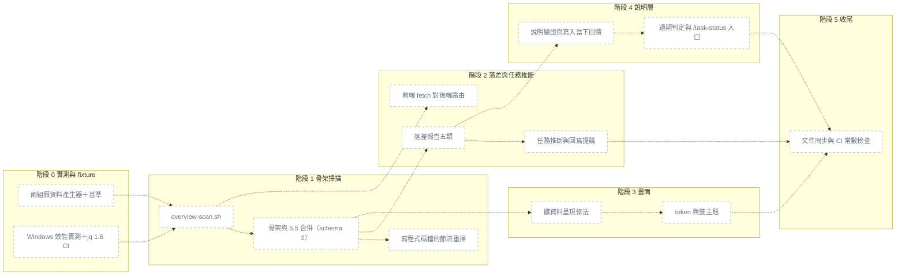

# 實作計畫：專案圖解改以程式碼為準（骨架掃描、落差報告、畫面修正、說明層）

## 目標

做完之後，沒有照模板格式寫架構文件的既有專案（例如 Python 後端＋TS 前端、文件放在 `docs/architecture/`、WBS 沒有模組欄）
打開專案圖解也會看到一張由程式碼掃出來的模組地圖：模組、依賴線、路由數都有，任務盡量對到模組，
文件、程式碼、WBS 三方對不上的地方列成「落差 N 項」。畫面保留現行互動，但在髒資料下不疊卡、不溢出、不洗版，並有深淺雙主題。
使用者同意後，documentation-specialist 會替每個模組寫一句白話說明，存進 git，過期才重寫。

## 一眼看懂

| id | 部件 | 階段 | 檔案 | 驗收 |
|---|---|---|---|---|
| p1 | 兩組假資料產生器＋基準 | 0 | `.claude/hooks/tests/fixtures/overview/**` | `make-fixture.sh shop-clean <dir>` 後跑現行 overview.sh → 6 個模組、`unmappedTasks` 為空 |
| p2 | Windows 效能實測＋jq 1.6 CI | 0 | `.claude/context/decisions/overview-scan-bench-*.md`, `.github/workflows/template-ci.yml` | CI 的 jq 1.6 job 印出 `jq-1.6` 並跑完 overview 節全綠 |
| p3 | overview-scan.sh | 1 | `.claude/scripts/overview-scan.sh` | forquery-like → 模組含 `backend-api` 與 `frontend-api`（跨套件撞名加套件前綴） |
| p4 | 骨架與 5.5 合併（schema 2） | 1 | `.claude/scripts/overview.sh` | shop-clean（5.5 有效）→ 模組 id 清單與階段 0 記下的基準完全相同 |
| p5 | 寫程式碼檔的節流重掃 | 1 | `.claude/hooks/post-write.sh` | 30 秒內第二次寫程式碼檔 → 不呼叫 overview.sh、stdout 為空 |
| p6 | 落差報告五類 | 2 | `.claude/scripts/overview.sh` | 5.5 寫了 `src/legacy/**`、沒有對應檔案 → `drift.docNotInCode` 含 `legacy` |
| p7 | 任務推斷與回寫提議 | 2 | `.claude/scripts/overview.sh`, `.claude/commands/task-status.md` | WBS 沒模組欄、plan `files:` 全在 orders 模組 → 該任務 `modules:["orders"]`、`inferredBy:"plan-files"` |
| p8 | 前端 fetch 對後端路由 | 2 | `.claude/scripts/overview-scan.sh` | 前端 `` fetch(`/api/orders/${id}`) ``＋後端 `prefix="/orders"` 的 `@router.get("/{order_id}")` → 一條 `source:"http"` 的邊 |
| p9 | 髒資料呈現修法 | 3 | `.claude/templates/overview/index.html`, `.claude/hooks/tests/fixtures/overview/qa-check.js` | forquery-like 在 390／1440 × 淺／深四種組合下，`qa-check.js` 回傳的六項全為 0／false |
| p10 | token 與雙主題 | 3 | `.claude/templates/overview/index.html`, `.claude/scripts/check-counts.sh` | token 區塊以外出現 hex 色碼 → `check-counts.sh` 失敗 |
| p11 | 說明驗證與寫入當下回饋 | 4 | `.claude/scripts/overview.sh`, `.claude/hooks/post-write.sh`, `.claude/skills/project-docs/module-notes.md` | 寫入含 `Server=db01` 的 module-notes.md → post-write 的 `additionalContext` 列出該列 |
| p12 | 過期判定與 /task-status 入口 | 4 | `.claude/scripts/overview.sh`, `.claude/commands/task-status.md`, `.claude/agents/documentation-specialist.md` | `based_on` 之後改過模組 A 的檔 → A 的 `description.stale` 為 true、B 為 false |
| p13 | 文件同步與 CI 常數檢查 | 5 | `.claude/scripts/check-counts.sh`, `.claude/guides/WORKFLOW.md`, `README.md` | `OVERVIEW_COLS_NOTES` 與附屬檔表頭不一致 → `check-counts.sh` 失敗 |

## WBS 連結

- ad-hoc，模板 repo 沒有 WBS。完成後 `/verify` 會問要不要補登
- 分支：`feat/overview-from-code`（已開）
- 總預估：約 31h（0：3h／1：8h／2：5h／3：6h／4：6h／5：3h）。比 standard 一般的量大，**每個階段各自合併**

## 依據

- 設計提案：`.claude/context/decisions/architect-2026-11-05-1500.md`（下稱「提案」）
- ADR-2026-11-05-001（骨架）、002（說明層）、003（畫面），三份已改為「已採納」並記下定案
- 定案問答：`.claude/qa-history/2026-11-05-153000-overview-from-code-adr.md`
- 坑：`.claude/context/learned/2026-11-04-jq-windows-non-ascii-path.md`、`2026-11-05-jq16-reserved-word-variable.md`

## 技術依賴

- 只用 bash、awk、jq、git（hook 本來就需要），不新增依賴
- **jq 只用 1.6 語法**：不用保留字當變數名、不用 1.7 之後的內建函式（`trim`、`ltrim`、`abs`、`toarray`、`pick`…，要用就自己 `def`）
- **jq 不用 `--rawfile`／`--slurpfile`／`-f` 讀含中文的絕對路徑**：掃描結果一律走 stdin 給 jq，或照 `generate()` 的做法複製到暫存目錄用 ASCII 相對檔名
- **awk 有兩種**：Git Bash 是 gawk，Ubuntu CI 預設是 mawk。mawk 對輸入中的 NUL 位元組支援不可靠，
  `git grep -z` 的輸出不要讓 awk 直接以 `\0` 切欄——要嘛 awk 只處理換行分隔的資料、要嘛先在 bash 端轉換。兩種 awk 都要在 CI 跑過
- 中文路徑：`git -c core.quotepath=off` ＋ `-z`；awk 用 `LC_ALL=C` 逐位元組處理；**字數一律用 jq 的 `length` 算**（awk 在 `LC_ALL=C` 下算的是位元組）
- 節流只用 bash 內建：`printf '%(%s)T' -1` 取時間、`read -r < 檔` 讀戳記、`printf > 檔` 寫戳記。bash < 4.2（macOS 內建 3.2）沒有 `%(%s)T`，退回 `date +%s`（多 1 個行程，可接受）
- 主 checkout 一律用 `git rev-parse --git-common-dir` 算（`overview.sh` 已這樣做）；骨架、節流戳記、`skeleton.json` 都屬「共享產物」，放主 checkout 的 `taskmaster-data/overview/`（該目錄的 `.gitignore` 是 `*`，不必另外忽略）
- hook 不寫模型會 Edit 的檔：notes、wbs、plan、架構文件都不寫

## 偏離提案的決定（實作者必讀）

| # | 提案寫的 | 本計畫的做法 | 理由 |
|---|---|---|---|
| D1 | fixture 是一個個實體檔放在 `fixtures/overview/` | 改成**產生器腳本** `make-fixture.sh <名稱> <目標目錄>`，用 heredoc 把檔案寫進測試沙箱；repo 裡只有 `.sh`、`qa-check.js` 與基準檔 | `.claude/hooks/tests/` 會被 copy-template 帶進每個新專案。實體的 `.py`、`.ts`、`pyproject.toml`、`package.json` 可能被專案自己的 pytest、tsc、eslint、依賴掃描撿到。產生器沒有這個風險，也不必改兩份 copy-template 的排除清單 |
| D2 | 撞名時加父層前綴（`admin-api`） | **跨套件撞名時加套件目錄名**（`backend-api`、`frontend-api`）；同一套件內撞名才加父層 | `backend/app/api` 與 `frontend/src/api` 的父層是 `app`、`src`，加上去得到 `app-api`、`src-api`，看不出是哪一邊 |
| D3 | 模組 id 取目錄名轉 kebab-case | 目錄名含非 ASCII 時，id 用 `m-` 加 6 碼雜湊（awk 在 `LC_ALL=C` 下算，不開額外行程），名稱保留原目錄名 | mermaid 節點 id 必須是 ASCII，否則 `overview.md` 的圖壞掉；雜湊讓同一路徑永遠得到同一 id |
| D4 | 32 個任務全部對到模組 | forquery-like 設計成 32 個任務：24 個有帶 `files:` 的 plan、4 個 plan 沒寫 `files:` 但有 diff、4 個沒有 plan → 驗收「28 個推斷成功、4 個列在一句區塊層級的說明裡」 | 沒有 plan 的任務既沒有 `files:` 也沒有 diff，推斷不出來；硬要全部對到只能靠猜任務標題，違反「不要猜」 |
| D5 | 落差與說明只寫進 data.js | 加兩個給模型讀的小出口：`overview.sh --print-inferred`（階段 2）、`overview.sh --notes-todo`（階段 4），輸出 TSV | R4 規定模型不讀 data.js／skeleton.json，但 `/task-status` 要提議回寫推斷結果、documentation-specialist 要知道哪些模組待寫，總得有個管道 |
| D6 | 前端 fetch 呼叫（使用者第 3 題補充）提案沒有規劃 | 放在**階段 2**、只做字串常值與 template literal 的路徑，對 FastAPI 的 `prefix=` 與路由做後綴比對，邊標 `source:"http"` | 前後端分開的專案沒有這條，前端和後端是兩座孤島。放階段 2 是為了讓階段 1 不要太大；可以整段砍掉不影響其他驗收 |
| D7 | jq 1.6 CI job 在階段 5 | **提前到階段 0** | 階段 1–4 每個都會新增 jq 程式。等到階段 5 才發現 1.6 編譯不過，要回頭改四個已合併的階段 |
| D8 | 標籤正規化（提案 6.2 第 1 項，腳本端）與「卡片顯示說明」的資料欄位歸在畫面階段 | 腳本端的正規化移到**階段 1**；畫面階段只碰 `index.html`、`qa-check.js`、`check-counts.sh` | 這樣階段 3 與階段 2、4 的檔案範圍完全不重疊，才能平行 |
| D9 | ADR-003 寫頁面上限 80KB | 沿用 `check-counts.sh` 現行的 **50KB** | 現行檢查本來就是 50KB，預估 40–45KB 放得下，不必放寬 |
| D10 | 既有測試只有「架構草稿不畫地圖」那幾條要改 | 實際會改的預期還有：`schema 為 1` 的 6 處、「寫一般程式檔 → 不產生」、`--print-path` 找不到架構文件的提示（清單見階段 1） | 逐條讀過 `run-tests.sh` 第 3258–3772 行後確認 |

## 階段拆解

每個階段的共同門檻（不另列在驗收裡）：`bash .claude/hooks/tests/run-tests.sh overview post-write` 全綠、
同一組在 jq 1.6 下也全綠（階段 0 起有 CI job）、`bash .claude/scripts/check-counts.sh` 全綠（新增的測試案例數依提示同步到文件）、
中文＋空格的主 checkout 路徑案例通過。審查照 `rules/task-mode.md`：standard 每階段 `code-quality-specialist`。

### 階段 0: 實測、fixture 產生器、jq 1.6 CI ⏳

- [ ] `.claude/hooks/tests/fixtures/overview/make-fixture.sh <shop-clean|forquery-like> <目標目錄>`：把檔案寫進目標目錄（不 `git init`，由呼叫端決定）
  - `shop-clean`：範例電商（照 `.claude/context/planning/overview-shop-clean-reference.md` 重建，那份是從使用者滿意的 artifact 抄出的原始資料），`docs/05_architecture.md` 帶有效的 5.1 與 5.5（6 個模組、3 個群組，路徑都對得到檔案），WBS 有模組欄、每個任務都有標，每個模組 2–5 個程式檔（Python＋TS）
  - `forquery-like`：**不含 for-query 的任何真實名稱或程式碼**，只複製結構特徵
    - `backend/pyproject.toml`、`backend/app/{api,services,models,core,<一個 ≥ 8 字的中文目錄>}/*.py`，含 FastAPI 的 `APIRouter(prefix=…)` 與 `@router.get(…)`，以及 `from app.services… import`、`from .x import`
    - `frontend/package.json`、`frontend/src/{api,pages,components,stores}/*.ts(x)`，含 `@/` 與相對路徑的 import、`fetch` 呼叫
    - `backend/tests/`、`frontend/src/__tests__/`（測試目錄，只計數不當模組）、一個只有 1 個檔的目錄（應併入「其他」）
    - `docs/architecture/01_system_architecture.md`：C4 系統情境圖（使用者、LDAP、MSSQL、Redis），標籤含 ` `、`&amp;`，**沒有**有效的 5.5
    - WBS 沒有模組欄、32 個任務；plan 分布照 D4（24 帶 `files:`、4 只有 diff、4 沒有 plan）
    - 3 個不在任何群組的模組、足以產生 5 則 notices 的條件
  - 名稱以外的參數 → exit 2 並印用法
- [ ] `.claude/hooks/tests/fixtures/overview/gen-large.sh <檔案數> <目標目錄>`：產生 N 個帶 import 的 `.py`／`.ts`，分散在 60 個目錄（也給階段 1 測「上限 40 個模組」用）
- [ ] 用**現行** overview.sh 跑 shop-clean，把模組 id、群組、邊記成 `fixtures/overview/shop-clean.golden`（純文字，一行一項）——這是階段 1「5.5 有效時 id 完全相同」的比對基準
- [ ] `run-tests.sh`：`_changed_rule` 加 `.claude/hooks/tests/fixtures/overview/*` → `=overview`、`.claude/scripts/overview-scan.sh` 併進第 66 行的規則（否則 `.claude/scripts/*` 會被判成 NONE、改掃描腳本不跑測試）；新增一小段驗產生器本身
- [ ] 在 Windows Git Bash 量：`git -c core.quotepath=off ls-files -z` 與一次 `git grep -z -n -I -E '<Python＋TS import 樣式聯集>'` 對 2,000／5,000 檔的耗時，加上 awk 解析一趟；行程數依設計逐一列出（不是量測值）。寫進 `.claude/context/decisions/overview-scan-bench-<日期>.md`
- [ ] `.github/workflows/template-ci.yml` 新增 job：下載官方 jq 1.6 linux64 執行檔（**釘 sha256**）放到 PATH 前面，跑 `run-tests.sh overview post-write`
- **預估**：3h
- **驗收**：
  - `make-fixture.sh shop-clean <dir>` 後 `git init`＋commit、跑現行 overview.sh → data.js 有 6 個模組、`unmappedTasks` 為空、沒有 `.last-error`
  - `make-fixture.sh forquery-like <dir>` → `docs/architecture/` 底下有一份檔名含 `architecture` 的 md、`wbs.md` 的任務表頭沒有「模組」、任務列恰好 32 列
  - `make-fixture.sh forquery-like <dir>` → 產生的檔案裡至少一個路徑含非 ASCII 字元，且 `git -c core.quotepath=off ls-files` 列得出原字元
  - `make-fixture.sh 不存在的名稱 <dir>` → exit 2、stderr 含用法
  - `gen-large.sh 5000 <dir>` 後 `git ls-files | wc -l` → 5000（不含產生器自己額外放的設定檔時）
  - `run-tests.sh --changed - --dry-run`，stdin 給 `.claude/scripts/overview-scan.sh` → 挑到 overview 那節，不是 NONE
  - [M] 實測報告列出 2k／5k 兩組的秒數與行程數；判讀：5k 檔 ≤ 3 秒、行程 ≤ 12 → 照原設計；超過 → 報告寫明「增量掃描提前到階段 1」，並在本 plan 的風險表補一列
  - CI 的 jq 1.6 job：`jq --version` 輸出 `jq-1.6`，且在**現行 main** 上跑 overview 與 post-write 兩節全綠（證明基線是 1.6 乾淨的）
- **不可退化**：本階段不動 overview.sh／post-write.sh；`run-tests.sh` 原有案例數只增不減
- **注意**：產生器寫中文目錄名時用 `printf` 寫入、不要靠 `echo -e`；Windows 上 heredoc 不要帶 CRLF（`.gitattributes` 若沒有覆蓋 `.sh`，提交前確認 `eol`）

### 階段 1: 骨架掃描與合併 ⏳

**1-A `overview-scan.sh`（獨立腳本，先不接線）**

- [ ] 新增 `.claude/scripts/overview-scan.sh <主 checkout 根目錄>`，輸出 `taskmaster-data/overview/skeleton.json`；演算法照提案 3.1 第 1–8 步，加上 D2、D3
- [ ] 排除：`.claude/`、`docs/`、vendor 與產物目錄（`node_modules/`、`dist/`、`build/`、`.venv/`、`__pycache__/`…）、`project.json` 的 `overview.scan.exclude`；測試目錄（`tests/`、`test/`、`__tests__/`、`*_test.go` 所在處）只計數
- [ ] 依賴邊：Python（`import x`、`from x.y import`、`from .x import`）、TS／JS（`from '…'`、`require('…')`、`import('…')`，只解析相對路徑與 `@/`→`src/`）優先完成；Go、Java／Kotlin、C# 照提案的對照法做，驗收只各放 1 個案例
- [ ] 路由：FastAPI／Flask 優先（`@app.get(`、`@router.post(`、`@app.route(`），Express、Spring、ASP.NET 各 1 個案例；每模組 `routes.count` 與前 20 條 `METHOD path`
- [ ] 快取：`key = HEAD sha ＋ 工作區改動清單`，key 相同就不重掃；寫檔走「暫存檔＋`mv`」
- [ ] 上限：`OVERVIEW_MAX_MODULES`（預設 40，超過時最小的併入 `other`）、`OVERVIEW_SCAN_MAX_FILES`（預設 20000，超過只做目錄層級、不掃邊、加 notice）；`overview.scan.roots`／`overview.scan.depth` 覆寫
- [ ] 檔頭註解寫明「給 overview.sh 與瀏覽器讀，模型不要讀」（R4）

**1-B 接進 `overview.sh` 與 hook**

- [ ] `overview.sh` 呼叫 `overview-scan.sh`，合併規則照提案 3.2：5.5 有效時路徑對得上的掃描模組改用 5.5 的 id、名稱、分組；5.5 有、對不到檔 → `source:"doc"`；掃到、5.5 沒寫 → `source:"scan"`；**5.5 有效時其餘行為（5.1 版面、未宣告節點、未分組）照舊**
- [ ] 沒有架構文件、或 5.5 格式不合 → 完全用掃描結果，5.1 對不到模組的節點（C4 的使用者、LDAP…）不畫
- [ ] `find_arch` 加入 `docs/**/*architecture*.md`（`overview.architectureDoc` 覆寫仍優先、`docs/*architecture*.md` 次之）
- [ ] 草稿標記的行為變更：帶 `<!-- overview: draft -->` 時照樣畫地圖，只是不拿那份文件覆寫
- [ ] 標籤正規化（D8）：所有來自 md 的 name／label 去 HTML 標籤、`<br\s*/?>` 換空白、解碼 `&amp;` `&lt;` `&gt;` `&quot;` `&#39;`、壓多餘空白
- [ ] data.js 升 `schema: 2`，新增 `scan`、`modules[].{nameSource,source,fileCount,routes,description}`、`edges[].source`、`tasks[]`、`drift`（五個 key、本階段都是空陣列）、`description` 一律 `null`——**這是階段 3 平行開工的合約，欄位名照提案第 7 節**
- [ ] `shrink_data`：超過 `OVERVIEW_MAX_BYTES` 時先丟 `routes.sample`，再走既有四級
- [ ] 沒有 jq 時寫的那份提示 data.js 改 `schema:2`
- [ ] `--print-path`：找不到架構文件 → **不再印提示**（地圖改由掃描產生）；草稿 → 提示改成「不拿它覆寫模組名稱；確認後移除標記」
- [ ] `post-write.sh` 專案圖解觸發段：寫入路徑相對 `WORK_ROOT` 後副檔名屬程式碼（常數 `OVERVIEW_CODE_EXT`：py ts tsx js jsx mjs cjs vue svelte go java kt cs rs）、且不在 `.claude/`、`docs/`、`node_modules/` 底下（錨定開頭）→ 節流觸發：讀主 checkout 的 `overview/.scan-at`，距今 < 30 秒（`OVERVIEW_THROTTLE_SEC`）就只用內建 `: > overview/.dirty`（overview 目錄存在時）然後跳過；否則寫戳記、照既有寫法背景跑 overview.sh。wbs／plan／架構文件的觸發**不受節流**
- [ ] `task-status.md` 步驟 7 的兩個提示分支改成新行為（找不到架構文件不再出現；草稿的說法改掉）
- [ ] `hooks/README.md`：post-write 功能表與檔案結構樹的說明加「寫程式碼檔時節流重掃」（hook 數不變，check-counts 不會提醒）
- [ ] 改既有測試預期（D10，逐條）：第 3369、3411、3414、3762、3769 行的 `.schema` 1→2；第 3741 行沒有 jq 的 `schema 1`；第 3423–3426 行架構草稿（改成「照畫、`architectureDraft` 仍為 true」）；第 3447–3448 行「寫一般程式檔 → 不產生」（改成節流案例）；第 3750–3756 行 `--print-path` 的提示

- **預估**：8h
- **驗收**：
  - shop-clean（5.5 有效）→ `[.modules[].id]` 排序後與 `shop-clean.golden` 的模組 id 完全相同，`unmappedTasks` 為空
  - shop-clean → 每個模組的 `source` 都是 `"both"`
  - 5.5 多一列 `src/legacy/**`、沒有對應檔 → 該模組存在且 `source:"doc"`
  - 程式多一個 `src/search/` 目錄（2 個檔）、5.5 沒寫 → 出現 `search` 模組、`source:"scan"`
  - forquery-like → 模組含 `backend-api` 與 `frontend-api`
  - forquery-like → 沒有任何 `fileCount == 0` 的模組（C4 的使用者、LDAP、MSSQL、Redis 都沒畫出來）
  - forquery-like → 沒有 id 以 `tests` 或 `__tests__` 結尾的模組，且 `scan.files` 不含 `docs/`、`.claude/` 底下的檔
  - forquery-like 的中文目錄 → 模組 id 符合 `^[a-z0-9-]+$`、`name` 等於原目錄名；連跑兩次 id 相同
  - 只有 1 個檔的目錄 → 不單獨成模組，該檔計入 `other`
  - `gen-large.sh` 產生 60 個各 ≥ 2 檔的目錄 → `modules | length` 為 40，其中一個是 `other`
  - `backend/app/api/orders.py` 寫 `from app.services.orders import create` → 有一條 `from` 為 api、`to` 為 services、`source:"import"` 的邊
  - `frontend/src/pages/Cart.tsx` 寫 `import { useCart } from '@/stores/cart'` → 有 pages→stores 的邊；`import React from 'react'` → 不產生邊
  - 模組裡 3 個 FastAPI decorator → `routes.count` 為 3，`routes.sample` 含 `"GET /orders"`
  - 第二次執行、HEAD 與工作區都沒變 → `skeleton.json` 的 mtime 不變、data.js 的 `scan.cached` 為 true
  - 新增一個程式檔後再跑 → `scan.cached` 為 false、`scan.files` 加 1
  - `OVERVIEW_SCAN_MAX_FILES=10` → `edges` 中 `source:"import"` 的數量為 0、`scan.truncated` 為 true、notices 有一則說明
  - 主 checkout 路徑含中文與空格 → 掃描與合併都成功，沒有 `.last-error`
  - 架構文件放在 `docs/architecture/x_architecture.md`、`project.json` 沒有覆寫 → `project.architectureDoc` 指向它
  - `project.json` 設 `overview.architectureDoc` → 優先用它，即使 `docs/architecture/` 也有一份
  - 架構文件帶草稿標記 → `modules | length` > 0、`project.architectureDraft` 為 true、模組名稱不取自該文件
  - 5.1 標籤 `訂單 處理&amp;出貨` → data.js 中對應名稱為 `訂單 處理&出貨`；整份 data.js 的所有 `name`、`label` 都不含 `<`、`&lt;`、`\n`
  - data.js 的 `schema` 為 2、`drift` 有五個 key 且都是陣列、每個模組都有 `description` 欄（值為 null）
  - 寫 `src/app.py`、沒有 `.scan-at` → 替身 overview.sh 被呼叫 1 次、主 checkout 出現 `.scan-at`
  - `.scan-at` 是 5 秒前 → 再寫 `src/app.py`，替身沒被呼叫、hook stdout 為空
  - `.scan-at` 是 31 秒前 → 寫 `src/app.py`，替身被呼叫 1 次
  - 節流視窗內、`overview/.lock` 存在 → 寫程式檔後留下 `overview/.dirty`
  - 寫 `.claude/scripts/x.py`、`docs/x.py`、`src/readme.md` → 替身都沒被呼叫
  - `.scan-at` 是 5 秒前 → 寫 plan 仍會觸發（wbs／plan 不受節流）
  - `OVERVIEW=off` → 寫程式檔不觸發
  - 在 worktree 寫程式檔 → `.scan-at` 與 data.js 都寫在主 checkout，worktree 底下沒有 `overview/`
  - `--print-path`：沒有架構文件 → 輸出沒有 `提示：` 開頭的行
- **不可退化**：除 D10 列出的預期外，`overview.sh — 專案地圖` 節（含任務圖、`--actual`、鎖、worktree overlay、大小上限、中文路徑）原樣通過；shop-clean 的 golden 比對通過
- **注意**：
  - `git grep` 的樣式聯集要用 `-E` 且只錨定行首（R2），一次呼叫掃完；Windows 上每多一個行程約 170ms
  - 路徑對 5.5 的 glob 比對沿用 overview.sh 既有的 glob→regex 函式，不要另寫一份
  - 雜湊 id（D3）要在 gawk 與 mawk 下得到同一個值（整數運算避免超過 2^31，取模）

### 階段 2: 落差報告、任務推斷、前後端連線 ⏳

- [ ] `drift` 五類照提案第 4 節：`codeNotInDoc`（只在有 5.5 時報）、`docNotInCode`、`taskModuleMismatch`、`wbsUnknownModule`（附「可能的新 id」：該任務 plan `files:` 落在的模組）、`tasksInferred`
- [ ] 任務推斷照提案 3.3：WBS 沒有模組欄、或該列是 `—` → 依 plan 的 `files:`，沒有 `files:` 再用該 plan 的 diff；`tasks[].inferred`、`inferredBy`（`plan-files`／`diff`）。WBS 明標的一律優先、不標 inferred
- [ ] 推斷出的模組參與燈號計算（與明標相同），推斷不出的任務維持在 `unmappedTasks`
- [ ] `overview.md` 新增「## 落差」一節：各類數量＋前 10 項明細；五類都是 0 時整節不出現
- [ ] `overview.sh --print-inferred`：一行一筆 `任務編號<TAB>模組 id（多個用逗號）<TAB>依據`；沒有推斷結果時不輸出
- [ ] `--print-path`：有推斷結果時多印一行 `提示：N 個任務的模組是由 plan 推斷的，/task-status 可提議寫回 WBS`
- [ ] `task-status.md`「補模組欄」節：收到上面那行提示時，跑 `--print-inferred`，把結果做成預覽（哪一列、填什麼），用 AskUserQuestion 問 寫回（Recommended）／先看預覽／不要；WBS 還沒有模組欄時先走既有的補欄流程。**只動 `wbs.md`**
- [ ] 前後端 HTTP 連線（D6）在 `overview-scan.sh`：前端 `fetch('…')`、`` fetch(`…`) ``、`axios.<method>('…')` 的路徑常值；後端 FastAPI 的 `APIRouter(prefix=…)` 與 decorator 路徑。路徑參數（`{id}`、`:id`、`${…}`）正規化成 `*`，去掉前端的 `/api` 前綴後做後綴比對；邊標 `source:"http"`
- [ ] `shrink_data`：drift 明細超過上限時改成只留數量
- **預估**：5h
- **驗收**：
  - 有效 5.5 沒寫、程式有 `src/search/` → `drift.codeNotInDoc` 含 `search`
  - 沒有架構文件、掃到 8 個模組 → `drift.codeNotInDoc` 為空陣列
  - 5.5 寫了 `src/legacy/**`、沒有對應檔 → `drift.docNotInCode` 含 `legacy`
  - 5.5 的路徑全部對得到檔案 → `drift.docNotInCode` 為空陣列
  - WBS 標 `api`、plan `files:` 只有 `src/web/**` → `drift.taskModuleMismatch` 有一筆 `task:"1.2"`、`declared:["api"]`、`actual:["web"]`
  - WBS 標 `api`、plan 同時碰 `src/api/` 與 `src/web/` → `taskModuleMismatch` 沒有這個任務
  - WBS 模組欄寫 `payment`、骨架沒有這個 id、該任務 plan `files:` 在 `src/pay/**` → `drift.wbsUnknownModule` 有一筆 `module:"payment"`、`suggest:"pay"`
  - WBS 模組欄寫 `—` → `wbsUnknownModule` 不含這列
  - WBS 沒有模組欄、plan `files:` 全在 `backend/app/services/**` → `tasks[]` 該任務 `modules:["services"]`、`inferred:true`、`inferredBy:"plan-files"`
  - plan 沒寫 `files:`、但帳本 BASE 之後的 diff 落在 `frontend/src/pages/` → `inferredBy:"diff"`、`modules:["pages"]`
  - WBS 有明標 `api` → 即使 plan `files:` 在別處，`tasks[]` 該任務 `inferred` 不是 true
  - forquery-like → `tasks[]` 中有模組的 28 個（24 個 `plan-files`、4 個 `diff`）、`unmappedTasks` 恰好 4 個
  - forquery-like → 「還沒對到模組」的說明在 notices 裡只出現 1 則
  - 推斷出 `services` 的任務是 🚫 阻塞 → `services` 模組 status 為 `issue`
  - 五類落差都是 0 → `overview.md` 沒有 `## 落差`；有落差 → 有這一節且列出各類數量
  - `--print-inferred` 在 forquery-like 上 → 28 行，每行 3 欄以 tab 分隔；沒有推斷結果的專案 → 輸出為空
  - 有推斷結果 → `--print-path` 有一行以 `提示：` 開頭且含「推斷」
  - 前端 `` fetch(`/api/orders/${id}`) ``、後端 `APIRouter(prefix="/orders")` 的 `@router.get("/{order_id}")` → 有一條 `from:"frontend-api"`、`to` 為 orders 所在模組、`source:"http"` 的邊
  - `fetch('https://example.com/x')` → 不產生邊；前端打到後端沒有的路徑 → 不產生邊
- **不可退化**：既有 `mismatch` 兩條（`declared-not-touched`／`touched-not-declared`，第 3606–3607 行）原樣通過；shop-clean 的 `drift` 五類全空、`tasks[]` 全部 `inferred` 不為 true
- **注意**：推斷用的 `files:` glob 與模組路徑的交集沿用既有 glob→regex；`--print-inferred` 的輸出經 jq `-r` 印出、tab 用 `@tsv`（jq 1.5 起就有，1.6 可用）

### 階段 3: 畫面（ui-builder，可與階段 2、4 平行） ⏳

- [ ] 提案 6.2 的頁面端修法：未分組獨立一欄放最右（全部未分組就不畫群組框）、全圖範圍改 `world.getBBox()`＋留白（小地圖共用）、同欄遠距連線從右側繞出、邊的標籤只在右側欄、`fitText(textEl, maxW, maxLines)`（等 `document.fonts.ready` 再量、名稱兩行時卡片長高）、沒有資料的列直接省略、任務列最多 6 個＋「＋N」且推斷任務加虛線底線、縮放 ≥ 55% 時顯示 `description.text` 第一行、`el()` 再防禦一次標籤
- [ ] Q1–Q14：語意 token、`prefers-color-scheme`＋`:root[data-theme]` 雙向覆寫、右上角切換鈕（`aria-pressed`，存 `localStorage` 的 `overview-theme`）、字型三角色（系統字型、不載外部字型）、資訊層次、notices 收成「⚠ N 則提示」chip、「落差 N 項」chip（預設收起，點開在右側欄列明細）、觸控目標 ≥ 44px、`focus-visible`、`prefers-reduced-motion`
- [ ] 讀到 `schema` 不是 2 → 顯示一則「請重產（跑一次 /task-status）」
- [ ] `.claude/hooks/tests/fixtures/overview/qa-check.js`：給 `browser_evaluate` 用，回傳 `{overlaps, outOfBounds, brCount, dupEmpty, overflowText, hScroll}`
- [ ] `check-counts.sh`：`index.html` 的 `:root`／`[data-theme]`／`prefers-color-scheme` token 區塊以外不得有 hex 色碼；沒有外部網址（`src=`、`href=`、`url(`、`@import`；`http://www.w3.org/2000/svg` 命名空間例外）；大小 ≤ 50KB（D9）
- [ ] 截圖：用階段 0 的產生器＋階段 1 的 overview.sh 在 `.claude/tmp/overview-fixtures/<名稱>/` 產出 data.js；需要落差或說明資料時，在 `.claude/tmp/` 複製一份 data.js 手動補欄位（不改 repo 裡任何檔）
- **預估**：6h
- **驗收**：
  - `index.html` 在 token 區塊外寫一個 `#fff` → `check-counts.sh` 失敗並指出行號；拿掉後通過
  - `index.html` 加一個 `<link href="https://fonts.googleapis.com/…">` → `check-counts.sh` 失敗；SVG 命名空間的 `http://www.w3.org/2000/svg` 不觸發
  - `index.html` 超過 51200 bytes → `check-counts.sh` 失敗
  - [M] shop-clean 與 forquery-like × 390／1440 × 淺色／深色共 8 種組合，`qa-check.js` 回傳的六項全為 0 或 false
  - [M] 8 張截圖與參考 artifact 並排給使用者確認；shop-clean 的 1440 淺色與現行版面相比，群組、卡片、連線的位置沒有變
  - [M] forquery-like 截圖：右上角只有「⚠ 5 則提示」一個 chip，點開後 warn 等級排在前面
  - [M] forquery-like 截圖：3 個未分組模組在最右邊一欄、欄名「未分組」，彼此不重疊
  - [M] 名稱超過兩行寬度的中文模組 → 卡片顯示兩行、結尾「…」，滑鼠停留的 `<title>` 與右側欄顯示全名
  - [M] 一個模組掛 9 個任務 → 卡片列 6 個任務 id 加「＋3」；推斷出來的任務 id 有虛線底線
  - [M] 頁首有「落差 N 項」chip、預設收起；點開後右側欄列出各類明細
  - [M] 補了 `description` 的 data.js、縮放 ≥ 55% → 卡片顯示說明第一行；`description` 為 null 的模組沒有空白的說明列
  - [M] 系統是深色 → 首次開啟為深色；按切換鈕改成淺色、重新整理後仍是淺色
  - [M] `browser_evaluate` 算兩個主題下 `--fg`／`--muted` 對 `--bg`／`--surface` 的對比 → 全部 ≥ 4.5
  - [M] 用 Tab 走一輪：每個按鈕都有可見的焦點外框；縮放鈕的量測尺寸 ≥ 44×44
  - [M] 開啟 reduced-motion 模擬、點檔案 → 直接跳到所屬模組，沒有飛行動畫
  - [M] 餵 `schema:1` 的 data.js → 頁面顯示「請重產」那則提示
  - [M] 390px 截圖：頁面本身沒有水平捲軸，右側欄在畫布下方
  - [M] 階段報告附上 `anti-ai.md` 產出後清單的逐項對照
- **不可退化**：互動模型不變（點點底紋、平移縮放、小地圖、縮放分層、點模組開右側欄、點檔案飛到模組、節點不可拖）；`overview.sh` 測試中「overview/index.html 與畫面原檔相同」照過
- **注意**：
  - Playwright 開 `file://` 時，主 checkout 在 `D:\模板\…` 這種非 ASCII 路徑要先 percent-encode；在 worktree 跑時用 worktree 自己的 `.claude/tmp/`
  - 頁面只讀新增欄位，**不得**要求 overview.sh 改欄位名；需要的資料欄位不在提案第 7 節時，回報 `NEEDS_CONTEXT` 而不是自己去改腳本
  - ui-builder 是 subagent：**本 plan 檔只讀**，階段狀態由主模型改

### 階段 4: 說明層 ⏳

- [ ] `.claude/skills/project-docs/module-notes.md`（附屬檔，唯一來源）：格式（提案 5.1）、寫作標準（5.2，含禁寫項目與每模組最多讀 3 檔 × 200 行）、範例與反例
- [ ] `overview.sh` 讀 `.claude/taskmaster-data/module-notes.md`（常數 `OVERVIEW_COLS_NOTES="id 名稱 分組 說明 依據"`）：通過驗證的列填進 `modules[].description` 與名稱、分組（優先序：5.5 → notes → 目錄名）；沒通過的列當作沒有說明
- [ ] `overview.sh --check-notes`：規則照提案 5.3；字數用 jq `length`；有違規時 stdout 一行一筆 `第 N 列 <id>：<原因>`、exit 1；沒違規時 stdout 為空、exit 0
- [ ] 過期判定（提案 5.4）：`git diff --name-only <based_on>`＋工作區改動對到模組 → `description.stale`；`based_on` 不是有效 commit → 全部 stale 並加 notice
- [ ] `overview.sh --notes-todo`（D5）：沒有說明或過期的模組，一行一筆 `id<TAB>路徑<TAB>代表檔（最多 3 個：進入點、最大的檔、路由檔）<TAB>missing|stale`
- [ ] `--print-path` 加一行 `提示：N 個模組沒有說明、M 個可能過期`（兩者都是 0 不印）；`project.json` 的 `overview.notes` 為 `"off"` 時不讀 notes、不印這行
- [ ] `post-write.sh`：寫入 `taskmaster-data/module-notes.md` 時前景跑 `--check-notes`，有違規就以 `additionalContext` 注入、沒有就不輸出；同時照既有寫法背景重產。**這段要放在 `.suggest-mode` 判斷與「擴充維護提醒」的 exit 之前**（後者命中 `.claude/` 底下的檔會提早結束）
- [ ] `task-status.md` 步驟 7：收到「N 個模組沒有說明、M 個可能過期」提示時，用 AskUserQuestion 問 只更新過期的（Recommended）／全部重寫／先不要（本 session 不再提）；說明程式碼片段會經 Claude Code 送到 Anthropic。**永遠不自動執行**
- [ ] `documentation-specialist.md` 新增「寫模組說明」節：先讀附屬檔（寫明完整路徑）→ 跑 `--notes-todo` → 每模組照規定讀檔 → 寫 `module-notes.md`、`based_on` 填當下 HEAD → 看 post-write 注入的違規並修到沒有
- [ ] `hooks/README.md`：post-write 功能表加「寫入 module-notes.md 時驗證並注入違規」
- [ ] `make-fixture.sh` 加一個選項產生一份 forquery-like 的 module-notes.md（含刻意違規的列，給測試用）
- **預估**：6h
- **驗收**：
  - 格式正確、id 都在骨架裡的 notes → `--check-notes` exit 0、stdout 為空
  - 某列 id 是 `nope`、骨架沒有 → 輸出含 `nope` 與「不存在」
  - 名稱 13 個全形字 → 違規；12 個全形字 → 不違規
  - 說明 61 字 → 違規；60 字 → 不違規
  - 依據檔案不存在 → 違規；依據檔案存在但不在該模組路徑內 → 違規
  - 說明含 `10.1.2.3`、`Server=db01`、`Data Source=x`、`password`、`pwd=1`、`https://u:p@host`、`a@b.com` → 7 個案例各自違規
  - 說明含 `版本 1.2.3` → 不違規
  - 表頭少了「依據」欄 → 違規且原因含「表頭」
  - post-write 收到寫入 `module-notes.md`、內容含 `Server=db01` 的 payload → stdout 為 JSON、`additionalContext` 含該列的列號與 id
  - post-write 收到寫入合格 `module-notes.md` → stdout 為空
  - `.suggest-mode` 為 off 時寫入含違規的 notes → 仍注入（這是品質檢查，不是建議）
  - notes 有 `auth` 一列、5.5 也有 `auth` → 名稱取 5.5、`nameSource:"doc"`；沒有 5.5 → 名稱取 notes、`nameSource:"notes"`
  - 某列違規 → 該模組 `description` 為 null，其他合格列照常填入
  - `based_on` 為 HEAD~1、之後改了 `backend/app/services/a.py` → `services` 的 `description.stale` 為 true、`api` 為 false
  - `based_on` 是不存在的 sha → 所有有說明的模組 stale 為 true、notices 有一則說明
  - 10 個模組中 3 個沒說明、2 個過期 → `--print-path` 有 `提示：3 個模組沒有說明、2 個可能過期`
  - `overview.notes: "off"` → 所有 `description` 為 null、`--print-path` 沒有說明層的提示行
  - `--notes-todo` → 只列沒有說明或過期的模組，每行 4 欄、第 3 欄最多 3 個檔且都在該模組路徑內
  - [M] 在 forquery-like 上實跑一次 documentation-specialist，人工抽查 5 個模組的說明是否正確、有沒有違反禁寫項目
- **不可退化**：沒有 `module-notes.md` 時，所有模組的名稱、分組與階段 1 完成時相同；`--check-notes` 不在背景重產時執行（背景只讀、不驗）
- **注意**：
  - 機密樣式比對不分大小寫；IPv4 樣式要求四段、每段 1–3 位數，避免誤判版本號
  - notes 檔可能含中文絕對路徑相關的讀取 → 照 learned 的做法走 stdin 或暫存 ASCII 檔名
  - 秘密樣式的規則是安全相關的保護，建議本階段除了 code-quality-specialist 也請 `security-infrastructure-auditor` 看一次樣式清單（選配，見「需要確認」）

### 階段 5: 文件同步與 CI 常數檢查 ⏳

- [ ] `check-counts.sh`：`OVERVIEW_COLS_NOTES` 對 `project-docs/module-notes.md` 範例表頭；`documentation-specialist.md` 寫到的附屬檔路徑存在
- [ ] `.claude/guides/WORKFLOW.md`、`README.md`、`.claude/README.md`：專案圖解改成「骨架掃程式碼、進度看 WBS／plan、說明按需」；寫明 SSH 遠端怎麼開（VS Code Remote 開遠端的 `overview/index.html`，或把 `overview/` 資料夾整個下載回本機）——不做匯出功能
- [ ] `05_architecture_and_design_document.md` 的 5.5：改成「選配覆寫——有寫就沿用你的 id、名稱、分組；沒寫地圖照樣由程式碼產生」
- [ ] `architect.md`：「5.5＝設計意圖、掃描＝現況，兩者不一致時看落差報告」
- [ ] `documentation-specialist.md`「沒有架構文件時：從程式碼反推草稿」節：改成選配（地圖不再依賴它），觸發來源不再是 `--print-path` 的提示
- [ ] `hooks/tests/README.md`：fixture 產生器與 `qa-check.js` 的用法
- [ ] 壓力測試題 `.claude/tests/skill-compliance/prompts/11-overview-old-project.txt` 與其評分標準改成新行為（「這個舊專案長什麼樣」應看地圖與落差、會提議寫說明而不是要求補架構文件）
- [ ] 階段 3 在平行期間用手補資料截的圖，在 2、3、4 都合併後用真資料重跑一次 `qa-check.js` 與 8 張截圖
- **預估**：3h
- **驗收**：
  - 把 `module-notes.md` 附屬檔的表頭「依據」改成「來源」→ `check-counts.sh` 失敗並指出 `OVERVIEW_COLS_NOTES`；改回後通過
  - `documentation-specialist.md` 裡的附屬檔路徑改錯一個字 → `check-counts.sh` 失敗
  - `WORKFLOW.md` 有一段說明 SSH 遠端用 VS Code Remote 開畫面（grep 得到 `VS Code`、`overview/index.html`）
  - 05 範本的 5.5 說明含「選配」
  - [M] 2、3、4 合併後，兩組 fixture × 4 種組合重跑 `qa-check.js` 全為 0／false
  - [M] 使用者在 for-query 本機跑一次 `update-template` ＋ `/task-status`：地圖不是全灰、任務對到模組的比例、落差項目合理（結果由使用者回報，不寫進 repo）
  - [M] `run-compliance.sh` 跑第 11 題，結果寫進 results 目錄的判讀
- **不可退化**：`check-counts.sh` 既有檢查全部仍在；CI 六個 job 全綠
- **注意**：`skill-compliance` 第 11 題在模板 repo 跑不到正向情境（CLAUDE.md「已知落差」），要在有應用程式碼的專案裡跑才算數

## 選做（不排入本計畫）

提案階段 6，等本計畫完成、照 ADR-001「何時該重新考慮」的條件決定：

- 外部系統欄：從第三方 import 認出 redis、ldap、pyodbc 等，畫在地圖邊緣
- codegraph adapter：`edges[].source:"codegraph"`。條件：C#／Java 專案實測依賴邊漏掉超過三成
- 增量掃描：條件是 5,000 檔在 Windows Git Bash 超過 5 秒（階段 0 實測若已超標則提前到階段 1）

## 平行開發

| 組合 | 可否 | 條件 |
|---|---|---|
| 0 → 1 | 循序 | 1 要用 0 的產生器與 golden |
| 1 → 2 | 循序 | 都改 `overview.sh`、`overview-scan.sh`、`run-tests.sh` |
| 2 → 4 | 循序 | 都改 `overview.sh`、`post-write.sh`、`run-tests.sh`、`task-status.md` |
| **3 ∥ 2、3 ∥ 4** | **可平行** | 見下 |
| 5 | 最後 | 依賴 2、3、4 |

階段 3 平行開工的條件（全部成立才派）：

1. 階段 1 已合併：data.js 是 schema 2，`drift` 五個 key 與每個模組的 `description` 欄都已存在（值為空），欄位名照提案第 7 節
2. 階段 0、1 的產物與**本 plan 檔**已 commit（`plans/` 在 `.git/info/exclude` 裡，要 `git add -f`）；worktree 從本地 HEAD 開分支，沒 commit 的帶不進去
3. 用 `Agent` 派 `ui-builder` 時帶 `isolation: "worktree"`（它的 frontmatter 沒有設 isolation）
4. 階段 3 只寫 `index.html`、`qa-check.js`、`check-counts.sh`；階段 2、4 不得碰這三個檔（`check-counts.sh` 的 notes 常數檢查因此排在階段 5）
5. 階段 3 需要的落差／說明資料用 `.claude/tmp/` 裡手補的 data.js 截圖；最終以真資料重跑的驗收排在階段 5
6. 合併順序：先合先完成的那條；兩邊沒有共同檔，預期零衝突。合併前跑 `run-tests.sh overview`

## 風險與緩解

| 風險 | 影響 | 緩解 |
|---|---|---|
| 掃描在 Windows Git Bash 超過 3 秒（5k 檔） | MEDIUM | 階段 0 先量；超標就把增量掃描提前到階段 1；本來就在背景跑，不卡 hook |
| mawk 與 gawk 行為不同（NUL、整數溢位、`length` 單位） | HIGH | 不讓 awk 吃 NUL；雜湊取模；字數交給 jq；Ubuntu（mawk）與 Windows（gawk）兩個 CI job 都要綠 |
| jq 1.6 不相容再次漏網 | HIGH | 階段 0 就建 jq 1.6 CI job（D7）；保留字靜態掃描已涵蓋 `.claude/scripts/*.sh`，新腳本自動納入 |
| post-write 改壞 → 所有寫入的 hook 失效 | HIGH | `post-write.sh` 自身的語法檢查與 `run-tests.sh` 全體語法節；節流段在視窗內只用內建指令，常態成本為 0 |
| 自動切出的模組粒度不符直覺 | MEDIUM | 上限 40、`overview.scan.roots`／`depth` 覆寫；5.5 有效時以它為準 |
| 目錄改名讓 WBS 的模組 id 斷掉 | MEDIUM | `wbsUnknownModule` 附建議的新 id |
| 前端 fetch 對後端路由的後綴比對誤連 | LOW | 只連得上唯一候選時才畫；可整段砍掉（D6） |
| 模型去 Read `skeleton.json`、data.js | MEDIUM | 檔頭註明；`--print-inferred`、`--notes-todo` 提供小出口（D5） |
| 說明寫進客戶機密 | HIGH | `--check-notes` 樣式＋寫入當下注入＋附屬檔禁寫清單＋`based_on` 供抽查；`overview.notes: off` 整個關掉 |
| 階段 3 平行期間 schema 被階段 2 改動 | MEDIUM | schema 2 的欄位名在階段 1 定死；階段 2 只填值不改名 |
| fixture 不小心帶入真實客戶名稱 | HIGH | 產生器只用通用電商／查詢系統詞彙；每階段審查時 grep 一次 |

## 驗收標準（整體）

- [ ] 所有階段狀態為 ✅
- [ ] 每階段審查無未解的 CRITICAL/HIGH（審查節奏見 `rules/task-mode.md`）
- [ ] `run-tests.sh` 整套在 Ubuntu、Windows、jq 1.6 三個 CI job 都綠
- [ ] 使用者確認 8 張截圖，並在 for-query 實跑一輪
