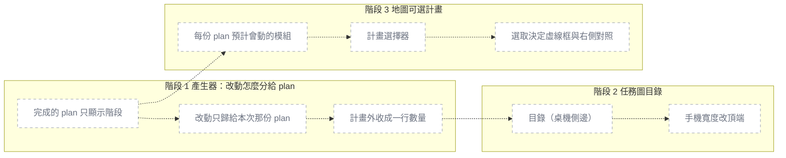

# 專案圖解看得懂：完成的 plan 不再算改動、任務圖加目錄、地圖可選計畫

## 為什麼做

使用者的專案（smartwork，14 份 plan）裡，任務圖把同一批工作區改動分給每一份沒帳本的 plan（7.59 顯示「計畫外：.gitignore」）、
已完成的 11.38 因為帳本的 BASE 停在 2021 個 commit 前而列出「計畫外（另 170 個檔）」，計畫外又一檔一張卡片，整頁讀不下去；
14 張卡片沒有目錄，地圖的「plan 預計會動」只畫得出被猜成本次的那一份。

### PRD 情境變更

無（模板 repo 沒有 PRD；行為變更寫在下方「改善了什麼」）

### 資料流變更

無

## 怎麼做

**可平行**：無。三個階段的部件「檔案」兩兩有交集：階段 1 與 2 都改 `index.html`；階段 1 與 3 都改 `overview.sh`、`run-tests.sh`、`index.html`；階段 2 與 3 都改 `index.html`。另外階段 3 讀階段 1 產出的 `plans[].completed` 欄位（依賴）。依序 1 → 2 → 3。

### 一眼看懂

| id | 部件                     | 階段 | 檔案                                                                   | 驗收                                                                                                                                     |
| ---- | -------------------------- | ------ | ------------------------------------------------------------------------ | ------------------------------------------------------------------------------------------------------------------------------------------ |
| p1 | 完成的 plan 只顯示階段   | 1    | `.claude/scripts/overview.sh`, `.claude/hooks/tests/run-tests.sh`      | status `✅ 完成`、帳本 BASE 在 2 個 commit 前 → 該 plan `changes` 為 `[]`、`extraCount` 為 0、部件全是 `done`                           |
| p2 | 改動只歸給本次那份 plan  | 1    | `.claude/scripts/overview.sh`, `.claude/hooks/tests/run-tests.sh`      | `.current-task` 是 1.3、工作區改了 `src/api/c.ts` → 1.3 的 `changes` 含它、1.2（沒帳本）的 `changes` 為 `[]` 且 `changesFrom` 是 `none` |
| p3 | 計畫外收成一行數量       | 1    | `.claude/scripts/overview.sh`, `.claude/templates/overview/index.html` | 本次 plan 有 35 個計畫外檔 → overview.md 的任務圖 mermaid 只有一個「＋ 計畫外 35 個檔」節點                                             |
| p4 | 目錄（桌機側邊）         | 2    | `.claude/templates/overview/index.html`                                | 1440px 寬、14 份 plan → 卡片左側有 14 列目錄，點第 10 列後第 10 張卡的上緣在任務圖可視區頂端 16px 內（截圖驗收）                        |
| p5 | 手機寬度改頂端           | 2    | `.claude/templates/overview/index.html`                                | 390px 寬 → 目錄在第一張卡上方、頁面沒有水平捲軸（截圖驗收）                                                                             |
| p6 | 每份 plan 預計會動的模組 | 3    | `.claude/scripts/overview.sh`, `.claude/hooks/tests/run-tests.sh`      | 兩份 plan 的 `files:` 分別在 svc-a、web → `plans[]` 各帶 `plannedModules` `["svc-a"]`、`["web"]`                                        |
| p7 | 計畫選擇器               | 3    | `.claude/templates/overview/index.html`                                | 打開選擇器 → 只列未完成的 plan，本次那份預設勾選（截圖驗收）                                                                            |
| p8 | 選取決定虛線框與右側對照 | 3    | `.claude/templates/overview/index.html`                                | 勾選兩份 plan → 虛線框畫在兩份 `plannedModules` 的聯集上（截圖驗收）                                                                    |

### 階段 1: 產生器——完成的 plan 不算改動、改動只歸本次、計畫外收成一行 ✅

- **依賴**：無

- [ ]  `build_plan` 判定「已完成」：`status` 含 ✅，或 `phases` 至少一個且全部 `done`。已完成的 plan 不呼叫 `changes_for`：`changes`、`changesRollup` 為 `[]`、`base` 為 null、沒有計畫外部件；部件狀態只看階段（階段 done → `done`，其餘照階段狀態 `wip`／`planned`）。輸出新欄位 `completed: true` — 驗證：`bash .claude/hooks/tests/run-tests.sh --changed <本階段起點>`
- [ ]  `changes_for` 改規則：有帳本且 BASE 有效 → 照舊（帳本 diff＋未追蹤）；否則只有「`.current-task` 明確指到、且來源相同」的那份 plan 拿該來源的預設基準改動；其他 plan 一律空清單。每份 plan 輸出 `changesFrom`：`ledger`／`current`／`none`／`completed` — 驗證：同上
- [ ]  `--actual` 指定的那份 plan（`$vSrc`／`$vFile`）不套「已完成」與「只歸本次」兩條，照舊算改動（`/verify` 寫「計畫 vs 實際」時，plan 通常已全部階段 ✅）— 驗證：同上
- [ ]  `notices_for` 的「找不到比較基準」只在 `changesFrom` 是 `ledger` 或 `current` 且 `base == null` 時出現 — 驗證：同上
- [ ]  每份 plan 輸出 `extraCount`（計畫外檔的總數，含沒列出的）；`taskgraph` 的 mermaid 把逐檔的「＋ 計畫外 <檔>」節點收成一個「＋ 計畫外 N 個檔」節點（表格 `ptable` 不動）— 驗證：同上
- [ ]  `index.html` 的 `planCard`：拿掉「計畫外」那一欄卡片，改成一行 `
`，摘要「計畫外 N 個檔」、點開才列檔名（最多列 30 個，其餘寫「另 M 個檔沒列出」）；meta 列依 `changesFrom` 顯示「已完成：只顯示階段狀態」／「沒有執行帳本、也不是本次任務：工作區改動見地圖的「本次改動」」，不再對這兩種顯示「找不到比較基準」— 驗證：截圖
- [ ]  改既有案例：`run-tests.sh` 任務圖段（約 3669–3701 行）靠「猜成本次」拿到改動的案例，先寫 `.current-task` 1.2 再跑 — 驗證：同上

- **預估**：2.5h
- **驗收**：
  - plan status `✅ 完成`、兩階段都 ✅、帳本 BASE 是 2 個 commit 前、之後改了 `src/api/a.ts`、`src/api/c.ts` → 該 plan `changes` 長度 0、`extraCount` 0、`base` null、`changesFrom` `"completed"`、部件狀態 `done done`
  - plan status `🔄 進行中` 但兩個階段標題都 ✅ → 同上（`completed: true`、`changes` 長度 0）
  - 已完成的 plan → `notices` 沒有「找不到比較基準」
  - 兩份沒帳本的 plan 1.2、1.3，`.current-task` 是 1.3，工作區新增未 commit 的 `src/api/c.ts` → 1.3 的 `changes` 含 `src/api/c.ts`、`changesFrom` `"current"`；1.2 的 `changes` 長度 0、`changesFrom` `"none"`、`base` null
  - 同上但沒有 `.current-task`（本次是猜的）→ 沒有任何 plan 的 `changes` 含 `src/api/c.ts`；地圖 `.changes` 仍含 `src/api/c.ts`；`currents[0].guessed` 為 true
  - `changesFrom` 為 `"none"` 的 plan → `notices` 沒有「找不到比較基準」
  - 有帳本、BASE 有效、未完成的 plan → `changes` 照舊只含 BASE 之後的改動（既有案例「帳本有 BASE= → 用它當基準」維持綠）
  - plan 兩階段都 ✅、沒帳本、不是本次，對它跑 `--actual --result PASS` → 寫進 plan 的「計畫 vs 實際」區塊列得出分支上改的 `src/api/a.ts`
  - 本次 plan 有 35 個不在 `files:` 也不在部件的改動 → `extraCount` 35；overview.md 該 plan 的 mermaid 裡含「＋ 計畫外 35 個檔」的節點恰好 1 個、不含「＋ 計畫外 src/」
  - 任務圖的卡片：計畫外顯示成一行「計畫外 35 個檔」、預設收合，點開列出 30 個檔名與「另 5 個檔沒列出」（截圖驗收）
- **注意**：
  - 「本次」現在是 `build_plan` 之後才算（`plan_of` 用 overlay 後的 `$plans0`），改動歸屬又要先知道誰是本次——要把 `build_plan` 拆成「不含改動的部分」與「掛上改動與部件狀態」兩段，或先用 frontmatter 與 `.current-task` 算出明確的本次。overlay 的 `progress` 只看階段、驗證與 mtime，不看改動，所以順序可以換
  - 已完成的 plan 的 `_diffMods` 會變成 `[]`：沒有 `files:`、只靠帳本 diff 推斷模組的「已完成」任務會掉到「還沒對到模組」。messy-fullstack 那 4 份是 ⏳，X4 案例不受影響；若 smartwork 實測出現新增的「還沒對到模組」，記到「發現與決策」
  - 帳本 BASE 很舊但還沒完成的 plan 仍會列一大串改動——那是事實（BASE 之後真的改了那麼多），本計畫不處理
  - 新案例裡的 `git init` 一律帶 `-b main` 或 `-c init.defaultBranch=main`（`context/learned/2026-11-09-test-sandbox-branch-name-depends-on-host-git-config.md`，`GITINIT_RE` 會擋）；沿用 `tg_reset` 的中文空格路徑（`context/learned/2026-11-04-jq-windows-non-ascii-path.md`）；jq 不寫 1.7 以前才需要的遷就語法（最低 1.7.1）
  - `shrink_data` 第 4 級的 stub 欄位清單要加 `completed`、`changesFrom`、`extraCount`（階段 3 會再加 `plannedModules`），否則被縮成 stub 的 plan 在畫面上又變回「找不到比較基準」

### 階段 2: 任務圖目錄 ✅

- **依賴**：階段 1（同改 `index.html` 的 `planCard`／`renderTasks`，且目錄的燈號用到 `completed`）

- [ ]  `renderTasks` 在卡片前產生目錄：每份 plan 一列，燈號＋`task 標題`（本次加 ★）。燈號：`verify.result == "FAIL"` 或 status 含 🚫 → 紅；`completed` → 綠；status 含 🔄 → 黃；其餘 → 灰。沿用既有的 `.dot.s-done`／`s-wip`／`s-issue`／`s-todo` — 驗證：截圖
- [ ]  每張卡片給穩定的 id；點目錄 → 在 `#tv` 內捲到該卡（`scrollIntoView`，`prefers-reduced-motion` 時不做平滑）— 驗證：截圖
- [ ]  版面：寬於 760px 時目錄在左側、`position: sticky`；760px 以下（沿用既有斷點）改在卡片上方、橫向可捲或摺疊，不產生頁面水平捲軸 — 驗證：截圖
- [ ]  輪詢重繪（`render` → `renderTasks`）後目錄與捲動位置都保留 — 驗證：截圖
- [ ]  `bash .claude/scripts/check-counts.sh`：`index.html` 仍 ≤ 80KB、沒有 token 區外的 hex 色碼 — 驗證：`bash .claude/scripts/check-counts.sh`

- **預估**：1.5h
- **驗收**：
  - 1440px、14 份 plan → 卡片左側有 14 列目錄，每列一個燈號與「編號 標題」（截圖驗收）
  - 1440px，往下捲到最後一張卡 → 目錄仍在畫面內（截圖驗收）
  - 點目錄第 10 列 → 第 10 張卡的上緣距 `#tv` 可視區頂端 ≤ 16px（Playwright `getBoundingClientRect` 量）
  - plan status `✅ 完成` → 目錄那列是綠燈；最近一次驗證 FAIL 的 plan → 紅燈；🔄 → 黃燈；⏳ → 灰燈（截圖驗收）
  - 390px → 目錄在第一張卡的上方，`document.documentElement.scrollWidth <= innerWidth`（Playwright 量）
  - data.js 重產（`generatedAt` 變了）→ 重繪後目錄列數不變、`#tv.scrollTop` 與重繪前相同
- **注意**：`check-counts.sh` 的上限已依 ADR-2026-11-09-001 調回 80KB，目前檔案已有模組展開的程式，動手前先 `wc -c` 看剩多少；階段 3 還要再加選擇器

### 階段 3: 地圖可選計畫 ⏳

- **依賴**：階段 1（選擇器只列 `completed` 為 false 的 plan）、階段 2（同改 `index.html`）

- [ ]  `build_plan` 輸出 `plannedModules`（＝現在的 `_fileMods`，`files:` 對到的模組）進 `public`；`shrink_data` 第 4 級 stub 保留它；`modules[].planned` 照舊代表「本次 plan 預計會動」（`shrink_data` 第 0 級與 overview.md 還在用）— 驗證：`bash .claude/hooks/tests/run-tests.sh --changed <本階段起點>`
- [ ]  `index.html` 加計畫選擇器：「plan 預計會動」旁一個「選計畫（N）」按鈕，打開抽屜（沿用 `#ntc`／`#drift` 的 `.drawer` 樣式），列出未完成的 plan（燈號＋標題＋預計模組數），附「全選」「只選本次」「清除」 — 驗證：截圖
- [ ]  預設選取 = `plans[].current` 為 true 的那幾份；使用者改過選取後，輪詢重繪保留選取（以 plan 的 `file` 為鍵，不存在的就丟掉）— 驗證：截圖
- [ ]  把畫面上所有讀 `m.planned` 的地方（虛線框 `planf`、篩選 `shown()` 的 `plan`、`planDiff()` 的預計但沒動／沒預計卻動了、模組右側欄的兩則 note、總覽說明文字）改成讀「選取的 plan 的 `plannedModules` 聯集」，文字的「本次 plan」改成「選取的 plan」— 驗證：截圖

- **預估**：2h
- **驗收**：
  - 兩份 plan，`files:` 分別是 `src/services/a/**`、`src/web/**`，`.current-task` 是其中第一份 → `plans[]` 兩份的 `plannedModules` 分別是 `["svc-a"]`、`["web"]`；`modules[]` 裡 `planned` 為 true 的只有 svc-a
  - plan 沒有 `files:` → `plannedModules` 是 `[]`
  - `OVERVIEW_MAX_BYTES` 小到非本次 plan 被縮成 stub → stub 仍有 `plannedModules`
  - 打開頁面、不動選擇器 → 虛線框只在本次 plan 的模組上（與改版前相同）（截圖驗收）
  - 選擇器裡沒有 status `✅ 完成` 的 plan；按「全選」→ 勾選數等於未完成 plan 數（smartwork 為 7）（截圖驗收）
  - 勾選兩份 → 虛線框畫在兩份 `plannedModules` 的聯集；右側「預計但沒動」列出聯集中沒有本次改動的模組（截圖驗收）
  - 按「清除」→ 地圖上沒有虛線框、右側沒有「預計但沒動」「沒預計卻動了」兩節（截圖驗收）
  - 改過選取後 data.js 重產 → 勾選的 plan 不變（截圖驗收）
- **注意**：`planDiff()` 現在用「有沒有任何 planned 模組」決定要不要算「沒預計卻動了」，改成讀選取後語意不變：選取為空就不算

### 實機驗證（三階段都完成後）

在 smartwork 根目錄跑 `bash .claude/scripts/overview.sh`（smartwork 的 `.claude/` 要先換成本分支的 `overview.sh` 與 `templates/overview/index.html`；不改 smartwork 的程式與 plan），開 `taskmaster-data/overview/index.html`：

- 7.59 的卡片沒有「計畫外」那一行
- 11.38 的卡片沒有「計畫外」、meta 寫「已完成：只顯示階段狀態」
- 任務圖左側目錄 14 列
- 地圖選擇器列出 7 份未完成 plan，全選後虛線框是 7 份的聯集

1440／390 × 淺色／深色四張截圖交使用者確認，問答寫 `.claude/qa-history/<時間>-overview-readability-review.md`（照 ADR-2026-11-06-002 的做法：沒有「確認」不合併）。整套 `run-tests.sh` 留到這時才跑。

## 改善了什麼

|                       | 之前                                                                    | 之後                                                                                    |
| ----------------------- | ------------------------------------------------------------------------- | ----------------------------------------------------------------------------------------- |
| 沒帳本的 plan         | 每一份都分到同一批工作區改動（7.59 顯示「計畫外：.gitignore」）         | 工作區改動只歸 `.current-task` 指到的那份；其他份不列改動，卡片說明去地圖看「本次改動」 |
| 已完成的 plan         | 拿很舊的帳本 BASE 對現在的工作區 diff（11.38「計畫外（另 170 個檔）」） | 只顯示階段狀態，不算改動、不列計畫外                                                    |
| 計畫外                | 一個檔一張卡片，排成一整欄                                              | 一行「計畫外 N 個檔」，點開才列檔名                                                     |
| 任務圖 14 張卡        | 只能一路往下捲找                                                        | 側邊（手機在頂端）目錄，燈號看狀態、點了跳到該卡                                        |
| 地圖「plan 預計會動」 | 只畫本次（或被猜成本次）那一份                                          | 預設本次那份，可多選、全選未完成的 plan                                                 |

## 發現與決策

- 2026-11-09 「本次」若是猜的（沒有 `.current-task`，取最近改過的未完成 plan），**不**把工作區改動分給它：smartwork 的 7.59 正是被猜成本次的那份，分給它就重現案例 1。地圖選擇器的預設仍包含猜的本次（那只是畫面預設，不是對改動歸屬下判斷）
- 2026-11-09 `--actual` 指定的 plan 不套「已完成不算改動」：`/verify` 寫「計畫 vs 實際」時 plan 多半已全部階段 ✅，套了會寫出空表
- 2026-11-09 overview.md 的任務圖 mermaid 也一併把計畫外收成一個節點（與畫面同一個問題）；表格照舊逐檔列
- 2026-11-09 worktree 來源同規則：該 worktree 的 `.current-task` 指到的 plan 才拿它的改動；沒寫 `.current-task` 的 worktree plan 只能靠帳本
- 2026-11-09 平行替代方案（未採用，待使用者決定）：把階段 1 的 `index.html` 部分（計畫外一行、meta 文字）移到階段 2，階段 1 只剩 `overview.sh`＋`run-tests.sh`，則階段 1 與 2 檔案無交集；但目錄燈號要用 `completed`，階段 2 得改用 status 文字自己判斷才能去掉依賴。省約 1h 牆鐘時間，換來畫面在階段 1 合併後暫時對不上新欄位
- 2026-11-09 改變了 ADR-2026-11-05-007 第 3 點（預計會動的來源從「本次 plan」變成「選取的 plan，預設本次」）與任務圖的改動歸屬規則，建議跑 `/adr` 記錄（放 `.claude/context/decisions/`）
