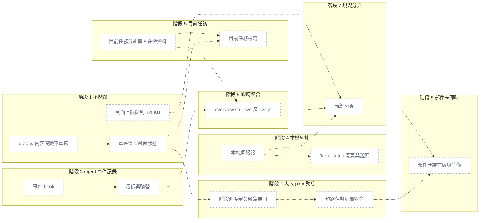

# 專案圖解改版：不閃爍、本機網址、目前任務標籤、現況分頁、agent 即時動態、大包 plan 聚焦

## 為什麼做

使用者用 VS Code Live Server 開專案圖解，畫面每幾秒整頁閃一次（data.js 內容沒變也被重寫，Live Server 看到就重載；頁面也每次整張重畫）。
平行開發時看不出「現在誰在做什麼、哪裡在等我、有沒有撞檔」，★ 也看不懂是什麼意思。
實際專案（M21）一份 plan 14+ 階段、上百個檔，任務圖長到找不到目前在做的那一段。

### PRD 情境變更

無（模板 repo 沒有 PRD；行為變更寫在「改善了什麼」）

### 資料流變更

無（模板 repo 沒有架構文件資料流節）。新增的「hook 事件 → `logs/live-events.jsonl` → `overview.sh --live` → `overview/live.js` → 頁面」見 `.claude/context/decisions/ADR-2026-11-12-002-live-events-log-and-live-js.md`「資料流」節（`sequenceDiagram`）

## 怎麼做

**可平行**：階段 1 完成後，階段 2 與 3（或 2 與 4）——依賴都已完成，檔案不重疊。1 與 3、1 與 4、3 與 4 都共改 `run-tests.sh`，不可互相平行；5、6 也改 `run-tests.sh`，7、8 與 2、5 共改 `index.html`，其餘依序做。
三份 ADR 已落檔（見「發現與決策」），階段 1 可直接開始。

### 一眼看懂

| id | 部件 | 階段 | 檔案 | 驗收 |
|---|---|---|---|---|
| p1 | data.js 內容沒變不重寫 | 1 | `.claude/scripts/overview.sh`, `.claude/hooks/tests/run-tests.sh` | 同一組輸入連跑兩次 → 第二次 data.js 的 mtime 與內容都不變 |
| p2 | 重畫保留畫面狀態 | 1 | `.claude/templates/overview/index.html` | 放大到 150%、選一個模組、展開一個明細後換資料 → 三者都維持（截圖） |
| p13 | 頁面上限提到 128KB | 1 | `.claude/scripts/check-counts.sh`, `.claude/templates/overview/index.html` | index.html 為 100000 bytes → check-counts 通過；131073 bytes → 失敗並印「超過 128KB 上限」 |
| p3 | 階段進度帶與聚焦展開 | 2 | `.claude/templates/overview/index.html` | 12 階段、第 9 階段進行中 → 只展開 9、10，11–12 寫成一行「之後：…」 |
| p4 | 短路徑與明細收合 | 2 | `.claude/templates/overview/index.html` | ≥6 成檔案在 `src/services/checkout/app/` 下 → 共同路徑只寫一次，表格與卡片用短路徑 |
| p5 | 事件 hook | 3 | `.claude/hooks/agent-events.sh`, `.claude/hooks/tests/run-tests.sh` | SubagentStart → `live-events.jsonl` 多一行，含 `ev`、`aid`、`at`、`src`、整數 `t` 與 `ms` |
| p6 | 接線與輪替 | 3 | `.claude/settings.json`, `.claude/hooks/session-start.sh`, `.claude/hooks/README.md`, `.claude/skills/worktree-orchestration/SKILL.md` | session 啟動時 live-events.jsonl 超過 3000 行 → 截尾成 3000 行 |
| p7 | 本機伺服器 | 4 | `.claude/scripts/overview-serve.sh`, `.claude/scripts/overview-serve.py`, `.claude/hooks/tests/run-tests.sh` | 已在跑時再呼叫 → 不起第二個，印同一個 `http://127.0.0.1:<port>/<token>/index.html`、不開瀏覽器；不帶 token 的路徑回 404 |
| p8 | /task-status 開頁與說明 | 4 | `.claude/commands/task-status.md`, `README.md`, `.claude/guides/WORKFLOW.md` | task-status.md 步驟 7 最後一行印 `http://127.0.0.1:<port>/<token>/index.html`（沒 Python 3.7+ 時退回 file://） |
| p9 | 目前任務分組與人在做資料 | 5 | `.claude/scripts/overview.sh`, `.claude/hooks/tests/run-tests.sh` | 主 checkout 與 worktree 的 `.current-task` 都是 1.2 → `curGroups` 只有 1 筆 |
| p10 | 目前任務標籤 | 5 | `.claude/templates/overview/index.html` | 3 條目前任務 → 標題列只顯示「目前任務 3 條 ▾」，點開列 3 條（截圖） |
| p11 | overview.sh --live 產 live.js | 6 | `.claude/scripts/overview.sh`, `.claude/hooks/tests/run-tests.sh`, `.claude/skills/worktree-orchestration/SKILL.md` | 等批准事件之後同 session、同 agent 再有一筆事件 → `needs` 變 0 筆 |
| p12 | 現況分頁 | 7 | `.claude/templates/overview/index.html` | 開頁沒有 hash → 預設現況分頁，頂端 4 格；`doneToday` 為 `{agents:7,tasks:1}` → 「今天完成」格寫「7 個 agent · 1 個任務」（截圖） |
| p14 | 部件卡誰在做與等你 | 8 | `.claude/templates/overview/index.html` | 某 agent 寫了部件 p9a 的檔 → p9a 卡顯示「implementer · 12 分」 |

### 階段 1: 內容沒變不重寫 data.js、重畫保留畫面狀態 ✅
- **依賴**：無
- [x] `overview.sh` 的 `run_once`：寫 data.js 前，把新舊兩份去掉易變欄位後比對，相同就不寫（不 `mv`、不動 mtime）。比對用 bash 內建（`read -r -d ''` 讀舊檔、參數展開去欄位），不多開行程 — 驗證：`bash .claude/hooks/tests/run-tests.sh overview`
- [x] 易變欄位：`generatedAt`、`scan.ms`、`scan.cached`。實作前先在沙箱連跑三次 diff 兩份 data.js，找出其他每次都會變的欄位一併排除（結果記進「發現與決策」）
- [x] `index.html` 的 `render()`：重畫時保留地圖縮放平移（`S`）、選取的模組、內部圖（`INNER`）、任務圖 `scrollTop`、各 `
` 的展開狀態（依 plan 檔名＋區塊種類當 key，重畫後還原） — 驗證：Playwright 截圖
- [x] 頁面上限提到 128KB（決策 Q1，依據 `.claude/context/decisions/ADR-2026-11-12-001-overview-page-size-128kb.md`，取代 ADR-2026-11-09-001）：`check-counts.sh` 約 507 行 `81920` → `131072`、約 509 行訊息「80KB」→「128KB」、約 497 行守門註解；`index.html` 約 10 行頁首註解「整份 ≤ 80KB」→「≤ 128KB」；`ADR-2026-11-12-001` 已落檔。兩處註解都補 ADR-001 的觸發條件：「超過 112KB（上限的 7/8）→ 下一個加功能的計畫在規劃時就要評估拆檔或瘦身；再超過 128KB → 預設拆檔，不再調上限（ADR-2026-11-12-001）」。112KB 只寫在註解，不加第二道檢查（ADR 的確認方式只要求 128KB 失敗訊息） — 驗證：`bash .claude/scripts/check-counts.sh`
- **預估**：1.5h
- **驗收**：
  - 同一組輸入連跑兩次 → 第二次後 data.js 的 mtime（`stat -c %Y`）與內容都不變
  - 改 wbs 一個任務的狀態再跑 → data.js 改寫，`generatedAt` 更新
  - 只有 `scan.ms`、`scan.cached` 不同 → 不改寫
  - overview.md 的既有行為不變（`同一組輸入連跑兩次 → overview.md 相同` 照綠）
  - 頁面放大到 150%、選取一個模組、在任務圖展開一個「計畫外」明細，換一份內容不同的 data.js → 縮放仍 150%、選取不變、明細仍展開、任務圖捲動位置不變（截圖）
  - data.js 沒變的輪詢 → 不呼叫 `render()`（`#world` 的第一個子節點仍是同一個物件）
  - 範本 index.html 補空白到 100000 bytes（沙箱複本）→ check-counts 的專案圖解守門通過；補到 131073 bytes → 失敗並印「超過 128KB 上限」
  - `grep -c '80KB' .claude/scripts/check-counts.sh .claude/templates/overview/index.html` 兩檔都為 0；`grep -c '112KB'` 兩檔都 ≥ 1
  - 其餘專案圖解守門（外部網址、module script、token 區外 hex 色碼）照綠
- **注意**：資料沒改寫時頁首「資料時間」會停在上次內容變動的時間，這是對的；不要為了讓它跳而寫回 `generatedAt`。上限放在階段 1 改，是因為現行約 67KB、階段 2／5／7／8 都往 index.html 加東西，越早放寬越不會在中途被 check-counts 擋

### 階段 2: 大包 plan 聚焦（任務圖） ✅
- **依賴**：階段 1
- [x] `planCard`：每份 plan 上方一條階段進度帶（每階段一格，完成／進行中／未開始三色，滑過顯示階段名），下方一行「完成 N／M 個階段 · 現在：階段 X 名稱」 — 驗證：截圖
- [x] 只展開「進行中＋下一個」階段的部件；再後面的寫成一行「之後：階段 11 退款、階段 12 對帳報表…」；已完成階段收成一行 `
`「已完成 N 個階段」，展開列每階段 `+/−` 與測試數 — 驗證：截圖
- [x] 檔案明細表預設收起（`
「檔案明細 N 個」`）；共同路徑前綴＝≥6 成檔案共有的最長目錄，只在明細頂端寫一次，表格與部件卡用短路徑 — 驗證：截圖
- [x] 部件卡最多列 2 個檔＋「另 N 個檔」；目錄（`tocItem`）的長任務編號串 `21.2,21.3,…,21.10` 壓成 `21.2–21.10`，標題最多兩行（`-webkit-line-clamp:2`） — 驗證：截圖
- [x] `PST` 加 `waiting: '等你'` 與 `.pc.waiting` 樣式（顏色只用 `:root` token；資料在階段 8 才接） — 驗證：`bash .claude/scripts/check-counts.sh`
- **預估**：2h
- **驗收**：
  - 12 階段、1–8 完成、9 進行中的 plan → 只展開階段 9、10 的部件，下方一行「之後：階段 11 …、階段 12 …」，上方「已完成 8 個階段」收合（截圖）
  - 全部完成的 plan → 進度帶全綠、「現在」寫「全部完成」、不展開任何階段（截圖）
  - 只有 1 個階段的 plan → 不畫進度帶，照常展開該階段（截圖）
  - 30 個檔中 20 個在 `src/services/checkout/app/` → 明細頂端「共同路徑：src/services/checkout/app/」，列表寫 `cart/store.py`（截圖）
  - 不到 3 個檔、或沒有目錄被 ≥6 成檔案共有 → 不顯示共同路徑、全寫完整路徑
  - 部件有 5 個檔 → 卡上 2 個 `<code>`＋「另 3 個檔」
  - 任務編號 `21.2,21.3,21.4` → 目錄顯示 `21.2–21.4`；`1.2,1.3` → `1.2, 1.3`
  - 390px 與 1440px、淺／深色四張截圖，沒有文字溢出卡片
- **注意**：截圖用的大 plan 示範資料在 scratchpad 產（可參考預覽腳本的 `phase_defs`），不進 repo。預覽腳本踩過 class 撞名：`.bar`、`.dash`、`.mini` 已被頁面使用，新 class 先 grep 一次

### 階段 3: agent 事件記錄（hook） ✅
- **依賴**：無
- [x] **先錄真實 payload**：裝臨時探針（把 stdin 存到 scratchpad）錄 SubagentStart、SubagentStop、Notification、PermissionRequest、subagent 內的 Pre/PostToolUse、AskUserQuestion 各一筆，確認：subagent 內的 PermissionRequest／Notification 有沒有 `agent_id`、SubagentStart 的 `cwd` 是不是 worktree 根、`async: true` 在目前版本是否正常（官方文件已查，見 ADR-002 第 1 節；這裡只做實測）、Notification 實際出現哪些 `notification_type`（`agent_needs_input` 不在官方清單，探針沒錄到就不列進開啟者）。結果寫進「發現與決策」，探針用完移除 — 驗證：scratchpad 有各事件的 payload 檔
- [x] 新增 `.claude/hooks/agent-events.sh`：一次 `jq` 把 payload 壓成一行事件（格式見下）附加到 `$MAIN_CLAUDE/logs/live-events.jsonl`；永遠無輸出、exit 0 — 驗證：`bash .claude/hooks/tests/run-tests.sh agent-events.sh`
- [x] 事件行（v1，欄位、來源、上限、白名單以 `.claude/context/decisions/ADR-2026-11-12-002-live-events-log-and-live-js.md` 第 2、3 節為準）：`{"v":1,"t":<epoch 秒>,"ms":<0–999>,"ev":"<事件名>","sid":"…","aid":"…","at":"<agent_type>","src":"main|worktree:<資料夾名>","tool":"…","file":"<相對該 checkout 根的路徑>","act":"<正在做，≤80 字>","need":"approve|reply|null","nt":"<notification_type，≤30 字>","text":"<≤120 字>"}`。`t`／`ms` 在腳本**第一行**讀 bash 內建 `$EPOCHREALTIME` 拆出（不開 `date`）；`src` 用 `resolve_roots` 的 `IN_WORKTREE`／`WORK_ROOT`，命名與 overview.sh 的 overlay 相同（`worktree:${WORK_ROOT##*/}`）；整行 `utf8bytelength` 超過 1000 時依序把 `text`、`act` 縮到 40 字、`file` 只留檔名
- [x] 主 session（沒有 `agent_id`）的工具事件**也記**，`aid` 為 `""`（ADR-002 第 1 節：主 session 自己的等批准、AskUserQuestion、寫檔要算進「需要你」與撞檔，主 session 的 need 也要有事件能關）
- [x] `act`／`text` 規則照 ADR-002 第 3 節：Bash／PowerShell 有 `description` → `跑 <description>`；沒有 → 跳過開頭所有 `NAME=value` 賦值，取第一個不含 `=` 的詞再取 basename，取不到寫 `跑指令`；Notification 的 `text` 為 `message`、`nt` 為 `notification_type`；UserPromptSubmit 的 `act`／`text` 都為 `""`
- [x] 寫完事件後，在背景觸發 `overview.sh --live`（階段 6 才有；這階段先寫好觸發段）：2 秒內只觸發一次，視窗內只留 `.live-dirty`，視窗判斷只用 bash 內建（照抄 post-write.sh 的 `.scan-at` 寫法）
- [x] `settings.json` 接線，全部 `async: true`（若查證不支援 → 同步，但腳本裡只准 1 次 jq）：SubagentStart、SubagentStop、Notification、PermissionRequest、UserPromptSubmit、Stop、PreToolUse `AskUserQuestion|Bash|PowerShell`、PostToolUse `Write|Edit|MultiEdit|Bash|PowerShell|AskUserQuestion` — 驗證：`jq . .claude/settings.json`
- [x] `session-start.sh` 加 `rotate_log …/live-events.jsonl 3000`；`hooks/README.md` 檔案樹＋功能表＋輪替段；`worktree-orchestration` 邊界表 `MAIN_CLAUDE` 欄加 `logs/live-events.jsonl` 一句 — 驗證：`bash .claude/scripts/check-counts.sh`
- **預估**：2.5h
- **驗收**：
  - SubagentStart payload（實測形狀）→ live-events.jsonl 多一行，`v` 為 1、`ev` 為 `SubagentStart`、`aid`／`at` 與 payload 相同、`src` 為 `main`、`t` 與 `ms` 都是整數、`ms` 在 0–999
  - 主 session 的 PostToolUse Write（payload 沒有 `agent_id`）→ 照寫一行，`aid` 為 `""`、`file` 有值
  - `cwd` 是 `.claude/worktrees/wt-a/src` → `src` 為 `worktree:wt-a`；Write 的 `file_path` 是絕對路徑 → `file` 為相對 wt-a 根的 `src/x.ts`
  - Bash 事件：有 `description` → `act` 為「跑 <description>」；沒有 → 只記指令第一個詞
  - Bash 指令 `API_KEY=xyz curl -H 'Authorization: Bearer abc' …`、沒有 description → 事件行不含 `xyz`、`abc`，`act` 為 `跑 curl`；`FOO=1 BAR=2 /usr/bin/make` → `跑 make`；整串都是賦值 → `跑指令`
  - Edit 事件 → 事件行不含 `old_string`／`new_string` 的任何內容；UserPromptSubmit 帶 prompt「密碼是 hunter2」→ 事件行不含 `hunter2`
  - PermissionRequest → `need` 為 `approve`；Notification `permission_prompt` → `approve`、`nt` 為 `permission_prompt`；Notification `idle_prompt`／`elicitation_dialog` → `reply`；Notification `auth_success`／`elicitation_complete`／`elicitation_response` → `need` 為 `null` 但仍寫一行；PreToolUse `AskUserQuestion` → `reply`、`text` 為第一題題目
  - 任一字串欄位超過上限（含全形字）→ 截斷；任何事件寫出的那一行 < 1024 bytes
  - `grep -l live-events .claude/hooks/pre-agent-gate.sh .claude/hooks/lib/agent-inflight.sh` 為空；裝好 `agent-events.sh` 後跑既有 `pre-agent-gate`／`agent-monitor` 測試節 → 全綠、`agent-activity.jsonl` 與裝前相同
  - `OVERVIEW=off` 或 `OVERVIEW_LIVE=off` → 不寫檔、不觸發、exit 0
  - 沒有 jq、輸入不是 JSON → exit 0、stdout 空、不寫檔
  - 沒有 `taskmaster-data/project.json`（模板 repo 本身）→ 照寫事件（log 不污染圖解），但不觸發 `--live`
  - 2 秒內連續 5 個事件 → `overview.sh --live` 只被呼叫 1 次（測試用假 overview.sh 記次數），其餘留 `.live-dirty`
  - session 啟動時 live-events.jsonl 有 3500 行 → 截尾成最後 3000 行
- **注意**：`settings.json` 在 `_changed_rule` 是 ALL——本階段只跑 `run-tests.sh agent-events.sh session-start`（關鍵字模式），**不要用 `--changed`**，整套留到最後。`agent-monitor.sh` 與 `agent-activity.jsonl` 不動（閘門在讀它）；agent 的任務描述在階段 6 用 `agent_id` 去 join，不重記一份。這支 hook 只寫不讀，跟 2026-09-09「讀到自己這一次」的坑無關；lane 結束只認 SubagentStop（2026-09-11 的坑）

### 階段 4: 本機伺服器與 /task-status 開頁 ⏳
- **依賴**：無
- [ ] 新增 `.claude/scripts/overview-serve.py`（規格以 `.claude/context/decisions/ADR-2026-11-12-003-overview-local-server-lifecycle.md` 第 1 節為準）：`ThreadingHTTPServer`＋`SimpleHTTPRequestHandler(directory=<overview 資料夾>)`，最低 Python 3.7；只綁 `127.0.0.1`；**只服務 `/<token>/` 底下**，其他一律 404（token 用 `secrets.token_urlsafe(16)`，`.serve` 已有就沿用）；回應帶 `Cache-Control: no-store`；不印存取 log；`GET /<token>/.serve-id` 回 200；`POST /<token>/.shutdown` 回 200 後結束；閒置 `OVERVIEW_SERVE_IDLE_MIN`（預設 30）分鐘沒有請求就結束並刪 `.serve`（決策 Q3）；**選 port 由 Python 自己 bind**（8765 起最多 20 個），bind 成功才把 `{port, token, pid, started}` 以暫存檔＋rename 寫進 `overview/.serve` — 驗證：`bash .claude/hooks/tests/run-tests.sh overview-serve`
- [ ] 新增 `.claude/scripts/overview-serve.sh [--stop] [<工作目錄>]`（ADR-003 第 2 節）：主 checkout 用 git common dir 算（同 overview.sh）；讀 `.serve` → 用 bash `/dev/tcp` 打 `GET /<token>/.serve-id`，200 就是已在跑；否則 `mkdir overview/.serve.lock` 拿鎖、拿到後再讀一次 `.serve` 確認；找 Python（`python3` → `python` → `py -3`，跑 `-c 'import sys;print(sys.version_info>=(3,7))'` 要印 `True`，擋掉 Windows Microsoft Store 假 `python3`）；`umask 077` 下 `nohup … &` 起在背景，最多等 3 秒讓 `.serve` 出現再確認一次；`--stop` 走 `POST /<token>/.shutdown`，不用 `kill <pid>`。bash 不先探測空 port — 驗證：同上
- [ ] 開瀏覽器只在**新啟動**時做，伺服器已在跑只印網址（決策 Q4，順序照 ADR-003 第 3 節，先符合者為準）：① 有 `$BROWSER`（VS Code 終端機會設）→ `"$BROWSER" <網址>`；② 平台（`uname -s`，測試用 `OVERVIEW_SERVE_PLATFORM` 覆寫）`Linux` 且有 `DISPLAY`／`WAYLAND_DISPLAY` 且有 `xdg-open` → `xdg-open`；③ `Darwin` → `open`；④ `MINGW*`／`MSYS*`／`CYGWIN*` → `cmd //c start "" <網址>`；⑤ 其他 → 只印網址，有 `SSH_CONNECTION` 時多印一行 `ssh -L <port>:127.0.0.1:<port> <你的主機>`。開瀏覽器失敗不影響 exit code；不論哪種情況 stdout 最後一行都是網址 — 驗證：同上
- [ ] `_changed_rule` 加 `.claude/scripts/overview-serve.*) echo "=overview-serve" ;;`（排在 `.claude/scripts/*` 的 NONE 之前） — 驗證：`bash .claude/hooks/tests/run-tests.sh --changed - --dry-run <<< .claude/scripts/overview-serve.sh`
- [ ] `commands/task-status.md` 步驟 7：`--print-path` 之後跑 `bash .claude/scripts/overview-serve.sh`，最後一行改印它給的網址（格式 `http://127.0.0.1:<port>/<token>/index.html`，說明 token 是防同機其他使用者與惡意網頁讀取、要整段複製）；補一段「VS Code 的 Simple Browser（Ctrl+Shift+P → Simple Browser: Show）貼網址也能看」與「不要用 Live Server：資料每幾秒更新一次，它會整頁重載」；README「專案圖解」段、WORKFLOW「想看整體長什麼樣」的 SSH 說明改成 port 轉發 — 驗證：人讀
- **預估**：2h
- **驗收**：
  - 沒在跑 → 起一個伺服器，stdout 最後一行符合 `^http://127\.0\.0\.1:[0-9]+/[A-Za-z0-9_-]+/index\.html$`，GET 該網址回 200；GET `http://127.0.0.1:<port>/index.html`（不帶 token）回 404；GET 錯的 token 回 404
  - 已在跑時再呼叫 → 不起第二個（行程數不變），印同一個網址，假 `$BROWSER` 沒被呼叫
  - 8765 被別的程式佔用（測試先用 python 佔住）→ 用 8766，印 8766 的網址
  - 狀態檔記的 port 上是別人的伺服器（`/<token>/.serve-id` 不是 200）→ 不沿用，另起一個，`.serve` 更新
  - 兩個 `overview-serve.sh` 同時跑 → 只有一個伺服器，兩者印同一個網址
  - 20 個 port 都不能用 → 印 `file:///…/index.html` 與一行原因，exit 0
  - PATH 裡只有一個印不出 `True` 的假 `python3` → 印 `file:///…/index.html` 與「找不到 Python 3.7 以上，改用檔案開啟；SSH 遠端請改用 Live Preview」，exit 0
  - 行程命令列與 `.serve` 不含 `0.0.0.0`；用 `ss`／`netstat` 確認只聽 127.0.0.1
  - 回應標頭含 `Cache-Control: no-store`
  - `.serve` 權限為 600（Linux）
  - 有 `$BROWSER`（測試用假腳本記參數）且是新啟動 → 呼叫 1 次、參數是網址
  - 沒 `$BROWSER`、`OVERVIEW_SERVE_PLATFORM=MINGW64_NT-10.0`、PATH 前面放假 `cmd` 記參數、新啟動 → 假 `cmd` 被呼叫 1 次，參數含 `start` 與網址；已在跑 → 不呼叫
  - 沒 `$BROWSER`、`OVERVIEW_SERVE_PLATFORM=Darwin`、假 `open`、新啟動 → 呼叫 1 次、參數是網址
  - 沒 `$BROWSER`、`Linux`、有 `DISPLAY`、假 `xdg-open` → 呼叫 1 次（有 `SSH_CONNECTION` 也一樣）；沒有 `DISPLAY` 也沒有 `WAYLAND_DISPLAY` → 不呼叫、只印網址
  - 假 `open` exit 1 → `overview-serve.sh` 仍 exit 0、最後一行仍是網址
  - `Linux`、沒 `$BROWSER`、沒 `DISPLAY`、有 `SSH_CONNECTION` → 不呼叫任何開瀏覽器指令，多印一行含 `ssh -L <port>:127.0.0.1:<port>`，最後一行仍是網址
  - `OVERVIEW_SERVE_IDLE_MIN` 設成極短（測試用）且沒有請求 → 伺服器自己結束、`.serve` 被刪；下次呼叫重起
  - `--stop` → 經 `POST /<token>/.shutdown` 結束、`.serve` 刪除；沒在跑時 `--stop` → exit 0
  - 沒有 `project.json` → 什麼都不印、exit 0
  - Windows Git Bash 手動驗：`/task-status` 跑完 60 秒後網址仍打得開（結果寫進「發現與決策」）
  - VS Code Remote-SSH 終端機手動驗：跑 `/task-status` → 本機瀏覽器自動打開、畫面不閃
- **注意**：Windows 從 Git Bash `nohup &` 起的原生 python.exe，在 Bash tool 的 shell 結束後會不會被收掉沒有實測過——手動驗不過時依 ADR-003 第 5 節依序改試 `cmd //c start "" /b <python> …`、`powershell -NoProfile -Command Start-Process -WindowStyle Hidden …`，採用第一個通過的，寫進「發現與決策」與 `overview-serve.sh` 檔頭；都不通過 → Windows 退回 file:// 並記進 KNOWN-GAPS（KNOWN-GAPS 不在本 plan `files:`，屆時回報由主模型處理）

### 階段 5: 「目前任務」分組、標籤與人在做資料 ⏳
- **依賴**：階段 1, 2
- [ ] `overview.sh` 的 jq：由 `$cx` 依 plan（沒有 plan 時依 task）分組成 `curGroups: [{key, task, title, plan, sources, where, guessed, phase, phases, activePhases}]`。同一份 plan 出現在主 checkout 與 worktree → 一組，`where` 取主 checkout；只在 worktree 的 → `where` 為該 worktree。保留既有 `current`／`currents` 欄位不改形狀 — 驗證：`bash .claude/hooks/tests/run-tests.sh overview`
- [ ] WBS 解析多讀「負責」欄（沒有這欄的舊節照讀、值為空）；`gather` 多一次 `git for-each-ref --sort=-committerdate refs/heads refs/remotes`；產 `humans: [{who, task, title, status, branch}]`：負責不是 `—`、不是我、狀態不是 ✅／⏭️ 的任務；分支名含任務編號（`2.1` 或 `2-1`，前後是 `/`、`-`、`_` 或字串邊界）就填最近一條。「我」＝`git config user.name` 與 `git config user.email`（`gather` 多讀這兩個值），負責欄與其中任一相同（不分大小寫、去頭尾空白）就算我（決策 Q5） — 驗證：同上
- [ ] WBS 任務多記 `doneOn`：狀態是 `✅ MM-DD` → `"MM-DD"`，其他（含只寫 ✅ 沒日期）→ `null`。給階段 6 算「今天完成的任務數」（決策 Q6） — 驗證：同上
- [ ] `index.html`：拿掉全部 ★（地圖模組名、模組側欄、選計畫抽屜、目錄、卡片標題）；有 current 的地方改成小標籤「目前任務」（推測的寫「目前任務（推測）」）；標題列依 `curGroups` 畫標籤「目前任務 <編號> <名稱>（主 checkout／worktree xxx）」，超過 2 條收成「目前任務 N 條 ▾」 — 驗證：截圖
- **預估**：2h
- **驗收**：
  - 主 checkout 與 worktree wt-a 的 `.current-task` 都是 1.2 → `curGroups` 1 筆、`sources` 為 `["main","worktree:wt-a"]`、`where` 為主 checkout
  - 主 checkout 1.2、worktree wt-b 3.1 → `curGroups` 2 筆，3.1 的 `where` 為 `worktree:wt-b`
  - 都沒有 `.current-task`、猜出最近改過的 plan → 1 筆、`guessed: true`
  - 標題列：1 條 → 1 個標籤；2 條 → 2 個標籤；3 條 → 1 個「目前任務 3 條 ▾」，點開列 3 條（截圖）
  - `grep -c '★' .claude/templates/overview/index.html` 為 0
  - WBS 任務 1.5 負責 `alice`、狀態 🚫 → `humans` 有 `{who:"alice", task:"1.5", status:"blocked", branch:null}`；建立分支 `feat/1.5-points` 後 → `branch` 為 `feat/1.5-points`；分支 `feat/11.5-x` 不算 1.5
  - 負責是 `—`、或任務已 ✅ → 不列進 `humans`
  - `git config user.name` 為 `Alice`、負責 `alice` → 不列；`user.email` 為 `bob@x.io`、負責 `BOB@x.io` → 不列；負責 `carol`、兩者都不符 → 列
  - 沒設 git user.name／email → 所有有負責人的未完成任務都列
  - 狀態 `✅ 11-12` → 該任務 `doneOn` 為 `"11-12"`；`✅`（沒日期）、`🔄 進行中` → `doneOn` 為 `null`
  - 沒有「負責」欄的 WBS → `humans` 為空陣列，其餘輸出不變
- **注意**：`taskIds()` 壓編號的函式在階段 2 已有，標籤沿用

### 階段 6: 即時聚合 `overview.sh --live` → live.js ⏳
- **依賴**：階段 3, 5
- [ ] `overview.sh --live [<工作目錄>]`：不掃描、不收 git 改動；讀主 checkout 的 `logs/live-events.jsonl` 最後 3000 行＋`.claude/worktrees/*/.claude/logs/live-events.jsonl`（`claude -w` 的 session 把事件寫在 worktree 裡，見 KNOWN-GAPS 的 resolve-roots 那條；這些檔裡 `src` 是 `main` 的改標成 `worktree:<資料夾名>`）、`logs/agent-activity.jsonl`（只取 `agent_start` 的 `description`，用 `agent_id` join）、現有 data.js（`curGroups`、`plans` 的部件與階段）；一支 jq 算完，寫 `overview/live.js`，內容是單一句 `window.OVERVIEW_LIVE = {...};` — 驗證：`bash .claude/hooks/tests/run-tests.sh overview`
- [ ] 鎖：自己的 `.live.lock`，拿不到就留 `.live-dirty` 走人；持鎖者做完看到 `.live-dirty` 再跑一輪（最多 3 輪）。不搶完整重產的 `.lock`
- [ ] 完整重產（`run_once`）結束時也跑一次 live 聚合，`curGroups` 變了 lanes 的歸屬跟著變
- [ ] 輸出欄位與規則（寫進 overview.sh 檔頭，唯一來源）：
  - `lanes`：12 小時內 SubagentStart 了、還沒 SubagentStop 的 agent，加上最近 15 分鐘有事件、最後一筆不是 Stop 的 session（`who` 為「主 session」或「worktree session」）。每筆 `{id, who, desc, where, readonly, group, since, lastAt, doing, files}`；`readonly` 依 `AGENT_INFLIGHT_READONLY`（從 `hooks/lib/agent-inflight.sh` 讀，不抄一份）；`doing` 取該 lane 最後一筆有 `act` 的事件；`files` 為 `{done, total}`＝該 lane 寫過的檔 ∩ 所屬組進行中階段的部件檔／部件檔總數，沒有部件檔為 `null`
  - `group` 歸屬：① lane 的 `src` 在某組 `sources` 裡 → 該組；② 否則用同 `sid` 的 session 事件所在 `src` 找組（Agent 帶 `isolation: worktree` 派出的 subagent 走這條：同一任務的某階段拆去 worktree 跑，仍歸原任務組）；③ 都找不到 → `null`
  - 事件一律先依 `(t, ms)` 排序再判斷，不靠檔案行序（async 寫入順序不保證，ADR-002 第 2 節）；`v` 不認得的整行略過
  - `needs`（規則以 ADR-002 第 5 節為準）：開啟者＝PermissionRequest、Notification 的 `nt` 為 `permission_prompt`（approve）／`idle_prompt`／`elicitation_dialog`（reply）、PreToolUse `AskUserQuestion`（reply）；其他 `nt` 不是開啟者但可當關閉者；同 `sid`＋同 `aid`（主 session 的 `aid` 為空）之後出現**任何非開啟者事件**、或該 agent SubagentStop、或（主 session 的 need）同 `sid` 的 UserPromptSubmit → 視為已處理不列；PermissionRequest 前後 10 秒內同 `sid`／`aid` 的 Notification `permission_prompt` 合併成一筆；同 `sid`／`aid` 只留最新一筆；開啟超過 4 小時 → 不列。每筆 `{id, kind: approve|reply, who, where, text, since}`。「卡住」不在這裡算，由頁面用 `lastAt` 即時判斷（階段 7）
  - `clashes`：線＝checkout（`src`）；寫入集＝該 checkout 12 小時內事件記到的寫入 ∪ 該 checkout 所屬組 plan 的 `files:`。某個**實際寫入的檔**出現在另一條線的寫入集（實寫或 glob 命中）→ 一筆 `{file, lines:[…]}`；兩邊都只是 plan glob 重疊不算。同一個 checkout 內兩個**都還在跑**的 agent 寫同一個檔也算
  - `doneToday: {agents, tasks}`（決策 Q6 兩個都要）：`agents`＝本機時區今天 SubagentStop 的不重複 `aid` 數；`tasks`＝data.js 裡 `doneOn` 等於今天 `MM-DD` 的 WBS 任務數（只看 wbs.md，已歸檔的不算）。`feed`（agent 開始／完成、need 出現／處理，最近 30 筆，新的在前）、`at`（產生時間）
- [ ] 內容（去掉 `at`）沒變就不重寫 live.js；壞行用 `fromjson?` 略過
- [ ] `worktree-orchestration` 邊界表的 overview 那格加 `live.js` 一句
- **預估**：3h
- **驗收**：
  - live.js 只有一句賦值，以 `window.OVERVIEW_LIVE = ` 開頭、`;` 結尾
  - SubagentStart a1（implementer，src main）沒有 Stop → `lanes` 1 筆、`since` 為該事件的 `t`、`desc` 為 agent-activity.jsonl 同 `agent_id` 的 description；補一筆 SubagentStop a1 → `lanes` 0 筆、`feed` 第一筆是 a1 完成、`doneToday.agents` 加 1
  - 昨天 23:59 的 SubagentStop → 不算進 `doneToday.agents`；同一個 a1 有兩筆 SubagentStop → 只算 1
  - data.js 有 2 個任務 `doneOn` 為今天、1 個為昨天 → `doneToday.tasks` 為 2
  - a1 PostToolUse Write `src/a.ts` → a1 的 `doing` 為「編輯 a.ts」；所屬組進行中階段的部件檔共 3 個、a1 寫了其中 1 個 → `files` 為 `{done:1,total:3}`；該階段沒有部件檔 → `files` 為 `null`
  - 主 checkout 目前任務 1.2：a1（src main）→ 歸 1.2；a2（src `worktree:agent-x`，不在任何組的 `sources`、與 a1 同 `sid`）→ 歸 1.2；a3（src `worktree:wt-b`，wt-b 目前任務 3.1）→ 歸 3.1；a4 對不到 → `group` 為 `null`
  - `code-quality-specialist` 的 lane → `readonly: true`
  - PermissionRequest（s1、a1）→ `needs` 1 筆 `approve`；之後一筆 s1／a1 的 PostToolUse → `needs` 0 筆
  - Notification `idle_prompt`（s1、無 aid）→ 1 筆 `reply`；之後 UserPromptSubmit s1 → 0 筆
  - PreToolUse `AskUserQuestion` → 1 筆 `reply`、`text` 為題目；PostToolUse `AskUserQuestion` → 0 筆
  - PermissionRequest 後 3 秒同 s1／a1 的 Notification `permission_prompt` → 仍只 1 筆
  - PreToolUse Bash（`ms` 100）與 PermissionRequest（同一秒、`ms` 300）**以相反順序寫進檔案** → `needs` 1 筆（PreToolUse 不被當成關閉者）
  - Notification `auth_success`（s1）→ 不開 need；它出現在 s1 的 `idle_prompt` 之後 → 該 need 關閉
  - 事件行 `v` 為 2 → 整行略過，其餘照算
  - 5 小時前開啟、之後沒事件的 need → 不列
  - 主 checkout 的 a1 寫 `src/x.ts`、wt-b 的 a3 也寫 `src/x.ts` → `clashes` 1 筆 `{file:"src/x.ts", lines:["main","worktree:wt-b"]}`
  - wt-b 的 plan `files:` 含 `src/**`、主 checkout 寫了 `src/y.ts` → `clashes` 含 `src/y.ts`；兩邊只有 plan glob 重疊、沒有實際寫入 → 0 筆
  - 同 checkout 的 a1、a5 都在跑且都寫 `src/z.ts` → 1 筆；a5 已 Stop → 0 筆
  - `.claude/worktrees/wt-c/.claude/logs/live-events.jsonl` 裡 `src` 為 `main` 的事件 → 當成 `worktree:wt-c`
  - 事件檔有一行被截斷 → 略過該行，其餘照算
  - 兩次 `--live` 之間沒有新事件 → live.js 的 mtime 不變
  - 沒有事件檔 → live.js 照寫，`lanes`／`needs`／`clashes`／`feed` 為空陣列、`doneToday.agents` 0（`tasks` 照 data.js 算）
  - 完整重產進行中（`.lock` 存在）→ `--live` 照跑完、不等
  - 3000 行事件在 Linux 上 `--live` 跑完 < 1 秒
- **注意**：若階段 3 探針顯示 subagent 內的 PermissionRequest／Notification **不帶** `agent_id`，`aid` 為空的開啟者改用 ADR-002 第 5 節的退路規則（同 `sid` 之後出現同 `tool` 的 PostToolUse，或任一事件晚於開啟者 10 秒以上且該 session 沒有其他未結束的 subagent → 已處理），採用哪一支寫進 overview.sh 檔頭與「發現與決策」，並補對應驗收。資料放獨立的 live.js 是決策 Q2（已決定），檔案格式與分檔理由見 `.claude/context/decisions/ADR-2026-11-12-002-live-events-log-and-live-js.md`；欄位定義以 overview.sh 檔頭為唯一來源，ADR 與它不一致時回報，不自行擇一

### 階段 7: 現況分頁 ⏳
- **依賴**：階段 4（`/<token>/.serve-id` 端點與 `overview-serve.sh --stop`，供「伺服器已結束」提示與其驗收）, 6
- [ ] 全部寫在 `index.html`（決策 Q1：不拆檔）：`renderNow`、live.js 輪詢（頁面可見時每 2 秒，同 `check()` 的插 script 寫法，`window.OVERVIEW_LIVE` 先設 `null` 判斷半份檔）、每秒時鐘、暫停動畫按鈕；現況的 CSS 寫在既有 `<style>`，顏色只用 `var(--token)` — 驗證：截圖
- [ ] 分頁順序「現況／專案地圖／任務圖」，沒有 hash 預設 `#now`；`
` 容器；現況分頁隱藏圖例、篩選、落差、提示（`.v-now` 規則） — 驗證：截圖
- [ ] 版面：頂端 4 格（需要你＝`needs`＋卡住數、在跑的線＝`lanes` 數、今天完成＝一格兩個數字「N 個 agent · M 個任務」取自 `doneToday`、撞檔）；「需要你」清單（等批准／等回覆／卡住：lane 的 `lastAt` 超過 10 分鐘）；「現在在跑」依 `curGroups` 分組（組標題：任務名、在哪、目前階段「階段 9／12 結帳頁」、階段進度帶；`group` 為 null 的放「未歸屬」組），組內每 lane 一張卡（誰、在哪、正在做、經過時間每秒跳、進度條）；右側「動態」時間軸、「撞檔」、「人在做」（`humans`，取自 data.js）
- [ ] 更新時只改變動的卡（以 lane／need id 對應），新增的淡入、消失的淡出、數字變了跳一下；不整個重建 `#nv`
- [ ] 動畫只用 CSS transition／animation，包在 `@media (prefers-reduced-motion: no-preference)` 裡；「暫停動畫」按鈕切 `.still`（`animation-play-state: paused`），狀態存 localStorage
- [ ] 伺服器已閒置結束的提示（ADR-003「犧牲」第 3 點）：頁面是 `http:` 開的、且 data.js 或 live.js 的輪詢載入失敗時，`fetch('.serve-id')`（相對路徑，落在 `/<token>/.serve-id`）；連線失敗（promise reject）→ 頁首顯示一條「伺服器已結束（閒置 30 分鐘），重跑 /task-status」，停止輪詢計時器但保留畫面；回 200 或 404 → 不顯示（live.js 只是還沒產生）。分頁從背景回到可見時再試一次，伺服器回來了就收掉提示、恢復輪詢。`file:` 開的頁面不做這件事 — 驗證：截圖
- [ ] 做完 `wc -c .claude/templates/overview/index.html`，數字記進「發現與決策」（上限已在階段 1 提到 128KB） — 驗證：`bash .claude/scripts/check-counts.sh`
- **預估**：4h
- **驗收**：
  - 開頁沒有 hash → 顯示現況分頁，分頁列順序是現況、專案地圖、任務圖（截圖）
  - `needs` 2 筆＋1 個 lane 的 `lastAt` 是 11 分鐘前 → 「需要你」數字 3、清單 3 行，卡住那行寫「11 分鐘沒有動靜」（截圖）
  - 數字為 0 的那格變淡（截圖）
  - `doneToday` 為 `{agents:7,tasks:1}` → 「今天完成」格寫「7 個 agent · 1 個任務」；`{agents:0,tasks:2}` → 「0 個 agent · 2 個任務」且不變淡；`{agents:0,tasks:0}` → 變淡
  - lane 的 `since` 是 5 分鐘前 → 卡上經過時間顯示 `5:00`，1 秒後 `5:01`
  - lane 有 `files` `{done:1,total:3}` → 進度條 33%；`files` 為 null → 來回滑動的進度條（截圖）
  - 2 個 curGroups、其中一組 3 張 lane 卡、`group` 為 null 的 1 張 → 3 個組框，第三個標「未歸屬」（截圖）
  - live.js 換成多一筆 lane 的版本 → 新卡淡入，原有卡片仍是同一個 DOM 物件
  - 現況分頁看不到圖例、篩選、落差、提示按鈕；切到地圖分頁它們回來（截圖）
  - `prefers-reduced-motion: reduce` 下，所有元素的 computed `animation-name` 為 `none`
  - 按「暫停動畫」→ 文字變「繼續動畫」、動畫停住；重開頁面仍是暫停
  - 沒有 live.js（file:// 開、還沒有事件）→ 現況分頁顯示「還沒有即時資料：agent 開始工作後這裡會出現」，數字全 0
  - 沒有 live.js 時「今天完成」格寫「0 個 agent · 0 個任務」（`tasks` 要等 live.js 才有，不從 data.js 另算）
  - 用 `overview-serve.sh` 開頁後 `overview-serve.sh --stop`，等下一輪輪詢 → 頁首出現「伺服器已結束（閒置 30 分鐘），重跑 /task-status」、地圖與現況畫面仍在（截圖）；再跑 `overview-serve.sh`（同 port、同 token）後切走分頁再切回 → 提示消失、live.js 恢復更新
  - 伺服器活著但還沒有 live.js（`.serve-id` 回 200）→ 不顯示伺服器結束提示，顯示「還沒有即時資料」
  - `file://` 開頁、沒有 live.js → 不顯示伺服器結束提示
  - `ls .claude/templates/overview/` 沒有 `now.js`；`bash .claude/scripts/check-counts.sh` 通過（大小 ≤ 128KB、token 區外沒有 hex 色碼）
  - 390／1440 × 淺／深四張截圖
- **注意**：不拆檔，所以 `copy_page`、`session-start.sh`、`check-counts.sh` 本階段都不動。估計做完約 84–86KB，離 128KB 還有約 40KB；萬一超過 128KB 先回報，不自行瘦身或再調上限

### 階段 8: 部件卡「誰在做／等你」與標籤連動 ⏳
- **依賴**：階段 2, 7
- [ ] lane 寫過的檔落在某部件的檔案裡 → 該部件卡顯示「<誰> · <經過分鐘> 分」（`.who`）；該 lane 有未處理 need → 部件狀態改「等你」（`.pc.waiting`） — 驗證：截圖
- [ ] live.js 更新時只 patch 部件卡（`data-part` 對應），不重建任務圖
- [ ] 標題列的目前任務標籤點了 → 切到現況分頁並捲到該組
- **預估**：1.5h
- **驗收**：
  - implementer a1 寫了部件 p9a 的檔、已跑 12 分鐘 → p9a 卡顯示「implementer · 12 分」（截圖）
  - a1 有一筆未處理的 `approve` need → p9a 狀態顯示「等你」、黃框（截圖）
  - need 被處理（live.js 換掉）→ p9a 回到「進行中」，任務圖 `scrollTop` 不變、`.tcards` 仍是同一個 DOM 物件
  - 點標題列「目前任務 1.2 …」→ 現況分頁、1.2 組框在視窗頂端（截圖）

## 改善了什麼

| | 之前 | 之後 |
|---|---|---|
| 用 Live Server 開圖解 | 每幾秒整頁閃一次，捲動、縮放、展開的明細全回原狀 | `/task-status` 給一個本機網址，內容沒變不重寫、變了也保留畫面狀態 |
| SSH 遠端看圖解 | 要 Live Preview 擴充或整個資料夾下載回本機 | VS Code 終端機自動開本機瀏覽器（port 自動轉發），其他情況照印出的 `ssh -L` 指令轉發 |
| 看「本次」是哪個任務 | 名稱前一顆 ★，不知道意思；平行時看不出各在哪 | 標題列「目前任務 1.2 …（主 checkout）」，平行每條一個標籤，超過 2 條收成下拉 |
| 平行開發時想知道誰在做什麼 | 只能翻 agent log | 現況分頁：哪條線在跑、正在改哪個檔、跑多久、哪裡在等我、哪個檔兩邊都在改 |
| 14 階段、上百個檔的 plan | 任務圖長到要一直往下捲才找到進行中的階段 | 一條階段進度帶＋只展開進行中與下一個，其餘收成一行；路徑共同前綴只寫一次 |

## 發現與決策

- 2026-11-12 規劃：資料管線採「hook 寫事件 → `overview.sh --live` 聚合 → 獨立的 `overview/live.js`」，而不是使用者原話的「data.js 的 live 區塊」——事件每幾秒就有，塞進 data.js 會讓整張圖跟著每幾秒重寫、重判要不要重畫，正好是第 1 項要消除的事；`--live` 不掃描、不跑 git，可以頻繁跑。**已決定（Q2）：獨立的 live.js**（問答紀錄 `.claude/qa-history/2026-11-12-130000-overview-live-plan.md`，以下 Q1–Q6 同）
- 2026-11-12 決策 Q1：**不拆 now.js**，現況分頁寫在 index.html；`check-counts.sh` 上限 80KB（81920）→ 128KB（131072），新 ADR 取代 ADR-2026-11-09-001（`.claude/context/decisions/ADR-2026-11-12-001-overview-page-size-128kb.md`；另訂 112KB 預警線，寫進守門註解）。上限改在階段 1；階段 7 原本的 now.js、`copy_page`／`session-start.sh`／check-counts 守 now.js 全部拿掉，階段 8 只改 index.html
- 2026-11-12 決策 Q3：自寫小 Python 伺服器，閒置 30 分鐘沒有請求自行結束（階段 4）
- 2026-11-12 決策 Q4：新起伺服器時自動開瀏覽器——VS Code 終端機用 `$BROWSER`、Linux 桌面用 `xdg-open`、macOS 用 `open`、Windows 用 `cmd //c start`；伺服器已在跑只印網址；都不符合時只印網址，有 SSH 再印 `ssh -L`（階段 4，順序照 ADR-003 第 3 節）
- 2026-11-12 使用者確認：伺服器網址帶 token 前綴 `http://127.0.0.1:<port>/<token>/index.html`（ADR-003 第 1 節，防同機其他使用者與 DNS rebinding）
- 2026-11-12 決策 Q5：「我」＝`git config user.name`／`user.email`，與 WBS 負責欄不分大小寫比對（階段 5）
- 2026-11-12 決策 Q6：「今天完成」兩個都要——`doneToday: {agents, tasks}`，agent 數來自今天的 SubagentStop、任務數來自 WBS 狀態 `✅ MM-DD` 等於今天；頁面一格寫「N 個 agent · M 個任務」（階段 5 記 `doneOn`、階段 6 算、階段 7 畫）
- 2026-11-12 規劃：不用 `claude agents --json`——每次要起一支 node CLI（Windows 上秒級）、背景 hook 環境不保證 PATH 裡有 `claude`，而 hook 事件已涵蓋同一 repo 內的 session 與 subagent。之後若發現「別的終端機開的 session」看不到，再評估當備援
- 2026-11-12 規劃：不擴充 `agent-monitor.sh`／`agent-activity.jsonl`——兩道閘門讀它，改它的風險不值得；新 hook 另寫 `live-events.jsonl`，agent 的任務描述用 `agent_id` 從 agent-activity.jsonl join
- 2026-11-12 規劃：不修 `resolve-roots.sh` 在 `claude -w` 下的誤判（使用者已決定暫不處理，見 KNOWN-GAPS），改由 `--live` 多讀 `.claude/worktrees/*/.claude/logs/live-events.jsonl` 補償
- 2026-11-12 規劃：頁面大小——現行約 67KB；預覽的現況分頁約 +14KB（CSS 約 7KB、JS 約 8KB）、加上真實資料接線約再 +3KB，全塞進 index.html 估 84–86KB，超過 ADR-2026-11-09-001 的 80KB（該 ADR 寫明「再超過時不再調上限，改拆檔或瘦身並另寫 ADR」）。規劃時推薦拆 `now.js`，使用者選擇不拆、上限提到 128KB（見上方決策 Q1）
- 2026-11-12 規劃：`architect` 寫了三份 ADR（報告 `.claude/context/decisions/architect-2026-11-12-1400.md`）：
  - `.claude/context/decisions/ADR-2026-11-12-001-overview-page-size-128kb.md`——上限 128KB、不拆 now.js、112KB 預警線（階段 1）
  - `.claude/context/decisions/ADR-2026-11-12-002-live-events-log-and-live-js.md`——事件行格式、白名單、need 開關規則、live.js 分檔（階段 3、6）
  - `.claude/context/decisions/ADR-2026-11-12-003-overview-local-server-lifecycle.md`——token 前綴、Python 自己 bind、`.serve.lock`、`.shutdown` 端點、開瀏覽器順序、Windows 背景行程退路（階段 4、7）
  - plan 與 ADR 衝突時以 ADR 為準
- 2026-11-12 同步 architect 報告「需要 planner 同步」九項：①事件行加 `ms`、`nt`，need 依 `(t, ms)` 排序（階段 3 格式與驗收、階段 6 規則與驗收）②主 session 工具事件也記、`aid` 為空（階段 3）③Bash 第一個詞跳過 `NAME=value`（階段 3 驗收）④Notification 開啟者拿掉 `agent_needs_input`、改官方類型（階段 3、6）⑤網址帶 token、`.serve-id`／`.shutdown` 走 token 路徑（階段 4、p7、p8、task-status）⑥Python 自己 bind、`.serve.lock`（階段 4）⑦開瀏覽器：上一輪已改成依平台開，本輪把順序對齊 ADR-003（Linux 有桌面時即使有 SSH 也用 `xdg-open`）⑧頁面處理伺服器已閒置結束（階段 7 新增一項與 3 條驗收，階段 7 因此多依賴階段 4）⑨now.js 殘留——上一輪已拿掉，本輪核對 plan 只剩「確認沒有 now.js」的驗收與歷史紀錄，已處理
- 2026-11-12 規劃：其他未完成的 plan 只有 `adhoc-2026-10-16-frontend-style-library`（⏳ 0/11）。本 plan 沒有情境編號；`files:` 與它共有 `.claude/hooks/tests/run-tests.sh`、`.claude/hooks/session-start.sh`、`.claude/hooks/README.md`、`README.md`，兩份不可平行開發
- 2026-11-12 階段 1 實測：沙箱連跑三次，data.js 每次都變的只有 `generatedAt` 與快取命中後的 `scan.cached`（沙箱 `scan.ms` 恆為 0，真實專案會變，照規格一併排除），沒有其他易變欄位。未測 worktree 並行與大 repo，若之後頁面仍無故重畫先查這裡
- 2026-11-12 階段 1：重畫保留縮放、選取、內部圖、scrollTop 原本就成立，實際只補了 `
` 展開狀態（key：`plan|<source>|<file>|extra`、`loose|<模組>|<label>`）；頁面 68345 bytes
- 2026-11-12 階段 1 審查 MEDIUM（未修）：`run-tests.sh` 找不到 chrome 時那 6 條「重畫保留狀態」印 ok 計入通過，沒 chrome 的機器上等於沒跑卻是綠的。之後動到同一節時改成獨立的「略過」計數
- 2026-11-12 階段 2：聚焦改成「先取第一個 wip（沒有就第一個未完成）＋它之後的下一個未完成」；任務編號只在同主編號且連續 ≥3 個時壓成區間。wip 不是第一個未完成時，「之後」會列出前面還沒開始的階段（字面略不精確，未處理）；聚焦只有 dom dump 手動驗，沒進自動測試。頁面 72709 bytes
- 2026-11-12 階段 3 探針（`claude -p --settings` headless 實測）：錄到 UserPromptSubmit、SubagentStart/Stop、Stop、PreToolUse（Bash／Write）、PostToolUse（Bash）、PermissionRequest（Write）。subagent 內的 Pre/PostToolUse 與 PermissionRequest 都帶 `agent_id`、`agent_type`（ADR-002 第 5 節退路不需要）；主 session 事件沒有這兩欄。`async: true` 正常。**未錄到**：Notification、AskUserQuestion（headless 不出現），`notification_type` 只依官方清單、未實測；SubagentStart 的 `cwd` 在 worktree 的情形沒有真實 payload，只用測試沙箱模擬
- 2026-11-12 階段 3 與 ADR-002 的差異（審查判定可接受）：`$EPOCHREALTIME` 需 bash 5，退路 `date +%s%3N`，再退整秒 `ms=0`——bash 4／macOS 上同秒事件排序只能靠行序，**階段 6 遇相同 `(t, ms)` 要以檔案行序為準**；`resolve_roots` 另開一次 jq（實際 2 次）；超過 1000 bytes 多一步縮短，`ev` 上限 40、`src` 上限 60；Bash 第一個詞不符 `^[A-Za-z0-9_.+-]+$` 記「跑指令」
- 2026-11-12 階段 3 介面（給階段 6）：`.live-at`／`.live-dirty` 在 `$MAIN_CLAUDE/taskmaster-data/overview/`；觸發形狀 `overview.sh --live "$WORK_ROOT"`；過渡守衛 `grep -q -- '--live' "$OV_SH"`，overview.sh 支援 `--live` 後自動放行，不用移除
- 2026-11-12 階段 2、3 合併驗證：階段 2 合併後快檢 11 節 553/0；階段 3 合併後（settings.json → 整套）1392/0、check-counts 720 一致。`.claude/sessions/` 未追蹤使 `clean=no`，`.merge-round-open` 留著，由最後的 `/verify` 涵蓋
