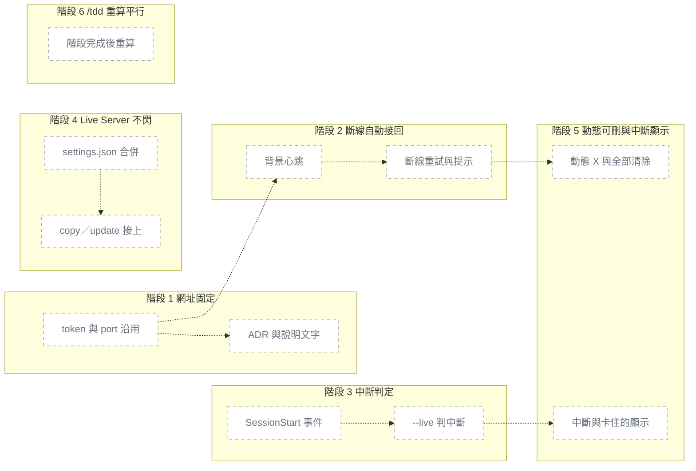

# 專案地圖：網址固定、斷線自動接回、被中斷的 agent 不再卡在「現在在跑」、動態可刪、Live Server 不閃；/tdd 階段完成時重算平行

## 為什麼做

使用者在 smartwork_for_KM 實際使用專案地圖時回報五件事：用 VS Code Live Server 開會整頁閃（live.js 每幾秒重寫）；網址每次重起都換 token，關掉分頁就找不回；分頁在背景一段時間後斷線、要 Reload Window 才打得開；重開 VS Code 視窗後被中斷的 agent 永遠掛在「現在在跑」並標「卡住」；「動態」清單不能一則一則刪。
另外 `/tdd` 只在開工時算一次可平行的階段，「階段 1 → 2–5 可平行」這種 plan 在階段 1 完成後不會再提平行，要使用者自己開口才開 worktree。

### PRD 情境變更

無（模板 repo 沒有 `docs/` 與 PRD；行為變更寫在「改善了什麼」）

### 資料流變更

無（模板 repo 沒有架構文件資料流節）。事件流多一個入口「SessionStart → `agent-events.sh` → `live-events.jsonl`」，`--live` 用它判斷中斷；在 ADR-2026-11-12-002 補一段「2026-11-16 增補」說明（階段 3），完整流程圖沿用該 ADR「資料流」節的 `sequenceDiagram`，不另畫

## 怎麼做

**可平行**：階段 6 與階段 1–5 任一個（只動 `commands/tdd.md`、`subagent-execution/SKILL.md`，與其他階段檔案不重疊、沒有依賴）。階段 1–5 全都改 `.claude/hooks/tests/run-tests.sh`，彼此不可平行；建議順序 1 → 2 → 3 → 5，階段 4 插在任一處。

各階段只跑自己那節測試（整套約 50 分鐘，留到 `/verify`）。`settings.json` 在 `_changed_rule` 是 ALL——階段 3 **不要用 `--changed`**，用關鍵字模式。

### 一眼看懂

| id | 部件 | 階段 | 檔案 | 驗收 |
|---|---|---|---|---|
| p1 | token 與 port 沿用 | 1 | `.claude/scripts/overview-serve.py`, `.claude/scripts/overview-serve.sh`, `.claude/hooks/tests/run-tests.sh` | 起 → `--stop` → 再起 → 兩次印的網址完全相同 |
| p2 | ADR 與說明文字 | 1 | `.claude/context/decisions/ADR-2026-11-16-*.md`, `.claude/context/decisions/ADR-2026-11-12-003-overview-local-server-lifecycle.md`, `.claude/commands/task-status.md`, `.claude/guides/WORKFLOW.md`, `README.md` | `grep -c '每次新起都換新 token' .claude/commands/task-status.md` 為 0 |
| p3 | 背景心跳 | 2 | `.claude/templates/overview/index.html`, `.claude/hooks/tests/fixtures/overview/**`, `.claude/hooks/tests/run-tests.sh` | 分頁隱藏 15 分鐘（虛擬時間）→ `.serve-id` 被請求 3 次、data.js／live.js 0 次 |
| p4 | 斷線重試與提示 | 2 | `.claude/templates/overview/index.html` | 伺服器連不上時頁首顯示重開指令；10 秒後 `.serve-id` 回 200 → 提示收掉、輪詢恢復，不用切分頁 |
| p5 | SessionStart 事件 | 3 | `.claude/hooks/agent-events.sh`, `.claude/settings.json`, `.claude/hooks/README.md`, `.claude/hooks/tests/run-tests.sh` | SessionStart `source: resume` → 事件行 `ev` 為 `SessionStart`、`ss` 為 `resume`、`aid` 為 `""` |
| p6 | --live 判中斷 | 3 | `.claude/scripts/overview.sh`, `.claude/context/decisions/ADR-2026-11-12-002-live-events-log-and-live-js.md` | a1 SubagentStart（s1）後 s1 出現 SessionStart resume、a1 之後沒有事件 → `lanes` 不含 a1，`feed` 第一筆 `kind` 為 `agent_cut`、`why` 為 `restart` |
| p7 | settings.json 合併 | 4 | `scripts/lib/vscode-live-server.sh`, `scripts/lib/vscode-live-server.ps1`, `.claude/hooks/tests/run-tests.sh` | 既有 `ignoreFiles: ["**/*.ts"]` → 變成 `["**/*.ts", ".claude/taskmaster-data/overview/**"]`，其他鍵不變 |
| p8 | copy／update 接上 | 4 | `scripts/copy-template.sh`, `scripts/copy-template.ps1`, `scripts/update-template.sh`, `scripts/update-template.ps1` | `update-template.sh --claude-only` → 不建也不改 `.vscode/settings.json` |
| p9 | 動態 X 與全部清除 | 5 | `.claude/templates/overview/index.html`, `.claude/hooks/tests/fixtures/overview/**`, `.claude/hooks/tests/run-tests.sh` | 30 則動態刪掉第 1 則 → 仍顯示 12 則，第 12 則是原本的第 13 則；重新整理後被刪的那則不出現 |
| p10 | 中斷與卡住的顯示 | 5 | `.claude/templates/overview/index.html` | `feed` 有 `kind: agent_cut, why: restart` → 該行寫「中斷 · 視窗重開」 |
| p11 | 階段完成後重算 | 6 | `.claude/commands/tdd.md`, `.claude/skills/subagent-execution/SKILL.md` | tdd.md 第 2 節「續跑沿用」那句後面明寫「只沿用派法，平行與否每階段 ✅ 後重算」 |

### 階段 1: 網址固定（token、port 沿用）與 ADR ✅
- **依賴**：無
- [ ] **先寫 ADR**（Q1 已確認：永久固定、外洩手動 `--rotate`）：新增 `.claude/context/decisions/ADR-2026-11-16-001-overview-fixed-token.md`，取代 ADR-003 第 1 節「每次新起都換新 token」那一條與「犧牲」第 3 點；ADR-003 檔頭加一行「第 1 節 token 一條已被 ADR-2026-11-16-001 取代」。威脅模型重看：① 同機其他使用者——`.serve-keep` 0600、`.serve` 0600，仍讀不到，**成立**；② DNS rebinding／本機惡意網頁——token 128 bit（`token_urlsafe(16)`），固定不會讓它變得可猜，**成立**；③ **新增的風險**：網址外洩（瀏覽器歷史、螢幕分享、終端機捲動紀錄、對話 transcript）後一直有效，舊做法重起即失效。對策：`overview-serve.sh --rotate` 換 token；`.serve-keep` 權限不是 600 時視為外洩、自動換。替代方案表至少列「每次換（現狀）」「固定」「固定但 N 天自動換」 — 驗證：人讀
- [ ] `overview-serve.py`：在 overview 資料夾讀 `.serve-keep`（單行 JSON `{"token","port"}`）。token 符合 `^[A-Za-z0-9_-]{20,64}$`、且（POSIX）檔案權限沒有 group／other 位元 → 沿用；否則產新 token。bind 時**先試 `.serve-keep` 的 port**（1024–65535 才試），失敗再照原本從 `OVERVIEW_SERVE_PORT_BASE` 起試 20 個。bind 成功後以暫存檔＋`os.replace` 寫回 `.serve-keep`（0600），再寫 `.serve`。閒置結束時**不刪** `.serve-keep` — 驗證：`bash .claude/hooks/tests/run-tests.sh overview-serve`
- [ ] `overview-serve.sh` 加 `--rotate`：在跑就先走 `.shutdown`，刪 `.serve-keep`，再照「新起」流程（會開瀏覽器）；檔頭用法補這行 — 驗證：同上
- [ ] `commands/task-status.md` 步驟 7：拿掉「每次新起都換新 token，舊網址會失效」，改成「網址固定（同一個專案重起也一樣），可加書籤；網址外洩時跑 `bash .claude/scripts/overview-serve.sh --rotate` 換一個」；WORKFLOW「網址怎麼來」、README「專案圖解」段同步一句 — 驗證：人讀
- **預估**：2h
- **驗收**：
  - 沒在跑 → 起、`--stop`、再起 → 兩次 stdout 最後一行相同（port 與 token 都一樣）
  - 閒置結束（`OVERVIEW_SERVE_IDLE_MIN` 極短）後再起 → 網址與閒置前相同；`.serve` 被刪、`.serve-keep` 還在
  - 第一次起在 8766（測試先佔 8765）→ 釋放 8765、`--stop`、再起 → 仍是 8766
  - `.serve-keep` 記的 port 被測試佔住 → 從 `OVERVIEW_SERVE_PORT_BASE` 起找空的，token 不變，`.serve-keep` 的 port 更新成新值
  - `.serve-keep` 權限改成 644 → 再起後 token 與原本不同，`.serve-keep` 權限回到 600
  - `.serve-keep` 內容是壞 JSON 或 token 只有 5 個字 → 產新 token、照常起，exit 0
  - `--rotate` → 新網址的 token 與舊的不同；舊網址的 `/<舊 token>/.serve-id` 回 404；`--rotate` 時假 `$BROWSER` 被呼叫 1 次
  - GET `/.serve-keep`、`/<token>/.serve-keep` 都回 404
  - 既有 `overview-serve` 節其餘案例照綠（不帶 token 404、只聽 127.0.0.1、`no-store`、兩個同時跑只起一個、沒 Python 退回 file://）
  - `grep -c '每次新起都換新 token' .claude/commands/task-status.md` 為 0；ADR-2026-11-16-001 存在且「替代方案」表至少 3 列
- **注意**：`.serve-keep` 是點開頭，`_serve_file` 本來就拒絕點開頭的段，不用另外擋，但驗收要測。`MAIN_CLAUDE` 側（同 `.serve`），worktree 不另存

### 階段 2: 頁面斷線自動接回 ✅
- **依賴**：階段 1（固定 token 才讓「伺服器重起後舊分頁拿到 200」成立；測試用真伺服器重起驗接回）
- [ ] 動手前 `wc -c .claude/templates/overview/index.html` 記進「發現與決策」。超過 112KB → 停下回報（ADR-2026-11-12-001：規劃時要評估拆檔或瘦身），不自行處理 — 驗證：`wc -c`
- [ ] 分頁隱藏時不再全停：停掉 data.js／live.js 輪詢，改每 `HEARTBEAT_MS`（5 分鐘，小於伺服器閒置 30 分鐘）`fetch('.serve-id')`；只在 `http:` 開的頁面做。回到可見時停心跳、恢復輪詢 — 驗證：headless chrome（`now-check.js` 的 `?mock`）
- [ ] 拿掉永久的 `DEAD`／`expire()`：改成兩種斷線狀態，**都持續重試**（可見時每 10 秒、隱藏時跟著心跳）拿到 200 就收掉提示並恢復輪詢：
  - 連不上（fetch reject）→「伺服器沒在跑。在專案裡跑 /task-status 或 `bash .claude/scripts/overview-serve.sh`，這頁會自己接回」
  - 連上過之後 `.serve-id` 回 404（固定 token 下只剩 `--rotate`、`.serve-keep` 被刪、或 port 被別的專案的伺服器拿走）→「這個網址已失效（token 換了或伺服器換了 port）。跑 /task-status 取得新網址」
  - 文字只寫在一處常數；既有「從沒連上過、第一次就 404 → 不顯示提示」（Live Server 開的情況）保留
- [ ] `fixtures/overview/now-check.js`：既有「404 → 網址已失效、不再重試」案例改成新行為 — 驗證：`bash .claude/hooks/tests/run-tests.sh 現況分頁`
- **預估**：1.5h
- **驗收**：
  - 分頁隱藏 15 分鐘（虛擬時間）→ `.serve-id` 被請求 3 次，data.js 與 live.js 都 0 次
  - 回到可見 → 立刻各載入一次 data.js、live.js，之後心跳不再發
  - `file://` 開的頁面隱藏 15 分鐘 → `.serve-id` 0 次
  - 可見時 `.serve-id` 連不上 → 頁首出現含 `overview-serve.sh` 的提示；不切分頁，10 秒後假 `.serve-id` 改回 200 → 提示消失、live.js 恢復每 2 秒載入
  - 連上過之後回 404 → 提示含「這個網址已失效」；之後 `.serve-id` 改回 200 → 提示消失、輪詢恢復（原本是永久停止）
  - 從沒連上過、第一次就 404 → 不顯示提示、照常輪詢（原案例照綠）
  - 真伺服器：開頁 → `overview-serve.sh --stop` → 頁首出現「伺服器沒在跑」→ 再跑 `overview-serve.sh`（同網址）→ 不切分頁，20 秒（虛擬時間）內提示消失（截圖）
  - `check-counts.sh` 通過（≤128KB、token 區外沒有 hex 色碼、沒有 module script）
- **注意**：Chrome 對背景分頁的計時器會節流（隱藏 5 分鐘後對齊到每分鐘），5 分鐘心跳不受影響；不要用 `requestAnimationFrame` 或 Web Worker 做心跳

### 階段 3: 被中斷的 agent 判定（SessionStart 接線、靜默超時、閒置主 session） ✅
- **依賴**：無
- [ ] `settings.json` 的 `SessionStart` 陣列加 `agent-events.sh`（`async: true`，不設 matcher）；`hooks/README.md` 檔案樹那行與功能表補 SessionStart — 驗證：`jq . .claude/settings.json`
- [ ] `agent-events.sh`：事件行加欄位 `ss`（SessionStart 的 `source`，`startup`／`resume`／`clear`／`compact`，上限 10 字；其他事件為 `""`）。**`v` 維持 1**：只加欄位、讀取端用 `.ss | str` 容忍沒有這欄的舊行；這條理由寫進 ADR-002 增補段。檔頭事件清單補 SessionStart — 驗證：`bash .claude/hooks/tests/run-tests.sh agent-events`
- [ ] `overview.sh --live`（規則寫進檔頭「即時聚合」，唯一來源）：
  - **中斷（restart）**：同 `sid` 出現 `SessionStart` 且 `ss` 為 `startup`／`resume`／`clear` → 該 `sid` 在這筆**之前** SubagentStart、沒有 SubagentStop、而且**在這筆之後沒有任何事件**的 agent 判為中斷。`compact` 不算（壓縮時背景 agent 是否存活查不到官方說明，保守不判；若之後實測確認會死再改）
  - **中斷（silent）**：agent 最後一筆事件距今超過 `OVERVIEW_LIVE_CUT_MIN`（預設 30 分鐘）**且**最後一筆不是 PreToolUse Bash／PowerShell（還在跑的長指令，例如 50 分鐘的整套測試，不判）→ 判為中斷
  - 中斷的 agent：不進 `lanes`；`feed` 多一筆 `{t, kind: "agent_cut", id: aid, who, where, text: description, why: "restart"|"silent"}`（`t` 取 SessionStart 的 t，或最後一筆 + 門檻）；它還開著的 need 照 SubagentStop 的方式關（feed 記 `need_done`）；不算進 `doneToday.agents`
  - **閒置主 session**：session lane 判斷「最後一筆」時略過 `Notification` 與 `SessionStart`——Stop 之後只有 `idle_prompt` 通知的 session **不在** `lanes`（它的 `reply` need 照舊留在 `needs`）；只有 SessionStart、還沒送出第一句話的 session 也不在 `lanes`
  - `feed` 上限 30 → 50（階段 5 刪掉幾則後還有更舊的能補）
- [ ] ADR-002 末尾加「2026-11-16 增補」：第 1 節表多一列 SessionStart、第 2 節欄位表多 `ss`、v 不加 1 的理由、中斷規則的唯一來源是 overview.sh 檔頭 — 驗證：人讀
- **預估**：2.5h
- **驗收**：
  - SessionStart payload `{"hook_event_name":"SessionStart","session_id":"s1","source":"resume"}` → 多一行，`ev` `SessionStart`、`ss` `resume`、`aid` `""`、整行 < 1024 bytes
  - PostToolUse 事件行 → `ss` 為 `""`
  - a1 SubagentStart（s1, t=100）、a1 PostToolUse（t=110）、SessionStart s1 `resume`（t=200）、之後沒有 a1 的事件 → `lanes` 不含 a1；`feed` 第一筆 `{kind:"agent_cut", id:"a1", why:"restart", t:200}`
  - 同上但 SessionStart 的 `ss` 是 `compact` → a1 仍在 `lanes`
  - 同上但 SessionStart 之後 a1 還有一筆 PostToolUse → a1 仍在 `lanes`
  - SessionStart 的 `sid` 是 s2（不同 session）→ s1 的 a1 仍在 `lanes`
  - smartwork 實例重現：planner A（s1）Start 後最後事件 17:12:46、s1 SessionStart `resume`、planner B（s1）Start→Stop → `lanes` 0 筆，`feed` 有 A 的 `agent_cut` 與 B 的 `agent_done`
  - a1 最後一筆是 PostToolUse、距今 31 分鐘 → 不在 `lanes`，`feed` 有 `why:"silent"`；距今 29 分鐘 → 仍在
  - a1 最後一筆是 PreToolUse Bash、距今 50 分鐘 → 仍在 `lanes`
  - `OVERVIEW_LIVE_CUT_MIN=5`、距今 6 分鐘 → 判中斷
  - a1 有一筆未處理的 `approve` need、之後 SessionStart resume → `needs` 0 筆，`feed` 有該 need 的 `need_done`
  - 中斷的 a1 → `doneToday.agents` 不加
  - 主 session s1：PostToolUse → Stop → Notification `idle_prompt`（之後 11 分鐘沒事件）→ `lanes` 沒有 s1；`needs` 有 1 筆 `reply`
  - 主 session s1 只有一筆 SessionStart `startup` → `lanes` 沒有 s1
  - 35 筆 agent 開始／完成事件 → `feed` 長度 35（上限 50）
  - 沒有 `ss` 欄的舊事件行 → 照常聚合，既有 `overview.sh --live` 節案例全綠
  - `grep -l live-events .claude/hooks/pre-agent-gate.sh .claude/hooks/lib/agent-inflight.sh` 仍為空
- **注意**：`/clear` 會換新的 `session_id`、VS Code 重開若是 `startup` 也是新 sid——payload 裡沒有舊 sid 可以對，這兩種只能靠 silent 超時收掉，ADR 增補段要寫明。lane 的「結束」仍只認 SubagentStop（2026-09-11 的坑），中斷是另一種「不再顯示」，不寫回 `agent-activity.jsonl`、閘門不讀。`run-tests.sh agent-events "overview.sh --live"` 用關鍵字模式跑

### 階段 4: Live Server 不再整頁閃（`.vscode/settings.json` 合併） ⏳
- **依賴**：無
- [ ] **先查證** Live Server 擴充（ritwickdey.LiveServer）的設定名 `liveServer.settings.ignoreFiles` 的格式（字串陣列、glob、相對工作區根）與預設值（記憶中是 `[".vscode/**", "**/*.scss", "**/*.sass", "**/*.ts"]`），來源網址寫進「發現與決策」。規劃時沒有網路工具，**未查證** — 驗證：官方 README／package.json 的 `contributes.configuration`
- [ ] 新增 `scripts/lib/vscode-live-server.sh`（函式 `ensure_live_server_ignore <專案根> [--dry-run]`，給 copy／update 兩支 sh 共用）：
  - 沒有 `.vscode/settings.json` → 建立，內容是 `liveServer.settings.ignoreFiles` = Live Server 預設值 ＋ `.claude/taskmaster-data/overview/**`（帶預設值是因為設了這個鍵就會蓋掉預設）
  - 有、`jq` 讀得懂且是物件：沒有這個鍵 → 加（同上）；鍵是陣列且沒有這個 glob → 附加到尾端；已有 → 不寫、印「已設定」；鍵不是陣列 → 不改、印手動那行
  - jq 讀不懂（註解、尾逗號）或沒有 jq → **一個 byte 都不動**，印：`⚠ .vscode/settings.json 有註解或不是標準 JSON，沒有自動修改。請手動加入："liveServer.settings.ignoreFiles": [".claude/taskmaster-data/overview/**"]（已有這個鍵就把字串加進陣列）`
  - 改寫時縮排照原檔（第一個縮排行：tab 用 `--tab`，否則照空白數）、CRLF 照原檔；暫存檔＋`mv`
- [ ] 新增 `scripts/lib/vscode-live-server.ps1`（同一套規則，給兩支 ps1 dot-source）：先檢查內容有沒有註解（`(?m)(^|[\s,{\[])//` 或 `/*`，誤判方向只會變成印手動那行）；有就印手動那行；沒有才 `ConvertFrom-Json` → 改 → `ConvertTo-Json -Depth 100`。PS 7 的 `ConvertFrom-Json` 會吞註解，所以註解檢查必須在 parse 之前
- [ ] 接到四支腳本：`copy-template.sh`／`.ps1` 在後置處理呼叫（目標可能是「已存在且非空」的資料夾）；`update-template.sh`／`.ps1` 在「補 .gitignore」之後呼叫，`--claude-only` 跳過、`--dry-run` 只印會做什麼。`/scripts/` 已在 copy-template 的排除清單，`lib/` 不會被帶進新專案
- [ ] `run-tests.sh`：`_changed_rule` 加 `scripts/lib/vscode-live-server.*) echo "=vscode-live-server"`、`scripts/update-template.sh) echo "=update-template"`（都排在 `scripts/*` 的 NONE 之前）；新節「vscode-live-server — Live Server 忽略專案地圖資料夾」，用假模板跑（同既有 update-template 節，假模板要多放 `scripts/lib/`）— 驗證：`bash .claude/hooks/tests/run-tests.sh vscode-live-server update-template`
- [ ] `task-status.md` 步驟 7、WORKFLOW、README 的「不要用 Live Server」改成「建議用 `/task-status` 給的網址；用 Live Server 開也不會閃了（模板已在 `.vscode/settings.json` 讓它忽略地圖資料夾）」 — 驗證：人讀
- **預估**：2h
- **驗收**：
  - 目標沒有 `.vscode/` → 建出 `.vscode/settings.json`，`jq -r '."liveServer.settings.ignoreFiles"[-1]'` 為 `.claude/taskmaster-data/overview/**`，陣列也含查證到的預設值
  - 既有 `{"editor.tabSize": 4, "liveServer.settings.ignoreFiles": ["**/*.ts"]}` → 鍵值變成 `["**/*.ts", ".claude/taskmaster-data/overview/**"]`，`editor.tabSize` 仍為 4
  - 既有物件沒有這個鍵 → 加上（含預設值），其他鍵與順序不變
  - 已含 `.claude/taskmaster-data/overview/**` → 檔案 `cmp` 相同（mtime 不變），輸出含「已設定」
  - 連跑兩次 → 第二次檔案 `cmp` 相同
  - 檔案含 `// 註解` → `cmp` 相同，輸出含 `"liveServer.settings.ignoreFiles": [".claude/taskmaster-data/overview/**"]`，exit 0
  - 鍵的值是字串 `"**/*.ts"` → 不改，印手動那行
  - 原檔 4 空白縮排、CRLF → 改寫後仍是 4 空白、每行 CRLF
  - PATH 裡沒有 jq → 不建也不改，印手動那行，exit 0
  - `update-template.sh --claude-only` → 不建也不改 `.vscode/settings.json`；`--dry-run` → 不寫，輸出列出會做的事
  - `copy-template.sh` 到新資料夾 → 新專案有 `.vscode/settings.json` 且含該 glob；新專案沒有 `scripts/lib/`
  - ps1 兩支：本機有 `pwsh` 時跑同一組前 6 條；沒有 `pwsh` 的機器上不計入通過（印「略過」），並在「發現與決策」記實際有沒有跑到
- **注意**：使用者的 VS Code 工作區根若不是專案根（multi-root、開上一層資料夾），glob 對不到，Live Server 仍會閃——寫進 task-status 那段一句。`.vscode/` 本身仍在 copy-template 排除清單（模板 repo 自己的編輯器設定不帶過去），新檔是由 helper 產的

### 階段 5: 動態可刪除、中斷與卡住的顯示 🔄
- **依賴**：階段 3（`feed` 的 `agent_cut`／`why` 與上限 50）
- [ ] 每則動態右側一個刪除鈕（`<button>`，`aria-label="刪除這則動態：<誰> <動作>"`，可點範圍 ≥ 44×44px）；「動態」標題旁「全部清除」鈕。「需要你」不加 — 驗證：截圖
- [ ] 刪掉的 id（既有 `t|kind|id`）存 localStorage，key `overview-feed-hidden|<data.js 的 project.name>|<location.pathname>`（file:// 下各專案 pathname 不同；http 下 pathname 含 token；Live Server 下靠專案名區分）；讀寫都 try/catch；每次存時只留仍在目前 `LIVE.feed` 裡的 id、最多 200 個 — 驗證：同上
- [ ] `renderNow` 的 `fd` 改成「濾掉已刪的再取前 12」；刪除後焦點移到下一則的刪除鈕，沒有下一則就移到「全部清除」，都沒有就移到「動態」所在的側欄標題
- [ ] `FEEDV` 加 `agent_cut: ['中斷', 'cut']`，該行動作寫「中斷 · 視窗重開」（`why: restart`）或「中斷 · N 分鐘沒有動靜」（`silent`）；`.fv.cut` 顏色只用 `:root` 既有 token
- [ ] 「卡住」改成：lane 有未處理的 need 時不算卡住（它在「需要你」已經列成等批准／等回覆，不重複算）
- [ ] 頁面上「卡住」與「中斷」的差別寫進 index.html 的「說明」或 `title`：卡住＝還在名單上、10 分鐘沒動靜，可能在跑長指令也可能卡住，請看一眼；中斷＝判定已經不在跑（視窗重開或 30 分鐘沒動靜且沒有指令在跑），已從名單移除
- [ ] 做完 `wc -c` 記進「發現與決策」 — 驗證：`bash .claude/scripts/check-counts.sh`
- **預估**：2h
- **驗收**：
  - 30 則動態 → 顯示 12 則，每則一個刪除鈕；「需要你」清單沒有刪除鈕（截圖）
  - 刪第 1 則 → 仍 12 則，最後一則是原本第 13 則
  - 重新整理（同一個 localStorage）→ 被刪的那則仍不出現
  - live.js 更新、多一則新的 → 新的出現在最前，被刪的仍不出現，仍 12 則
  - 按「全部清除」→ 動態區隱藏；之後 live.js 多一則 → 動態區出現且只有那 1 則
  - 兩份 data.js 的 `project.name` 不同（同一個 file:// 目錄、同一個 profile）→ 在 A 刪的不影響 B
  - localStorage 拋例外（測試覆寫 `setItem` 會 throw）→ 刪除當下仍從畫面消失，不報錯
  - 刪除鈕的 `getBoundingClientRect()` 寬高都 ≥ 44；按 Tab 能到、Enter 能刪；刪除後 `document.activeElement` 是下一則的刪除鈕
  - `feed` 有 `{kind:"agent_cut", why:"restart"}` → 該行文字含「中斷 · 視窗重開」；`why:"silent"`、`t` 與前一筆差 30 分鐘 → 含「沒有動靜」
  - lane 的 `lastAt` 是 11 分鐘前、且有一筆同 id 的 `approve` need →「需要你」只 1 行（等批准），lane 卡不標 `stuck`
  - 390／1440 × 淺／深四張截圖，刪除鈕不擠壓文字
  - `check-counts.sh` 通過
- **注意**：`sync()` 移除節點有 0.3 秒淡出，焦點要在淡出前移走。已有 class 先 grep 一次再取名（上一輪踩過 `.bar`／`.dash`／`.mini` 撞名）

### 階段 6: `/tdd` 每個階段完成後重算能否平行 ✅
- **依賴**：無
- [ ] 動手前讀 `writing-extensions` skill，在「發現與決策」記一句為什麼這次用文字規則（觸發點「plan 階段標 ✅」是一次 Edit，可以改成 PostToolUse hook 注入提醒；先用文字、若實測被漏掉再升級成 hook）— 驗證：人讀
- [ ] `commands/tdd.md` 第 2 節：「續跑 → 直接沿用上次選的方式，不要再問」改成「續跑 → 沿用上次選的**派法**（implementer／主模型直接做），不再問；**能否平行不沿用**，照下面『每個階段 ✅ 之後』重算」。新增一小段「每個階段 ✅ 之後」：照 `plan-format`「階段『依賴』與可平行」判準重算未完成的階段；依賴都已 ✅、部件表檔案無交集的 ≥ 2 個 → **直接改用 worktree 平行**（照 `worktree-orchestration`），宣告一句「階段 X、Y 現在可以同時做，改開 worktree 平行」，在帳本記一筆 `Ruling: 改用 worktree 平行跑階段 X、Y — 依賴已完成且檔案不重疊 — 若判錯，合併時會有衝突`，**不另問使用者**；帳本或先前回答明確寫過「不要平行」才不改 — 驗證：人讀＋下方 grep
- [ ] `skills/subagent-execution/SKILL.md` 流程圖第 6 步改成「通過 → 帳本記完成、plan 階段標 ✅、current_phase++ → 重算可平行（`commands/tdd.md`『每個階段 ✅ 之後』）」，正文不重述規則，只指過去 — 驗證：同上
- **預估**：30min
- **驗收**：
  - `grep -c '能否平行不沿用' .claude/commands/tdd.md` ≥ 1；`grep -c '每個階段 ✅ 之後' .claude/commands/tdd.md .claude/skills/subagent-execution/SKILL.md` 兩檔都 ≥ 1
  - tdd.md 寫明三件事（人讀逐條核對）：① 重算時機是每個階段標 ✅ 之後；② ≥ 2 個可同時開工 → 直接改 worktree、宣告一句、帳本記 Ruling、不問；③ 帳本或先前回答有「不要平行」→ 不改
  - 情境走一遍（人讀）：plan 為「階段 1 → 2–5 依賴 1、檔案互不重疊」、開工時選了「逐階段派 implementer」→ 照新文字，階段 1 ✅ 後主模型應改開 2–4 條 worktree（超過 4 個時一次 2–4 條，照 worktree-orchestration），帳本多一筆 Ruling
  - `bash .claude/scripts/check-counts.sh` 通過
- **注意**：只改 `.md`，不是注入內容（`using-taskmaster`、路由、rules 都沒動），不需要跑 skill-compliance。`subagent-execution` 正文第 29–31 行「問過就記在帳本裡別再問」講的是派法，可加半句「平行與否見 tdd.md」，不要另寫一份判準

## 改善了什麼

| | 之前 | 之後 |
|---|---|---|
| 用 VS Code Live Server 開專案地圖 | live.js 每幾秒重寫，整頁一直閃 | 新專案與跑過 update-template 的專案，Live Server 忽略地圖資料夾，不閃；有註解的 settings.json 會印出要手動加的那行 |
| 關掉分頁後找回網址 | 每次重起換 token，舊網址失效，只能重跑 `/task-status` | 同一個專案網址固定，可加書籤；外洩時 `--rotate` 換一個 |
| 分頁放在背景一陣子 | 輪詢全停 → 30 分鐘後伺服器自行結束 → 舊分頁永久顯示「網址已失效」，要 Reload Window | 背景每 5 分鐘心跳，分頁開著伺服器就不關；伺服器真的停了，頁面寫出重開指令，重開後自己接回 |
| 重開 VS Code 視窗後 | 被中斷的 agent 永遠在「現在在跑」並標「卡住」 | 同 session 重開時判為中斷、從名單移除，動態記一筆「中斷 · 視窗重開」；其他情況 30 分鐘沒動靜（且沒有指令在跑）也收掉 |
| 主 session 停下等你回話 | 約 1 分鐘後出現在「現在在跑」，10 分鐘後標「卡住」 | 只在「需要你」顯示等回覆，不佔「現在在跑」 |
| 「動態」清單 | 不能刪 | 每則一個 X、可全部清除，重新整理後不再出現，更舊的往上補 |
| `/tdd` 執行「階段 1 → 2–5 可平行」的 plan | 開工時只算一次，階段 1 完成後不再提平行 | 每個階段 ✅ 後重算，可平行就直接開 worktree 並在帳本記一筆 |

## 發現與決策

- 2026-11-16 規劃：上一輪 plan（`archive/adhoc-2026-11-12-overview-live.md`）階段 4 審查後決定「每次新起都換新 token」，本 plan 階段 1 推翻這條，需要新 ADR（ADR-2026-11-16-001）並經使用者確認安全取捨（開放問題 Q1）後再動程式
- 2026-11-16 規劃：smartwork 的閒置主 session 誤判是查 `overview.sh` 時順帶發現的——session lane 把 `Notification`（`idle_prompt` 約在 Stop 後 1 分鐘送出）當成「最後一筆不是 Stop」，所以 Stop 後的主 session 會重新出現在「現在在跑」、10 分鐘後被標卡住。併入階段 3、5 處理
- 2026-11-16 規劃：靜默超時排除「最後一筆是 PreToolUse Bash／PowerShell」——本 repo 整套測試在 Windows 約 50 分鐘，跑在 subagent 裡會被 30 分鐘門檻誤判
- 2026-11-16 規劃：事件行加 `ss` 但 `v` 不加 1——ADR-002「改形狀就加 1」的用意是讓讀取端略過看不懂的行；只加欄位時舊讀取端照樣讀得懂，加 1 反而會讓還沒更新的 `--live` 丟掉所有新事件
- 2026-11-16 規劃：Live Server 合併邏輯放根目錄 `scripts/lib/`（sh 與 ps1 各一份、各給兩支腳本共用），不放 `.claude/scripts/`：只有模板維護腳本用得到，`/scripts/` 已在 copy-template 排除清單，不會帶進新專案。替代方案「放進 session-start／overview-serve 在專案裡自動補」否決：hook 靜默改使用者的 `.vscode/settings.json` 太侵入
- 2026-11-16 規劃：`liveServer.settings.ignoreFiles` 的名稱與預設值**規劃時無網路工具、未查證**，列為階段 4 第一步
- 2026-11-16 規劃：`index.html` 目前大小規劃時沒量（無 shell）；上一輪階段 7 記 92187 bytes、之後階段 8 又加了一些。階段 2 第一步量，超過 112KB 停下回報
- 2026-11-16 規劃：其他進行中的 plan——`plans/` 下只剩 `adhoc-2026-10-16-frontend-style-library.md`，檔內 `status` 已是 `✅ 完成`（INDEX 那列仍寫 ⏳，未改），與本 plan 無平行衝突。本 plan 沒有情境編號
- 2026-11-16 規劃：階段 6（`/tdd` 重算平行）為使用者追加、已同意；只動 `.md`，與階段 1–5 檔案無交集
- 2026-11-16 使用者裁決開放問題（全部照 plan 預設）：Q1 token 永久固定、外洩時手動 `--rotate`、`.serve-keep` 權限不對自動換；Q2 主 session 停下等回話時只在「需要你」顯示等回覆（最多 4 小時），不加額外說明；Q3 中斷判定 30 分鐘（`OVERVIEW_LIVE_CUT_MIN`），最後一筆是還在跑的 Bash 不判；Q4 專案沒有 `.vscode/settings.json` 時主動建立（含 Live Server 官方預設忽略清單 `.vscode/**`、`**/*.scss`、`**/*.sass`——2026-11-16 查官方文件 https://ritwickdey.github.io/vscode-live-server/docs/settings.html，沒有 `**/*.ts`）；Q5 `/clear`、新視窗換 sid 的情況只靠 30 分鐘超時收掉，可接受
- 2026-11-16 主模型量測：`templates/overview/index.html` 現為 94144 bytes（上限 128KB）
- 2026-11-16 階段 6：用文字規則不用 hook——觸發點「plan 階段標 ✅」是一次 Edit，可做成 PostToolUse 提醒，但重算要判斷依賴與檔案交集，hook 只能提醒、做不了判斷；實測被漏掉再升級成 hook 提醒
- 2026-11-16 階段 2：index.html 動工前 94144 bytes、改後 94618 bytes
